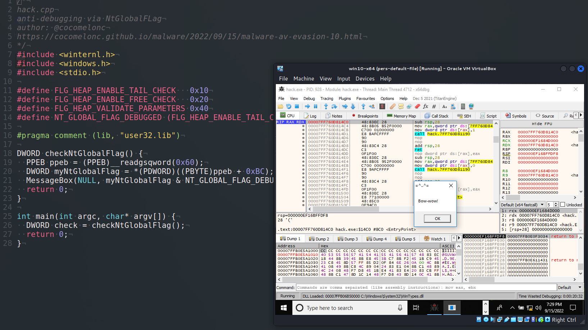
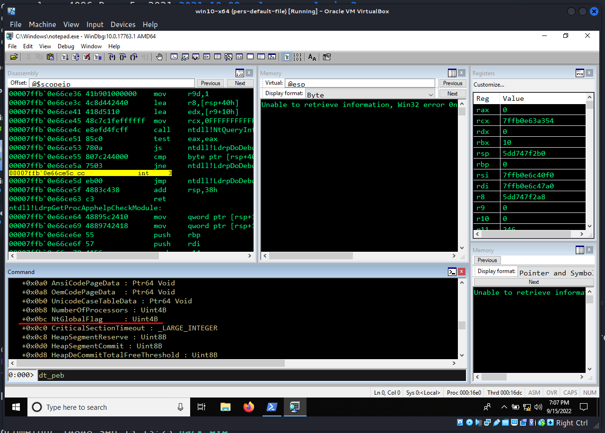
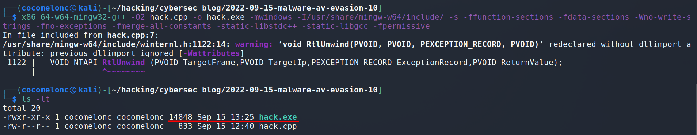
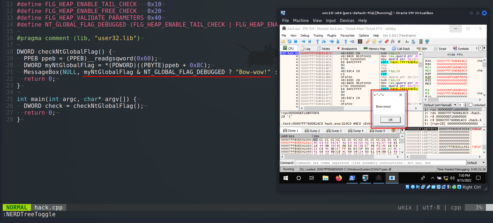
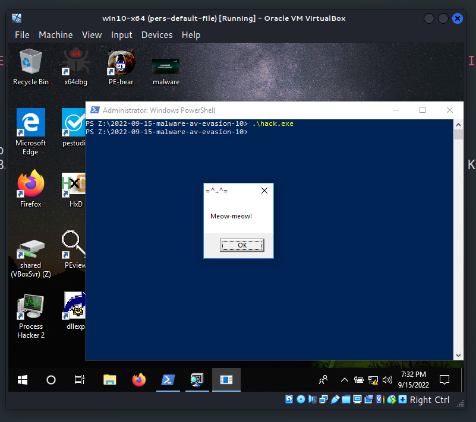
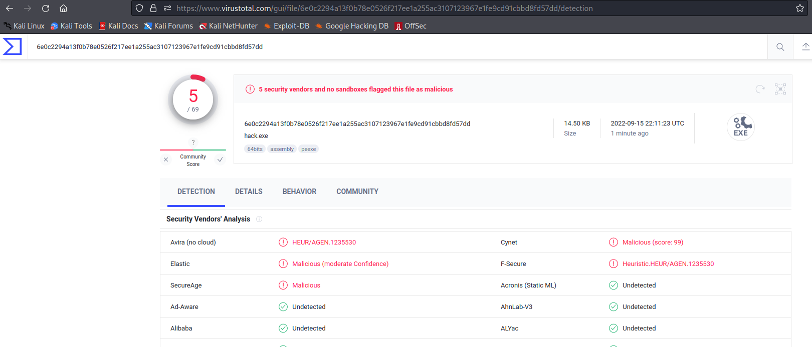

\newpage
\subsection{恶意软件 AV/VM 规避（第 10 部分）：反调试之 NtGlobalFlag（简单的 C++ 示例）}

﷽

{width="80%"}

这篇文章是我自我研究一个有趣的反调试技巧的结果：检查 `NtGlobalFlag`。

这只是恶意软件检测自己正运行在调试器中的另一种方式。

### NtGlobalFlag

在调试过程中，系统会在 PEB 结构中的 `NtGlobalFlag` 字段里设置几个标志：`FLG_HEAP_ENABLE_TAIL_CHECK`（0x10）、`FLG_HEAP_ENABLE_FREE_CHECK`（0x20）以及 `FLG_HEAP_VALIDATE_PARAMETERS`（0x40）。

在 32 位 Windows 上 `NtGlobalFlag` 的偏移值是 0x68，在 64 位 Windows 上是 0xbc，并且它们都被设置为 0：

{width="80%"}

### 实战示例

反调试的简单 PoC 代码：

```cpp
/*
hack.cpp
anti-debugging via NtGlobalFLag
author: @cocomelonc
https://cocomelonc.github.io/malware/2022/09/15/malware-av-evasion-10.html
*/
#include <winternl.h>
#include <windows.h>
#include <stdio.h>

#define FLG_HEAP_ENABLE_TAIL_CHECK  0x10
#define FLG_HEAP_ENABLE_FREE_CHECK  0x20
#define FLG_HEAP_VALIDATE_PARAMETERS 0x40
#define NT_GLOBAL_FLAG_DEBUGGED (FLG_HEAP_ENABLE_TAIL_CHECK | 
FLG_HEAP_ENABLE_FREE_CHECK | FLG_HEAP_VALIDATE_PARAMETERS)

#pragma comment (lib, "user32.lib")

DWORD checkNtGlobalFlag() {
  PPEB ppeb = (PPEB)__readgsqword(0x60);
  DWORD myNtGlobalFlag = *(PDWORD)((PBYTE)ppeb + 0xBC);
  MessageBox(NULL, myNtGlobalFlag & NT_GLOBAL_FLAG_DEBUGGED ? "Bow-wow!" : 
  "Meow-meow!", "=^..^=", MB_OK);
  return 0;

int main(int argc, char* argv[]) {
  DWORD check = checkNtGlobalFlag();
  return 0;

```

如你所见，逻辑相当简单，我们只是检查一组标志的组合。

为了简单起见，我只考虑了 64 位 Windows。

### 演示

我们来看看一切的实际运行。编译：

```bash
x86_64-w64-mingw32-g++ -O2 hack.cpp -o hack.exe \
-I/usr/share/mingw-w64/include/ -s \
-ffunction-sections -fdata-sections -Wno-write-strings \
-fno-exceptions -fmerge-all-constants -static-libstdc++ \
-static-libgcc -fpermissive
```

{width="80%"}

用 x64dbg 调试器运行它：

{width="80%"}

然后从命令行运行：

{width="80%"}

我们可以看到一切都完美工作了 :)

把它上传到 VirusTotal：

{width="80%"}

我们可以看到，69 个 AV 引擎中有 5 个把我们的 PoC 文件检测为恶意。

<https://www.virustotal.com/gui/file/6e0c2294a13f0b78e0526f217ee1a255ac3107123967e1fe9cd91cbbd8fd57dd/detection>

我希望这篇文章能让蓝队意识到这项有趣的技术，同时为红队的武器库增添一件武器。

[MITRE ATT&CK: Debugger evasion](https://attack.mitre.org/techniques/T1622/)  
[MSDN: PEB structure](https://docs.microsoft.com/en-us/windows/win32/api/winternl/ns-winternl-peb)  
[x64dbg](https://github.com/x64dbg/x64dbg)  
[al-khaser](https://github.com/LordNoteworthy/al-khaser)  
[source code in github](https://github.com/cocomelonc/meow/tree/master/2022-09-15-malware-av-evasion-10)
