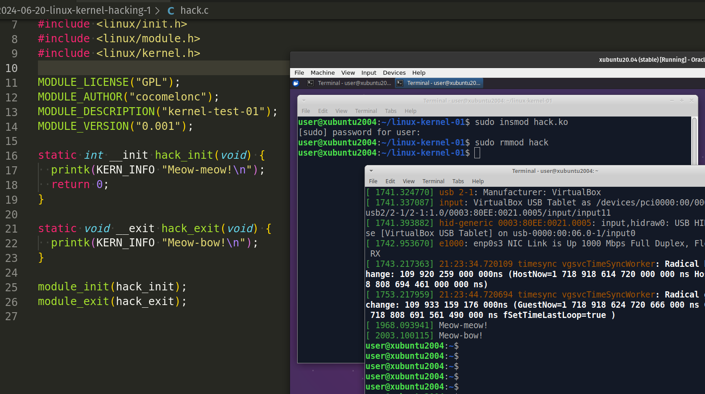
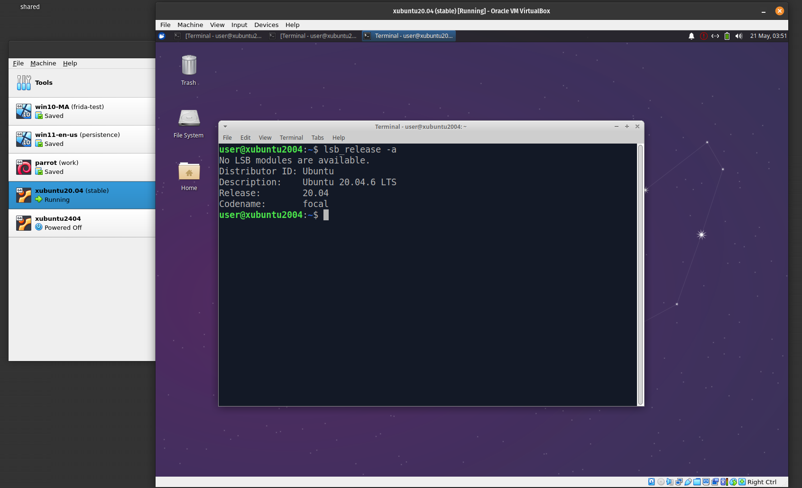
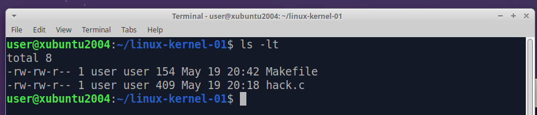
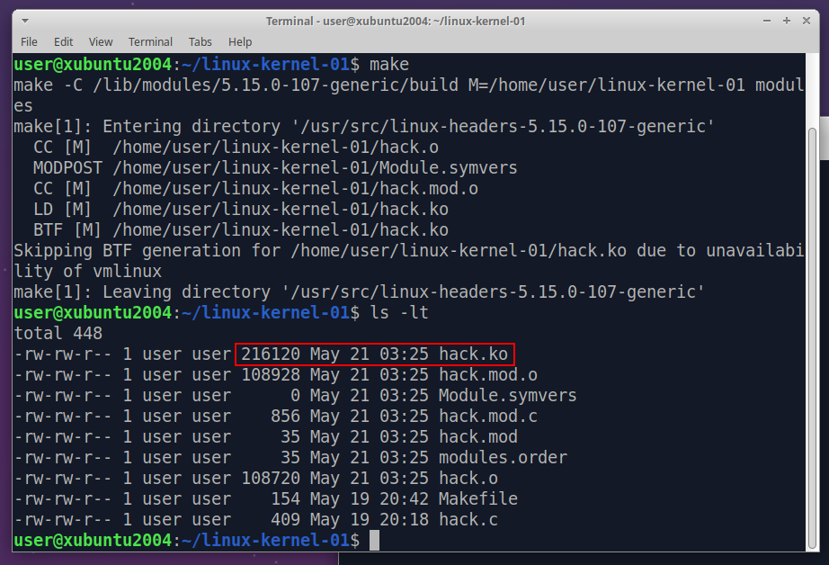
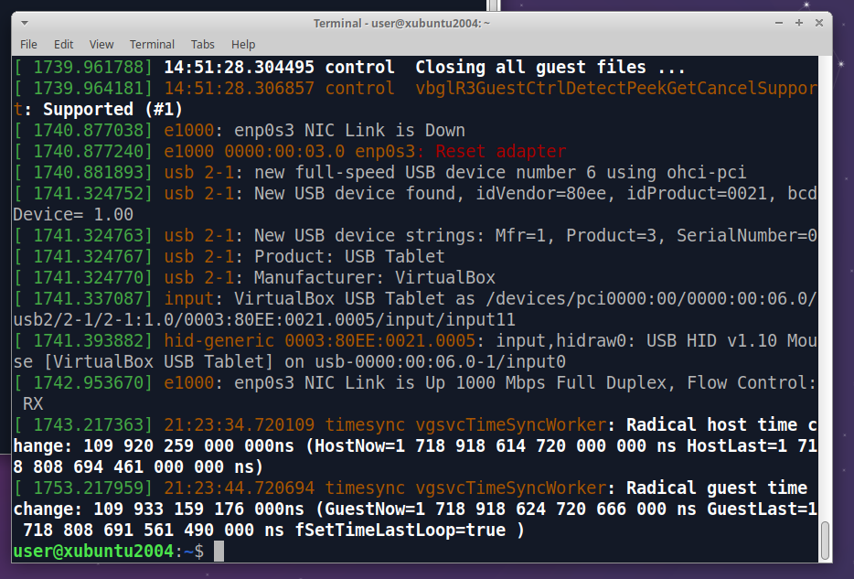
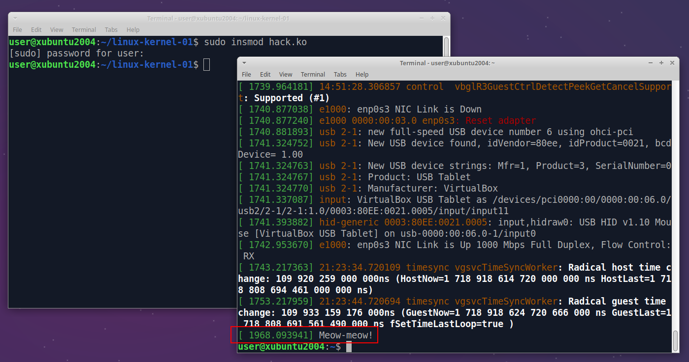
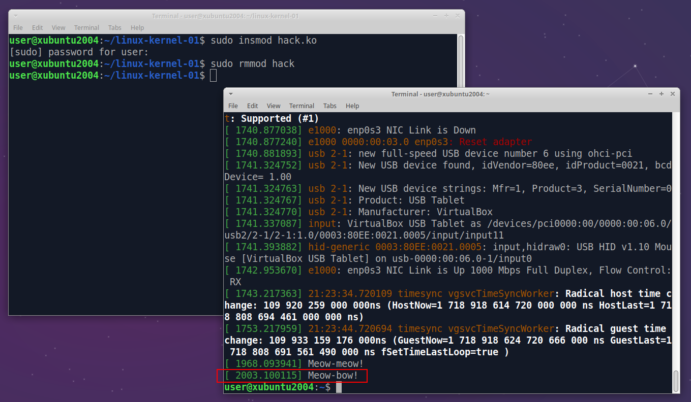
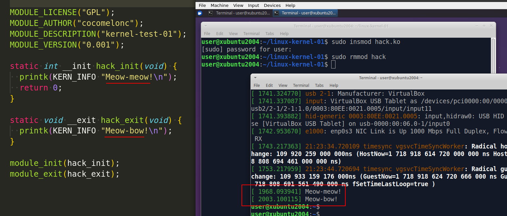

\newpage
\subsection{Linux 恶意软件开发 1：内核黑客技术入门（简单的 C 示例）}

﷽

{width="80%"}

事实上，这篇文章也可以叫作“恶意软件开发技巧第 41 部分”，不过这里我又一次回答了读者们向我提出的许多问题：我该如何为 Linux 开发恶意软件？

这篇文章或许是一个系列的开端，同时也是起点（长期阅读我的读者可能已经注意到，我开启过许多不同的系列，但并没有把它们都写到逻辑上的终点）。

说实话，我上一次为 Linux 内核编程还是在十多年前的大学里，此间很多东西都变了，所以我决定尝试写点有意思的东西，比如恶意软件：Linux rootkit、信息窃取器之类的……

首先，我安装了一台 Linux 虚拟机——Xubuntu 20.04，以免把我的系统搞坏。我觉得你也可以装一个更新的 Ubuntu 版本（Xubuntu、Lubuntu），不过 20.04 这个版本做实验已经相当合适了：

{width="80%"}

### 实战示例

比如说，如果我们需要编写一个像内核 rootkit 这样的恶意软件，那么我们开发的代码就具备了以内核级特权（ring 0）执行的能力，方式就是利用我们创建的内核模块。以这种角色开展工作会有它自己的挑战：一方面，我们的工作不会被用户和用户态工具察觉；但另一方面，一旦出错，后果可能相当严重。内核无法保护我们免受它自身缺陷的影响，这意味着我们面临整个系统崩溃的风险。使用虚拟机有助于缓解在 Xubuntu 上开发的种种难处，让这件事变得容易管理得多。

我们从导入模块开始：

```cpp
#include <linux/init.h>
#include <linux/module.h>
#include <linux/kernel.h>
```

下面这些 `#include` 语句引入了内核模块编程所需的头文件：

`linux/init.h` - contains macros and functions for module initialization and cleanup.

这些 `#include` 语句引入了内核模块编程所需的头文件：

- `linux/init.h`——包含用于模块初始化和清理的宏与函数。
- `linux/module.h`——包含用于模块编程的宏与函数。
- `linux/kernel.h`——为内核开发提供了各种函数和宏。

```cpp
MODULE_LICENSE("GPL");
MODULE_AUTHOR("cocomelonc");
MODULE_DESCRIPTION("kernel-test-01");
MODULE_VERSION("0.001");
```

这些宏定义了模块的元数据：

`MODULE_LICENSE("GPL")` —— 指定该模块发布时所采用的许可证。这里是 GNU 通用公共许可证。

`MODULE_AUTHOR("cocomelonc")` - specifies the author of the module.

`MODULE_DESCRIPTION("kernel-test-01")` - Provides a description of the module.

- `MODULE_LICENSE("GPL")`——指定模块发布所采用的许可证，这里是 GNU 通用公共许可证。
- `MODULE_AUTHOR("cocomelonc")`——指定模块作者。
- `MODULE_DESCRIPTION("kernel-test-01")`——给出模块的描述。
- `MODULE_VERSION("0.001")`——指定模块版本号。

接下来的几行定义初始化函数：

```cpp
static int __init hack_init(void) {
  printk(KERN_INFO "Meow-meow!\n");
  return 0;

```

该函数是模块的初始化函数：

`static int __init hack_init(void)` —— 把该函数定义为静态函数（仅在本文件内可见），并用 `__init` 宏将其标记为初始化函数。

`printk(KERN_INFO "Meow-meow!\\n")` —— 以信息级日志等级把 `"Meow-meow!"` 消息打印到内核日志。

- `static int __init hack_init(void)`——把该函数定义为静态函数（仅在本文件中可见），并用 `__init` 宏标记它为初始化函数。
- `printk(KERN_INFO "Meow-meow!\{}n")`——以信息级日志等级把“Meow-meow!”打印到内核日志。
- `return 0`——返回 0 表示初始化成功。

接下来是 `hack_exit` 函数：

```cpp
static void __exit hack_exit(void) {
  printk(KERN_INFO "Meow-bow!\n");

```

该函数是模块的清理函数：

`static void __exit hack_exit(void)` —— 把该函数定义为静态函数，并用 `__exit` 宏将其标记为退出（清理）函数。

- `static void __exit hack_exit(void)`——把该函数定义为静态函数，并用 `__exit` 宏标记它为退出（清理）函数。
- `printk(KERN_INFO "Meow-bow!\{}n")`——以信息级日志等级把“Meow-bow!”打印到内核日志。

然后，注册初始化函数和清理函数：

```cpp
module_init(hack_init);
module_exit(hack_exit);
```

所以，完整源码看起来像这样（`hack.c`）：

```cpp
/*
 * hack.c
 * introduction to linux kernel hacking
 * author @cocomelonc
 * https://cocomelonc.github.io/linux/2024/06/20/kernel-hacking-1.html
*/
#include <linux/init.h>
#include <linux/module.h>
#include <linux/kernel.h>

MODULE_LICENSE("GPL");
MODULE_AUTHOR("cocomelonc");
MODULE_DESCRIPTION("kernel-test-01");
MODULE_VERSION("0.001");

static int __init hack_init(void) {
  printk(KERN_INFO "Meow-meow!\n");
  return 0;

static void __exit hack_exit(void) {
  printk(KERN_INFO "Meow-bow!\n");

module_init(hack_init);
module_exit(hack_exit);
```

这段代码展示了 Linux 内核模块的基本结构，包括如何定义初始化函数和清理函数，以及如何为模块提供元数据。

### 演示

我们来看看这个模块跑起来是什么样子。编译之前你需要先安装：

```bash
$ apt update
$ apt install build-essential linux-headers-$(uname -r)
```

为了编译，创建一个内容如下的 Makefile 文件：

```makefile
obj-m += hack.o

all:
	make -C /lib/modules/$(shell uname -r)/build M=$(PWD) modules

clean:
	make -C /lib/modules/$(shell uname -r)/build M=$(PWD) clean
```

这个 Makefile 用来编译和清理 Linux 内核模块。

```makefile
make -C /lib/modules/$(shell uname -r)/build M=$(PWD) modules
```

`obj-m` 变量用于列出要构建为内核模块的目标文件。`hack.o` 是由 `hack.c` 源文件构建出的目标文件。`+=` 运算符把 `hack.o` 添加到需要按模块编译的目标文件列表中。

这条命令调用 make 来编译模块。`-C /lib/modules/$(shell uname -r)/build` 把工作目录切换到当前正在运行的内核的构建目录。`$(shell uname -r)` 取得当前运行内核的版本号，而 `/lib/modules/$(shell uname -r)/build` 正是内核构建目录所在的位置。

`M=$(PWD)` 把 M 变量设为当前工作目录 `$(PWD)`，也就是你的模块源码所在之处。这告诉内核构建系统去当前目录里查找模块源文件。

`make -C /lib/modules/$(shell uname -r)/build M=$(PWD) clean` —— 该命令用于清理模块的构建文件。

而 `modules` 这个目标会编译 `obj-m` 中列出的模块。

{width="80%"}

这条命令用于清理模块的构建文件。

```bash
make
```

{width="80%"}

打开一个终端，进入包含 `hack.c` 和 `Makefile` 的目录：

然后运行下面的命令来编译模块：

```bash
dmesg
```

{width="80%"}

结果就是，运行 make 命令之后，你会找到若干新的中间二进制文件。不过最重要的新增产物是 `hack.ko` 文件。

```bash
sudo insmod hack.ko
```

然后在 `hack.ko` 所在目录下运行下面的命令，把这个模块加载进正在运行的内核：

{width="80%"}

现在，如果你再从新的终端里查看 dmesg，应该能看到一行 Meow-meow!：

```bash
sudo rmmod hack
```

{width="80%"}

{width="80%"}

如果想把模块从正在运行的内核中删除，只需运行：

如你所见，内核缓冲区里出现了 Meow-bow! 消息，所以一切都如预期般运行完美！=..=

当然还有一个需要注意的地方。在构建 Linux 内核模块时，务必注意它归属于构建时所用的那个特定内核版本。如果你试图把模块加载到一个内核版本不同的系统上，它极有可能会加载失败。

我想我们就在这里先告一段落，rootkit 和信息窃取器我们会在后续的文章里来看。

我希望这篇带有实战示例的文章对恶意软件研究人员、Linux 程序员以及所有对 Linux 内核编程技术感兴趣的人都有所帮助。

那么接下来呢。在新的终端里运行 dmesg 命令：
