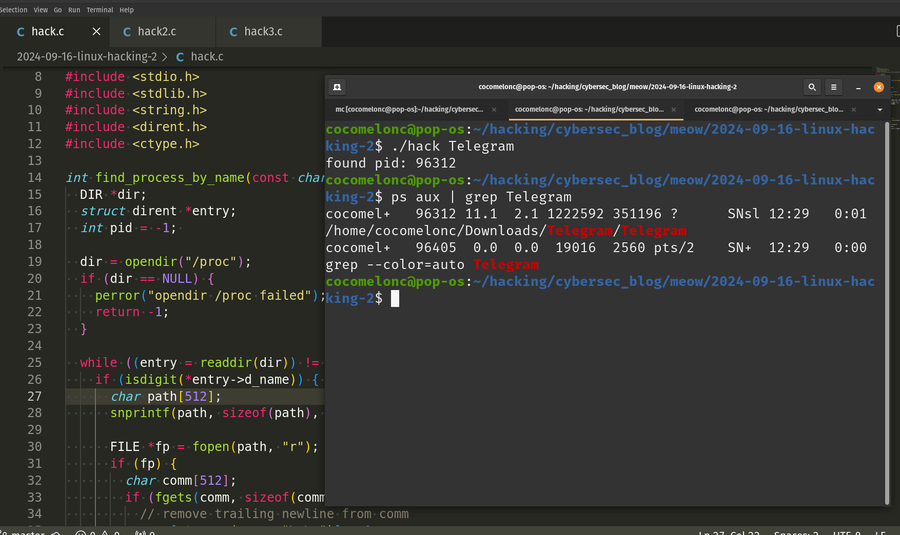
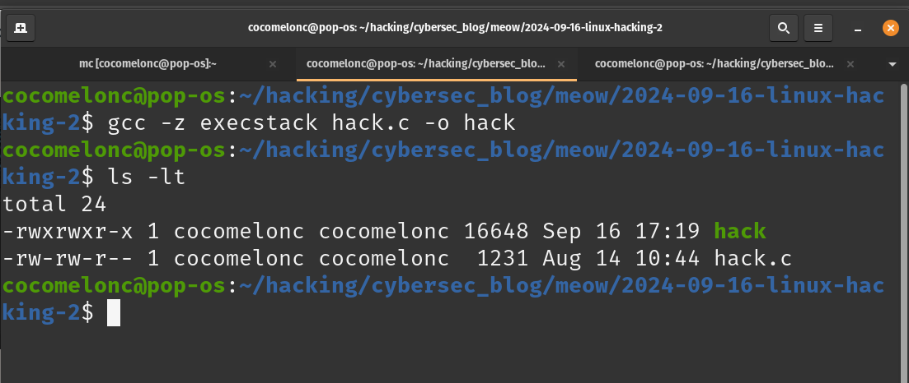
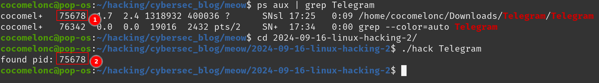
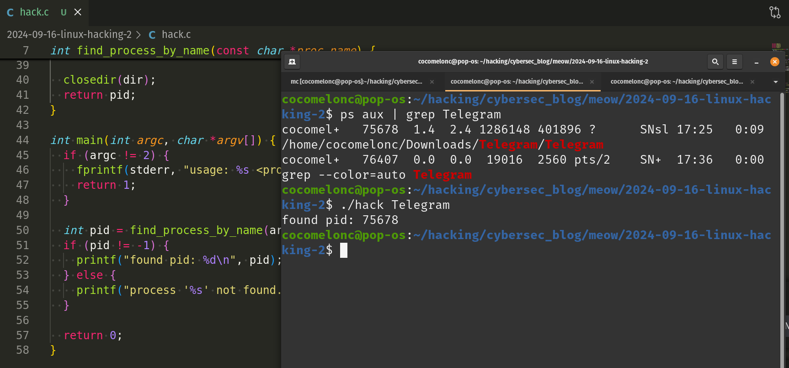
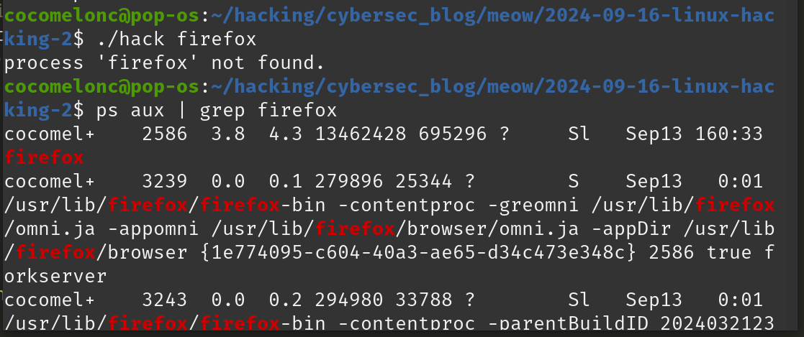
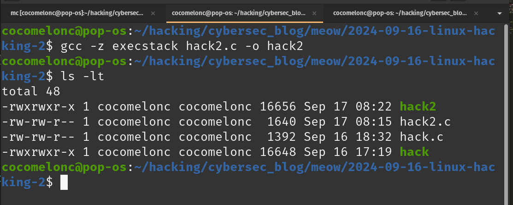
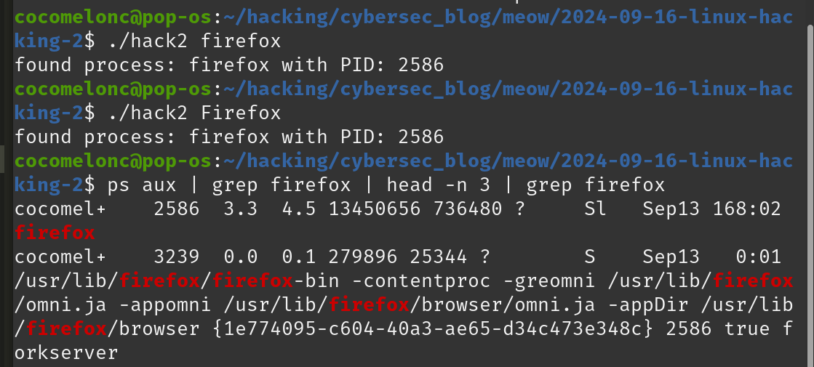

\newpage
\subsection{Linux 恶意软件开发 2：按名称查找进程 ID（简单的 C 示例）}

﷽

{width="80%"}

我曾承诺要揭示 rootkit 编程以及其他一些有趣话题背后的原理。

那些长期阅读我的读者应该还记得，在早先的文章中我们曾用 Windows API 实现过类似的功能。

### 实战示例

我们在 Linux 上实现同样的逻辑。一切都非常简单：

```cpp
/*
 * hack.c
 * linux hacking part 2: 
 * find process ID by name
 * author @cocomelonc
 * https://cocomelonc.github.io/linux/2024/09/16/linux-hacking-2.html
*/
#include <stdio.h>
#include <stdlib.h>
#include <string.h>
#include <dirent.h>
#include <ctype.h>

int find_process_by_name(const char *proc_name) {
  DIR *dir;
  struct dirent *entry;
  int pid = -1; 

  dir = opendir("/proc");
  if (dir == NULL) {
  perror("opendir /proc failed"); 
  return -1;
  }

  while ((entry = readdir(dir)) != NULL) {
  if (isdigit(*entry->d_name)) { 
  char path[512];
  snprintf(path, sizeof(path), "/proc/%s/comm", entry->d_name); 

  FILE *fp = fopen(path, "r");
  if (fp) {
  char comm[512];
  if (fgets(comm, sizeof(comm), fp) != NULL) {
  // remove trailing newline from comm
  comm[strcspn(comm, "\r\n")] = 0; 
  if (strcmp(comm, proc_name) == 0) {
  pid = atoi(entry->d_name); 
  fclose(fp);
  break;
  }
  }
  fclose(fp);
  }
  }
  }

  closedir(dir);
  return pid;

int main(int argc, char *argv[]) {
  if (argc != 2) {
  fprintf(stderr, "usage: %s <process_name>\n", argv[0]);
  return 1;
  }

  int pid = find_process_by_name(argv[1]);
  if (pid != -1) {
  printf("found pid: %d\n", pid);
  } else {
  printf("process '%s' not found.\n", argv[1]);
  }

  return 0;

```

我的代码演示了如何在 Linux 上通过扫描 `/proc` 目录、按名称查找正在运行的进程。它读取 `/proc/[pid]/comm` 中保存的进程名，一旦找到匹配项，就取出目标进程的进程 ID（`PID`）。

我的代码演示了如何在 Linux 上按名称搜索正在运行的进程：扫描 `/proc` 目录，读取保存在 `/proc/[pid]/comm` 中的进程名，一旦找到匹配项，就取出目标进程的进程 ID（PID）。

如你所见，这里只有两个函数。首先是我们实现的 `find_process_by_name` 函数，它负责在 `/proc` 目录中按名称搜索进程。该函数以进程名（`proc_name`）作为输入，返回找到的进程的 PID；如果没有找到，则返回 -1。

该函数用 `opendir()` 函数打开 `/proc` 目录。这个目录里保存着正在运行的进程的信息，其中每个子目录都以一个进程 ID（PID）命名。

然后，遍历 `/proc` 中的各个条目：

```cpp
while ((entry = readdir(dir)) != NULL) {
```

这里用 `readdir()` 函数遍历 `/proc` 目录中的所有条目，每个条目要么是一个正在运行的进程（条目名是数字），要么是其他系统文件。

接着检查条目名是否表示一个数字（即进程 ID）。在 `/proc` 中，只有以数字命名的目录才是有效的进程目录：

```cpp
if (isdigit(*entry->d_name)) {
```

注意，每个 `/proc/[pid]` 目录中的 `comm` 文件保存着与该进程关联的可执行文件名：

```cpp
snprintf(path, sizeof(path), "/proc/%s/comm", entry->d_name);
```

也就是说，我们把 `/proc/`、进程 ID（`d_name`）和 `/comm` 拼接起来，就得到了 `comm` 文件的完整路径。

最后，我们打开 `comm` 文件，读取进程名并进行比较：

```cpp
FILE *fp = fopen(path, "r");
  if (fp) {
  char comm[512];
  if (fgets(comm, sizeof(comm), fp) != NULL) {
  // remove trailing newline from comm
  comm[strcspn(comm, "\r\n")] = 0; 
  if (strcmp(comm, proc_name) == 0) {
  pid = atoi(entry->d_name); 
  fclose(fp);
  break;
  }

  }
```

然后。当然，最后还要关闭目录并返回。

第二个函数是 main 函数：

```cpp
int main(int argc, char *argv[]) {
  if (argc != 2) {
  fprintf(stderr, "usage: %s <process_name>\n", argv[0]);
  return 1;
  }

  int pid = find_process_by_name(argv[1]);
  if (pid != -1) {
  printf("found pid: %d\n", pid);
  } else {
  printf("process '%s' not found.\n", argv[1]);
  }

  return 0;

```

它只负责检查命令行参数，然后执行查找进程的逻辑。

### 演示

我们来看看实际效果。编译它：

```bash
gcc -z execstack hack.c -o hack
```

{width="80%"}

然后在 Linux 机器上运行它：

```bash
.\hack [process_name]
```

{width="80%"}

{width="80%"}

如你所见，一切都运行完美。在我这里找到了 Telegram 的 ID（75678）！=..=

看起来非常简单，不是吗？

但有一个需要注意的地方。如果我们用它去找 firefox 这类进程：

```bash
.\hack firefox
```

我们得到的是：

{width="80%"}

我们遇到的问题可能源于这样一个事实：某些进程（比如 firefox）会派生出子进程或多个线程，而这些并不都用 `comm` 文件来保存自己的进程名。`/proc/[pid]/comm` 文件保存的是不带完整路径的可执行文件名，当同一个父进程下存在多个线程或子进程时，它可能无法反映该进程的所有实例。

`/proc/[pid]/comm` 文件保存的是不含完整路径的可执行文件名，当同一父进程下存在多个线程或子进程时，它可能无法反映该进程的所有实例。

在我看来，可能的问题有：

- `/proc/[pid]/comm` 中的进程名不同：子进程或线程可能采用不同的命名约定，也可能不会以 firefox 的名义出现在 `/proc/[pid]/comm` 中。
- 僵尸进程或孤儿进程：如果某个进程处于僵尸状态或孤儿状态，它可能无法被正确显示。

僵尸进程或孤儿进程：如果某个进程处于僵尸状态或已被孤立，它可能无法被正确地显示出来。

### 实战示例 2

我们不读取 `comm` 文件，而是改为检查 `/proc/[pid]/cmdline` 文件，它保存着启动该进程所用的完整命令行（包括进程名、完整路径和参数）。对于像 firefox 这样会派生出多个实例的进程来说，这个文件更加可靠。

出于这个原因，我干脆又写了一个版本（`hack2.c`）：

```cpp
/*
 * hack2.c
 * linux hacking part 2: 
 * find processes ID by name
 * author @cocomelonc
 * https://cocomelonc.github.io/linux/2024/09/16/linux-hacking-2.html
*/
#include <stdio.h>
#include <stdlib.h>
#include <string.h>
#include <dirent.h>
#include <ctype.h>

void find_processes_by_name(const char *proc_name) {
  DIR *dir;
  struct dirent *entry;
  int found = 0;

  dir = opendir("/proc");
  if (dir == NULL) {
  perror("opendir /proc failed");
  return;
  }

  while ((entry = readdir(dir)) != NULL) {
  if (isdigit(*entry->d_name)) {
  char path[512];
  snprintf(path, sizeof(path), "/proc/%s/cmdline", entry->d_name);

  FILE *fp = fopen(path, "r");
  if (fp) {
  char cmdline[512];
  if (fgets(cmdline, sizeof(cmdline), fp) != NULL) {
  // command line arguments are separated by '\0', 
  // we only need the first argument (the program name)
  cmdline[strcspn(cmdline, "\0")] = 0;

  // perform case-insensitive comparison 
  // of the base process name
  const char *base_name = strrchr(cmdline, '/');
  base_name = base_name ? base_name + 1 : cmdline;

  if (strcasecmp(base_name, proc_name) == 0) {
  printf("found process: %s with PID: %s\n", base_name, 
  entry->d_name);
  found = 1;
  }
  }
  fclose(fp);
  }
  }
  }

  if (!found) {
  printf("no processes found with the name '%s'.\n", proc_name);
  }

  closedir(dir);

int main(int argc, char *argv[]) {
  if (argc != 2) {
  fprintf(stderr, "usage: %s <process_name>\n", argv[0]);
  return 1;
  }

  find_processes_by_name(argv[1]);

  return 0;

```

如你所见，这是改为读取 `/proc/[pid]/cmdline` 之后的代码更新版本。

如你所见，这是读取 `cmdline` 文件的更新版本。不过 `/proc/[pid]/cmdline` 或 `/proc/[pid]/status` 文件并不总是包含你期望的信息。

### 演示 2

我们来看看第二个例子的实际效果。编译它：

```bash
gcc -z execstack hack2.c -o hack2
```

{width="80%"}

然后在 Linux 机器上运行它：

```bash
.\hack [process_name]
```

{width="80%"}

如你所见，结果是正确的。

我希望这篇带有实战示例的文章对恶意软件研究人员、Linux 程序员以及所有对 Linux 内核编程技术感兴趣的人都有所帮助。

[Find process ID by name. Windows version](https://cocomelonc.github.io/pentest/2021/09/29/findmyprocess.html)  
[source code in github](https://github.com/cocomelonc/meow/tree/master/2024-09-16-linux-hacking-2)
